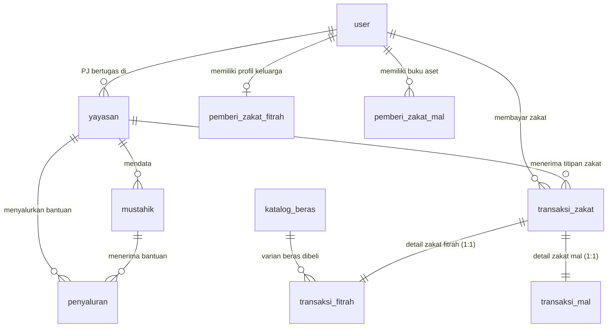

# 📖 Handout & Dokumentasi Desain Database: Sistem Pengelolaan Zakat

Dokumen ini berisi dokumentasi teknis dan arsitektur database untuk **Sistem Pengelolaan & Pembayaran Zakat (Fitrah & Maal)**. Database ini dirancang dengan standar industri (menggunakan MySQL/MariaDB Engine: `InnoDB`, Charset: `utf8mb4`) agar **anti-banting, aman dari selisih pembulatan uang, konsisten secara audit finansial, dan sesuai prinsip syariah**.

---

## 1. Arsitektur & Prinsip Desain "Anti-Banting"

Sebelum melihat struktur tabel, tim pengembang perlu memahami 5 prinsip penting di balik perancangan database ini:

1. **Prinsip Keuangan (Presisi Angka Tanpa Selisih):**
   * Seluruh nominal uang dan bobot timbangan menggunakan `DECIMAL(15,2)` atau `DECIMAL(10,2)`.
   * **DILARANG** menggunakan `FLOAT` atau `DOUBLE` karena memiliki masalah presisi pembulatan bilangan desimal (*floating-point arithmetic error*) yang haram di aplikasi finansial.
2. **Pola Header-Detail (Master-Detail Pattern):**
   * Semua urusan pembayaran digital (QRIS, VA, status bayar Midtrans/Xendit) dipusatkan di 1 master tabel: `transaksi_zakat`.
   * Detail spesifik dipisahkan ke `transaksi_fitrah` (rincian jiwa & beras) dan `transaksi_mal` (rincian harta & emas) dengan relasi 1-to-1 (`transaksi_id` UNIQUE).
3. **Pola Snapshot Finansial (*Historical Immutability*):**
   * Harga emas dan harga beras bersifat fluktuatif (berubah setiap hari).
   * Pada detik user melakukan *checkout* pembayaran, harga beras/kg dan harga acuan emas/gram **dikunci di baris transaksi** (`harga_per_kg_snapshot` dan `harga_emas_per_gram_snapshot`). Jika besok harga beras naik, data transaksi kemarin tidak akan rusak atau berubah nilai tagihannya.
4. **Model Gudang Mandiri (*Centralized Fulfillment*):**
   * Platform kita mengelola gudang dan stok beras sendiri (`katalog_beras`).
   * Menggunakan *soft-deactivation* (`is_active BOOLEAN`): Jika suatu beras sudah habis atau tidak dijual, beras tidak boleh di-`DELETE` dari database (karena terikat *Foreign Key* transaksi lama), melainkan cukup diubah menjadi `is_active = FALSE`.
5. **Integritas Relasi (*Foreign Key Constraints*):**
   * `ON DELETE RESTRICT` pada transaksi dan penyaluran: Mencegah penghapusan user, yayasan, atau katalog beras jika masih memiliki riwayat transaksi/audit.
   * `ON DELETE CASCADE` pada detail: Jika sebuah master invoice pembayaran dihapus/dibatalkan, rincian detailnya otomatis ikut terhapus bersih.

---

## 2. Diagram Relasi Database (ERD)



---

## 3. Pembagian Peran Pengguna (*User Roles*)

Kolom `role` pada tabel `user` terbagi menjadi 3 peran:
1. **`pemberi` (Muzakki):** Masyarakat umum yang membuat akun untuk membayar zakat fitrah atau zakat maal via QRIS.
2. **`pj` (Penanggung Jawab Yayasan):** Kontak/pimpinan resmi dari yayasan mitra penerima zakat yang terhubung melalui kolom `yayasan.pj_user_id`.
3. **`panitia` (Tim Internal Website Kita):** Staf/panitia pengelola website dan organisasi kita yang bertugas memverifikasi yayasan, mengelola katalog/stok beras gudang, dan memantau seluruh transaksi masuk.

---

## 4. Kamus Data Lengkap (10 Tabel)

### 1. Tabel `user` (Akun Pengguna)
Menyimpan akun muzakki, amil yayasan, dan panitia platform.

| Nama Kolom | Tipe Data & Panjang | Nullable? | Key / Constraint | Nilai Default | Penjelasan Singkat |
| :--- | :--- | :--- | :--- | :--- | :--- |
| `id` | `BIGINT` | NOT NULL | **PK**, Auto Increment | *(None)* | ID unik pengguna |
| `nik` | `VARCHAR(16)` | **NULL** | - | `NULL` | KTP Indonesia 16 digit (opsional) |
| `nama` | `VARCHAR(255)` | NOT NULL | - | *(None)* | Nama lengkap pengguna |
| `telp` | `VARCHAR(20)` | NOT NULL | - | *(None)* | Nomor HP/telepon (+62 / 08...) |
| `email` | `VARCHAR(191)` | NOT NULL | **UNIQUE** | *(None)* | Email login (191 standar utf8mb4) |
| `pass_hash` | `VARCHAR(255)` | NOT NULL | - | *(None)* | Hash kata sandi akun (Bcrypt/Argon2) |
| `tggl_lahir` | `DATE` | **NULL** | - | `NULL` | Tanggal lahir (YYYY-MM-DD) |
| `gender` | `ENUM('L', 'P')` | **NULL** | - | `NULL` | Jenis kelamin |
| `kota_kabupaten` | `VARCHAR(100)` | NOT NULL | - | *(None)* | Kota domisili |
| `provinsi` | `VARCHAR(100)` | NOT NULL | - | *(None)* | Provinsi domisili |
| `alamat_lengkap` | `TEXT` | **NULL** | - | `NULL` | Alamat tempat tinggal |
| `npwp` | `VARCHAR(25)` | **NULL** | - | `NULL` | NPWP pengurang pajak (opsional) |
| `role` | `ENUM('pemberi', 'pj', 'panitia')` | NOT NULL | - | `'pemberi'` | Hak akses user |
| `created_at` | `TIMESTAMP` | NOT NULL | - | `CURRENT_TIMESTAMP` | Waktu akun dibuat |
| `updated_at` | `TIMESTAMP` | NOT NULL | - | `CURRENT_TIMESTAMP` | Waktu profil diubah |

---

### 2. Tabel `yayasan` (Lembaga Penerima Zakat)
Profil lembaga/masjid mitra yang menerima titipan penyaluran zakat.

| Nama Kolom | Tipe Data & Panjang | Nullable? | Key / Constraint | Nilai Default | Penjelasan Singkat |
| :--- | :--- | :--- | :--- | :--- | :--- |
| `id` | `BIGINT` | NOT NULL | **PK**, Auto Increment | *(None)* | ID unik yayasan |
| `nama` | `VARCHAR(255)` | NOT NULL | - | *(None)* | Nama resmi lembaga/yayasan |
| `nomor_izin` | `VARCHAR(100)` | NOT NULL | - | *(None)* | Nomor izin Kemenag / BAZNAS |
| `telp` | `VARCHAR(20)` | NOT NULL | - | *(None)* | Nomor telepon resmi kantor |
| `email` | `VARCHAR(191)` | NOT NULL | - | *(None)* | Email resmi yayasan |
| `kota_kabupaten` | `VARCHAR(100)` | NOT NULL | - | *(None)* | Kota domisili yayasan |
| `provinsi` | `VARCHAR(100)` | NOT NULL | - | *(None)* | Provinsi domisili yayasan |
| `alamat_lengkap` | `TEXT` | NOT NULL | - | *(None)* | Alamat fisik kantor |
| `kode_pos` | `VARCHAR(10)` | **NULL** | - | `NULL` | Kode pos |
| `nama_bank` | `VARCHAR(50)` | NOT NULL | - | *(None)* | Bank penerima (BSI, BCA, Mandiri) |
| `no_rek` | `VARCHAR(50)` | NOT NULL | - | *(None)* | Nomor rekening bank yayasan |
| `atas_nama_rek` | `VARCHAR(255)` | NOT NULL | - | *(None)* | Nama pemilik rekening |
| `status_verif` | `ENUM('pending', 'verified', 'rejected')` | NOT NULL | - | `'pending'` | Status verifikasi oleh panitia |
| `is_active` | `BOOLEAN` | NOT NULL | - | `TRUE` | Status operasional yayasan |
| `pj_user_id` | `BIGINT` | NOT NULL | **FK** $\rightarrow$ `user.id` | *(None)* | Akun user penanggung jawab yayasan |
| `pict_id` | `VARCHAR(255)` | **NULL** | - | `NULL` | URL/Path logo foto profil yayasan |
| `created_at` | `TIMESTAMP` | NOT NULL | - | `CURRENT_TIMESTAMP` | Waktu yayasan terdaftar |
| `updated_at` | `TIMESTAMP` | NOT NULL | - | `CURRENT_TIMESTAMP` | Waktu profil di-update |

---

### 3. Tabel `pemberi_zakat_fitrah` (Buku Profil Keluarga Muzakki)
Menyimpan data jumlah tanggungan keluarga di profil muzakki agar tidak perlu ketik ulang setiap tahun.

| Nama Kolom | Tipe Data & Panjang | Nullable? | Key / Constraint | Nilai Default | Penjelasan Singkat |
| :--- | :--- | :--- | :--- | :--- | :--- |
| `id` | `BIGINT` | NOT NULL | **PK**, Auto Increment | *(None)* | ID profil keluarga |
| `id_kepala` | `BIGINT` | NOT NULL | **FK** $\rightarrow$ `user.id`, **UNIQUE** | *(None)* | Akun kepala keluarga (1 user = 1 profil) |
| `jum_anggota` | `INT` | NOT NULL | - | `1` | Jumlah anggota yang ditanggung |
| `created_at` | `TIMESTAMP` | NOT NULL | - | `CURRENT_TIMESTAMP` | Waktu data dibuat |
| `updated_at` | `TIMESTAMP` | NOT NULL | - | `CURRENT_TIMESTAMP` | Waktu data diperbarui |

---

### 4. Tabel `pemberi_zakat_mal` (Buku Catatan Harta Muzakki)
Draft aset berjalan di profil user untuk memantau apakah hartanya sudah wajib zakat.

| Nama Kolom | Tipe Data & Panjang | Nullable? | Key / Constraint | Nilai Default | Penjelasan Singkat |
| :--- | :--- | :--- | :--- | :--- | :--- |
| `id` | `BIGINT` | NOT NULL | **PK**, Auto Increment | *(None)* | ID catatan aset |
| `user_id` | `BIGINT` | NOT NULL | **FK** $\rightarrow$ `user.id` | *(None)* | Pemilik catatan harta |
| `kepemilikan` | `VARCHAR(100)` | **NULL** | - | `NULL` | Misal: "Pribadi", "Usaha Bersama" |
| `atas_nama` | `VARCHAR(255)` | **NULL** | - | `NULL` | Nama pada dokumen kepemilikan aset |
| `nominal_tabungan` | `DECIMAL(15,2)` | NOT NULL | - | `0.00` | Saldo uang tabungan/kas saat ini |
| `emas_gram` | `DECIMAL(8,2)` | NOT NULL | - | `0.00` | Bobot emas (gram, bisa koma) |
| `nilai_invest` | `DECIMAL(15,2)` | NOT NULL | - | `0.00` | Portofolio saham / reksadana |
| `nilai_aset_dagang`| `DECIMAL(15,2)` | NOT NULL | - | `0.00` | Nilai stok barang dagangan |
| `piutang` | `DECIMAL(15,2)` | NOT NULL | - | `0.00` | Uang yang dipinjam pihak lain |
| `utang` | `DECIMAL(15,2)` | NOT NULL | - | `0.00` | Utang jatuh tempo yang harus dibayar |
| `total_harta_bersih`| `DECIMAL(15,2)` | NOT NULL | - | `0.00` | $(Tabungan + Emas + Invest + Dagang + Piutang) - Utang$ |
| `apakah_wajib_zakat`| `BOOLEAN` | NOT NULL | - | `FALSE` | Otomatis `TRUE` jika harta bersih $\ge$ nisab |
| `created_at` | `TIMESTAMP` | NOT NULL | - | `CURRENT_TIMESTAMP` | Waktu pertama dicatat |
| `updated_at` | `TIMESTAMP` | NOT NULL | - | `CURRENT_TIMESTAMP` | Waktu data aset diperbarui |

---

### 5. Tabel `katalog_beras` (Gudang Beras Platform Kita)
Pilihan beras yang disediakan di gudang platform untuk pembayaran zakat fitrah.

| Nama Kolom | Tipe Data & Panjang | Nullable? | Key / Constraint | Nilai Default | Penjelasan Singkat |
| :--- | :--- | :--- | :--- | :--- | :--- |
| `id` | `BIGINT` | NOT NULL | **PK**, Auto Increment | *(None)* | ID varian beras |
| `nama_beras` | `VARCHAR(100)` | NOT NULL | - | *(None)* | Contoh: "Pandan Wangi", "Ramos" |
| `harga_per_kg` | `DECIMAL(10,2)` | NOT NULL | - | *(None)* | Harga beras per kg saat ini (realtime) |
| `stock` | `DECIMAL(10,2)` | NOT NULL | - | `0.00` | Sisa kuantitas gudang (dalam Kg) |
| `pict_id` | `VARCHAR(255)` | **NULL** | - | `NULL` | Foto produk beras |
| `is_active` | `BOOLEAN` | NOT NULL | - | `TRUE` | `TRUE` = dijual, `FALSE` = dinonaktifkan |
| `created_at` | `TIMESTAMP` | NOT NULL | - | `CURRENT_TIMESTAMP` | Waktu data beras dibuat |
| `updated_at` | `TIMESTAMP` | NOT NULL | - | `CURRENT_TIMESTAMP` | Waktu harga/stok diperbarui |

---

### 6. Tabel `mustahik` (Penerima Zakat)
Data penerima manfaat yang dibina dan didata oleh masing-masing yayasan mitra.

| Nama Kolom | Tipe Data & Panjang | Nullable? | Key / Constraint | Nilai Default | Penjelasan Singkat |
| :--- | :--- | :--- | :--- | :--- | :--- |
| `id` | `BIGINT` | NOT NULL | **PK**, Auto Increment | *(None)* | ID mustahik |
| `yayasan_id` | `BIGINT` | NOT NULL | **FK** $\rightarrow$ `yayasan.id` | *(None)* | Yayasan yang mendata |
| `nama` | `VARCHAR(255)` | NOT NULL | - | *(None)* | Nama lengkap penerima zakat |
| `kelamin` | `ENUM('L', 'P')` | NOT NULL | - | *(None)* | Jenis kelamin |
| `tggl_lahir` | `DATE` | **NULL** | - | `NULL` | Tanggal lahir (YYYY-MM-DD) |
| `kategori_asnaf` | `ENUM('fakir', 'miskin', 'amil', 'mualaf', 'riqab', 'gharimin', 'fisabilillah', 'ibnu_sabil')` | NOT NULL | - | *(None)* | 8 Golongan wajib penerima zakat |
| `created_at` | `TIMESTAMP` | NOT NULL | - | `CURRENT_TIMESTAMP` | Waktu mustahik didata |
| `updated_at` | `TIMESTAMP` | NOT NULL | - | `CURRENT_TIMESTAMP` | Waktu data diperbarui |

---

### 7. Tabel `transaksi_zakat` (Master Pembayaran & QRIS)
Header transaksi pembayaran zakat yang terhubung langsung ke Payment Gateway.

| Nama Kolom | Tipe Data & Panjang | Nullable? | Key / Constraint | Nilai Default | Penjelasan Singkat |
| :--- | :--- | :--- | :--- | :--- | :--- |
| `id` | `BIGINT` | NOT NULL | **PK**, Auto Increment | *(None)* | ID master transaksi |
| `kode_transaksi` | `VARCHAR(50)` | NOT NULL | **UNIQUE** | *(None)* | Nomor invoice (Order ID QRIS) |
| `user_id` | `BIGINT` | NOT NULL | **FK** $\rightarrow$ `user.id` | *(None)* | Muzakki yang membayar |
| `yayasan_id` | `BIGINT` | NOT NULL | **FK** $\rightarrow$ `yayasan.id` | *(None)* | Yayasan tujuan zakat |
| `jenis_zakat` | `ENUM('fitrah', 'mal')` | NOT NULL | - | *(None)* | Kategori zakat yang dibayar |
| `total_nominal` | `DECIMAL(15,2)` | NOT NULL | - | *(None)* | Total tagihan rupiah di QRIS |
| `metode_pembayaran`| `VARCHAR(50)` | **NULL** | - | `NULL` | Contoh: 'QRIS', 'BCA_VA' |
| `status_pembayaran`| `ENUM('pending', 'paid', 'expired', 'failed')` | NOT NULL | - | `'pending'` | Status pembayaran |
| `payment_gateway_ref`| `VARCHAR(100)`| **NULL** | - | `NULL` | ID referensi dari Payment Gateway |
| `qr_payload` | `TEXT` | **NULL** | - | `NULL` | String payload QRIS / QR image URL |
| `catatan_doa` | `TEXT` | **NULL** | - | `NULL` | Titipan doa dari muzakki |
| `expired_at` | `TIMESTAMP` | **NULL** | - | `NULL` | Waktu batas bayar QRIS |
| `paid_at` | `TIMESTAMP` | **NULL** | - | `NULL` | Waktu pembayaran berhasil |
| `created_at` | `TIMESTAMP` | NOT NULL | - | `CURRENT_TIMESTAMP` | Waktu invoice dibuat |
| `updated_at` | `TIMESTAMP` | NOT NULL | - | `CURRENT_TIMESTAMP` | Waktu status pembayaran diperbarui |

---

### 8. Tabel `transaksi_fitrah` (Snapshot Detail Zakat Fitrah)
Rincian takaran jiwa dan snapshot beras pada detik transaksi dilakukan.

| Nama Kolom | Tipe Data & Panjang | Nullable? | Key / Constraint | Nilai Default | Penjelasan Singkat |
| :--- | :--- | :--- | :--- | :--- | :--- |
| `id` | `BIGINT` | NOT NULL | **PK**, Auto Increment | *(None)* | ID detail fitrah |
| `transaksi_id` | `BIGINT` | NOT NULL | **FK** $\rightarrow$ `transaksi_zakat.id`, **UNIQUE** | *(None)* | Relasi 1-to-1 ke master invoice |
| `katalog_beras_id` | `BIGINT` | NOT NULL | **FK** $\rightarrow$ `katalog_beras.id` | *(None)* | Varian beras yang dipilih |
| `nama_beras_snapshot`| `VARCHAR(100)`| NOT NULL | - | *(None)* | Nama beras saat checkout (terkunci) |
| `harga_per_kg_snapshot`| `DECIMAL(10,2)`| NOT NULL | - | *(None)* | Harga beras/kg saat checkout (terkunci) |
| `bobot_per_jiwa_kg`| `DECIMAL(4,2)` | NOT NULL | - | `2.50` | Takaran standar BAZNAS (2.50 kg) |
| `jumlah_jiwa` | `INT` | NOT NULL | - | *(None)* | Jumlah orang yang dibayarkan |
| `total_beras_kg` | `DECIMAL(8,2)` | NOT NULL | - | *(None)* | `jumlah_jiwa * bobot_per_jiwa_kg` |
| `total_biaya_fitrah`| `DECIMAL(15,2)` | NOT NULL | - | *(None)* | `total_beras_kg * harga_snapshot` |
| `bukti_pict_id` | `VARCHAR(255)` | **NULL** | - | `NULL` | Foto sertifikat / bukti zakat fitrah |
| `created_at` | `TIMESTAMP` | NOT NULL | - | `CURRENT_TIMESTAMP` | Waktu detail dicatat |
| `updated_at` | `TIMESTAMP` | NOT NULL | - | `CURRENT_TIMESTAMP` | Waktu detail diperbarui |

---

### 9. Tabel `transaksi_mal` (Snapshot Detail Kalkulator Harta)
Rincian perhitungan harta dan snapshot harga acuan emas saat pembayaran dibuat.

| Nama Kolom | Tipe Data & Panjang | Nullable? | Key / Constraint | Nilai Default | Penjelasan Singkat |
| :--- | :--- | :--- | :--- | :--- | :--- |
| `id` | `BIGINT` | NOT NULL | **PK**, Auto Increment | *(None)* | ID detail mal |
| `transaksi_id` | `BIGINT` | NOT NULL | **FK** $\rightarrow$ `transaksi_zakat.id`, **UNIQUE** | *(None)* | Relasi 1-to-1 ke master invoice |
| `nilai_tabungan` | `DECIMAL(15,2)` | NOT NULL | - | `0.00` | Snapshot tabungan saat bayar |
| `emas_gram` | `DECIMAL(8,2)` | NOT NULL | - | `0.00` | Snapshot bobot emas saat bayar |
| `harga_emas_per_gram_snapshot`| `DECIMAL(12,2)`| NOT NULL | - | *(None)* | Snapshot harga acuan emas per gram |
| `nilai_investasi` | `DECIMAL(15,2)` | NOT NULL | - | `0.00` | Snapshot portofolio investasi |
| `nilai_aset_dagang`| `DECIMAL(15,2)` | NOT NULL | - | `0.00` | Snapshot nilai barang dagang |
| `nilai_piutang` | `DECIMAL(15,2)` | NOT NULL | - | `0.00` | Snapshot piutang lancar |
| `nilai_utang` | `DECIMAL(15,2)` | NOT NULL | - | `0.00` | Snapshot utang jatuh tempo |
| `total_harta_bersih`| `DECIMAL(15,2)` | NOT NULL | - | *(None)* | Harta bersih terhitung saat itu |
| `nilai_nisab` | `DECIMAL(15,2)` | NOT NULL | - | *(None)* | Nilai batas nisab ($85 \times \text{harga emas}$) |
| `wajib_zakat` | `BOOLEAN` | NOT NULL | - | *(None)* | `TRUE` karena sudah mencapai nisab |
| `persentase_zakat` | `DECIMAL(4,2)` | NOT NULL | - | `2.50` | Persentase zakat (2.50%) |
| `total_zakat_wajib`| `DECIMAL(15,2)` | NOT NULL | - | *(None)* | $2.5\% \times \text{total harta bersih}$ |
| `bukti_pict_id` | `VARCHAR(255)` | **NULL** | - | `NULL` | Foto sertifikat / bukti zakat mal |
| `created_at` | `TIMESTAMP` | NOT NULL | - | `CURRENT_TIMESTAMP` | Waktu detail dicatat |
| `updated_at` | `TIMESTAMP` | NOT NULL | - | `CURRENT_TIMESTAMP` | Waktu detail diperbarui |

---

### 10. Tabel `penyaluran` (Distribusi Bantuan ke Mustahik)
Pencatatan penyaluran beras atau uang zakat yang diserahkan yayasan kepada mustahik.

| Nama Kolom | Tipe Data & Panjang | Nullable? | Key / Constraint | Nilai Default | Penjelasan Singkat |
| :--- | :--- | :--- | :--- | :--- | :--- |
| `id` | `BIGINT` | NOT NULL | **PK**, Auto Increment | *(None)* | ID penyaluran |
| `yayasan_id` | `BIGINT` | NOT NULL | **FK** $\rightarrow$ `yayasan.id` | *(None)* | Yayasan yang menyalurkan |
| `mustahik_id` | `BIGINT` | NOT NULL | **FK** $\rightarrow$ `mustahik.id` | *(None)* | Mustahik yang menerima |
| `jenis_zakat` | `ENUM('fitrah', 'mal')` | NOT NULL | - | *(None)* | Kas zakat yang disalurkan |
| `barang` | `VARCHAR(100)` | NOT NULL | - | *(None)* | Jenis bantuan ('Beras', 'Uang Tunai') |
| `jumlah` | `DECIMAL(15,2)` | NOT NULL | - | *(None)* | Kuantitas (misal: 2.50 atau 200000.00) |
| `satuan` | `VARCHAR(20)` | NOT NULL | - | *(None)* | Satuan ('Kg', 'Rupiah', 'Paket') |
| `bukti_pict_id` | `VARCHAR(255)` | **NULL** | - | `NULL` | Foto serah terima bantuan |
| `created_at` | `TIMESTAMP` | NOT NULL | - | `CURRENT_TIMESTAMP` | Waktu bantuan diserahkan |
| `updated_at` | `TIMESTAMP` | NOT NULL | - | `CURRENT_TIMESTAMP` | Waktu data penyaluran diedit |

---

## 5. Alur Transaksi & Operasional Sistem (*User Journey*)

### A. Alur Pembayaran Zakat Fitrah
```
[Muzakki Login]
       │
       ▼
Pilih Yayasan Tujuan & Jenis Beras (katalog_beras)
       │
       ▼
Masukkan Jumlah Jiwa (misal: 4 orang)
       │
       ▼
Sistem Menghitung: (4 x 2.5 Kg) x Harga Beras/Kg
       │
       ▼
Insert: `transaksi_zakat` (PENDING) + `transaksi_fitrah` (Snapshot Harga & Kg)
       │
       ▼
User Scan QRIS & Bayar
       │
       ▼
Webhook Payment Gateway -> UPDATE `transaksi_zakat` SET status_pembayaran = 'PAID'
       │
       ▼
Stok Beras di `katalog_beras` Terpotong Otomatis
```

### B. Alur Pembayaran Zakat Maal
```
[Muzakki Login]
       │
       ▼
Buka Menu Kalkulator Zakat Maal
       │
       ▼
Input Nilai: Tabungan, Emas (gr), Investasi, Aset Dagang, Piutang, Utang
       │
       ▼
Sistem Mengambil Harga Emas Realtime & Menghitung Nisab (85 gr x Harga Emas)
       │
       ▼
Jika Total Harta Bersih >= Nisab:
Hitung Zakat Wajib = 2.5% x Total Harta Bersih
       │
       ▼
Insert: `transaksi_zakat` (PENDING) + `transaksi_mal` (Snapshot Nilai Harta)
       │
       ▼
User Scan QRIS & Bayar -> Status Menjadi 'PAID'
```

### C. Alur Penyaluran ke Mustahik (Outflow)
```
Yayasan Menerima Titipan Zakat (PAID)
       │
       ▼
Yayasan Membina & Mendata Mustahik (8 Asnaf) di `mustahik`
       │
       ▼
Amil Menyerahkan Beras/Uang Tunai ke Mustahik
       │
       ▼
Amil Mencatat Dokumentasi & Bukti Serah Terima di Tabel `penyaluran`
```

---

## 6. Skrip DDL SQL (STATUS: ✅ SUDAH DIJALANKAN DI MYSQL)

> [!IMPORTANT]
> **Catatan Status:** Skrip SQL berikut **SUDAH dieksekusi** di database MySQL user `keli`. Jangan dijalankan ulang kecuali ingin mereset database dari awal.

```sql
-- ==========================================================
-- DATABASE SCHEMA: ZAKAT MANAGEMENT SYSTEM
-- Engine: InnoDB | Charset: utf8mb4
-- ==========================================================

-- 1. TABEL PENGGUNA (USER)
CREATE TABLE `user` (
    `id` BIGINT AUTO_INCREMENT PRIMARY KEY,
    `nik` VARCHAR(16) NULL,
    `nama` VARCHAR(255) NOT NULL,
    `telp` VARCHAR(20) NOT NULL,
    `email` VARCHAR(191) NOT NULL UNIQUE,
    `pass_hash` VARCHAR(255) NOT NULL,
    `tggl_lahir` DATE NULL,
    `gender` ENUM('L', 'P') NULL,
    `kota_kabupaten` VARCHAR(100) NOT NULL,
    `provinsi` VARCHAR(100) NOT NULL,
    `alamat_lengkap` TEXT NULL,
    `npwp` VARCHAR(25) NULL,
    `role` ENUM('pemberi', 'pj', 'panitia') NOT NULL DEFAULT 'pemberi',
    `created_at` TIMESTAMP NOT NULL DEFAULT CURRENT_TIMESTAMP,
    `updated_at` TIMESTAMP NOT NULL DEFAULT CURRENT_TIMESTAMP ON UPDATE CURRENT_TIMESTAMP
) ENGINE=InnoDB DEFAULT CHARSET=utf8mb4;

-- 2. TABEL YAYASAN
CREATE TABLE `yayasan` (
    `id` BIGINT AUTO_INCREMENT PRIMARY KEY,
    `nama` VARCHAR(255) NOT NULL,
    `nomor_izin` VARCHAR(100) NOT NULL,
    `telp` VARCHAR(20) NOT NULL,
    `email` VARCHAR(191) NOT NULL,
    `kota_kabupaten` VARCHAR(100) NOT NULL,
    `provinsi` VARCHAR(100) NOT NULL,
    `alamat_lengkap` TEXT NOT NULL,
    `kode_pos` VARCHAR(10) NULL,
    `nama_bank` VARCHAR(50) NOT NULL,
    `no_rek` VARCHAR(50) NOT NULL,
    `atas_nama_rek` VARCHAR(255) NOT NULL,
    `status_verif` ENUM('pending', 'verified', 'rejected') NOT NULL DEFAULT 'pending',
    `is_active` BOOLEAN NOT NULL DEFAULT TRUE,
    `pj_user_id` BIGINT NOT NULL,
    `pict_id` VARCHAR(255) NULL,
    `created_at` TIMESTAMP NOT NULL DEFAULT CURRENT_TIMESTAMP,
    `updated_at` TIMESTAMP NOT NULL DEFAULT CURRENT_TIMESTAMP ON UPDATE CURRENT_TIMESTAMP,
    CONSTRAINT `fk_yayasan_user` FOREIGN KEY (`pj_user_id`) REFERENCES `user` (`id`) ON DELETE RESTRICT ON UPDATE CASCADE
) ENGINE=InnoDB DEFAULT CHARSET=utf8mb4;

-- 3. TABEL PROFIL KELUARGA (PEMBERI ZAKAT FITRAH)
CREATE TABLE `pemberi_zakat_fitrah` (
    `id` BIGINT AUTO_INCREMENT PRIMARY KEY,
    `id_kepala` BIGINT NOT NULL UNIQUE,
    `jum_anggota` INT NOT NULL DEFAULT 1,
    `created_at` TIMESTAMP NOT NULL DEFAULT CURRENT_TIMESTAMP,
    `updated_at` TIMESTAMP NOT NULL DEFAULT CURRENT_TIMESTAMP ON UPDATE CURRENT_TIMESTAMP,
    CONSTRAINT `fk_fitrah_kepala` FOREIGN KEY (`id_kepala`) REFERENCES `user` (`id`) ON DELETE CASCADE ON UPDATE CASCADE
) ENGINE=InnoDB DEFAULT CHARSET=utf8mb4;

-- 4. TABEL BUKU CATATAN HARTA (PEMBERI ZAKAT MAL)
CREATE TABLE `pemberi_zakat_mal` (
    `id` BIGINT AUTO_INCREMENT PRIMARY KEY,
    `user_id` BIGINT NOT NULL,
    `kepemilikan` VARCHAR(100) NULL,
    `atas_nama` VARCHAR(255) NULL,
    `nominal_tabungan` DECIMAL(15,2) NOT NULL DEFAULT 0.00,
    `emas_gram` DECIMAL(8,2) NOT NULL DEFAULT 0.00,
    `nilai_invest` DECIMAL(15,2) NOT NULL DEFAULT 0.00,
    `nilai_aset_dagang` DECIMAL(15,2) NOT NULL DEFAULT 0.00,
    `piutang` DECIMAL(15,2) NOT NULL DEFAULT 0.00,
    `utang` DECIMAL(15,2) NOT NULL DEFAULT 0.00,
    `total_harta_bersih` DECIMAL(15,2) NOT NULL DEFAULT 0.00,
    `apakah_wajib_zakat` BOOLEAN NOT NULL DEFAULT FALSE,
    `created_at` TIMESTAMP NOT NULL DEFAULT CURRENT_TIMESTAMP,
    `updated_at` TIMESTAMP NOT NULL DEFAULT CURRENT_TIMESTAMP ON UPDATE CURRENT_TIMESTAMP,
    CONSTRAINT `fk_mal_user` FOREIGN KEY (`user_id`) REFERENCES `user` (`id`) ON DELETE CASCADE ON UPDATE CASCADE
) ENGINE=InnoDB DEFAULT CHARSET=utf8mb4;

-- 5. TABEL KATALOG & GUDANG BERAS
CREATE TABLE `katalog_beras` (
    `id` BIGINT AUTO_INCREMENT PRIMARY KEY,
    `nama_beras` VARCHAR(100) NOT NULL,
    `harga_per_kg` DECIMAL(10,2) NOT NULL,
    `stock` DECIMAL(10,2) NOT NULL DEFAULT 0.00,
    `pict_id` VARCHAR(255) NULL,
    `is_active` BOOLEAN NOT NULL DEFAULT TRUE,
    `created_at` TIMESTAMP NOT NULL DEFAULT CURRENT_TIMESTAMP,
    `updated_at` TIMESTAMP NOT NULL DEFAULT CURRENT_TIMESTAMP ON UPDATE CURRENT_TIMESTAMP
) ENGINE=InnoDB DEFAULT CHARSET=utf8mb4;

-- 6. TABEL MUSTAHIK (PENERIMA ZAKAT)
CREATE TABLE `mustahik` (
    `id` BIGINT AUTO_INCREMENT PRIMARY KEY,
    `yayasan_id` BIGINT NOT NULL,
    `nama` VARCHAR(255) NOT NULL,
    `kelamin` ENUM('L', 'P') NOT NULL,
    `tggl_lahir` DATE NULL,
    `kategori_asnaf` ENUM('fakir', 'miskin', 'amil', 'mualaf', 'riqab', 'gharimin', 'fisabilillah', 'ibnu_sabil') NOT NULL,
    `created_at` TIMESTAMP NOT NULL DEFAULT CURRENT_TIMESTAMP,
    `updated_at` TIMESTAMP NOT NULL DEFAULT CURRENT_TIMESTAMP ON UPDATE CURRENT_TIMESTAMP,
    CONSTRAINT `fk_mustahik_yayasan` FOREIGN KEY (`yayasan_id`) REFERENCES `yayasan` (`id`) ON DELETE CASCADE ON UPDATE CASCADE
) ENGINE=InnoDB DEFAULT CHARSET=utf8mb4;

-- 7. TABEL MASTER TRANSAKSI (PEMBAYARAN & QRIS)
CREATE TABLE `transaksi_zakat` (
    `id` BIGINT AUTO_INCREMENT PRIMARY KEY,
    `kode_transaksi` VARCHAR(50) NOT NULL UNIQUE,
    `user_id` BIGINT NOT NULL,
    `yayasan_id` BIGINT NOT NULL,
    `jenis_zakat` ENUM('fitrah', 'mal') NOT NULL,
    `total_nominal` DECIMAL(15,2) NOT NULL,
    `metode_pembayaran` VARCHAR(50) NULL,
    `status_pembayaran` ENUM('pending', 'paid', 'expired', 'failed') NOT NULL DEFAULT 'pending',
    `payment_gateway_ref` VARCHAR(100) NULL,
    `qr_payload` TEXT NULL,
    `catatan_doa` TEXT NULL,
    `expired_at` TIMESTAMP NULL,
    `paid_at` TIMESTAMP NULL,
    `created_at` TIMESTAMP NOT NULL DEFAULT CURRENT_TIMESTAMP,
    `updated_at` TIMESTAMP NOT NULL DEFAULT CURRENT_TIMESTAMP ON UPDATE CURRENT_TIMESTAMP,
    CONSTRAINT `fk_trx_user` FOREIGN KEY (`user_id`) REFERENCES `user` (`id`) ON DELETE RESTRICT ON UPDATE CASCADE,
    CONSTRAINT `fk_trx_yayasan` FOREIGN KEY (`yayasan_id`) REFERENCES `yayasan` (`id`) ON DELETE RESTRICT ON UPDATE CASCADE
) ENGINE=InnoDB DEFAULT CHARSET=utf8mb4;

-- 8. TABEL DETAIL TRANSAKSI FITRAH (SNAPSHOT)
CREATE TABLE `transaksi_fitrah` (
    `id` BIGINT AUTO_INCREMENT PRIMARY KEY,
    `transaksi_id` BIGINT NOT NULL UNIQUE,
    `katalog_beras_id` BIGINT NOT NULL,
    `nama_beras_snapshot` VARCHAR(100) NOT NULL,
    `harga_per_kg_snapshot` DECIMAL(10,2) NOT NULL,
    `bobot_per_jiwa_kg` DECIMAL(4,2) NOT NULL DEFAULT 2.50,
    `jumlah_jiwa` INT NOT NULL,
    `total_beras_kg` DECIMAL(8,2) NOT NULL,
    `total_biaya_fitrah` DECIMAL(15,2) NOT NULL,
    `bukti_pict_id` VARCHAR(255) NULL,
    `created_at` TIMESTAMP NOT NULL DEFAULT CURRENT_TIMESTAMP,
    `updated_at` TIMESTAMP NOT NULL DEFAULT CURRENT_TIMESTAMP ON UPDATE CURRENT_TIMESTAMP,
    CONSTRAINT `fk_detail_fitrah_trx` FOREIGN KEY (`transaksi_id`) REFERENCES `transaksi_zakat` (`id`) ON DELETE CASCADE ON UPDATE CASCADE,
    CONSTRAINT `fk_detail_fitrah_beras` FOREIGN KEY (`katalog_beras_id`) REFERENCES `katalog_beras` (`id`) ON DELETE RESTRICT ON UPDATE CASCADE
) ENGINE=InnoDB DEFAULT CHARSET=utf8mb4;

-- 9. TABEL DETAIL TRANSAKSI MAL (SNAPSHOT KALKULATOR)
CREATE TABLE `transaksi_mal` (
    `id` BIGINT AUTO_INCREMENT PRIMARY KEY,
    `transaksi_id` BIGINT NOT NULL UNIQUE,
    `nilai_tabungan` DECIMAL(15,2) NOT NULL DEFAULT 0.00,
    `emas_gram` DECIMAL(8,2) NOT NULL DEFAULT 0.00,
    `harga_emas_per_gram_snapshot` DECIMAL(12,2) NOT NULL,
    `nilai_investasi` DECIMAL(15,2) NOT NULL DEFAULT 0.00,
    `nilai_aset_dagang` DECIMAL(15,2) NOT NULL DEFAULT 0.00,
    `nilai_piutang` DECIMAL(15,2) NOT NULL DEFAULT 0.00,
    `nilai_utang` DECIMAL(15,2) NOT NULL DEFAULT 0.00,
    `total_harta_bersih` DECIMAL(15,2) NOT NULL,
    `nilai_nisab` DECIMAL(15,2) NOT NULL,
    `wajib_zakat` BOOLEAN NOT NULL,
    `persentase_zakat` DECIMAL(4,2) NOT NULL DEFAULT 2.50,
    `total_zakat_wajib` DECIMAL(15,2) NOT NULL,
    `bukti_pict_id` VARCHAR(255) NULL,
    `created_at` TIMESTAMP NOT NULL DEFAULT CURRENT_TIMESTAMP,
    `updated_at` TIMESTAMP NOT NULL DEFAULT CURRENT_TIMESTAMP ON UPDATE CURRENT_TIMESTAMP,
    CONSTRAINT `fk_detail_mal_trx` FOREIGN KEY (`transaksi_id`) REFERENCES `transaksi_zakat` (`id`) ON DELETE CASCADE ON UPDATE CASCADE
) ENGINE=InnoDB DEFAULT CHARSET=utf8mb4;

-- 10. TABEL PENYALURAN (DISTRIBUSI KE MUSTAHIK)
CREATE TABLE `penyaluran` (
    `id` BIGINT AUTO_INCREMENT PRIMARY KEY,
    `yayasan_id` BIGINT NOT NULL,
    `mustahik_id` BIGINT NOT NULL,
    `jenis_zakat` ENUM('fitrah', 'mal') NOT NULL,
    `barang` VARCHAR(100) NOT NULL,
    `jumlah` DECIMAL(15,2) NOT NULL,
    `satuan` VARCHAR(20) NOT NULL,
    `bukti_pict_id` VARCHAR(255) NULL,
    `created_at` TIMESTAMP NOT NULL DEFAULT CURRENT_TIMESTAMP,
    `updated_at` TIMESTAMP NOT NULL DEFAULT CURRENT_TIMESTAMP ON UPDATE CURRENT_TIMESTAMP,
    CONSTRAINT `fk_penyaluran_yayasan` FOREIGN KEY (`yayasan_id`) REFERENCES `yayasan` (`id`) ON DELETE RESTRICT ON UPDATE CASCADE,
    CONSTRAINT `fk_penyaluran_mustahik` FOREIGN KEY (`mustahik_id`) REFERENCES `mustahik` (`id`) ON DELETE RESTRICT ON UPDATE CASCADE
) ENGINE=InnoDB DEFAULT CHARSET=utf8mb4;
```

---

## 7. Penyesuaian Kritis untuk Integrasi Laravel (Eloquent Mapping)

Karena skema database ini menggunakan nama tabel dan kolom kustom, Model di Laravel disesuaikan dengan aturan berikut:

### A. Model `User` (`app/Models/User.php`)
1. **Nama Tabel Tunggal (`user` bukan `users`):**
   ```php
   protected $table = 'user';
   ```
2. **Kolom Password Kustom (`pass_hash` bukan `password`):**
   ```php
   public function getAuthPasswordName()
   {
       return 'pass_hash';
   }
   ```
3. **Pemetaan Peran (*Roles*):**
   * Di database: `'pemberi'`, `'pj'`, `'panitia'`
   * `pemberi` = Muzakki (pembayar zakat)
   * `pj` = Penanggung Jawab Yayasan
   * `panitia` = Pengelola Website Platform

---

## 8. Panduan Koneksi Database MySQL (User `keli`)

### A. Login ke MySQL Melalui Terminal Server:
```bash
mysql -u keli -p
# Masukkan password user keli saat diminta
```
Atau jika dari jaringan lokal:
```bash
mysql -h 127.0.0.1 -u keli -p
```

### B. Konfigurasi File `.env` Laravel:
Buka file [`.env`](file://.env) dan sesuaikan:
```env
DB_CONNECTION=mysql
DB_HOST=127.0.0.1
DB_PORT=3306
DB_DATABASE=nama_database_anda
DB_USERNAME=keli
DB_PASSWORD=password_user_keli
```

Setelah mengubah `.env`, wajib bersihkan cache Laravel:
```bash
php artisan config:clear
php artisan cache:clear
```

---

## 9. Catatan Audit Implementasi (2026-09-26)

> Catatan ini merangkum pemeriksaan statis terhadap kode dan file yang ada di folder proyek. Database MySQL eksternal dan perilaku aplikasi saat dijalankan tidak diverifikasi dalam pemeriksaan ini.

### Temuan prioritas tinggi

1. **Pembatasan akses berdasarkan peran belum terlihat.** Grup rute di `routes/web.php` hanya memakai middleware `auth`. Dengan demikian, semua pengguna yang sudah login berpotensi mengakses halaman dan aksi panitia maupun yayasan. Aksi verifikasi transaksi dan penghapusan pengajuan dapat mengubah data penting.

2. **Aksi konfirmasi penerimaan tidak memeriksa kepemilikan pengajuan.** `YayasanController::confirmReceipt` mencari data penyaluran berdasarkan ID saja. Pengguna yang dapat memanggil rute tersebut berpotensi mengubah bukti penerimaan milik yayasan lain.

3. **Pembuatan proposal dapat membuat yayasan berstatus terverifikasi.** `YayasanController::storeProposal` tidak memeriksa peran pengguna. Jika akun belum memiliki data yayasan, controller membuat data yayasan baru dengan status `verified` dan data contoh. Ini melewati proses verifikasi yang seharusnya dilakukan panitia.

4. **Bukti pembayaran disimpan di direktori publik.** Unggahan disimpan di `public/uploads/bukti`, sehingga dapat diakses melalui URL publik. Bukti transfer dan foto penerimaan sebaiknya diperlakukan sebagai data yang tidak boleh terbuka untuk umum.

5. **Server mempercayai nominal yang dikirim formulir.** `MuzakkiController::store` menerima `total_bayar` dari klien dan tidak menghitung ulang total fitrah atau maal dari data input di server. `jumlah_keluarga` serta komponen aset maal juga belum divalidasi secara memadai. Nilai tagihan dapat tidak cocok dengan detail transaksi.

6. **Status proposal dan konfirmasi penerimaan tidak selaras.** Aksi panitia menandai penyaluran dengan mengisi `bukti_pict_id`, dan model menganggap setiap nilai di kolom itu sebagai `disalurkan`. Sementara itu, formulir konfirmasi yayasan hanya ditampilkan untuk status `approved`, yang tidak tampak dihasilkan oleh alur panitia saat ini.

### Temuan konfigurasi dan kesiapan proyek

7. **Skema aplikasi belum dapat dibangun ulang dari migrasi yang tersedia.** Model memakai tabel seperti `user`, `yayasan`, dan `transaksi_zakat`, sedangkan migrasi di folder ini hanya membuat tabel bawaan Laravel seperti `users`, `sessions`, dan tabel cache/antrian. File `database/database.sqlite` yang diperiksa hanya memiliki tabel bawaan Laravel. Konfigurasi lokal mengarah ke MySQL, sehingga skema MySQL eksternal yang disebut di dokumen ini belum dapat dipastikan dari folder proyek.

8. **Terdapat kredensial bawaan di seeder.** `database/seeders/UserSeeder.php` membuat akun panitia dengan kata sandi tetap. Kredensial bawaan perlu diganti atau dihilangkan sebelum aplikasi dipakai di lingkungan nyata.

9. **Sejumlah nilai masih berupa contoh atau konstanta.** Kode memakai rekening contoh, gambar QRIS placeholder, tarif fitrah tetap, dan harga emas tetap. Nilai-nilai ini perlu dikonfirmasi dan dikelola dari konfigurasi/data resmi sebelum transaksi nyata.

10. **Konfigurasi lokal mengaktifkan debug.** File `.env` yang ada menunjukkan lingkungan `local` dan debug aktif. Jangan gunakan konfigurasi tersebut untuk server publik; jangan masukkan `.env` ke repo.

### Prioritas tindak lanjut

- Batasi rute dengan middleware/otorisasi berbasis peran dan validasi kepemilikan data.
- Hitung dan validasi seluruh nominal transaksi di server.
- Simpan bukti di lokasi privat dan sajikan hanya setelah otorisasi.
- Buat migrasi Laravel untuk seluruh tabel aplikasi agar instalasi baru dapat direproduksi.
- Hapus kredensial tetap dan data contoh dari jalur transaksi produksi.
