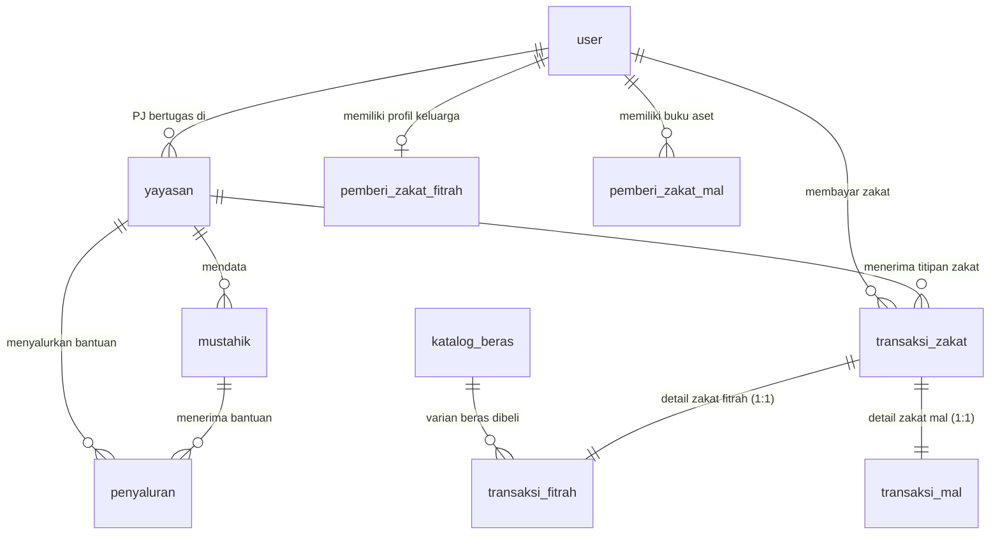

# 📖 Handout & Dokumentasi Desain Database: Sistem Pengelolaan Zakat

Dokumen ini berisi dokumentasi teknis dan arsitektur database untuk **Sistem Pengelolaan & Pembayaran Zakat (Fitrah & Maal)**. Database ini dirancang dengan standar industri (menggunakan MySQL/MariaDB Engine: `InnoDB`, Charset: `utf8mb4`) agar **anti-banting, aman dari selisih pembulatan uang, konsisten secara audit finansial, dan sesuai prinsip syariah**.

> **Arah pengembangan terbaru:** Lihat [Bagian 11: Rencana perubahan dan checklist](#11-rencana-perubahan-dan-checklist-2026-09-27), khususnya [Bagian 11.10: Keputusan operasional](#1110-keputusan-operasional-lanjutan) dan [Bagian 11.11: Rancangan database](#1111-rancangan-database-lanjutan). Bagian 1–9 menggambarkan skema dan alur lama, **bukan spesifikasi implementasi baru**. Khususnya, uraian QRIS/payment gateway nyata, harga tetap, pemotongan stok langsung saat pembayaran, dan akun panitia sebagai pengelola seluruh situs sudah perlu direvisi. Checklist baru masih berupa rencana; kotak kosong berarti belum dikerjakan.

---

## 1. Arsitektur & Prinsip Desain "Anti-Banting"

Sebelum melihat struktur tabel, tim pengembang perlu memahami 5 prinsip penting di balik perancangan database ini:

1. **Prinsip Keuangan (Presisi Angka Tanpa Selisih):**
   * Seluruh nominal uang dan bobot timbangan menggunakan `DECIMAL(15,2)` atau `DECIMAL(10,2)`.
   * **DILARANG** menggunakan `FLOAT` atau `DOUBLE` karena memiliki masalah presisi pembulatan bilangan desimal (*floating-point arithmetic error*) yang haram di aplikasi finansial.
2. **Pola Header-Detail (Master-Detail Pattern):**
   * Semua urusan pembayaran digital (QRIS, VA, status bayar Midtrans/Xendit) dipusatkan di 1 master tabel: `transaksi_zakat`.
   * Detail spesifik dipisahkan ke `transaksi_fitrah` (rincian jiwa & beras) dan `transaksi_mal` (rincian harta & emas) dengan relasi 1-to-1 (`transaksi_id` UNIQUE).
3. **Pola Snapshot Finansial (*Historical Immutability*):**
   * Harga emas dan harga beras bersifat fluktuatif (berubah setiap hari).
   * Pada detik user melakukan *checkout* pembayaran, harga beras/kg dan harga acuan emas/gram **dikunci di baris transaksi** (`harga_per_kg_snapshot` dan `harga_emas_per_gram_snapshot`). Jika besok harga beras naik, data transaksi kemarin tidak akan rusak atau berubah nilai tagihannya.
4. **Model Gudang Mandiri (*Centralized Fulfillment*):**
   * Platform kita mengelola gudang dan stok beras sendiri (`katalog_beras`).
   * Menggunakan *soft-deactivation* (`is_active BOOLEAN`): Jika suatu beras sudah habis atau tidak dijual, beras tidak boleh di-`DELETE` dari database (karena terikat *Foreign Key* transaksi lama), melainkan cukup diubah menjadi `is_active = FALSE`.
5. **Integritas Relasi (*Foreign Key Constraints*):**
   * `ON DELETE RESTRICT` pada transaksi dan penyaluran: Mencegah penghapusan user, yayasan, atau katalog beras jika masih memiliki riwayat transaksi/audit.
   * `ON DELETE CASCADE` pada detail: Jika sebuah master invoice pembayaran dihapus/dibatalkan, rincian detailnya otomatis ikut terhapus bersih.

---

## 2. Diagram Relasi Database (ERD)



---

## 3. Pembagian Peran Pengguna (*User Roles*)

Kolom `role` pada tabel `user` terbagi menjadi 3 peran:
1. **`pemberi` (Muzakki):** Masyarakat umum yang membuat akun untuk membayar zakat fitrah atau zakat maal via QRIS.
2. **`pj` (Penanggung Jawab Yayasan):** Kontak/pimpinan resmi dari yayasan mitra penerima zakat yang terhubung melalui kolom `yayasan.pj_user_id`.
3. **`panitia` (Tim Internal Website Kita):** Staf/panitia pengelola website dan organisasi kita yang bertugas memverifikasi yayasan, mengelola katalog/stok beras gudang, dan memantau seluruh transaksi masuk.

---

## 4. Kamus Data Lengkap (10 Tabel)

### 1. Tabel `user` (Akun Pengguna)
Menyimpan akun muzakki, amil yayasan, dan panitia platform.

| Nama Kolom | Tipe Data & Panjang | Nullable? | Key / Constraint | Nilai Default | Penjelasan Singkat |
| :--- | :--- | :--- | :--- | :--- | :--- |
| `id` | `BIGINT` | NOT NULL | **PK**, Auto Increment | *(None)* | ID unik pengguna |
| `nik` | `VARCHAR(16)` | **NULL** | - | `NULL` | KTP Indonesia 16 digit (opsional) |
| `nama` | `VARCHAR(255)` | NOT NULL | - | *(None)* | Nama lengkap pengguna |
| `telp` | `VARCHAR(20)` | NOT NULL | - | *(None)* | Nomor HP/telepon (+62 / 08...) |
| `email` | `VARCHAR(191)` | NOT NULL | **UNIQUE** | *(None)* | Email login (191 standar utf8mb4) |
| `pass_hash` | `VARCHAR(255)` | NOT NULL | - | *(None)* | Hash kata sandi akun (Bcrypt/Argon2) |
| `tggl_lahir` | `DATE` | **NULL** | - | `NULL` | Tanggal lahir (YYYY-MM-DD) |
| `gender` | `ENUM('L', 'P')` | **NULL** | - | `NULL` | Jenis kelamin |
| `kota_kabupaten` | `VARCHAR(100)` | NOT NULL | - | *(None)* | Kota domisili |
| `provinsi` | `VARCHAR(100)` | NOT NULL | - | *(None)* | Provinsi domisili |
| `alamat_lengkap` | `TEXT` | **NULL** | - | `NULL` | Alamat tempat tinggal |
| `npwp` | `VARCHAR(25)` | **NULL** | - | `NULL` | NPWP pengurang pajak (opsional) |
| `role` | `ENUM('pemberi', 'pj', 'panitia')` | NOT NULL | - | `'pemberi'` | Hak akses user |
| `created_at` | `TIMESTAMP` | NOT NULL | - | `CURRENT_TIMESTAMP` | Waktu akun dibuat |
| `updated_at` | `TIMESTAMP` | NOT NULL | - | `CURRENT_TIMESTAMP` | Waktu profil diubah |

---

### 2. Tabel `yayasan` (Lembaga Penerima Zakat)
Profil lembaga/masjid mitra yang menerima titipan penyaluran zakat.

| Nama Kolom | Tipe Data & Panjang | Nullable? | Key / Constraint | Nilai Default | Penjelasan Singkat |
| :--- | :--- | :--- | :--- | :--- | :--- |
| `id` | `BIGINT` | NOT NULL | **PK**, Auto Increment | *(None)* | ID unik yayasan |
| `nama` | `VARCHAR(255)` | NOT NULL | - | *(None)* | Nama resmi lembaga/yayasan |
| `nomor_izin` | `VARCHAR(100)` | NOT NULL | - | *(None)* | Nomor izin Kemenag / BAZNAS |
| `telp` | `VARCHAR(20)` | NOT NULL | - | *(None)* | Nomor telepon resmi kantor |
| `email` | `VARCHAR(191)` | NOT NULL | - | *(None)* | Email resmi yayasan |
| `kota_kabupaten` | `VARCHAR(100)` | NOT NULL | - | *(None)* | Kota domisili yayasan |
| `provinsi` | `VARCHAR(100)` | NOT NULL | - | *(None)* | Provinsi domisili yayasan |
| `alamat_lengkap` | `TEXT` | NOT NULL | - | *(None)* | Alamat fisik kantor |
| `kode_pos` | `VARCHAR(10)` | **NULL** | - | `NULL` | Kode pos |
| `nama_bank` | `VARCHAR(50)` | NOT NULL | - | *(None)* | Bank penerima (BSI, BCA, Mandiri) |
| `no_rek` | `VARCHAR(50)` | NOT NULL | - | *(None)* | Nomor rekening bank yayasan |
| `atas_nama_rek` | `VARCHAR(255)` | NOT NULL | - | *(None)* | Nama pemilik rekening |
| `status_verif` | `ENUM('pending', 'verified', 'rejected')` | NOT NULL | - | `'pending'` | Status verifikasi oleh panitia |
| `is_active` | `BOOLEAN` | NOT NULL | - | `TRUE` | Status operasional yayasan |
| `pj_user_id` | `BIGINT` | NOT NULL | **FK** $\rightarrow$ `user.id` | *(None)* | Akun user penanggung jawab yayasan |
| `pict_id` | `VARCHAR(255)` | **NULL** | - | `NULL` | URL/Path logo foto profil yayasan |
| `created_at` | `TIMESTAMP` | NOT NULL | - | `CURRENT_TIMESTAMP` | Waktu yayasan terdaftar |
| `updated_at` | `TIMESTAMP` | NOT NULL | - | `CURRENT_TIMESTAMP` | Waktu profil di-update |

---

### 3. Tabel `pemberi_zakat_fitrah` (Buku Profil Keluarga Muzakki)
Menyimpan data jumlah tanggungan keluarga di profil muzakki agar tidak perlu ketik ulang setiap tahun.

| Nama Kolom | Tipe Data & Panjang | Nullable? | Key / Constraint | Nilai Default | Penjelasan Singkat |
| :--- | :--- | :--- | :--- | :--- | :--- |
| `id` | `BIGINT` | NOT NULL | **PK**, Auto Increment | *(None)* | ID profil keluarga |
| `id_kepala` | `BIGINT` | NOT NULL | **FK** $\rightarrow$ `user.id`, **UNIQUE** | *(None)* | Akun kepala keluarga (1 user = 1 profil) |
| `jum_anggota` | `INT` | NOT NULL | - | `1` | Jumlah anggota yang ditanggung |
| `created_at` | `TIMESTAMP` | NOT NULL | - | `CURRENT_TIMESTAMP` | Waktu data dibuat |
| `updated_at` | `TIMESTAMP` | NOT NULL | - | `CURRENT_TIMESTAMP` | Waktu data diperbarui |

---

### 4. Tabel `pemberi_zakat_mal` (Buku Catatan Harta Muzakki)
Draft aset berjalan di profil user untuk memantau apakah hartanya sudah wajib zakat.

| Nama Kolom | Tipe Data & Panjang | Nullable? | Key / Constraint | Nilai Default | Penjelasan Singkat |
| :--- | :--- | :--- | :--- | :--- | :--- |
| `id` | `BIGINT` | NOT NULL | **PK**, Auto Increment | *(None)* | ID catatan aset |
| `user_id` | `BIGINT` | NOT NULL | **FK** $\rightarrow$ `user.id` | *(None)* | Pemilik catatan harta |
| `kepemilikan` | `VARCHAR(100)` | **NULL** | - | `NULL` | Misal: "Pribadi", "Usaha Bersama" |
| `atas_nama` | `VARCHAR(255)` | **NULL** | - | `NULL` | Nama pada dokumen kepemilikan aset |
| `nominal_tabungan` | `DECIMAL(15,2)` | NOT NULL | - | `0.00` | Saldo uang tabungan/kas saat ini |
| `emas_gram` | `DECIMAL(8,2)` | NOT NULL | - | `0.00` | Bobot emas (gram, bisa koma) |
| `nilai_invest` | `DECIMAL(15,2)` | NOT NULL | - | `0.00` | Portofolio saham / reksadana |
| `nilai_aset_dagang`| `DECIMAL(15,2)` | NOT NULL | - | `0.00` | Nilai stok barang dagangan |
| `piutang` | `DECIMAL(15,2)` | NOT NULL | - | `0.00` | Uang yang dipinjam pihak lain |
| `utang` | `DECIMAL(15,2)` | NOT NULL | - | `0.00` | Utang jatuh tempo yang harus dibayar |
| `total_harta_bersih`| `DECIMAL(15,2)` | NOT NULL | - | `0.00` | $(Tabungan + Emas + Invest + Dagang + Piutang) - Utang$ |
| `apakah_wajib_zakat`| `BOOLEAN` | NOT NULL | - | `FALSE` | Otomatis `TRUE` jika harta bersih $\ge$ nisab |
| `created_at` | `TIMESTAMP` | NOT NULL | - | `CURRENT_TIMESTAMP` | Waktu pertama dicatat |
| `updated_at` | `TIMESTAMP` | NOT NULL | - | `CURRENT_TIMESTAMP` | Waktu data aset diperbarui |

---

### 5. Tabel `katalog_beras` (Gudang Beras Platform Kita)
Pilihan beras yang disediakan di gudang platform untuk pembayaran zakat fitrah.

| Nama Kolom | Tipe Data & Panjang | Nullable? | Key / Constraint | Nilai Default | Penjelasan Singkat |
| :--- | :--- | :--- | :--- | :--- | :--- |
| `id` | `BIGINT` | NOT NULL | **PK**, Auto Increment | *(None)* | ID varian beras |
| `nama_beras` | `VARCHAR(100)` | NOT NULL | - | *(None)* | Contoh: "Pandan Wangi", "Ramos" |
| `harga_per_kg` | `DECIMAL(10,2)` | NOT NULL | - | *(None)* | Harga beras per kg saat ini (realtime) |
| `stock` | `DECIMAL(10,2)` | NOT NULL | - | `0.00` | Sisa kuantitas gudang (dalam Kg) |
| `pict_id` | `VARCHAR(255)` | **NULL** | - | `NULL` | Foto produk beras |
| `is_active` | `BOOLEAN` | NOT NULL | - | `TRUE` | `TRUE` = dijual, `FALSE` = dinonaktifkan |
| `created_at` | `TIMESTAMP` | NOT NULL | - | `CURRENT_TIMESTAMP` | Waktu data beras dibuat |
| `updated_at` | `TIMESTAMP` | NOT NULL | - | `CURRENT_TIMESTAMP` | Waktu harga/stok diperbarui |

---

### 6. Tabel `mustahik` (Penerima Zakat)
Data penerima manfaat yang dibina dan didata oleh masing-masing yayasan mitra.

| Nama Kolom | Tipe Data & Panjang | Nullable? | Key / Constraint | Nilai Default | Penjelasan Singkat |
| :--- | :--- | :--- | :--- | :--- | :--- |
| `id` | `BIGINT` | NOT NULL | **PK**, Auto Increment | *(None)* | ID mustahik |
| `yayasan_id` | `BIGINT` | NOT NULL | **FK** $\rightarrow$ `yayasan.id` | *(None)* | Yayasan yang mendata |
| `nama` | `VARCHAR(255)` | NOT NULL | - | *(None)* | Nama lengkap penerima zakat |
| `kelamin` | `ENUM('L', 'P')` | NOT NULL | - | *(None)* | Jenis kelamin |
| `tggl_lahir` | `DATE` | **NULL** | - | `NULL` | Tanggal lahir (YYYY-MM-DD) |
| `kategori_asnaf` | `ENUM('fakir', 'miskin', 'amil', 'mualaf', 'riqab', 'gharimin', 'fisabilillah', 'ibnu_sabil')` | NOT NULL | - | *(None)* | 8 Golongan wajib penerima zakat |
| `created_at` | `TIMESTAMP` | NOT NULL | - | `CURRENT_TIMESTAMP` | Waktu mustahik didata |
| `updated_at` | `TIMESTAMP` | NOT NULL | - | `CURRENT_TIMESTAMP` | Waktu data diperbarui |

---

### 7. Tabel `transaksi_zakat` (Master Pembayaran & QRIS)
Header transaksi pembayaran zakat yang terhubung langsung ke Payment Gateway.

| Nama Kolom | Tipe Data & Panjang | Nullable? | Key / Constraint | Nilai Default | Penjelasan Singkat |
| :--- | :--- | :--- | :--- | :--- | :--- |
| `id` | `BIGINT` | NOT NULL | **PK**, Auto Increment | *(None)* | ID master transaksi |
| `kode_transaksi` | `VARCHAR(50)` | NOT NULL | **UNIQUE** | *(None)* | Nomor invoice (Order ID QRIS) |
| `user_id` | `BIGINT` | NOT NULL | **FK** $\rightarrow$ `user.id` | *(None)* | Muzakki yang membayar |
| `yayasan_id` | `BIGINT` | NOT NULL | **FK** $\rightarrow$ `yayasan.id` | *(None)* | Yayasan tujuan zakat |
| `jenis_zakat` | `ENUM('fitrah', 'mal')` | NOT NULL | - | *(None)* | Kategori zakat yang dibayar |
| `total_nominal` | `DECIMAL(15,2)` | NOT NULL | - | *(None)* | Total tagihan rupiah di QRIS |
| `metode_pembayaran`| `VARCHAR(50)` | **NULL** | - | `NULL` | Contoh: 'QRIS', 'BCA_VA' |
| `status_pembayaran`| `ENUM('pending', 'paid', 'expired', 'failed')` | NOT NULL | - | `'pending'` | Status pembayaran |
| `payment_gateway_ref`| `VARCHAR(100)`| **NULL** | - | `NULL` | ID referensi dari Payment Gateway |
| `qr_payload` | `TEXT` | **NULL** | - | `NULL` | String payload QRIS / QR image URL |
| `catatan_doa` | `TEXT` | **NULL** | - | `NULL` | Titipan doa dari muzakki |
| `expired_at` | `TIMESTAMP` | **NULL** | - | `NULL` | Waktu batas bayar QRIS |
| `paid_at` | `TIMESTAMP` | **NULL** | - | `NULL` | Waktu pembayaran berhasil |
| `created_at` | `TIMESTAMP` | NOT NULL | - | `CURRENT_TIMESTAMP` | Waktu invoice dibuat |
| `updated_at` | `TIMESTAMP` | NOT NULL | - | `CURRENT_TIMESTAMP` | Waktu status pembayaran diperbarui |

---

### 8. Tabel `transaksi_fitrah` (Snapshot Detail Zakat Fitrah)
Rincian takaran jiwa dan snapshot beras pada detik transaksi dilakukan.

| Nama Kolom | Tipe Data & Panjang | Nullable? | Key / Constraint | Nilai Default | Penjelasan Singkat |
| :--- | :--- | :--- | :--- | :--- | :--- |
| `id` | `BIGINT` | NOT NULL | **PK**, Auto Increment | *(None)* | ID detail fitrah |
| `transaksi_id` | `BIGINT` | NOT NULL | **FK** $\rightarrow$ `transaksi_zakat.id`, **UNIQUE** | *(None)* | Relasi 1-to-1 ke master invoice |
| `katalog_beras_id` | `BIGINT` | NOT NULL | **FK** $\rightarrow$ `katalog_beras.id` | *(None)* | Varian beras yang dipilih |
| `nama_beras_snapshot`| `VARCHAR(100)`| NOT NULL | - | *(None)* | Nama beras saat checkout (terkunci) |
| `harga_per_kg_snapshot`| `DECIMAL(10,2)`| NOT NULL | - | *(None)* | Harga beras/kg saat checkout (terkunci) |
| `bobot_per_jiwa_kg`| `DECIMAL(4,2)` | NOT NULL | - | `2.50` | Takaran standar BAZNAS (2.50 kg) |
| `jumlah_jiwa` | `INT` | NOT NULL | - | *(None)* | Jumlah orang yang dibayarkan |
| `total_beras_kg` | `DECIMAL(8,2)` | NOT NULL | - | *(None)* | `jumlah_jiwa * bobot_per_jiwa_kg` |
| `total_biaya_fitrah`| `DECIMAL(15,2)` | NOT NULL | - | *(None)* | `total_beras_kg * harga_snapshot` |
| `bukti_pict_id` | `VARCHAR(255)` | **NULL** | - | `NULL` | Foto sertifikat / bukti zakat fitrah |
| `created_at` | `TIMESTAMP` | NOT NULL | - | `CURRENT_TIMESTAMP` | Waktu detail dicatat |
| `updated_at` | `TIMESTAMP` | NOT NULL | - | `CURRENT_TIMESTAMP` | Waktu detail diperbarui |

---

### 9. Tabel `transaksi_mal` (Snapshot Detail Kalkulator Harta)
Rincian perhitungan harta dan snapshot harga acuan emas saat pembayaran dibuat.

| Nama Kolom | Tipe Data & Panjang | Nullable? | Key / Constraint | Nilai Default | Penjelasan Singkat |
| :--- | :--- | :--- | :--- | :--- | :--- |
| `id` | `BIGINT` | NOT NULL | **PK**, Auto Increment | *(None)* | ID detail mal |
| `transaksi_id` | `BIGINT` | NOT NULL | **FK** $\rightarrow$ `transaksi_zakat.id`, **UNIQUE** | *(None)* | Relasi 1-to-1 ke master invoice |
| `nilai_tabungan` | `DECIMAL(15,2)` | NOT NULL | - | `0.00` | Snapshot tabungan saat bayar |
| `emas_gram` | `DECIMAL(8,2)` | NOT NULL | - | `0.00` | Snapshot bobot emas saat bayar |
| `harga_emas_per_gram_snapshot`| `DECIMAL(12,2)`| NOT NULL | - | *(None)* | Snapshot harga acuan emas per gram |
| `nilai_investasi` | `DECIMAL(15,2)` | NOT NULL | - | `0.00` | Snapshot portofolio investasi |
| `nilai_aset_dagang`| `DECIMAL(15,2)` | NOT NULL | - | `0.00` | Snapshot nilai barang dagang |
| `nilai_piutang` | `DECIMAL(15,2)` | NOT NULL | - | `0.00` | Snapshot piutang lancar |
| `nilai_utang` | `DECIMAL(15,2)` | NOT NULL | - | `0.00` | Snapshot utang jatuh tempo |
| `total_harta_bersih`| `DECIMAL(15,2)` | NOT NULL | - | *(None)* | Harta bersih terhitung saat itu |
| `nilai_nisab` | `DECIMAL(15,2)` | NOT NULL | - | *(None)* | Nilai batas nisab ($85 \times \text{harga emas}$) |
| `wajib_zakat` | `BOOLEAN` | NOT NULL | - | *(None)* | `TRUE` karena sudah mencapai nisab |
| `persentase_zakat` | `DECIMAL(4,2)` | NOT NULL | - | `2.50` | Persentase zakat (2.50%) |
| `total_zakat_wajib`| `DECIMAL(15,2)` | NOT NULL | - | *(None)* | $2.5\% \times \text{total harta bersih}$ |
| `bukti_pict_id` | `VARCHAR(255)` | **NULL** | - | `NULL` | Foto sertifikat / bukti zakat mal |
| `created_at` | `TIMESTAMP` | NOT NULL | - | `CURRENT_TIMESTAMP` | Waktu detail dicatat |
| `updated_at` | `TIMESTAMP` | NOT NULL | - | `CURRENT_TIMESTAMP` | Waktu detail diperbarui |

---

### 10. Tabel `penyaluran` (Distribusi Bantuan ke Mustahik)
Pencatatan penyaluran beras atau uang zakat yang diserahkan yayasan kepada mustahik.

| Nama Kolom | Tipe Data & Panjang | Nullable? | Key / Constraint | Nilai Default | Penjelasan Singkat |
| :--- | :--- | :--- | :--- | :--- | :--- |
| `id` | `BIGINT` | NOT NULL | **PK**, Auto Increment | *(None)* | ID penyaluran |
| `yayasan_id` | `BIGINT` | NOT NULL | **FK** $\rightarrow$ `yayasan.id` | *(None)* | Yayasan yang menyalurkan |
| `mustahik_id` | `BIGINT` | NOT NULL | **FK** $\rightarrow$ `mustahik.id` | *(None)* | Mustahik yang menerima |
| `jenis_zakat` | `ENUM('fitrah', 'mal')` | NOT NULL | - | *(None)* | Kas zakat yang disalurkan |
| `barang` | `VARCHAR(100)` | NOT NULL | - | *(None)* | Jenis bantuan ('Beras', 'Uang Tunai') |
| `jumlah` | `DECIMAL(15,2)` | NOT NULL | - | *(None)* | Kuantitas (misal: 2.50 atau 200000.00) |
| `satuan` | `VARCHAR(20)` | NOT NULL | - | *(None)* | Satuan ('Kg', 'Rupiah', 'Paket') |
| `bukti_pict_id` | `VARCHAR(255)` | **NULL** | - | `NULL` | Foto serah terima bantuan |
| `created_at` | `TIMESTAMP` | NOT NULL | - | `CURRENT_TIMESTAMP` | Waktu bantuan diserahkan |
| `updated_at` | `TIMESTAMP` | NOT NULL | - | `CURRENT_TIMESTAMP` | Waktu data penyaluran diedit |

---

## 5. Alur Transaksi & Operasional Sistem (*User Journey*)

> **Arsip alur lama:** Diagram pada bagian ini menggambarkan rancangan QRIS/payment gateway dan stok lama. Untuk pengerjaan berikutnya, gunakan Bagian 11 yang menetapkan QR simulasi internal, stok gudang pusat, dan alokasi penyaluran.

### A. Alur Pembayaran Zakat Fitrah
```
[Muzakki Login]
       │
       ▼
Pilih Yayasan Tujuan & Jenis Beras (katalog_beras)
       │
       ▼
Masukkan Jumlah Jiwa (misal: 4 orang)
       │
       ▼
Sistem Menghitung: (4 x 2.5 Kg) x Harga Beras/Kg
       │
       ▼
Insert: `transaksi_zakat` (PENDING) + `transaksi_fitrah` (Snapshot Harga & Kg)
       │
       ▼
User Scan QRIS & Bayar
       │
       ▼
Webhook Payment Gateway -> UPDATE `transaksi_zakat` SET status_pembayaran = 'PAID'
       │
       ▼
Stok Beras di `katalog_beras` Terpotong Otomatis
```

### B. Alur Pembayaran Zakat Maal
```
[Muzakki Login]
       │
       ▼
Buka Menu Kalkulator Zakat Maal
       │
       ▼
Input Nilai: Tabungan, Emas (gr), Investasi, Aset Dagang, Piutang, Utang
       │
       ▼
Sistem Mengambil Harga Emas Realtime & Menghitung Nisab (85 gr x Harga Emas)
       │
       ▼
Jika Total Harta Bersih >= Nisab:
Hitung Zakat Wajib = 2.5% x Total Harta Bersih
       │
       ▼
Insert: `transaksi_zakat` (PENDING) + `transaksi_mal` (Snapshot Nilai Harta)
       │
       ▼
User Scan QRIS & Bayar -> Status Menjadi 'PAID'
```

### C. Alur Penyaluran ke Mustahik (Outflow)
```
Yayasan Menerima Titipan Zakat (PAID)
       │
       ▼
Yayasan Membina & Mendata Mustahik (8 Asnaf) di `mustahik`
       │
       ▼
Amil Menyerahkan Beras/Uang Tunai ke Mustahik
       │
       ▼
Amil Mencatat Dokumentasi & Bukti Serah Terima di Tabel `penyaluran`
```

---

## 6. Skrip DDL SQL (STATUS: ✅ SUDAH DIJALANKAN DI MYSQL)

> [!IMPORTANT]
> **Catatan Status:** Skrip SQL berikut **SUDAH dieksekusi** di database MySQL user `keli`. Jangan dijalankan ulang kecuali ingin mereset database dari awal.

```sql
-- ==========================================================
-- DATABASE SCHEMA: ZAKAT MANAGEMENT SYSTEM
-- Engine: InnoDB | Charset: utf8mb4
-- ==========================================================

-- 1. TABEL PENGGUNA (USER)
CREATE TABLE `user` (
    `id` BIGINT AUTO_INCREMENT PRIMARY KEY,
    `nik` VARCHAR(16) NULL,
    `nama` VARCHAR(255) NOT NULL,
    `telp` VARCHAR(20) NOT NULL,
    `email` VARCHAR(191) NOT NULL UNIQUE,
    `pass_hash` VARCHAR(255) NOT NULL,
    `tggl_lahir` DATE NULL,
    `gender` ENUM('L', 'P') NULL,
    `kota_kabupaten` VARCHAR(100) NOT NULL,
    `provinsi` VARCHAR(100) NOT NULL,
    `alamat_lengkap` TEXT NULL,
    `npwp` VARCHAR(25) NULL,
    `role` ENUM('pemberi', 'pj', 'panitia') NOT NULL DEFAULT 'pemberi',
    `created_at` TIMESTAMP NOT NULL DEFAULT CURRENT_TIMESTAMP,
    `updated_at` TIMESTAMP NOT NULL DEFAULT CURRENT_TIMESTAMP ON UPDATE CURRENT_TIMESTAMP
) ENGINE=InnoDB DEFAULT CHARSET=utf8mb4;

-- 2. TABEL YAYASAN
CREATE TABLE `yayasan` (
    `id` BIGINT AUTO_INCREMENT PRIMARY KEY,
    `nama` VARCHAR(255) NOT NULL,
    `nomor_izin` VARCHAR(100) NOT NULL,
    `telp` VARCHAR(20) NOT NULL,
    `email` VARCHAR(191) NOT NULL,
    `kota_kabupaten` VARCHAR(100) NOT NULL,
    `provinsi` VARCHAR(100) NOT NULL,
    `alamat_lengkap` TEXT NOT NULL,
    `kode_pos` VARCHAR(10) NULL,
    `nama_bank` VARCHAR(50) NOT NULL,
    `no_rek` VARCHAR(50) NOT NULL,
    `atas_nama_rek` VARCHAR(255) NOT NULL,
    `status_verif` ENUM('pending', 'verified', 'rejected') NOT NULL DEFAULT 'pending',
    `is_active` BOOLEAN NOT NULL DEFAULT TRUE,
    `pj_user_id` BIGINT NOT NULL,
    `pict_id` VARCHAR(255) NULL,
    `created_at` TIMESTAMP NOT NULL DEFAULT CURRENT_TIMESTAMP,
    `updated_at` TIMESTAMP NOT NULL DEFAULT CURRENT_TIMESTAMP ON UPDATE CURRENT_TIMESTAMP,
    CONSTRAINT `fk_yayasan_user` FOREIGN KEY (`pj_user_id`) REFERENCES `user` (`id`) ON DELETE RESTRICT ON UPDATE CASCADE
) ENGINE=InnoDB DEFAULT CHARSET=utf8mb4;

-- 3. TABEL PROFIL KELUARGA (PEMBERI ZAKAT FITRAH)
CREATE TABLE `pemberi_zakat_fitrah` (
    `id` BIGINT AUTO_INCREMENT PRIMARY KEY,
    `id_kepala` BIGINT NOT NULL UNIQUE,
    `jum_anggota` INT NOT NULL DEFAULT 1,
    `created_at` TIMESTAMP NOT NULL DEFAULT CURRENT_TIMESTAMP,
    `updated_at` TIMESTAMP NOT NULL DEFAULT CURRENT_TIMESTAMP ON UPDATE CURRENT_TIMESTAMP,
    CONSTRAINT `fk_fitrah_kepala` FOREIGN KEY (`id_kepala`) REFERENCES `user` (`id`) ON DELETE CASCADE ON UPDATE CASCADE
) ENGINE=InnoDB DEFAULT CHARSET=utf8mb4;

-- 4. TABEL BUKU CATATAN HARTA (PEMBERI ZAKAT MAL)
CREATE TABLE `pemberi_zakat_mal` (
    `id` BIGINT AUTO_INCREMENT PRIMARY KEY,
    `user_id` BIGINT NOT NULL,
    `kepemilikan` VARCHAR(100) NULL,
    `atas_nama` VARCHAR(255) NULL,
    `nominal_tabungan` DECIMAL(15,2) NOT NULL DEFAULT 0.00,
    `emas_gram` DECIMAL(8,2) NOT NULL DEFAULT 0.00,
    `nilai_invest` DECIMAL(15,2) NOT NULL DEFAULT 0.00,
    `nilai_aset_dagang` DECIMAL(15,2) NOT NULL DEFAULT 0.00,
    `piutang` DECIMAL(15,2) NOT NULL DEFAULT 0.00,
    `utang` DECIMAL(15,2) NOT NULL DEFAULT 0.00,
    `total_harta_bersih` DECIMAL(15,2) NOT NULL DEFAULT 0.00,
    `apakah_wajib_zakat` BOOLEAN NOT NULL DEFAULT FALSE,
    `created_at` TIMESTAMP NOT NULL DEFAULT CURRENT_TIMESTAMP,
    `updated_at` TIMESTAMP NOT NULL DEFAULT CURRENT_TIMESTAMP ON UPDATE CURRENT_TIMESTAMP,
    CONSTRAINT `fk_mal_user` FOREIGN KEY (`user_id`) REFERENCES `user` (`id`) ON DELETE CASCADE ON UPDATE CASCADE
) ENGINE=InnoDB DEFAULT CHARSET=utf8mb4;

-- 5. TABEL KATALOG & GUDANG BERAS
CREATE TABLE `katalog_beras` (
    `id` BIGINT AUTO_INCREMENT PRIMARY KEY,
    `nama_beras` VARCHAR(100) NOT NULL,
    `harga_per_kg` DECIMAL(10,2) NOT NULL,
    `stock` DECIMAL(10,2) NOT NULL DEFAULT 0.00,
    `pict_id` VARCHAR(255) NULL,
    `is_active` BOOLEAN NOT NULL DEFAULT TRUE,
    `created_at` TIMESTAMP NOT NULL DEFAULT CURRENT_TIMESTAMP,
    `updated_at` TIMESTAMP NOT NULL DEFAULT CURRENT_TIMESTAMP ON UPDATE CURRENT_TIMESTAMP
) ENGINE=InnoDB DEFAULT CHARSET=utf8mb4;

-- 6. TABEL MUSTAHIK (PENERIMA ZAKAT)
CREATE TABLE `mustahik` (
    `id` BIGINT AUTO_INCREMENT PRIMARY KEY,
    `yayasan_id` BIGINT NOT NULL,
    `nama` VARCHAR(255) NOT NULL,
    `kelamin` ENUM('L', 'P') NOT NULL,
    `tggl_lahir` DATE NULL,
    `kategori_asnaf` ENUM('fakir', 'miskin', 'amil', 'mualaf', 'riqab', 'gharimin', 'fisabilillah', 'ibnu_sabil') NOT NULL,
    `created_at` TIMESTAMP NOT NULL DEFAULT CURRENT_TIMESTAMP,
    `updated_at` TIMESTAMP NOT NULL DEFAULT CURRENT_TIMESTAMP ON UPDATE CURRENT_TIMESTAMP,
    CONSTRAINT `fk_mustahik_yayasan` FOREIGN KEY (`yayasan_id`) REFERENCES `yayasan` (`id`) ON DELETE CASCADE ON UPDATE CASCADE
) ENGINE=InnoDB DEFAULT CHARSET=utf8mb4;

-- 7. TABEL MASTER TRANSAKSI (PEMBAYARAN & QRIS)
CREATE TABLE `transaksi_zakat` (
    `id` BIGINT AUTO_INCREMENT PRIMARY KEY,
    `kode_transaksi` VARCHAR(50) NOT NULL UNIQUE,
    `user_id` BIGINT NOT NULL,
    `yayasan_id` BIGINT NOT NULL,
    `jenis_zakat` ENUM('fitrah', 'mal') NOT NULL,
    `total_nominal` DECIMAL(15,2) NOT NULL,
    `metode_pembayaran` VARCHAR(50) NULL,
    `status_pembayaran` ENUM('pending', 'paid', 'expired', 'failed') NOT NULL DEFAULT 'pending',
    `payment_gateway_ref` VARCHAR(100) NULL,
    `qr_payload` TEXT NULL,
    `catatan_doa` TEXT NULL,
    `expired_at` TIMESTAMP NULL,
    `paid_at` TIMESTAMP NULL,
    `created_at` TIMESTAMP NOT NULL DEFAULT CURRENT_TIMESTAMP,
    `updated_at` TIMESTAMP NOT NULL DEFAULT CURRENT_TIMESTAMP ON UPDATE CURRENT_TIMESTAMP,
    CONSTRAINT `fk_trx_user` FOREIGN KEY (`user_id`) REFERENCES `user` (`id`) ON DELETE RESTRICT ON UPDATE CASCADE,
    CONSTRAINT `fk_trx_yayasan` FOREIGN KEY (`yayasan_id`) REFERENCES `yayasan` (`id`) ON DELETE RESTRICT ON UPDATE CASCADE
) ENGINE=InnoDB DEFAULT CHARSET=utf8mb4;

-- 8. TABEL DETAIL TRANSAKSI FITRAH (SNAPSHOT)
CREATE TABLE `transaksi_fitrah` (
    `id` BIGINT AUTO_INCREMENT PRIMARY KEY,
    `transaksi_id` BIGINT NOT NULL UNIQUE,
    `katalog_beras_id` BIGINT NOT NULL,
    `nama_beras_snapshot` VARCHAR(100) NOT NULL,
    `harga_per_kg_snapshot` DECIMAL(10,2) NOT NULL,
    `bobot_per_jiwa_kg` DECIMAL(4,2) NOT NULL DEFAULT 2.50,
    `jumlah_jiwa` INT NOT NULL,
    `total_beras_kg` DECIMAL(8,2) NOT NULL,
    `total_biaya_fitrah` DECIMAL(15,2) NOT NULL,
    `bukti_pict_id` VARCHAR(255) NULL,
    `created_at` TIMESTAMP NOT NULL DEFAULT CURRENT_TIMESTAMP,
    `updated_at` TIMESTAMP NOT NULL DEFAULT CURRENT_TIMESTAMP ON UPDATE CURRENT_TIMESTAMP,
    CONSTRAINT `fk_detail_fitrah_trx` FOREIGN KEY (`transaksi_id`) REFERENCES `transaksi_zakat` (`id`) ON DELETE CASCADE ON UPDATE CASCADE,
    CONSTRAINT `fk_detail_fitrah_beras` FOREIGN KEY (`katalog_beras_id`) REFERENCES `katalog_beras` (`id`) ON DELETE RESTRICT ON UPDATE CASCADE
) ENGINE=InnoDB DEFAULT CHARSET=utf8mb4;

-- 9. TABEL DETAIL TRANSAKSI MAL (SNAPSHOT KALKULATOR)
CREATE TABLE `transaksi_mal` (
    `id` BIGINT AUTO_INCREMENT PRIMARY KEY,
    `transaksi_id` BIGINT NOT NULL UNIQUE,
    `nilai_tabungan` DECIMAL(15,2) NOT NULL DEFAULT 0.00,
    `emas_gram` DECIMAL(8,2) NOT NULL DEFAULT 0.00,
    `harga_emas_per_gram_snapshot` DECIMAL(12,2) NOT NULL,
    `nilai_investasi` DECIMAL(15,2) NOT NULL DEFAULT 0.00,
    `nilai_aset_dagang` DECIMAL(15,2) NOT NULL DEFAULT 0.00,
    `nilai_piutang` DECIMAL(15,2) NOT NULL DEFAULT 0.00,
    `nilai_utang` DECIMAL(15,2) NOT NULL DEFAULT 0.00,
    `total_harta_bersih` DECIMAL(15,2) NOT NULL,
    `nilai_nisab` DECIMAL(15,2) NOT NULL,
    `wajib_zakat` BOOLEAN NOT NULL,
    `persentase_zakat` DECIMAL(4,2) NOT NULL DEFAULT 2.50,
    `total_zakat_wajib` DECIMAL(15,2) NOT NULL,
    `bukti_pict_id` VARCHAR(255) NULL,
    `created_at` TIMESTAMP NOT NULL DEFAULT CURRENT_TIMESTAMP,
    `updated_at` TIMESTAMP NOT NULL DEFAULT CURRENT_TIMESTAMP ON UPDATE CURRENT_TIMESTAMP,
    CONSTRAINT `fk_detail_mal_trx` FOREIGN KEY (`transaksi_id`) REFERENCES `transaksi_zakat` (`id`) ON DELETE CASCADE ON UPDATE CASCADE
) ENGINE=InnoDB DEFAULT CHARSET=utf8mb4;

-- 10. TABEL PENYALURAN (DISTRIBUSI KE MUSTAHIK)
CREATE TABLE `penyaluran` (
    `id` BIGINT AUTO_INCREMENT PRIMARY KEY,
    `yayasan_id` BIGINT NOT NULL,
    `mustahik_id` BIGINT NOT NULL,
    `jenis_zakat` ENUM('fitrah', 'mal') NOT NULL,
    `barang` VARCHAR(100) NOT NULL,
    `jumlah` DECIMAL(15,2) NOT NULL,
    `satuan` VARCHAR(20) NOT NULL,
    `bukti_pict_id` VARCHAR(255) NULL,
    `created_at` TIMESTAMP NOT NULL DEFAULT CURRENT_TIMESTAMP,
    `updated_at` TIMESTAMP NOT NULL DEFAULT CURRENT_TIMESTAMP ON UPDATE CURRENT_TIMESTAMP,
    CONSTRAINT `fk_penyaluran_yayasan` FOREIGN KEY (`yayasan_id`) REFERENCES `yayasan` (`id`) ON DELETE RESTRICT ON UPDATE CASCADE,
    CONSTRAINT `fk_penyaluran_mustahik` FOREIGN KEY (`mustahik_id`) REFERENCES `mustahik` (`id`) ON DELETE RESTRICT ON UPDATE CASCADE
) ENGINE=InnoDB DEFAULT CHARSET=utf8mb4;
```

---

## 7. Penyesuaian Kritis untuk Integrasi Laravel (Eloquent Mapping)

Karena skema database ini menggunakan nama tabel dan kolom kustom, Model di Laravel disesuaikan dengan aturan berikut:

### A. Model `User` (`app/Models/User.php`)
1. **Nama Tabel Tunggal (`user` bukan `users`):**
   ```php
   protected $table = 'user';
   ```
2. **Kolom Password Kustom (`pass_hash` bukan `password`):**
   ```php
   public function getAuthPasswordName()
   {
       return 'pass_hash';
   }
   ```
3. **Pemetaan Peran (*Roles*):**
   * Di database: `'pemberi'`, `'pj'`, `'panitia'`
   * `pemberi` = Muzakki (pembayar zakat)
   * `pj` = Penanggung Jawab Yayasan
   * `panitia` = Pengelola Website Platform

---

## 8. Panduan Koneksi Database MySQL (User `keli`)

### A. Login ke MySQL Melalui Terminal Server:
```bash
mysql -u keli -p
# Masukkan password user keli saat diminta
```
Atau jika dari jaringan lokal:
```bash
mysql -h 127.0.0.1 -u keli -p
```

### B. Konfigurasi File `.env` Laravel:
Buka file [`.env`](file://.env) dan sesuaikan:
```env
DB_CONNECTION=mysql
DB_HOST=127.0.0.1
DB_PORT=3306
DB_DATABASE=nama_database_anda
DB_USERNAME=keli
DB_PASSWORD=password_user_keli
```

Setelah mengubah `.env`, wajib bersihkan cache Laravel:
```bash
php artisan config:clear
php artisan cache:clear
```

---

## 9. Catatan Audit Implementasi (2026-09-26)

> Catatan ini merangkum pemeriksaan statis terhadap kode dan file yang ada di folder proyek. Database MySQL eksternal dan perilaku aplikasi saat dijalankan tidak diverifikasi dalam pemeriksaan ini.

### Temuan prioritas tinggi

1. **Pembatasan akses berdasarkan peran belum terlihat.** Grup rute di `routes/web.php` hanya memakai middleware `auth`. Dengan demikian, semua pengguna yang sudah login berpotensi mengakses halaman dan aksi panitia maupun yayasan. Aksi verifikasi transaksi dan penghapusan pengajuan dapat mengubah data penting.

2. **Aksi konfirmasi penerimaan tidak memeriksa kepemilikan pengajuan.** `YayasanController::confirmReceipt` mencari data penyaluran berdasarkan ID saja. Pengguna yang dapat memanggil rute tersebut berpotensi mengubah bukti penerimaan milik yayasan lain.

3. **Pembuatan proposal dapat membuat yayasan berstatus terverifikasi.** `YayasanController::storeProposal` tidak memeriksa peran pengguna. Jika akun belum memiliki data yayasan, controller membuat data yayasan baru dengan status `verified` dan data contoh. Ini melewati proses verifikasi yang seharusnya dilakukan panitia.

4. **Bukti pembayaran disimpan di direktori publik.** Unggahan disimpan di `public/uploads/bukti`, sehingga dapat diakses melalui URL publik. Bukti transfer dan foto penerimaan sebaiknya diperlakukan sebagai data yang tidak boleh terbuka untuk umum.

5. **Server mempercayai nominal yang dikirim formulir.** `MuzakkiController::store` menerima `total_bayar` dari klien dan tidak menghitung ulang total fitrah atau maal dari data input di server. `jumlah_keluarga` serta komponen aset maal juga belum divalidasi secara memadai. Nilai tagihan dapat tidak cocok dengan detail transaksi.

6. **Status proposal dan konfirmasi penerimaan tidak selaras.** Aksi panitia menandai penyaluran dengan mengisi `bukti_pict_id`, dan model menganggap setiap nilai di kolom itu sebagai `disalurkan`. Sementara itu, formulir konfirmasi yayasan hanya ditampilkan untuk status `approved`, yang tidak tampak dihasilkan oleh alur panitia saat ini.

### Temuan konfigurasi dan kesiapan proyek

7. **Skema MySQL tersedia, tetapi belum dapat dibangun ulang dari migrasi repo.** Pemeriksaan metadata read-only pada 2026-09-26 mengonfirmasi database `zakat` memiliki 10 tabel domain yang didokumentasikan, semuanya memakai InnoDB. Indeks unik dan foreign key utama juga tersedia. Namun migrasi di repo hanya membuat tabel bawaan Laravel seperti `users`, `sessions`, dan tabel cache/antrian; database MySQL tidak memiliki tabel `migrations`. File `database/database.sqlite` lokal hanya memiliki tabel bawaan Laravel. Artinya skema MySQL saat ini dibuat di luar migrasi Laravel dan setup database baru belum dapat direproduksi hanya dari repo. Pemeriksaan ini tidak membaca baris data pengguna.

8. **Terdapat kredensial bawaan di seeder.** `database/seeders/UserSeeder.php` membuat akun panitia dengan kata sandi tetap. Kredensial bawaan perlu diganti atau dihilangkan sebelum aplikasi dipakai di lingkungan nyata.

9. **Sejumlah nilai masih berupa contoh atau konstanta.** Kode memakai rekening contoh, gambar QRIS placeholder, tarif fitrah tetap, dan harga emas tetap. Nilai-nilai ini perlu dikonfirmasi dan dikelola dari konfigurasi/data resmi sebelum transaksi nyata.

10. **Konfigurasi lokal mengaktifkan debug.** File `.env` yang ada menunjukkan lingkungan `local` dan debug aktif. Jangan gunakan konfigurasi tersebut untuk server publik; jangan masukkan `.env` ke repo.

### Prioritas tindak lanjut

- Batasi rute dengan middleware/otorisasi berbasis peran dan validasi kepemilikan data.
- Hitung dan validasi seluruh nominal transaksi di server.
- Simpan bukti di lokasi privat dan sajikan hanya setelah otorisasi.
- Buat migrasi Laravel untuk seluruh tabel aplikasi agar instalasi baru dapat direproduksi.
- Hapus kredensial tetap dan data contoh dari jalur transaksi produksi.

---

## 10. Menjalankan Aplikasi di Server Lokal

Dari direktori utama proyek, jalankan server Laravel dengan host `0.0.0.0` dan port `8020`:

```bash
php artisan serve --host=0.0.0.0 --port=8020
```

Buka `http://localhost:8020` di browser, atau gunakan port forwarding IDE pada port `8020`. Untuk menghentikan server, tekan `Ctrl+C` di terminal.

---

## 11. Rencana Perubahan dan Checklist (2026-09-27)

### 11.1 Status keputusan dan batas pekerjaan

- [x] Tiga peran yang terlihat: **muzakki/pemberi**, **PJ panti**, dan **panitia**. Satu peran **admin** mengakses `/admin` tanpa opsi pendaftaran publik.
- [x] Tahap pertama memakai **pembayaran QR simulasi internal** yang membuka halaman situs ini; tidak menerima uang sungguhan dan tidak memakai bank/gateway.
- [x] Beras dibeli dari **vendor**, tersedia lebih dahulu sebagai stok fisik di **gudang pusat**, dan panitia dapat mencatat penambahan stok. Harga beli, selisih harga, dan biaya kirim harus transparan.
- [x] Lokasi gudang pusat awal adalah **Surabaya**. Wilayah layanan fitrah awal ditargetkan **Pulau Jawa**; ongkir dan tenggat dihitung dari Surabaya ke panti tujuan, bukan dari Jakarta atau alamat muzakki.
- [x] Setelah QR simulasi dibayar, status pembayaran ditampilkan **Paid (simulasi)**, sedangkan status penyaluran tetap **pending**. Penyaluran baru **selesai** sesudah panitia mencatat pengiriman dan foto, lalu PJ panti mengonfirmasi jumlah yang diterima serta mengunggah foto dari pihaknya.
- [x] Untuk **lingkup tugas ini**, konfirmasi panti beserta foto kedua pihak **dianggap sudah sampai ke penerima akhir**. Tidak diperlukan tahap bukti penyerahan lagi dari panti ke tiap mustahik pada versi tugas.
- [x] Pemilik proyek menyerahkan rancangan awal biaya admin, keuntungan, ongkir, wilayah layanan, pemilihan panti otomatis, dan struktur data harta keluarga untuk disusun dalam dokumen ini. Angka simulasi dan wilayah awal di Bagian 11.10 adalah **usulan kebijakan proyek**, bukan tarif/izin operasional nyata.
- [x] Permintaan saat ini adalah menyusun rencana dan checklist. **Tidak ada perubahan kode, skema, atau data aplikasi pada tahap ini.**
- [x] Keputusan pemilik proyek: penghapusan akun/data pengembangan **dicatat sebagai rencana saja dan belum dijalankan**.
- [ ] Jika kelak diminta menjalankan penghapusan, tetapkan cakupan dan urutan penghapusan secara spesifik terlebih dahulu: akun terhubung ke yayasan, mustahik, transaksi, dan penyaluran melalui foreign key. Pada pembacaan terakhir database aktif berisi 15 akun, 6 yayasan, dan 11 transaksi.
- [ ] Putuskan pembukuan nilai zakat beras, selisih harga/biaya layanan, dan ongkos kirim: mana yang merupakan zakat dan mana yang merupakan biaya terpisah. Minta peninjauan syariah/operasional sebelum transaksi nyata.
- [ ] Tetapkan apakah jenis beras, harga, panti tujuan, dan batas waktu pemenuhan dapat berbeda menurut wilayah; jangan mengunci nominal fitrah untuk semua tahun/daerah.

### 11.2 Tahap A — Fondasi, keamanan, dan data

- [ ] Inventarisasi skema MySQL aktif, lalu pilih jalur **mempertahankan data lama** atau **membangun skema baru pada database pengembangan terpisah**. Tulis migration Laravel untuk seluruh tabel aplikasi; jangan menjalankan `migrate:fresh` pada database aktif sebelum migration baru siap dan data uji memang diputuskan untuk dibuang.
- [ ] Pisahkan status/penanda **simulasi** dari pembayaran nyata agar transaksi uji tidak tampil sebagai uang sungguhan, tidak mencampur laporan keuangan, dan tidak otomatis memicu pengiriman fisik.
- [ ] Pasang otorisasi **per peran dan per objek** pada seluruh route/controller; kepemilikan transaksi/panti selalu diperiksa di server. `/admin` tersembunyi dari menu bukan pengaman akses.
- [ ] Batasi akses panitia ke data pengguna yang diperlukan saja; NIK, NPWP, alamat, rekening, dan data anak tidak ditampilkan di daftar umum. Foto/bukti privat hanya dapat dibuka pihak berwenang.
- [ ] Catat audit perubahan penting: verifikasi panti, perubahan rekening, koreksi stok, harga, admin/panitia, pembayaran simulasi, dan penyaluran.
- [ ] Hapus kredensial tetap di seeder; akun admin dibuat hanya oleh proses bootstrap terbatas dan disimpan di database dengan `pass_hash`, bukan kata sandi polos yang terus digunakan dari `.env`.
- [ ] Hilangkan data contoh yang dibuat otomatis di jalur pendaftaran/transaksi. Jangan otomatis membuat yayasan terverifikasi atau memilih baris yayasan/beras pertama sebagai pengganti pilihan pengguna.

### 11.3 Tahap B — Pendaftaran, login, dan PJ panti

- [ ] Form pendaftaran akun meminta nama lengkap, email, peran, NIK, telepon, tanggal lahir, jenis kelamin, provinsi, kabupaten/kota, dan kata sandi. Alamat lengkap **opsional untuk muzakki**, **wajib untuk PJ**, dengan label **alamat lengkap tempat tinggal**. NPWP opsional untuk keduanya.
- [ ] Ubah label `Nama Lengkap / Yayasan` menjadi **Nama lengkap**; opsi peran tampil sebagai **Muzakki** dan **Penanggung jawab panti asuhan**. Data lembaga diisi setelah akun PJ dibuat, bukan pada form akun.
- [ ] Sesuaikan label peran pada halaman login agar menyebut **Penanggung jawab panti asuhan**, selaras dengan pendaftaran.
- [ ] Tinjau autofill browser: `old(...)` saat ini hanya mengembalikan isian setelah validasi gagal. Tambahkan atribut `autocomplete` yang tepat dan jangan mengandalkan browser untuk validasi.
- [ ] Pertahankan hashing kata sandi yang sudah memakai `Hash::make`; tetapkan aturan kekuatan kata sandi di server dan tampilkan petunjuk/indikator yang selaras di form untuk kedua peran.
- [ ] Setelah login pertama, PJ hanya dapat mengisi **Daftarkan panti asuhan** dan melihat status. Menu lain nonaktif sampai verifikasi berhasil. Penolakan menampilkan alasan atau petunjuk menghubungi panitia.
- [ ] Form panti meminta nama, nomor izin, telepon, email, provinsi, kabupaten/kota, alamat lengkap, kode pos, nama bank, nomor rekening, dan nama pemilik rekening. Status awal `pending`; `is_active` dikelola terpisah dan dapat dinonaktifkan setelah pemeriksaan panitia, misalnya setiap bulan.
- [ ] Buat dropdown bank yang bisa dicari dan diperbarui berdasarkan direktori bank aktif (misalnya OJK); jangan menanam daftar yang dapat kedaluwarsa di Blade. Pastikan bank syariah dan bank daerah relevan tercakup.
- [ ] Sediakan banyak foto panti dari PJ/panitia dengan tabel relasi foto, sumber pengunggah, waktu, dan hak akses; satu `pict_id` lama tidak cukup.
- [ ] PJ dapat memperbarui profil dan data panti yang tidak sensitif; perubahan rekening/identitas penting masuk permohonan terpisah untuk pemeriksaan dan, jika diperlukan, kunjungan panitia.
- [ ] PJ dapat mencatat penerima yang memenuhi kriteria zakat dan kebutuhan panti. Batasi data identitas anak; pada halaman publik tampilkan angka agregat, bukan nama/tanggal lahir mereka.
- [ ] PJ dapat mengonfirmasi penerimaan fitrah/maal dan mengunggah bukti serah terima. **Proposal umum ditunda**; bila masih dibutuhkan, ganti menjadi daftar kebutuhan panti yang diverifikasi panitia.

### 11.4 Tahap C — Vendor, katalog beras, dan gudang pusat

- [ ] Tambah data vendor dan pembelian/lot beras: merek/jenis, bobot, harga beli per kg, tanggal masuk, bukti pembelian, dan lokasi gudang pusat.
- [ ] Pertahankan stok **per jenis/merek**, bukan satu angka stok gabungan. Catat mutasi stok masuk, pemesanan, pelepasan pesanan, pengiriman keluar, dan penyesuaian panitia agar angka dapat diaudit.
- [ ] Hitung stok yang tampil di katalog dengan `stok_tersedia = stok_tercatat_di_gudang - stok_dipesan_aktif`. Pesanan pending langsung mencadangkan stok; pesanan yang Paid (simulasi) tetap tercadang sampai dikirim; pembatalan/kedaluwarsa melepas cadangan. Saat barang keluar gudang, kurangi stok gudang **dan** cadangannya pada operasi yang sama. Dalam tugas, gunakan stok dan reservasi uji yang tidak mengubah persediaan fisik sungguhan.
- [ ] Tampilkan rincian harga kepada muzakki: harga beli beras, selisih harga/biaya layanan, perkiraan/biaya kirim, serta total. Simpan snapshot rinci pada pesanan; biaya kirim aktual batch juga dicatat.
- [ ] Pilihan awal pada pop-up beras adalah **beras aktif termurah yang stoknya cukup** untuk jumlah jiwa; tampilkan sebagai kartu pertama di kiri atas, beri warna hijau dan tanda centang, serta tombol `X` di kanan atas untuk menutup. Jika stok tidak cukup, tampilkan alasan dan cegah checkout.

### 11.5 Tahap D — Muzakki, fitrah, maal, dan simulasi bayar

- [ ] Dashboard muzakki memuat pintasan **Zakat Fitrah** dan **Zakat Maal**, transaksi tertunda, riwayat singkat, informasi dampak panti, serta pengingat yang relevan agar tidak kosong.
- [ ] Form fitrah tidak meminta ulang umur, tanggal lahir, atau pekerjaan. Umur bila perlu dihitung dari profil; jumlah jiwa tetap diisi pengguna. Nama tampilan boleh **Hamba Allah**, tetapi `user_id` pembayar tetap tercatat.
- [ ] Gunakan berat fitrah per jiwa dan harga beras yang disetujui untuk tahun/wilayah terkait; server menghitung total dari jumlah jiwa, varian beras, biaya, dan pilihan panti. Jangan percaya `total_bayar` dari browser.
- [ ] Pop-up panti menampilkan foto, lokasi, status verifikasi, kebutuhan, jumlah diterima, dan persentase tersalurkan tanpa mengumumkan identitas donor. Hanya panti terverifikasi dan aktif yang dapat dipilih.
- [ ] Setelah tombol **Bayar zakat**, buat pesanan `pending` dan halaman pembayaran tersendiri yang menampilkan total serta QR menuju URL situs ini. Halaman hasil scan memperlihatkan pesanan dan tombol **Bayar simulasi**; tidak meminta unggahan bukti transfer.
- [ ] QR memakai token acak bertenggat, terikat pada pesanan, serta pemeriksaan pemilik/izin; tombol bayar idempoten agar satu pesanan tidak terbayar dua kali. Status contoh: `pending`, `simulated_paid`, `failed`, `expired`, `cancelled`.
- [ ] Pembatalan/kedaluwarsa tidak menghapus riwayat. Simpan draft data yang boleh dipakai ulang tahun depan, tetapi harga/nisab/jumlah zakat dihitung ulang untuk transaksi baru.
- [ ] Form maal tidak meminta ulang umur, tanggal lahir, atau pekerjaan. Input nominal menyingkirkan `0` awal saat mulai mengetik dan menampilkan format **Rp3.000.000** (pemisah ribuan Indonesia); server tetap menerima angka numerik bersih.
- [ ] Pisahkan tabungan, emas (gram dan/atau nilai), investasi, dagang, piutang, utang, serta kepemilikan anggota keluarga. Opsi istri/anak memakai centang; pengguna dapat mengisi jumlah anak dan nama, dengan nama tampilan default **Hamba Allah**, sementara akun pembayar tetap tercatat. Jangan otomatis menggabungkan kewajiban setiap pemilik tanpa aturan yang disetujui.
- [ ] Ambil harga emas acuan **harian** dari sumber tepercaya, tampilkan waktu pembaruan/fallback, hitung nisab 85 gram dan cek syarat haul yang relevan. Simpan sumber, harga, nisab, aset, dan hasil kalkulasi sebagai snapshot transaksi; transaksi lama tidak berubah saat harga baru masuk.
- [ ] Jika perhitungan belum wajib zakat maal, tampilkan hasil tersebut secara jelas. Donasi sukarela jika nanti diadakan harus memakai kategori terpisah, bukan dicatat sebagai zakat maal wajib.
- [ ] Pilihan panti maal default: di antara panti layak yang **belum menerima zakat maal**, pilih secara acak penuh dan catat hasilnya; bila semua pernah menerima, tetapkan aturan lanjutan berdasarkan kebutuhan/rasio bantuan yang dapat diaudit. Pengguna masih boleh memilih sendiri.
- [ ] Pop-up panti maal dapat diurutkan menurut lokasi terdekat lalu jumlah maal yang diterima. Jarak kilometer hanya ditampilkan bila koordinat panti tersedia dan pengguna mengizinkan akses lokasi; provinsi/kota saja tidak cukup untuk km yang akurat.
- [ ] Pembayaran maal memakai alur QR simulasi dan halaman status yang sama dengan fitrah, dengan jumlah tagihan dari perhitungan server.
- [ ] Riwayat zakat hanya milik akun yang login. Tampilkan detail fitrah (jiwa, beras, bobot, harga snapshot, biaya, panti, total), detail maal (aset, harga emas snapshot, nisab, total), dan status pembayaran **terpisah** dari status penyaluran.
- [ ] Hapus menu daftar yayasan penerima dari riwayat jika tidak diperlukan; pemilihan dan informasi panti tersedia pada alur bayar serta detail transaksi.
- [ ] Bukti penyaluran/penerimaan panti dapat dilihat dari detail riwayat dengan akses yang sesuai. Siapkan data/antrean notifikasi email; pengiriman email bukti ditunda ke tahap berikutnya.
- [ ] Tinjau halaman profil: data akun, alamat, pilihan privasi nama tampilan, perubahan kata sandi, dan preferensi pengingat; perubahan identitas sensitif perlu alur pemeriksaan.

### 11.6 Tahap E — Penyaluran, peran panitia, dan admin

- [ ] Ganti menu konversi dana fitrah ke beras dan verifikasi manual pembayaran yang tidak lagi sesuai. Dashboard panitia fokus pada panti menunggu verifikasi, stok rendah per jenis beras, pesanan/alokasi, batch belum terkirim, bukti belum diterima, dan masalah operasional; jumlah seluruh pengguna bukan metrik utama.
- [ ] Daftar pengguna untuk panitia menyediakan pencarian dan detail secukupnya menurut izin tugas; NIK dan data sensitif lain tidak muncul pada daftar maupun detail panitia biasa.
- [ ] Tetapkan batas peran: panitia mengurus verifikasi panti, stok, dan distribusi; admin mengelola akun panitia, pengaturan, hak akses, konten situs, serta keputusan sensitif. Tidak perlu menambah peran “bos panitia” sebelum ada kebutuhan izin yang nyata.
- [ ] Bangun perjalanan/batch distribusi: kendaraan/kapasitas (misal 500 kg sebagai contoh, bukan kapasitas baku), jadwal, beberapa titik tujuan/panti, jenis dan jumlah beras per titik, ongkos kirim aktual, petugas, serta status perjalanan.
- [ ] Hubungkan banyak transaksi fitrah ke satu batch melalui tabel **alokasi**, termasuk kg/nilai masing-masing. Cegah alokasi ganda dan pastikan jumlah muatan tidak melampaui stok, kebutuhan, atau kapasitas kendaraan. Maal yang berbentuk uang memakai alokasi dan bukti transfer/serah terima terpisah dari beras.
- [ ] Buat manifest cetak untuk panitia yang berisi daftar alokasi/nama tampilan sesuai kebutuhan operasional, total kg, dan tujuan. Dokumen publik serta foto bukti menyamarkan NIK dan data pribadi; panitia/PJ mengunggah foto serah terima.
- [ ] Laporan tugas menampilkan berapa yang sudah dibayar, dialokasikan, dikirim, dan dikonfirmasi diterima panti; konfirmasi panti dengan kedua foto dihitung sebagai **tersalurkan** untuk tugas ini, tanpa menghitung satu alokasi dua kali. Status contoh: `menunggu_alokasi`, `dijadwalkan`, `dikirim`, `menunggu_konfirmasi_panti`, `tersalurkan`.
- [ ] Admin `/admin` mengelola verifikasi/penonaktifan panti, perubahan rekening, staf dan hak akses, daftar bank, sumber harga emas, aturan fitrah, vendor/katalog, konten landing page, laporan agregat, serta audit log.

### 11.7 Tahap F — Statistik publik, pengingat, dan halaman depan

- [ ] Dashboard muzakki menampilkan panti paling banyak/sedikit menerima fitrah dan maal, nasional dan sekitar pengguna, beserta jumlah tersalurkan. Sertakan periode data, jumlah penerima yang layak, dan rasio bantuan per penerima agar panti besar dan kecil tidak dibandingkan hanya dengan nominal mentah.
- [ ] Peringkat dan pilihan acak memakai data panti terverifikasi/aktif serta periode yang jelas. Jangan membuka identitas donor atau anak di statistik publik.
- [ ] Tampilkan hitung mundur Idul Fitri berdasarkan tanggal yang dapat diperbarui admin; jelaskan batas penyaluran fitrah. Pengingat maal memakai tanggal haul tiap pemilik/aset, bukan otomatis akhir tahun kalender.
- [ ] Buat halaman publik sebelum login berisi informasi platform, cara kerja, mitra panti, kalkulator, dampak yang benar-benar berasal dari data, artikel/FAQ, dan tombol daftar/masuk. Konten dapat diedit admin; warna mengikuti tema halaman login yang sekarang.
- [ ] Simpan preferensi dan log/antrean email untuk pengingat serta bukti penyaluran, walaupun pengiriman email otomatis belum diaktifkan pada tahap pertama.

### 11.8 Perubahan skema yang diperkirakan

- [ ] Gunakan tabel dasar `user`, `yayasan`, `katalog_beras`, `mustahik`, `transaksi_zakat`, detail fitrah/maal, dan `penyaluran` sebagai referensi model. Jika data lama dipertahankan, ubah skema bertahap; jika semua data uji dibuang, susun ulang tabel pada database pengembangan terpisah lalu alihkan aplikasi setelah siap.
- [ ] Tambah/ubah struktur untuk `admin` pada peran, foto panti, daftar bank, permohonan perubahan rekening, vendor, lot pembelian, mutasi/reservasi stok, rincian biaya snapshot, harga emas harian, percobaan pembayaran simulasi, batch, item batch, alokasi transaksi, bukti serah terima, notifikasi, konten publik, dan audit log.
- [ ] Pisahkan data **profil keluarga/draft aset** dari snapshot transaksi; draft boleh diperbarui, transaksi historis harus tetap konsisten.
- [ ] Ganti asumsi lama pada Bagian 5: QR tahap pertama adalah **simulasi**, bukan QRIS/webhook gateway; pembayaran simulasi tidak boleh diperlakukan sebagai penerimaan dana atau pemicu otomatis keluarnya beras fisik.
- [ ] Jika nanti beralih ke uang nyata, rancang integrasi gateway, rekonsiliasi, rekening, kebijakan biaya, dan tata kelola/izin operasional sebagai proyek terpisah setelah keputusan pemilik proyek.

### 11.9 Urutan dan kriteria selesai

1. **Fondasi:** otorisasi peran/objek, baseline database, pemisahan data uji, dan audit.
2. **Identitas:** pendaftaran muzakki/PJ, panti menunggu verifikasi, foto, dan akses sesuai status.
3. **Persediaan:** vendor, lot, harga transparan, stok/reservasi gudang pusat.
4. **Checkout:** kalkulator fitrah/maal, pemilihan beras/panti, QR simulasi, riwayat dan snapshot.
5. **Distribusi:** alokasi, batch kendaraan, manifest, bukti panitia dan konfirmasi foto PJ panti.
6. **Informasi:** dashboard, statistik adil, halaman publik, dan pengingat/email bertahap.

Setiap kotak baru dicentang **hanya setelah fitur/keputusan tersebut benar-benar selesai**, bukan karena sudah ditulis sebagai rencana.

### 11.10 Keputusan operasional lanjutan

**Dua status yang tidak boleh tercampur**

- [x] Keputusan alur: QR yang selesai membuat pembayaran **Paid (simulasi)**, tetapi penyaluran tetap **pending**. Pelunasan uji tidak mengurangi stok fisik atau otomatis membuat pengiriman nyata.
- [ ] Implementasikan status pembayaran tersendiri: `pending`, `simulated_paid`, `failed`, `expired`, `cancelled`. Saat nanti ada gateway sungguhan, `paid` nyata harus dibedakan dari `simulated_paid`, meskipun UI uji boleh menulis “Paid (simulasi)”.
- [ ] Implementasikan status penyaluran tersendiri: `pending` → `dialokasikan` → `dikirim` → `menunggu_konfirmasi_panti` → `selesai`; jika jumlah/bukti tidak cocok, masuk `sengketa` untuk ditinjau panitia/admin.
- [ ] Panitia mencatat waktu kirim, jumlah dan foto bukti. PJ panti kemudian mencatat jumlah diterima, waktu, dan foto dari pihak panti. **Selesai/tersalurkan untuk tugas ini** hanya jika kedua sisi tercatat serta jumlah sesuai; penerimaan panti dianggap penerimaan akhir sesuai asumsi tugas.
- [ ] Untuk maal, bukti penyerahan dana dan konfirmasi panti mengikuti prinsip dua sisi yang sama. Dalam mode simulasi, seluruh bukti diberi penanda uji; jangan mengklaim uang benar-benar berpindah.

**Harga stok lama/baru dan rincian checkout — usulan awal untuk simulasi**

- [x] Pilihan rancangan: setiap pembelian dari vendor menjadi **lot** terpisah dengan jumlah dan harga beli/kg asli. Stok lama tidak diganti harga belinya ketika harga vendor berubah. Pengeluaran lot memakai aturan FIFO (lot tersedia yang masuk lebih dulu), dengan harga pokok tepat dari lot yang dipakai.
- [ ] Jadikan katalog produk sebagai daftar jenis/merek dan harga penawaran **saat ini** yang dihitung dari HPP lot tersedia plus margin. Perubahan HPP karena lot berikutnya atau perubahan tarif margin berlaku bagi checkout baru; pesanan yang sudah dibuat tetap memakai snapshot. Jika satu pesanan memakai dua lot berbeda, tampilkan harga pokok masing-masing atau rata-rata tertimbang yang diberi penjelasan.
- [x] Tarif awal **untuk simulasi saja**: biaya admin **Rp1.000 per pesanan** dan keuntungan beras **5% dari total harga pokok lot yang dipakai**. Angka ini dipilih sebagai parameter sederhana yang dapat diubah admin, bukan ketentuan syariah atau harga pasar. Perubahan tarif hanya berlaku bagi pesanan baru.
- [ ] Di checkout tampilkan: berat zakat (contoh 2,5 kg/jiwa), harga pokok beras berdasarkan lot, keuntungan beras, biaya admin, biaya pengiriman, dan **total tagihan**. Catat masing-masing sebagai snapshot. Pisahkan komponen biaya/keuntungan dari pencatatan jumlah beras yang disalurkan; minta peninjauan syariah dan operasional sebelum menerima uang nyata.
- [ ] Contoh perhitungan uji: 2,5 kg dari lot Rp16.000/kg → pokok Rp40.000; keuntungan 5% = Rp2.000; admin Rp1.000; ongkir sesuai tujuan. Total sebelum ongkir Rp43.000. Bila lot berikutnya Rp18.000/kg, harga pokok transaksi berikutnya mengikuti lot baru; transaksi lama tidak berubah.
- [ ] Ongkir dihitung dari **rute gudang Surabaya → panti tujuan di Pulau Jawa** dan berat kiriman, bukan jarak rumah muzakki → panti atau garis lurus pada peta. Simpan zona/rute, jarak jalan bila tersedia, tarif per kg/atau per perjalanan, biaya tetap, dan biaya tambahan seperti tol. Saat checkout, gunakan tarif estimasi yang sudah dipublikasikan per zona; setelah batch dikirim, simpan biaya aktual dan selisihnya sebagai biaya operasional, **jangan menagih ulang transaksi yang sudah dibayar**.

**Wilayah layanan dan pemilihan panti**

- [x] Keputusan terbaru pemilik proyek: **satu gudang pusat di Surabaya** dan target layanan fitrah awal **Pulau Jawa** (Jawa Timur, Jawa Tengah, DI Yogyakarta, Jawa Barat, Banten, dan DKI Jakarta). Luar Jawa belum menjadi tujuan pengiriman beras dari gudang ini; perlu gudang/vendor atau mitra logistik setempat pada fase berikutnya.
- [ ] Bagi Jawa menjadi zona pengiriman dari Surabaya dengan tarif dan waktu tempuh berbeda. Aktifkan pilihan panti per zona hanya bila rute, kapasitas, ongkir, dan batas waktu penyalurannya sudah dapat dipenuhi; jangan menjanjikan seluruh kota di Jawa otomatis tersedia pada hari pertama.
- [ ] Simpan wilayah layanan dan batas checkout per panti/jenis zakat. Muzakki dapat mendaftar dari mana saja, tetapi hanya panti tujuan yang terverifikasi, aktif, dan terjangkau dari **Surabaya** yang dapat dipilih untuk pengiriman beras. Ketersediaan maal berbentuk dana dinilai terpisah karena tidak memerlukan pengiriman beras.
- [ ] Tetapkan tenggat pesanan fitrah lebih awal dari batas akhir penyaluran per zona, dengan waktu cadangan untuk perjalanan dan konfirmasi. Rujukan: [BAZNAS menyatakan penyaluran fitrah dilakukan sebelum salat Idulfitri](https://www.baznas.go.id/zakatfitrah).
- [x] Muzakki **bebas memilih** panti di antara panti yang layak dan dapat dilayani. Verifikasi kelayakan bukan untuk menggantikan pilihan muzakki; panitia memeriksa lembaga dan penerima manfaatnya sebelum panti muncul sebagai pilihan.
- [ ] PJ mengirim jumlah penerima yang memenuhi kriteria/asnaf, kebutuhan saat ini, dokumen, dan foto; panitia memeriksa lalu menetapkan status layak, tanggal pemeriksaan, dan kapasitas penerimaan. Panti merupakan perantara penyaluran, sehingga foto/izin panti saja tidak membuktikan semua penghuninya berhak menerima zakat. Rujukan: [BAZNAS tentang penerima zakat](https://baznas.go.id/artikel-show/Apakah-Anak-Yatim-Berhak-Menerima-Zakat-Mal%2C-Ini-Penjelasannya/527).
- [ ] Pada kartu panti tampilkan **total zakat terkumpul**, **total tersalurkan menurut asumsi tugas** (sudah dikonfirmasi panti dengan dua foto), dan persentase `tersalurkan / terkumpul` untuk periode/jenis zakat yang jelas; tampilkan jumlah penerima layak yang telah diverifikasi tanpa nama anak atau identitas donor. Jika penyebut nol, tampilkan “belum ada data”, bukan 0% yang menyesatkan.
- [x] Daftar panti boleh diurutkan menurut lokasi dan jumlah yang diterima. Pilihan maal otomatis tetap acak penuh **di antara panti layak yang belum menerima maal**; urutan tampilan tidak mengubah peluang acak mereka.

**Harta istri/anak dan tugas panitia**

- [x] Satu akun bertindak sebagai **pembayar**; istri dan tiap anak yang dipilih dicatat sebagai **pemilik harta terpisah**. Nama yang tampil boleh “Hamba Allah”. Perhitungan aset, nisab, haul, dan zakat tiap pemilik dibuat terpisah lalu nominal yang wajib dapat dijumlahkan dalam satu checkout. Jangan menjumlahkan semua harta keluarga sebelum memeriksa kewajiban per pemilik.
- [ ] Simpan draft per pemilik untuk dipakai ulang; saat checkout salin hasil perhitungan dan harga emas ke snapshot yang tidak berubah. Simpan data anak seminimal mungkin; nama tampilan tidak harus nama asli.
- [x] Menu panitia yang disepakati untuk rancangan: **Dashboard; Panti & Verifikasi; Vendor & Pembelian; Katalog & Stok Gudang; Pesanan & Alokasi; Pengiriman Fitrah; Penyaluran Maal & Bukti; Laporan Operasional**. Untuk navigasi awal, Vendor dapat dikelompokkan dalam Gudang dan dua menu penyaluran dapat dikelompokkan sebagai Penyaluran.
- [ ] Dashboard panitia menampilkan tugas, bukan hanya statistik: panti baru/perlu kunjungan, stok rendah per lot, pesanan siap dialokasikan, rute mendekati tenggat, kiriman belum dikonfirmasi PJ, dan sengketa bukti/jumlah.
- [ ] Pengiriman fitrah memakai **perjalanan truk → titik kirim/panti → alokasi transaksi**. Satu truk dapat menuju beberapa panti selama total berat tidak melewati kapasitas; foto dan konfirmasi PJ melekat pada titik kirim masing-masing. Manifest internal dapat memuat daftar alokasi; dokumen publik tidak menampilkan NIK.

### 11.11 Rancangan database lanjutan

Rancangan ini **belum dieksekusi** di MySQL. Nama tabel/kolom final ditetapkan saat migration dibuat. Tabel lama tetap dibaca sebagai baseline agar perubahan tidak bergantung pada skrip DDL lama yang harus dijalankan ulang.

| Bagian | Usulan struktur dan hubungan |
| :--- | :--- |
| Katalog dan pembelian | `katalog_beras` tetap sebagai produk; `vendor`, `pembelian_beras`, dan `lot_beras` mencatat pemasok, tanggal, jumlah, harga beli/kg, serta sisa per lot. `riwayat_harga_katalog` menyimpan harga penawaran/margin dan waktu mulai berlaku. |
| Stok | `mutasi_stok` mencatat masuk, reservasi, pelepasan, keluar, dan koreksi dengan pelaku serta alasan. Stok uji diberi mode/lingkungan terpisah dari stok fisik. Relasi pesanan ke lot yang dipesan mencatat kg dan harga pokok per lot. |
| Ongkir dan wilayah | `gudang` memiliki lokasi awal **Surabaya**; `wilayah_layanan` menentukan panti/daerah di Pulau Jawa yang bisa dilayani dan tenggat tiap zona; `tarif_pengiriman` menyimpan asal gudang, zona/rute, berat atau tarif per kg, masa berlaku, dan komponen tarif. Perkiraan checkout disnapshot, biaya aktual disimpan pada perjalanan. |
| Pesanan/pembayaran | `transaksi_zakat` mendapat mode pembayaran dan status penyaluran terpisah dari status pembayaran. Rincian snapshot mencatat pokok beras, keuntungan, admin, ongkir, total, tarif yang dipakai, dan tujuan. `percobaan_pembayaran` menyimpan token QR uji, waktu kedaluwarsa, serta perubahan status; status `simulated_paid` tidak sama dengan pembayaran nyata. |
| Zakat maal keluarga | `subjek_zakat_maal` berelasi ke akun pembayar/draft atau transaksi, dengan jenis hubungan (diri sendiri/istri/anak), nama tampilan opsional, aset dan hasil nisab/haul per pemilik. Nilai checkout disimpan sebagai snapshot terpisah dari draft. |
| Kelayakan panti | `verifikasi_panti` mencatat pemeriksaan panitia, tanggal, hasil, jumlah mustahik layak, dan dokumen; `mustahik` yang sudah ada tetap mendukung data penerima terbatas aksesnya. Statistik publik dihitung dari data agregat terverifikasi. |
| Penyaluran | `perjalanan_pengiriman` berisi kendaraan, kapasitas, rute, petugas, ongkir aktual; `titik_pengiriman` berisi panti, urutan singgah, kg, status, waktu; `alokasi_transaksi` mengaitkan banyak transaksi dengan titik kirim atau penyaluran maal. `bukti_serah_terima` memiliki jenis pengunggah panitia/PJ, foto privat, jumlah, waktu, dan status cocok/sengketa. |

- [ ] Petakan foreign key dan indeks untuk setiap tabel baru; cegah transaksi dialokasikan lebih dari jumlah yang dibayar, lot menjadi negatif, serta penyaluran dinyatakan selesai tanpa bukti kedua pihak.
- [ ] Buat migration bertahap dan aturan transisi dari kolom/status lama; kode baru harus dapat membaca transaksi historis yang sudah ada sampai data uji memang diputuskan untuk dihapus.

### 11.12 Hasil Cek Kesenjangan Sebelum Mengubah Database

Bagian 11.8 dan 11.11 **sudah berisi rencana perubahan database**, tetapi masih berupa rancangan relasi. Kolom final, tipe data, indeks, urutan migration, dan keputusan operasional di bawah ini harus dituntaskan sebelum perubahan MySQL dijalankan.

- [x] **Asumsi penyaluran tugas:** dua foto dan konfirmasi jumlah dari panitia serta panti menandai `tersalurkan`. Tidak ada bukti tambahan per mustahik untuk tugas ini. Jika kelak dipakai sebagai layanan zakat nyata, asumsi ini perlu ditinjau lagi karena [peraturan BAZNAS mengatur penyaluran kepada mustahik dan verifikasi calon penerima](https://baznas.go.id/assets/pdf/ppid/baznas/PERBAZNAS-NO-3-TAHUN-2018-TENTANG-PENDISTRIBUSIAN-DAN-PENDAYAGUNAAN-ZAKAT.pdf).
- [x] **Satu rumus harga tanpa hitung ganda:** `harga pokok beras = jumlah(kg dari lot FIFO × harga beli/kg lot)`; `keuntungan = 5% × harga pokok`; `harga beras yang tampil di katalog = harga pokok + keuntungan` (harga penawaran per kg dapat ditampilkan dari lot berikutnya); `total tagihan = harga pokok + keuntungan + admin + ongkir`. Harga katalog adalah **hasil**, bukan komponen tambahan yang dijumlahkan lagi. Pesanan yang dibuat menyimpan snapshot setiap komponen.
- [x] **Stok katalog:** `stok_tersedia = stok_gudang - reservasi_aktif`, bukan stok gudang dikurangi seluruh riwayat penyaluran sekali lagi. Misal stok gudang 100 kg dan pesanan aktif 10 kg, katalog menampilkan 90 kg; saat 10 kg itu dikirim, stok gudang menjadi 90 kg dan reservasi menjadi 0 kg, sehingga katalog tetap menampilkan 90 kg.
- [ ] **Pencatatan stok:** `mutasi_stok` mencatat masuk, keluar, dan koreksi gudang; `reservasi_stok` mencatat kg pesanan aktif. Data uji terpisah dari persediaan fisik sungguhan. Jaga pengurangan stok gudang dan pelepasan reservasi dalam satu transaksi database agar tidak terhitung dua kali.
- [ ] **Biaya kirim per pesanan:** tarif zona Surabaya→panti diketahui saat checkout, sementara biaya satu truk baru pasti setelah rute dibuat. Simpan `ongkir_ditagih_snapshot` per transaksi dan `ongkir_aktual` per perjalanan/titik; selisih dicatat di laporan operasional. Putuskan apakah tarif yang sama dibebankan per kg atau menurut kelas berat agar pesanan kecil tidak menanggung ongkir seluruh truk.
- [ ] **Fitrah lintas Jawa:** tentukan untuk tiap zona/tujuan apakah waktu berangkat, kapasitas angkut, dan batas checkout cukup agar penerima akhir memperoleh beras tepat waktu. Panti di zona yang belum siap atau melewati batas waktu tidak tampil sebagai pilihan checkout fitrah, meskipun masih terdaftar.
- [ ] **Kalkulator maal keluarga:** tabel lama `transaksi_mal` berelasi 1:1 dengan transaksi dan menyimpan angka agregat. Tambah detail 1:N per pemilik harta; tetapkan apakah kolom agregat lama tetap diisi sebagai ringkasan, sehingga jumlah detail selalu sama dengan total transaksi. Draft keluarga tidak boleh berubah menjadi snapshot historis.
- [ ] **Pembayaran uji vs pelaksanaan fisik:** status `simulated_paid` membuktikan klik pada aplikasi, bukan penerimaan uang. Bila ada demonstrasi pengiriman beras sungguhan, panitia harus mencatat sumber dana/beras fisik dan perintah kirim manual secara terpisah; jangan otomatis membiayainya dari transaksi simulasi.
- [ ] **Pilihan reset database pengembangan:** MySQL aplikasi memakai 10 tabel domain, sedangkan repo hanya memiliki migration bawaan Laravel (`users`, bukan `user` yang dipakai aplikasi). Jika seluruh data uji memang akan dibuang, siapkan migration lengkap untuk skema baru dan sebuah database pengembangan **terpisah** terlebih dahulu. Setelah aplikasi cocok dengan skema baru dan data lama sudah benar-benar tidak dibutuhkan, database lama dapat dihapus/reset secara terencana. Jangan menjalankan `migrate:fresh` sekarang: perintah itu menghapus semua tabel, sementara migration proyek saat ini belum bisa membangun ulang tabel zakat.
- [ ] **Pemetaan model lama:** `katalog_beras.stock` saat ini satu angka per produk dan `penyaluran.bukti_pict_id` saat ini dipakai sebagai penanda status. Keduanya harus dipetakan ke lot/reservasi dan bukti dua pihak tanpa membuat data lama seolah sudah diverifikasi. Tambah status `admin` dan `simulated_paid` dengan transisi enum/kolom yang aman.
