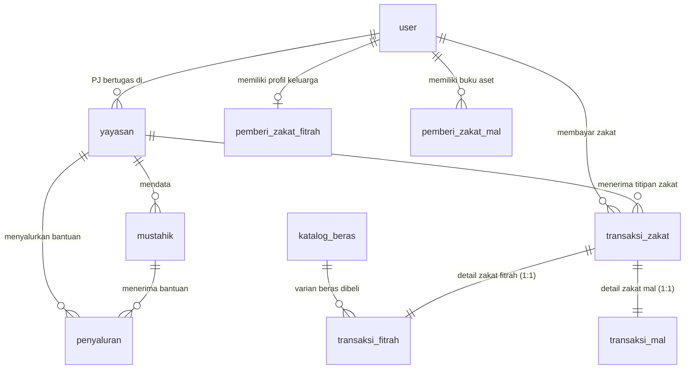

> [!IMPORTANT]
> **ATURAN KERJA GIT DAN PEMULIHAN — BACA SEBELUM MENGUBAH PROYEK**
>
> 1. Setiap **langkah perubahan yang utuh** (misalnya satu perbaikan, satu kelompok migration, atau satu halaman) dibuat sebagai **commit lokal tersendiri** dengan pesan yang menjelaskan isinya. Tidak perlu commit setiap kali menyimpan satu baris. Sebelum commit, periksa file yang berubah dan jangan ikutkan perubahan milik rekan yang tidak terkait.
> 2. Commit lokal sudah cukup untuk **kembali ke versi kode sebelumnya**. Untuk membatalkan perubahan yang sudah di-commit, gunakan `git revert <hash-commit>` agar riwayat tetap jelas. Hindari `git reset --hard` atau force push pada pekerjaan bersama.
> 3. **Publish ke GitHub tidak wajib untuk bisa rollback**, tetapi disarankan sebagai salinan di luar komputer dan untuk kolaborasi. Publish berarti `git push`, yang mengirim commit serta riwayatnya. Lakukan pada repository **private** setelah memeriksa isi commit; jangan push otomatis tiap commit. Keputusan kapan push tetap terpisah dari kewajiban commit lokal.
> 4. `.env`, kata sandi, dump berisi data pribadi, foto bukti, dan data MySQL **tidak boleh masuk commit**. Git hanya menyimpan kode dan migration, bukan isi database. Sebelum perubahan atau penghapusan skema/data, buat cadangan MySQL di lokasi aman **di luar repository**; pemulihan data memakai cadangan itu, bukan `git revert`.
> 5. Untuk rancangan baru, gunakan database pengembangan terpisah. Database lama belum dihapus; perintah yang menghapus tabel hanya dijalankan setelah migration baru siap dan cakupan penghapusan disepakati.

---

# 📖 Handout & Dokumentasi Desain Database: Sistem Pengelolaan Zakat

> **Pembaruan harga emas otomatis — 8 Oktober 2026:** Harga acuan maal kini memakai emas dunia dari Gold API dan kurs USD/IDR dari Frankfurter, dikonversi ke rupiah per gram sekali sehari pukul **09.30 WIB**. Scheduler sudah dipasang pada crontab akun `keli`. Harga pertama sudah tersimpan; pesanan lama tetap memakai snapshot. Baca [Bagian 12](#12-harga-acuan-emas-dunia-otomatis-8-oktober-2026) untuk alur, kolom database, command, dan pemulihan.

> **Panduan belajar lengkap (diperbarui 9 Oktober 2026):** Baca [PANDUAN_LENGKAP_PORTAL_ZAKAT.md](PANDUAN_LENGKAP_PORTAL_ZAKAT.md) untuk memahami alur seluruh role, status pembayaran dan penyaluran, contoh perhitungan/stok, arti 35 tabel dan 393 kolom database aktif `zakat_db`, peta route, serta tugas setiap file aplikasi dan method controller. Panduan menandai kode lama dan fitur yang belum lengkap. Panduan awal dibuat tanpa perubahan aplikasi; pembaruan integrasi emas pada Bagian 12 mencatat perubahan kode dan skema berikutnya.

Dokumen ini berisi dokumentasi teknis dan arsitektur database untuk **Sistem Pengelolaan & Pembayaran Zakat (Fitrah & Maal)**. Database ini dirancang dengan standar industri (menggunakan MySQL/MariaDB Engine: `InnoDB`, Charset: `utf8mb4`) agar **anti-banting, aman dari selisih pembulatan uang, konsisten secara audit finansial, dan sesuai prinsip syariah**.

> **Arah pengembangan terbaru:** Lihat [Bagian 11: Rencana perubahan dan checklist](#11-rencana-perubahan-dan-checklist-2026-09-27), khususnya [Bagian 11.14: Catatan implementasi](#1114-catatan-implementasi-bertahap) dan [Bagian 11.15: Menjalankan versi pengembangan](#1115-menjalankan-versi-pengembangan). Bagian 1–9 menggambarkan skema dan alur lama, **bukan spesifikasi implementasi baru**. Khususnya, uraian QRIS/payment gateway nyata, harga tetap, pemotongan stok langsung saat pembayaran, dan akun panitia sebagai pengelola seluruh situs sudah perlu direvisi. Banyak bagian checklist telah diimplementasikan sebagian; kotak kosong berarti pekerjaan atau pemeriksaan masih tersisa, bukan berarti semua kode pada bagian itu belum ada.

> **CRUD terbaru:** [Bagian 15](#15-crud-dan-penghapusan-terbatas-8-oktober-2026) menjelaskan CRUD vendor dan penghapusan terbatas jenis beras, draft maal, serta perjalanan kosong. Semua operasi hapus memeriksa hak akses dan riwayat terkait.

> **Teks tampilan terbaru:** Label simulasi, data pengembangan, dan pengembangan internal di antarmuka dirapikan pada 8 Oktober 2026. Lihat [Bagian 16](#16-perapian-teks-tampilan-dan-salinan-github-8-oktober-2026). Ini perubahan presentasi; QR masih mencatat konfirmasi tanpa transfer uang dan belum terhubung ke payment gateway.

> **ERD database baru (diperbarui 9 Oktober 2026):** [ERD_zakat_db.md](ERD_zakat_db.md) memuat ERD konseptual, diagram physical per kelompok, dan kamus skema dari MySQL aktif `zakat_db`: 35 tabel, 393 kolom, 55 foreign key, serta 2 CHECK constraint JSON. Sumber diagram lengkap tersedia di [ERD_zakat_db_conceptual.mmd](ERD_zakat_db_conceptual.mmd) dan [ERD_zakat_db_physical.mmd](ERD_zakat_db_physical.mmd). Diagram memakai metadata skema; diperbarui setelah migration emas harian, kapasitas pengajuan PJ, dan cleanup infrastruktur pada Bagian 12, 14, dan 17. ERD pada Bagian 2 di bawah tetap merupakan gambaran skema lama `zakat`.

---

## 1. Arsitektur & Prinsip Desain "Anti-Banting"

Sebelum melihat struktur tabel, tim pengembang perlu memahami 5 prinsip penting di balik perancangan database ini:

1. **Prinsip Keuangan (Presisi Angka Tanpa Selisih):**
   * Seluruh nominal uang dan bobot timbangan menggunakan `DECIMAL(15,2)` atau `DECIMAL(10,2)`.
   * **DILARANG** menggunakan `FLOAT` atau `DOUBLE` karena memiliki masalah presisi pembulatan bilangan desimal (*floating-point arithmetic error*) yang haram di aplikasi finansial.
2. **Pola Header-Detail (Master-Detail Pattern):**
   * Semua urusan pembayaran digital (QRIS, VA, status bayar Midtrans/Xendit) dipusatkan di 1 master tabel: `transaksi_zakat`.
   * Detail spesifik dipisahkan ke `transaksi_fitrah` (rincian jiwa & beras) dan `transaksi_mal` (rincian harta & emas) dengan relasi 1-to-1 (`transaksi_id` UNIQUE).
3. **Pola Snapshot Finansial (*Historical Immutability*):**
   * Harga emas dan harga beras bersifat fluktuatif (berubah setiap hari).
   * Pada detik user melakukan *checkout* pembayaran, harga beras/kg dan harga acuan emas/gram **dikunci di baris transaksi** (`harga_per_kg_snapshot` dan `harga_emas_per_gram_snapshot`). Jika besok harga beras naik, data transaksi kemarin tidak akan rusak atau berubah nilai tagihannya.
4. **Model Gudang Mandiri (*Centralized Fulfillment*):**
   * Platform kita mengelola gudang dan stok beras sendiri (`katalog_beras`).
   * Menggunakan *soft-deactivation* (`is_active BOOLEAN`): Jika suatu beras sudah habis atau tidak dijual, beras tidak boleh di-`DELETE` dari database (karena terikat *Foreign Key* transaksi lama), melainkan cukup diubah menjadi `is_active = FALSE`.
5. **Integritas Relasi (*Foreign Key Constraints*):**
   * `ON DELETE RESTRICT` pada transaksi dan penyaluran: Mencegah penghapusan user, yayasan, atau katalog beras jika masih memiliki riwayat transaksi/audit.
   * `ON DELETE CASCADE` pada detail: Jika sebuah master invoice pembayaran dihapus/dibatalkan, rincian detailnya otomatis ikut terhapus bersih.

---

## 2. Diagram Relasi Database (ERD)



---

## 3. Pembagian Peran Pengguna (*User Roles*)

Kolom `role` pada tabel `user` terbagi menjadi 3 peran:
1. **`pemberi` (Muzakki):** Masyarakat umum yang membuat akun untuk membayar zakat fitrah atau zakat maal via QRIS.
2. **`pj` (Penanggung Jawab Yayasan):** Kontak/pimpinan resmi dari yayasan mitra penerima zakat yang terhubung melalui kolom `yayasan.pj_user_id`.
3. **`panitia` (Tim Internal Website Kita):** Staf/panitia pengelola website dan organisasi kita yang bertugas memverifikasi yayasan, mengelola katalog/stok beras gudang, dan memantau seluruh transaksi masuk.

---

## 4. Kamus Data Lengkap (10 Tabel)

### 1. Tabel `user` (Akun Pengguna)
Menyimpan akun muzakki, amil yayasan, dan panitia platform.

| Nama Kolom | Tipe Data & Panjang | Nullable? | Key / Constraint | Nilai Default | Penjelasan Singkat |
| :--- | :--- | :--- | :--- | :--- | :--- |
| `id` | `BIGINT` | NOT NULL | **PK**, Auto Increment | *(None)* | ID unik pengguna |
| `nik` | `VARCHAR(16)` | **NULL** | - | `NULL` | KTP Indonesia 16 digit (opsional) |
| `nama` | `VARCHAR(255)` | NOT NULL | - | *(None)* | Nama lengkap pengguna |
| `telp` | `VARCHAR(20)` | NOT NULL | - | *(None)* | Nomor HP/telepon (+62 / 08...) |
| `email` | `VARCHAR(191)` | NOT NULL | **UNIQUE** | *(None)* | Email login (191 standar utf8mb4) |
| `pass_hash` | `VARCHAR(255)` | NOT NULL | - | *(None)* | Hash kata sandi akun (Bcrypt/Argon2) |
| `tggl_lahir` | `DATE` | **NULL** | - | `NULL` | Tanggal lahir (YYYY-MM-DD) |
| `gender` | `ENUM('L', 'P')` | **NULL** | - | `NULL` | Jenis kelamin |
| `kota_kabupaten` | `VARCHAR(100)` | NOT NULL | - | *(None)* | Kota domisili |
| `provinsi` | `VARCHAR(100)` | NOT NULL | - | *(None)* | Provinsi domisili |
| `alamat_lengkap` | `TEXT` | **NULL** | - | `NULL` | Alamat tempat tinggal |
| `npwp` | `VARCHAR(25)` | **NULL** | - | `NULL` | NPWP pengurang pajak (opsional) |
| `role` | `ENUM('pemberi', 'pj', 'panitia')` | NOT NULL | - | `'pemberi'` | Hak akses user |
| `created_at` | `TIMESTAMP` | NOT NULL | - | `CURRENT_TIMESTAMP` | Waktu akun dibuat |
| `updated_at` | `TIMESTAMP` | NOT NULL | - | `CURRENT_TIMESTAMP` | Waktu profil diubah |

---

### 2. Tabel `yayasan` (Lembaga Penerima Zakat)
Profil lembaga/masjid mitra yang menerima titipan penyaluran zakat.

| Nama Kolom | Tipe Data & Panjang | Nullable? | Key / Constraint | Nilai Default | Penjelasan Singkat |
| :--- | :--- | :--- | :--- | :--- | :--- |
| `id` | `BIGINT` | NOT NULL | **PK**, Auto Increment | *(None)* | ID unik yayasan |
| `nama` | `VARCHAR(255)` | NOT NULL | - | *(None)* | Nama resmi lembaga/yayasan |
| `nomor_izin` | `VARCHAR(100)` | NOT NULL | - | *(None)* | Nomor izin Kemenag / BAZNAS |
| `telp` | `VARCHAR(20)` | NOT NULL | - | *(None)* | Nomor telepon resmi kantor |
| `email` | `VARCHAR(191)` | NOT NULL | - | *(None)* | Email resmi yayasan |
| `kota_kabupaten` | `VARCHAR(100)` | NOT NULL | - | *(None)* | Kota domisili yayasan |
| `provinsi` | `VARCHAR(100)` | NOT NULL | - | *(None)* | Provinsi domisili yayasan |
| `alamat_lengkap` | `TEXT` | NOT NULL | - | *(None)* | Alamat fisik kantor |
| `kode_pos` | `VARCHAR(10)` | **NULL** | - | `NULL` | Kode pos |
| `nama_bank` | `VARCHAR(50)` | NOT NULL | - | *(None)* | Bank penerima (BSI, BCA, Mandiri) |
| `no_rek` | `VARCHAR(50)` | NOT NULL | - | *(None)* | Nomor rekening bank yayasan |
| `atas_nama_rek` | `VARCHAR(255)` | NOT NULL | - | *(None)* | Nama pemilik rekening |
| `status_verif` | `ENUM('pending', 'verified', 'rejected')` | NOT NULL | - | `'pending'` | Status verifikasi oleh panitia |
| `is_active` | `BOOLEAN` | NOT NULL | - | `TRUE` | Status operasional yayasan |
| `pj_user_id` | `BIGINT` | NOT NULL | **FK** $\rightarrow$ `user.id` | *(None)* | Akun user penanggung jawab yayasan |
| `pict_id` | `VARCHAR(255)` | **NULL** | - | `NULL` | URL/Path logo foto profil yayasan |
| `created_at` | `TIMESTAMP` | NOT NULL | - | `CURRENT_TIMESTAMP` | Waktu yayasan terdaftar |
| `updated_at` | `TIMESTAMP` | NOT NULL | - | `CURRENT_TIMESTAMP` | Waktu profil di-update |

---

### 3. Tabel `pemberi_zakat_fitrah` (Buku Profil Keluarga Muzakki)
Menyimpan data jumlah tanggungan keluarga di profil muzakki agar tidak perlu ketik ulang setiap tahun.

| Nama Kolom | Tipe Data & Panjang | Nullable? | Key / Constraint | Nilai Default | Penjelasan Singkat |
| :--- | :--- | :--- | :--- | :--- | :--- |
| `id` | `BIGINT` | NOT NULL | **PK**, Auto Increment | *(None)* | ID profil keluarga |
| `id_kepala` | `BIGINT` | NOT NULL | **FK** $\rightarrow$ `user.id`, **UNIQUE** | *(None)* | Akun kepala keluarga (1 user = 1 profil) |
| `jum_anggota` | `INT` | NOT NULL | - | `1` | Jumlah anggota yang ditanggung |
| `created_at` | `TIMESTAMP` | NOT NULL | - | `CURRENT_TIMESTAMP` | Waktu data dibuat |
| `updated_at` | `TIMESTAMP` | NOT NULL | - | `CURRENT_TIMESTAMP` | Waktu data diperbarui |

---

### 4. Tabel `pemberi_zakat_mal` (Buku Catatan Harta Muzakki)
Draft aset berjalan di profil user untuk memantau apakah hartanya sudah wajib zakat.

| Nama Kolom | Tipe Data & Panjang | Nullable? | Key / Constraint | Nilai Default | Penjelasan Singkat |
| :--- | :--- | :--- | :--- | :--- | :--- |
| `id` | `BIGINT` | NOT NULL | **PK**, Auto Increment | *(None)* | ID catatan aset |
| `user_id` | `BIGINT` | NOT NULL | **FK** $\rightarrow$ `user.id` | *(None)* | Pemilik catatan harta |
| `kepemilikan` | `VARCHAR(100)` | **NULL** | - | `NULL` | Misal: "Pribadi", "Usaha Bersama" |
| `atas_nama` | `VARCHAR(255)` | **NULL** | - | `NULL` | Nama pada dokumen kepemilikan aset |
| `nominal_tabungan` | `DECIMAL(15,2)` | NOT NULL | - | `0.00` | Saldo uang tabungan/kas saat ini |
| `emas_gram` | `DECIMAL(8,2)` | NOT NULL | - | `0.00` | Bobot emas (gram, bisa koma) |
| `nilai_invest` | `DECIMAL(15,2)` | NOT NULL | - | `0.00` | Portofolio saham / reksadana |
| `nilai_aset_dagang`| `DECIMAL(15,2)` | NOT NULL | - | `0.00` | Nilai stok barang dagangan |
| `piutang` | `DECIMAL(15,2)` | NOT NULL | - | `0.00` | Uang yang dipinjam pihak lain |
| `utang` | `DECIMAL(15,2)` | NOT NULL | - | `0.00` | Utang jatuh tempo yang harus dibayar |
| `total_harta_bersih`| `DECIMAL(15,2)` | NOT NULL | - | `0.00` | $(Tabungan + Emas + Invest + Dagang + Piutang) - Utang$ |
| `apakah_wajib_zakat`| `BOOLEAN` | NOT NULL | - | `FALSE` | Otomatis `TRUE` jika harta bersih $\ge$ nisab |
| `created_at` | `TIMESTAMP` | NOT NULL | - | `CURRENT_TIMESTAMP` | Waktu pertama dicatat |
| `updated_at` | `TIMESTAMP` | NOT NULL | - | `CURRENT_TIMESTAMP` | Waktu data aset diperbarui |

---

### 5. Tabel `katalog_beras` (Gudang Beras Platform Kita)
Pilihan beras yang disediakan di gudang platform untuk pembayaran zakat fitrah.

| Nama Kolom | Tipe Data & Panjang | Nullable? | Key / Constraint | Nilai Default | Penjelasan Singkat |
| :--- | :--- | :--- | :--- | :--- | :--- |
| `id` | `BIGINT` | NOT NULL | **PK**, Auto Increment | *(None)* | ID varian beras |
| `nama_beras` | `VARCHAR(100)` | NOT NULL | - | *(None)* | Contoh: "Pandan Wangi", "Ramos" |
| `harga_per_kg` | `DECIMAL(10,2)` | NOT NULL | - | *(None)* | Harga beras per kg saat ini (realtime) |
| `stock` | `DECIMAL(10,2)` | NOT NULL | - | `0.00` | Sisa kuantitas gudang (dalam Kg) |
| `pict_id` | `VARCHAR(255)` | **NULL** | - | `NULL` | Foto produk beras |
| `is_active` | `BOOLEAN` | NOT NULL | - | `TRUE` | `TRUE` = dijual, `FALSE` = dinonaktifkan |
| `created_at` | `TIMESTAMP` | NOT NULL | - | `CURRENT_TIMESTAMP` | Waktu data beras dibuat |
| `updated_at` | `TIMESTAMP` | NOT NULL | - | `CURRENT_TIMESTAMP` | Waktu harga/stok diperbarui |

---

### 6. Tabel `mustahik` (Penerima Zakat)
Data penerima manfaat yang dibina dan didata oleh masing-masing yayasan mitra.

| Nama Kolom | Tipe Data & Panjang | Nullable? | Key / Constraint | Nilai Default | Penjelasan Singkat |
| :--- | :--- | :--- | :--- | :--- | :--- |
| `id` | `BIGINT` | NOT NULL | **PK**, Auto Increment | *(None)* | ID mustahik |
| `yayasan_id` | `BIGINT` | NOT NULL | **FK** $\rightarrow$ `yayasan.id` | *(None)* | Yayasan yang mendata |
| `nama` | `VARCHAR(255)` | NOT NULL | - | *(None)* | Nama lengkap penerima zakat |
| `kelamin` | `ENUM('L', 'P')` | NOT NULL | - | *(None)* | Jenis kelamin |
| `tggl_lahir` | `DATE` | **NULL** | - | `NULL` | Tanggal lahir (YYYY-MM-DD) |
| `kategori_asnaf` | `ENUM('fakir', 'miskin', 'amil', 'mualaf', 'riqab', 'gharimin', 'fisabilillah', 'ibnu_sabil')` | NOT NULL | - | *(None)* | 8 Golongan wajib penerima zakat |
| `created_at` | `TIMESTAMP` | NOT NULL | - | `CURRENT_TIMESTAMP` | Waktu mustahik didata |
| `updated_at` | `TIMESTAMP` | NOT NULL | - | `CURRENT_TIMESTAMP` | Waktu data diperbarui |

---

### 7. Tabel `transaksi_zakat` (Master Pembayaran & QRIS)
Header transaksi pembayaran zakat yang terhubung langsung ke Payment Gateway.

| Nama Kolom | Tipe Data & Panjang | Nullable? | Key / Constraint | Nilai Default | Penjelasan Singkat |
| :--- | :--- | :--- | :--- | :--- | :--- |
| `id` | `BIGINT` | NOT NULL | **PK**, Auto Increment | *(None)* | ID master transaksi |
| `kode_transaksi` | `VARCHAR(50)` | NOT NULL | **UNIQUE** | *(None)* | Nomor invoice (Order ID QRIS) |
| `user_id` | `BIGINT` | NOT NULL | **FK** $\rightarrow$ `user.id` | *(None)* | Muzakki yang membayar |
| `yayasan_id` | `BIGINT` | NOT NULL | **FK** $\rightarrow$ `yayasan.id` | *(None)* | Yayasan tujuan zakat |
| `jenis_zakat` | `ENUM('fitrah', 'mal')` | NOT NULL | - | *(None)* | Kategori zakat yang dibayar |
| `total_nominal` | `DECIMAL(15,2)` | NOT NULL | - | *(None)* | Total tagihan rupiah di QRIS |
| `metode_pembayaran`| `VARCHAR(50)` | **NULL** | - | `NULL` | Contoh: 'QRIS', 'BCA_VA' |
| `status_pembayaran`| `ENUM('pending', 'paid', 'expired', 'failed')` | NOT NULL | - | `'pending'` | Status pembayaran |
| `payment_gateway_ref`| `VARCHAR(100)`| **NULL** | - | `NULL` | ID referensi dari Payment Gateway |
| `qr_payload` | `TEXT` | **NULL** | - | `NULL` | String payload QRIS / QR image URL |
| `catatan_doa` | `TEXT` | **NULL** | - | `NULL` | Titipan doa dari muzakki |
| `expired_at` | `TIMESTAMP` | **NULL** | - | `NULL` | Waktu batas bayar QRIS |
| `paid_at` | `TIMESTAMP` | **NULL** | - | `NULL` | Waktu pembayaran berhasil |
| `created_at` | `TIMESTAMP` | NOT NULL | - | `CURRENT_TIMESTAMP` | Waktu invoice dibuat |
| `updated_at` | `TIMESTAMP` | NOT NULL | - | `CURRENT_TIMESTAMP` | Waktu status pembayaran diperbarui |

---

### 8. Tabel `transaksi_fitrah` (Snapshot Detail Zakat Fitrah)
Rincian takaran jiwa dan snapshot beras pada detik transaksi dilakukan.

| Nama Kolom | Tipe Data & Panjang | Nullable? | Key / Constraint | Nilai Default | Penjelasan Singkat |
| :--- | :--- | :--- | :--- | :--- | :--- |
| `id` | `BIGINT` | NOT NULL | **PK**, Auto Increment | *(None)* | ID detail fitrah |
| `transaksi_id` | `BIGINT` | NOT NULL | **FK** $\rightarrow$ `transaksi_zakat.id`, **UNIQUE** | *(None)* | Relasi 1-to-1 ke master invoice |
| `katalog_beras_id` | `BIGINT` | NOT NULL | **FK** $\rightarrow$ `katalog_beras.id` | *(None)* | Varian beras yang dipilih |
| `nama_beras_snapshot`| `VARCHAR(100)`| NOT NULL | - | *(None)* | Nama beras saat checkout (terkunci) |
| `harga_per_kg_snapshot`| `DECIMAL(10,2)`| NOT NULL | - | *(None)* | Harga beras/kg saat checkout (terkunci) |
| `bobot_per_jiwa_kg`| `DECIMAL(4,2)` | NOT NULL | - | `2.50` | Takaran standar BAZNAS (2.50 kg) |
| `jumlah_jiwa` | `INT` | NOT NULL | - | *(None)* | Jumlah orang yang dibayarkan |
| `total_beras_kg` | `DECIMAL(8,2)` | NOT NULL | - | *(None)* | `jumlah_jiwa * bobot_per_jiwa_kg` |
| `total_biaya_fitrah`| `DECIMAL(15,2)` | NOT NULL | - | *(None)* | `total_beras_kg * harga_snapshot` |
| `bukti_pict_id` | `VARCHAR(255)` | **NULL** | - | `NULL` | Foto sertifikat / bukti zakat fitrah |
| `created_at` | `TIMESTAMP` | NOT NULL | - | `CURRENT_TIMESTAMP` | Waktu detail dicatat |
| `updated_at` | `TIMESTAMP` | NOT NULL | - | `CURRENT_TIMESTAMP` | Waktu detail diperbarui |

---

### 9. Tabel `transaksi_mal` (Snapshot Detail Kalkulator Harta)
Rincian perhitungan harta dan snapshot harga acuan emas saat pembayaran dibuat.

| Nama Kolom | Tipe Data & Panjang | Nullable? | Key / Constraint | Nilai Default | Penjelasan Singkat |
| :--- | :--- | :--- | :--- | :--- | :--- |
| `id` | `BIGINT` | NOT NULL | **PK**, Auto Increment | *(None)* | ID detail mal |
| `transaksi_id` | `BIGINT` | NOT NULL | **FK** $\rightarrow$ `transaksi_zakat.id`, **UNIQUE** | *(None)* | Relasi 1-to-1 ke master invoice |
| `nilai_tabungan` | `DECIMAL(15,2)` | NOT NULL | - | `0.00` | Snapshot tabungan saat bayar |
| `emas_gram` | `DECIMAL(8,2)` | NOT NULL | - | `0.00` | Snapshot bobot emas saat bayar |
| `harga_emas_per_gram_snapshot`| `DECIMAL(12,2)`| NOT NULL | - | *(None)* | Snapshot harga acuan emas per gram |
| `nilai_investasi` | `DECIMAL(15,2)` | NOT NULL | - | `0.00` | Snapshot portofolio investasi |
| `nilai_aset_dagang`| `DECIMAL(15,2)` | NOT NULL | - | `0.00` | Snapshot nilai barang dagang |
| `nilai_piutang` | `DECIMAL(15,2)` | NOT NULL | - | `0.00` | Snapshot piutang lancar |
| `nilai_utang` | `DECIMAL(15,2)` | NOT NULL | - | `0.00` | Snapshot utang jatuh tempo |
| `total_harta_bersih`| `DECIMAL(15,2)` | NOT NULL | - | *(None)* | Harta bersih terhitung saat itu |
| `nilai_nisab` | `DECIMAL(15,2)` | NOT NULL | - | *(None)* | Nilai batas nisab ($85 \times \text{harga emas}$) |
| `wajib_zakat` | `BOOLEAN` | NOT NULL | - | *(None)* | `TRUE` karena sudah mencapai nisab |
| `persentase_zakat` | `DECIMAL(4,2)` | NOT NULL | - | `2.50` | Persentase zakat (2.50%) |
| `total_zakat_wajib`| `DECIMAL(15,2)` | NOT NULL | - | *(None)* | $2.5\% \times \text{total harta bersih}$ |
| `bukti_pict_id` | `VARCHAR(255)` | **NULL** | - | `NULL` | Foto sertifikat / bukti zakat mal |
| `created_at` | `TIMESTAMP` | NOT NULL | - | `CURRENT_TIMESTAMP` | Waktu detail dicatat |
| `updated_at` | `TIMESTAMP` | NOT NULL | - | `CURRENT_TIMESTAMP` | Waktu detail diperbarui |

---

### 10. Tabel `penyaluran` (Distribusi Bantuan ke Mustahik)
Pencatatan penyaluran beras atau uang zakat yang diserahkan yayasan kepada mustahik.

| Nama Kolom | Tipe Data & Panjang | Nullable? | Key / Constraint | Nilai Default | Penjelasan Singkat |
| :--- | :--- | :--- | :--- | :--- | :--- |
| `id` | `BIGINT` | NOT NULL | **PK**, Auto Increment | *(None)* | ID penyaluran |
| `yayasan_id` | `BIGINT` | NOT NULL | **FK** $\rightarrow$ `yayasan.id` | *(None)* | Yayasan yang menyalurkan |
| `mustahik_id` | `BIGINT` | NOT NULL | **FK** $\rightarrow$ `mustahik.id` | *(None)* | Mustahik yang menerima |
| `jenis_zakat` | `ENUM('fitrah', 'mal')` | NOT NULL | - | *(None)* | Kas zakat yang disalurkan |
| `barang` | `VARCHAR(100)` | NOT NULL | - | *(None)* | Jenis bantuan ('Beras', 'Uang Tunai') |
| `jumlah` | `DECIMAL(15,2)` | NOT NULL | - | *(None)* | Kuantitas (misal: 2.50 atau 200000.00) |
| `satuan` | `VARCHAR(20)` | NOT NULL | - | *(None)* | Satuan ('Kg', 'Rupiah', 'Paket') |
| `bukti_pict_id` | `VARCHAR(255)` | **NULL** | - | `NULL` | Foto serah terima bantuan |
| `created_at` | `TIMESTAMP` | NOT NULL | - | `CURRENT_TIMESTAMP` | Waktu bantuan diserahkan |
| `updated_at` | `TIMESTAMP` | NOT NULL | - | `CURRENT_TIMESTAMP` | Waktu data penyaluran diedit |

---

## 5. Alur Transaksi & Operasional Sistem (*User Journey*)

> **Arsip alur lama:** Diagram pada bagian ini menggambarkan rancangan QRIS/payment gateway dan stok lama. Untuk pengerjaan berikutnya, gunakan Bagian 11 yang menetapkan QR simulasi internal, stok gudang pusat, dan alokasi penyaluran.

### A. Alur Pembayaran Zakat Fitrah
```
[Muzakki Login]
       │
       ▼
Pilih Yayasan Tujuan & Jenis Beras (katalog_beras)
       │
       ▼
Masukkan Jumlah Jiwa (misal: 4 orang)
       │
       ▼
Sistem Menghitung: (4 x 2.5 Kg) x Harga Beras/Kg
       │
       ▼
Insert: `transaksi_zakat` (PENDING) + `transaksi_fitrah` (Snapshot Harga & Kg)
       │
       ▼
User Scan QRIS & Bayar
       │
       ▼
Webhook Payment Gateway -> UPDATE `transaksi_zakat` SET status_pembayaran = 'PAID'
       │
       ▼
Stok Beras di `katalog_beras` Terpotong Otomatis
```

### B. Alur Pembayaran Zakat Maal
```
[Muzakki Login]
       │
       ▼
Buka Menu Kalkulator Zakat Maal
       │
       ▼
Input Nilai: Tabungan, Emas (gr), Investasi, Aset Dagang, Piutang, Utang
       │
       ▼
Sistem Mengambil Harga Emas Realtime & Menghitung Nisab (85 gr x Harga Emas)
       │
       ▼
Jika Total Harta Bersih >= Nisab:
Hitung Zakat Wajib = 2.5% x Total Harta Bersih
       │
       ▼
Insert: `transaksi_zakat` (PENDING) + `transaksi_mal` (Snapshot Nilai Harta)
       │
       ▼
User Scan QRIS & Bayar -> Status Menjadi 'PAID'
```

### C. Alur Penyaluran ke Mustahik (Outflow)
```
Yayasan Menerima Titipan Zakat (PAID)
       │
       ▼
Yayasan Membina & Mendata Mustahik (8 Asnaf) di `mustahik`
       │
       ▼
Amil Menyerahkan Beras/Uang Tunai ke Mustahik
       │
       ▼
Amil Mencatat Dokumentasi & Bukti Serah Terima di Tabel `penyaluran`
```

---

## 6. Skrip DDL SQL (STATUS: ✅ SUDAH DIJALANKAN DI MYSQL)

> [!IMPORTANT]
> **Catatan Status:** Skrip SQL berikut **SUDAH dieksekusi** di database MySQL user `keli`. Jangan dijalankan ulang kecuali ingin mereset database dari awal.

```sql
-- ==========================================================
-- DATABASE SCHEMA: ZAKAT MANAGEMENT SYSTEM
-- Engine: InnoDB | Charset: utf8mb4
-- ==========================================================

-- 1. TABEL PENGGUNA (USER)
CREATE TABLE `user` (
    `id` BIGINT AUTO_INCREMENT PRIMARY KEY,
    `nik` VARCHAR(16) NULL,
    `nama` VARCHAR(255) NOT NULL,
    `telp` VARCHAR(20) NOT NULL,
    `email` VARCHAR(191) NOT NULL UNIQUE,
    `pass_hash` VARCHAR(255) NOT NULL,
    `tggl_lahir` DATE NULL,
    `gender` ENUM('L', 'P') NULL,
    `kota_kabupaten` VARCHAR(100) NOT NULL,
    `provinsi` VARCHAR(100) NOT NULL,
    `alamat_lengkap` TEXT NULL,
    `npwp` VARCHAR(25) NULL,
    `role` ENUM('pemberi', 'pj', 'panitia') NOT NULL DEFAULT 'pemberi',
    `created_at` TIMESTAMP NOT NULL DEFAULT CURRENT_TIMESTAMP,
    `updated_at` TIMESTAMP NOT NULL DEFAULT CURRENT_TIMESTAMP ON UPDATE CURRENT_TIMESTAMP
) ENGINE=InnoDB DEFAULT CHARSET=utf8mb4;

-- 2. TABEL YAYASAN
CREATE TABLE `yayasan` (
    `id` BIGINT AUTO_INCREMENT PRIMARY KEY,
    `nama` VARCHAR(255) NOT NULL,
    `nomor_izin` VARCHAR(100) NOT NULL,
    `telp` VARCHAR(20) NOT NULL,
    `email` VARCHAR(191) NOT NULL,
    `kota_kabupaten` VARCHAR(100) NOT NULL,
    `provinsi` VARCHAR(100) NOT NULL,
    `alamat_lengkap` TEXT NOT NULL,
    `kode_pos` VARCHAR(10) NULL,
    `nama_bank` VARCHAR(50) NOT NULL,
    `no_rek` VARCHAR(50) NOT NULL,
    `atas_nama_rek` VARCHAR(255) NOT NULL,
    `status_verif` ENUM('pending', 'verified', 'rejected') NOT NULL DEFAULT 'pending',
    `is_active` BOOLEAN NOT NULL DEFAULT TRUE,
    `pj_user_id` BIGINT NOT NULL,
    `pict_id` VARCHAR(255) NULL,
    `created_at` TIMESTAMP NOT NULL DEFAULT CURRENT_TIMESTAMP,
    `updated_at` TIMESTAMP NOT NULL DEFAULT CURRENT_TIMESTAMP ON UPDATE CURRENT_TIMESTAMP,
    CONSTRAINT `fk_yayasan_user` FOREIGN KEY (`pj_user_id`) REFERENCES `user` (`id`) ON DELETE RESTRICT ON UPDATE CASCADE
) ENGINE=InnoDB DEFAULT CHARSET=utf8mb4;

-- 3. TABEL PROFIL KELUARGA (PEMBERI ZAKAT FITRAH)
CREATE TABLE `pemberi_zakat_fitrah` (
    `id` BIGINT AUTO_INCREMENT PRIMARY KEY,
    `id_kepala` BIGINT NOT NULL UNIQUE,
    `jum_anggota` INT NOT NULL DEFAULT 1,
    `created_at` TIMESTAMP NOT NULL DEFAULT CURRENT_TIMESTAMP,
    `updated_at` TIMESTAMP NOT NULL DEFAULT CURRENT_TIMESTAMP ON UPDATE CURRENT_TIMESTAMP,
    CONSTRAINT `fk_fitrah_kepala` FOREIGN KEY (`id_kepala`) REFERENCES `user` (`id`) ON DELETE CASCADE ON UPDATE CASCADE
) ENGINE=InnoDB DEFAULT CHARSET=utf8mb4;

-- 4. TABEL BUKU CATATAN HARTA (PEMBERI ZAKAT MAL)
CREATE TABLE `pemberi_zakat_mal` (
    `id` BIGINT AUTO_INCREMENT PRIMARY KEY,
    `user_id` BIGINT NOT NULL,
    `kepemilikan` VARCHAR(100) NULL,
    `atas_nama` VARCHAR(255) NULL,
    `nominal_tabungan` DECIMAL(15,2) NOT NULL DEFAULT 0.00,
    `emas_gram` DECIMAL(8,2) NOT NULL DEFAULT 0.00,
    `nilai_invest` DECIMAL(15,2) NOT NULL DEFAULT 0.00,
    `nilai_aset_dagang` DECIMAL(15,2) NOT NULL DEFAULT 0.00,
    `piutang` DECIMAL(15,2) NOT NULL DEFAULT 0.00,
    `utang` DECIMAL(15,2) NOT NULL DEFAULT 0.00,
    `total_harta_bersih` DECIMAL(15,2) NOT NULL DEFAULT 0.00,
    `apakah_wajib_zakat` BOOLEAN NOT NULL DEFAULT FALSE,
    `created_at` TIMESTAMP NOT NULL DEFAULT CURRENT_TIMESTAMP,
    `updated_at` TIMESTAMP NOT NULL DEFAULT CURRENT_TIMESTAMP ON UPDATE CURRENT_TIMESTAMP,
    CONSTRAINT `fk_mal_user` FOREIGN KEY (`user_id`) REFERENCES `user` (`id`) ON DELETE CASCADE ON UPDATE CASCADE
) ENGINE=InnoDB DEFAULT CHARSET=utf8mb4;

-- 5. TABEL KATALOG & GUDANG BERAS
CREATE TABLE `katalog_beras` (
    `id` BIGINT AUTO_INCREMENT PRIMARY KEY,
    `nama_beras` VARCHAR(100) NOT NULL,
    `harga_per_kg` DECIMAL(10,2) NOT NULL,
    `stock` DECIMAL(10,2) NOT NULL DEFAULT 0.00,
    `pict_id` VARCHAR(255) NULL,
    `is_active` BOOLEAN NOT NULL DEFAULT TRUE,
    `created_at` TIMESTAMP NOT NULL DEFAULT CURRENT_TIMESTAMP,
    `updated_at` TIMESTAMP NOT NULL DEFAULT CURRENT_TIMESTAMP ON UPDATE CURRENT_TIMESTAMP
) ENGINE=InnoDB DEFAULT CHARSET=utf8mb4;

-- 6. TABEL MUSTAHIK (PENERIMA ZAKAT)
CREATE TABLE `mustahik` (
    `id` BIGINT AUTO_INCREMENT PRIMARY KEY,
    `yayasan_id` BIGINT NOT NULL,
    `nama` VARCHAR(255) NOT NULL,
    `kelamin` ENUM('L', 'P') NOT NULL,
    `tggl_lahir` DATE NULL,
    `kategori_asnaf` ENUM('fakir', 'miskin', 'amil', 'mualaf', 'riqab', 'gharimin', 'fisabilillah', 'ibnu_sabil') NOT NULL,
    `created_at` TIMESTAMP NOT NULL DEFAULT CURRENT_TIMESTAMP,
    `updated_at` TIMESTAMP NOT NULL DEFAULT CURRENT_TIMESTAMP ON UPDATE CURRENT_TIMESTAMP,
    CONSTRAINT `fk_mustahik_yayasan` FOREIGN KEY (`yayasan_id`) REFERENCES `yayasan` (`id`) ON DELETE CASCADE ON UPDATE CASCADE
) ENGINE=InnoDB DEFAULT CHARSET=utf8mb4;

-- 7. TABEL MASTER TRANSAKSI (PEMBAYARAN & QRIS)
CREATE TABLE `transaksi_zakat` (
    `id` BIGINT AUTO_INCREMENT PRIMARY KEY,
    `kode_transaksi` VARCHAR(50) NOT NULL UNIQUE,
    `user_id` BIGINT NOT NULL,
    `yayasan_id` BIGINT NOT NULL,
    `jenis_zakat` ENUM('fitrah', 'mal') NOT NULL,
    `total_nominal` DECIMAL(15,2) NOT NULL,
    `metode_pembayaran` VARCHAR(50) NULL,
    `status_pembayaran` ENUM('pending', 'paid', 'expired', 'failed') NOT NULL DEFAULT 'pending',
    `payment_gateway_ref` VARCHAR(100) NULL,
    `qr_payload` TEXT NULL,
    `catatan_doa` TEXT NULL,
    `expired_at` TIMESTAMP NULL,
    `paid_at` TIMESTAMP NULL,
    `created_at` TIMESTAMP NOT NULL DEFAULT CURRENT_TIMESTAMP,
    `updated_at` TIMESTAMP NOT NULL DEFAULT CURRENT_TIMESTAMP ON UPDATE CURRENT_TIMESTAMP,
    CONSTRAINT `fk_trx_user` FOREIGN KEY (`user_id`) REFERENCES `user` (`id`) ON DELETE RESTRICT ON UPDATE CASCADE,
    CONSTRAINT `fk_trx_yayasan` FOREIGN KEY (`yayasan_id`) REFERENCES `yayasan` (`id`) ON DELETE RESTRICT ON UPDATE CASCADE
) ENGINE=InnoDB DEFAULT CHARSET=utf8mb4;

-- 8. TABEL DETAIL TRANSAKSI FITRAH (SNAPSHOT)
CREATE TABLE `transaksi_fitrah` (
    `id` BIGINT AUTO_INCREMENT PRIMARY KEY,
    `transaksi_id` BIGINT NOT NULL UNIQUE,
    `katalog_beras_id` BIGINT NOT NULL,
    `nama_beras_snapshot` VARCHAR(100) NOT NULL,
    `harga_per_kg_snapshot` DECIMAL(10,2) NOT NULL,
    `bobot_per_jiwa_kg` DECIMAL(4,2) NOT NULL DEFAULT 2.50,
    `jumlah_jiwa` INT NOT NULL,
    `total_beras_kg` DECIMAL(8,2) NOT NULL,
    `total_biaya_fitrah` DECIMAL(15,2) NOT NULL,
    `bukti_pict_id` VARCHAR(255) NULL,
    `created_at` TIMESTAMP NOT NULL DEFAULT CURRENT_TIMESTAMP,
    `updated_at` TIMESTAMP NOT NULL DEFAULT CURRENT_TIMESTAMP ON UPDATE CURRENT_TIMESTAMP,
    CONSTRAINT `fk_detail_fitrah_trx` FOREIGN KEY (`transaksi_id`) REFERENCES `transaksi_zakat` (`id`) ON DELETE CASCADE ON UPDATE CASCADE,
    CONSTRAINT `fk_detail_fitrah_beras` FOREIGN KEY (`katalog_beras_id`) REFERENCES `katalog_beras` (`id`) ON DELETE RESTRICT ON UPDATE CASCADE
) ENGINE=InnoDB DEFAULT CHARSET=utf8mb4;

-- 9. TABEL DETAIL TRANSAKSI MAL (SNAPSHOT KALKULATOR)
CREATE TABLE `transaksi_mal` (
    `id` BIGINT AUTO_INCREMENT PRIMARY KEY,
    `transaksi_id` BIGINT NOT NULL UNIQUE,
    `nilai_tabungan` DECIMAL(15,2) NOT NULL DEFAULT 0.00,
    `emas_gram` DECIMAL(8,2) NOT NULL DEFAULT 0.00,
    `harga_emas_per_gram_snapshot` DECIMAL(12,2) NOT NULL,
    `nilai_investasi` DECIMAL(15,2) NOT NULL DEFAULT 0.00,
    `nilai_aset_dagang` DECIMAL(15,2) NOT NULL DEFAULT 0.00,
    `nilai_piutang` DECIMAL(15,2) NOT NULL DEFAULT 0.00,
    `nilai_utang` DECIMAL(15,2) NOT NULL DEFAULT 0.00,
    `total_harta_bersih` DECIMAL(15,2) NOT NULL,
    `nilai_nisab` DECIMAL(15,2) NOT NULL,
    `wajib_zakat` BOOLEAN NOT NULL,
    `persentase_zakat` DECIMAL(4,2) NOT NULL DEFAULT 2.50,
    `total_zakat_wajib` DECIMAL(15,2) NOT NULL,
    `bukti_pict_id` VARCHAR(255) NULL,
    `created_at` TIMESTAMP NOT NULL DEFAULT CURRENT_TIMESTAMP,
    `updated_at` TIMESTAMP NOT NULL DEFAULT CURRENT_TIMESTAMP ON UPDATE CURRENT_TIMESTAMP,
    CONSTRAINT `fk_detail_mal_trx` FOREIGN KEY (`transaksi_id`) REFERENCES `transaksi_zakat` (`id`) ON DELETE CASCADE ON UPDATE CASCADE
) ENGINE=InnoDB DEFAULT CHARSET=utf8mb4;

-- 10. TABEL PENYALURAN (DISTRIBUSI KE MUSTAHIK)
CREATE TABLE `penyaluran` (
    `id` BIGINT AUTO_INCREMENT PRIMARY KEY,
    `yayasan_id` BIGINT NOT NULL,
    `mustahik_id` BIGINT NOT NULL,
    `jenis_zakat` ENUM('fitrah', 'mal') NOT NULL,
    `barang` VARCHAR(100) NOT NULL,
    `jumlah` DECIMAL(15,2) NOT NULL,
    `satuan` VARCHAR(20) NOT NULL,
    `bukti_pict_id` VARCHAR(255) NULL,
    `created_at` TIMESTAMP NOT NULL DEFAULT CURRENT_TIMESTAMP,
    `updated_at` TIMESTAMP NOT NULL DEFAULT CURRENT_TIMESTAMP ON UPDATE CURRENT_TIMESTAMP,
    CONSTRAINT `fk_penyaluran_yayasan` FOREIGN KEY (`yayasan_id`) REFERENCES `yayasan` (`id`) ON DELETE RESTRICT ON UPDATE CASCADE,
    CONSTRAINT `fk_penyaluran_mustahik` FOREIGN KEY (`mustahik_id`) REFERENCES `mustahik` (`id`) ON DELETE RESTRICT ON UPDATE CASCADE
) ENGINE=InnoDB DEFAULT CHARSET=utf8mb4;
```

---

## 7. Penyesuaian Kritis untuk Integrasi Laravel (Eloquent Mapping)

Karena skema database ini menggunakan nama tabel dan kolom kustom, Model di Laravel disesuaikan dengan aturan berikut:

### A. Model `User` (`app/Models/User.php`)
1. **Nama Tabel Tunggal (`user` bukan `users`):**
   ```php
   protected $table = 'user';
   ```
2. **Kolom Password Kustom (`pass_hash` bukan `password`):**
   ```php
   public function getAuthPasswordName()
   {
       return 'pass_hash';
   }
   ```
3. **Pemetaan Peran (*Roles*):**
   * Di database: `'pemberi'`, `'pj'`, `'panitia'`
   * `pemberi` = Muzakki (pembayar zakat)
   * `pj` = Penanggung Jawab Yayasan
   * `panitia` = Pengelola Website Platform

---

## 8. Panduan Koneksi Database MySQL (User `keli`)

### A. Login ke MySQL Melalui Terminal Server:
```bash
mysql -u keli -p
# Masukkan password user keli saat diminta
```
Atau jika dari jaringan lokal:
```bash
mysql -h 127.0.0.1 -u keli -p
```

### B. Konfigurasi File `.env` Laravel:
Buka file [`.env`](file://.env) dan sesuaikan:
```env
DB_CONNECTION=mysql
DB_HOST=127.0.0.1
DB_PORT=3306
DB_DATABASE=nama_database_anda
DB_USERNAME=keli
DB_PASSWORD=password_user_keli
```

Setelah mengubah `.env`, wajib bersihkan cache Laravel:
```bash
php artisan config:clear
php artisan cache:clear
```

---

## 9. Catatan Audit Implementasi (2026-09-26)

> Catatan ini merangkum pemeriksaan statis terhadap kode dan file yang ada di folder proyek. Database MySQL eksternal dan perilaku aplikasi saat dijalankan tidak diverifikasi dalam pemeriksaan ini.

### Temuan prioritas tinggi

1. **Pembatasan akses berdasarkan peran belum terlihat.** Grup rute di `routes/web.php` hanya memakai middleware `auth`. Dengan demikian, semua pengguna yang sudah login berpotensi mengakses halaman dan aksi panitia maupun yayasan. Aksi verifikasi transaksi dan penghapusan pengajuan dapat mengubah data penting.

2. **Aksi konfirmasi penerimaan tidak memeriksa kepemilikan pengajuan.** `YayasanController::confirmReceipt` mencari data penyaluran berdasarkan ID saja. Pengguna yang dapat memanggil rute tersebut berpotensi mengubah bukti penerimaan milik yayasan lain.

3. **Pembuatan proposal dapat membuat yayasan berstatus terverifikasi.** `YayasanController::storeProposal` tidak memeriksa peran pengguna. Jika akun belum memiliki data yayasan, controller membuat data yayasan baru dengan status `verified` dan data contoh. Ini melewati proses verifikasi yang seharusnya dilakukan panitia.

4. **Bukti pembayaran disimpan di direktori publik.** Unggahan disimpan di `public/uploads/bukti`, sehingga dapat diakses melalui URL publik. Bukti transfer dan foto penerimaan sebaiknya diperlakukan sebagai data yang tidak boleh terbuka untuk umum.

5. **Server mempercayai nominal yang dikirim formulir.** `MuzakkiController::store` menerima `total_bayar` dari klien dan tidak menghitung ulang total fitrah atau maal dari data input di server. `jumlah_keluarga` serta komponen aset maal juga belum divalidasi secara memadai. Nilai tagihan dapat tidak cocok dengan detail transaksi.

6. **Status proposal dan konfirmasi penerimaan tidak selaras.** Aksi panitia menandai penyaluran dengan mengisi `bukti_pict_id`, dan model menganggap setiap nilai di kolom itu sebagai `disalurkan`. Sementara itu, formulir konfirmasi yayasan hanya ditampilkan untuk status `approved`, yang tidak tampak dihasilkan oleh alur panitia saat ini.

### Temuan konfigurasi dan kesiapan proyek

7. **Skema MySQL tersedia, tetapi belum dapat dibangun ulang dari migrasi repo.** Pemeriksaan metadata read-only pada 2026-09-26 mengonfirmasi database `zakat` memiliki 10 tabel domain yang didokumentasikan, semuanya memakai InnoDB. Indeks unik dan foreign key utama juga tersedia. Namun migrasi di repo hanya membuat tabel bawaan Laravel seperti `users`, `sessions`, dan tabel cache/antrian; database MySQL tidak memiliki tabel `migrations`. File `database/database.sqlite` lokal hanya memiliki tabel bawaan Laravel. Artinya skema MySQL saat ini dibuat di luar migrasi Laravel dan setup database baru belum dapat direproduksi hanya dari repo. Pemeriksaan ini tidak membaca baris data pengguna.

8. **Terdapat kredensial bawaan di seeder.** `database/seeders/UserSeeder.php` membuat akun panitia dengan kata sandi tetap. Kredensial bawaan perlu diganti atau dihilangkan sebelum aplikasi dipakai di lingkungan nyata.

9. **Sejumlah nilai masih berupa contoh atau konstanta.** Kode memakai rekening contoh, gambar QRIS placeholder, tarif fitrah tetap, dan harga emas tetap. Nilai-nilai ini perlu dikonfirmasi dan dikelola dari konfigurasi/data resmi sebelum transaksi nyata.

10. **Konfigurasi lokal mengaktifkan debug.** File `.env` yang ada menunjukkan lingkungan `local` dan debug aktif. Jangan gunakan konfigurasi tersebut untuk server publik; jangan masukkan `.env` ke repo.

### Prioritas tindak lanjut

- Batasi rute dengan middleware/otorisasi berbasis peran dan validasi kepemilikan data.
- Hitung dan validasi seluruh nominal transaksi di server.
- Simpan bukti di lokasi privat dan sajikan hanya setelah otorisasi.
- Buat migrasi Laravel untuk seluruh tabel aplikasi agar instalasi baru dapat direproduksi.
- Hapus kredensial tetap dan data contoh dari jalur transaksi produksi.

---

## 10. Menjalankan Aplikasi di Server Lokal

Dari direktori utama proyek, jalankan server Laravel dengan host `0.0.0.0` dan port `8020`:

```bash
php artisan serve --host=0.0.0.0 --port=8020
```

Buka `http://localhost:8020` di browser, atau gunakan port forwarding IDE pada port `8020`. Untuk menghentikan server, tekan `Ctrl+C` di terminal.

### Menjalankan `basdatkeli` otomatis di LXC

Petunjuk ini khusus untuk proyek `/var/www/basdatkeli` di port `8020`. `basdat.service` yang sudah ada menjalankan website **berbeda** (`/root/basdat`) di port `8000`; jangan mengubah atau menghentikannya untuk menyalakan proyek ini. Jika sebelumnya menjalankan `php artisan serve` secara manual di port `8020`, hentikan dulu proses itu dengan `Ctrl+C` agar port tidak bentrok.

Di terminal LXC, buat unit layanan systemd dengan mengetik:

```bash
sudo nano /etc/systemd/system/basdatkeli.service
```

Isi file tersebut dengan konfigurasi berikut. Akhiran nama file adalah **`.service`**, bukan `.ini`; isi unit systemd menggunakan bentuk bagian dan pasangan `kunci=nilai` yang mirip format INI.

```ini
[Unit]
Description=Website Basdatkeli
After=network-online.target mariadb.service
Wants=network-online.target mariadb.service

[Service]
Type=simple
User=keli
WorkingDirectory=/var/www/basdatkeli
ExecStart=/usr/bin/php artisan serve --host=0.0.0.0 --port=8020
Restart=always
RestartSec=5

[Install]
WantedBy=multi-user.target
```

`WorkingDirectory` memilih proyek yang benar, `User` menjalankan proses sebagai pemilik proyek, dan `ExecStart` membuka server di port `8020`. `After` mengatur urutan mulai setelah jaringan dan MariaDB, sedangkan `Wants` meminta layanan tersebut ikut dimulai. `Restart=always` mencoba menjalankan ulang proses yang berhenti, dengan jeda `RestartSec=5` detik; perintah `systemctl stop` tetap dapat menghentikannya secara sengaja. `WantedBy=multi-user.target` memungkinkan layanan aktif saat LXC boot.

Di nano, simpan dengan `Ctrl+O`, tekan `Enter`, lalu keluar dengan `Ctrl+X`. Setelah itu ketik:

```bash
sudo systemctl daemon-reload
sudo systemctl enable --now basdatkeli.service
sudo systemctl status basdatkeli.service --no-pager
```

`daemon-reload` membuat systemd membaca unit baru; `enable --now` mengaktifkannya untuk boot berikutnya sekaligus menjalankannya sekarang; `status` memeriksa hasilnya. Untuk melihat alasan kegagalan atau memulai ulang setelah perubahan konfigurasi, gunakan:

```bash
sudo journalctl -u basdatkeli.service -n 50 --no-pager
sudo systemctl restart basdatkeli.service
```

Agar LXC `100 (gemini)` ikut menyala setelah **host Proxmox** boot, aktifkan `Options → Start at boot → Yes` pada LXC tersebut, atau ketik perintah berikut **di host Proxmox**, bukan di terminal LXC:

```bash
pct set 100 -onboot 1
```

Pengaturan Proxmox ini berlaku saat host boot; pengaturan systemd berlaku setelah LXC berjalan. Scheduler Laravel untuk tugas berkala tetap perlu dijalankan terpisah seperti dijelaskan pada Bagian 11.15.

---

## 11. Rencana Perubahan dan Checklist (2026-09-27)

### 11.1 Status keputusan dan batas pekerjaan

- [x] Tiga peran yang terlihat: **muzakki/pemberi**, **PJ panti**, dan **panitia**. Satu peran **admin** mengakses `/admin` tanpa opsi pendaftaran publik.
- [x] Tahap pertama memakai **pembayaran QR simulasi internal** yang membuka halaman situs ini; tidak menerima uang sungguhan dan tidak memakai bank/gateway.
- [x] Beras dibeli dari **vendor**, tersedia lebih dahulu sebagai stok fisik di **gudang pusat**, dan panitia dapat mencatat penambahan stok. Harga beli, selisih harga, dan biaya kirim harus transparan.
- [x] Lokasi gudang pusat awal adalah **Surabaya**. Wilayah layanan fitrah awal ditargetkan **Pulau Jawa**; ongkir dan tenggat dihitung dari Surabaya ke panti tujuan, bukan dari Jakarta atau alamat muzakki.
- [x] Setelah QR simulasi dibayar, status pembayaran ditampilkan **Paid (simulasi)**, sedangkan status penyaluran tetap **pending**. Penyaluran baru **selesai** sesudah panitia mencatat pengiriman dan foto, lalu PJ panti mengonfirmasi jumlah yang diterima serta mengunggah foto dari pihaknya.
- [x] Untuk **lingkup tugas ini**, konfirmasi panti beserta foto kedua pihak **dianggap sudah sampai ke penerima akhir**. Tidak diperlukan tahap bukti penyerahan lagi dari panti ke tiap mustahik pada versi tugas.
- [x] Pemilik proyek menyerahkan rancangan awal biaya admin, keuntungan, ongkir, wilayah layanan, pemilihan panti otomatis, dan struktur data harta keluarga untuk disusun dalam dokumen ini. Angka simulasi dan wilayah awal di Bagian 11.10 adalah **usulan kebijakan proyek**, bukan tarif/izin operasional nyata.
- [x] Tahap perencanaan awal selesai tanpa perubahan kode, skema, atau data aplikasi. **Mulai 2026-09-27 pemilik proyek telah mengizinkan implementasi bertahap pada database pengembangan `zakat_db`, dengan commit lokal untuk setiap bagian yang selesai.**
- [x] Keputusan pemilik proyek: penghapusan akun/data pengembangan **dicatat sebagai rencana saja dan belum dijalankan**.
- [ ] Jika kelak diminta menjalankan penghapusan, tetapkan cakupan dan urutan penghapusan secara spesifik terlebih dahulu: akun terhubung ke yayasan, mustahik, transaksi, dan penyaluran melalui foreign key. Pada pembacaan terakhir database aktif berisi 15 akun, 6 yayasan, dan 11 transaksi.
- [ ] Putuskan pembukuan nilai zakat beras, selisih harga/biaya layanan, dan ongkos kirim: mana yang merupakan zakat dan mana yang merupakan biaya terpisah. Minta peninjauan syariah/operasional sebelum transaksi nyata.
- [x] Untuk simulasi, jenis beras dan harga mengikuti lot tersedia, panti tujuan mengikuti zona layanan yang aktif, dan batas checkout fitrah mengikuti zona dari gudang Surabaya. Aturan dapat diubah admin tanpa mengubah kode; sebelum transaksi nyata perlu peninjauan operasional.

### 11.2 Tahap A — Fondasi, keamanan, dan data

- [x] Skema MySQL lama diinventarisasi dan migration Laravel untuk **database pengembangan `zakat_db`** ditulis serta dijalankan. Database lama `zakat` tidak dimigrasi ulang atau dihapus.
- [ ] Pisahkan status/penanda **simulasi** dari pembayaran nyata agar transaksi uji tidak tampil sebagai uang sungguhan, tidak mencampur laporan keuangan, dan tidak otomatis memicu pengiriman fisik.
- [ ] Pasang otorisasi **per peran dan per objek** pada seluruh route/controller; kepemilikan transaksi/panti selalu diperiksa di server. `/admin` tersembunyi dari menu bukan pengaman akses.
- [ ] Batasi akses panitia ke data pengguna yang diperlukan saja; NIK, NPWP, alamat, rekening, dan data anak tidak ditampilkan di daftar umum. Foto/bukti privat hanya dapat dibuka pihak berwenang.
- [ ] Catat audit perubahan penting: verifikasi panti, perubahan rekening, koreksi stok, harga, admin/panitia, pembayaran simulasi, dan penyaluran.
- [x] Hapus kredensial tetap di seeder; akun admin pertama dibuat melalui perintah interaktif `php artisan app:create-initial-admin` sesudah migration berhasil, dengan kata sandi hash di `pass_hash`. MariaDB dan migration sudah pulih; perintah belum dijalankan karena pemilik proyek perlu menentukan nama, email, dan kata sandi admin pertama.
- [ ] Hilangkan data contoh yang dibuat otomatis di jalur pendaftaran/transaksi. Jangan otomatis membuat yayasan terverifikasi atau memilih baris yayasan/beras pertama sebagai pengganti pilihan pengguna.

### 11.3 Tahap B — Pendaftaran, login, dan PJ panti

- [x] Form pendaftaran akun meminta nama lengkap, email, peran, NIK, telepon, tanggal lahir, jenis kelamin, provinsi, kabupaten/kota, dan kata sandi. Alamat lengkap **opsional untuk muzakki**, **wajib untuk PJ**. NPWP opsional untuk keduanya. Validasi server sudah disesuaikan; label alamat tempat tinggal masih perlu diperjelas.
- [x] Ubah label `Nama Lengkap / Yayasan` menjadi **Nama lengkap**; opsi peran tampil sebagai **Muzakki** dan **Penanggung jawab panti asuhan**. Data lembaga diisi setelah akun PJ dibuat, bukan pada form akun.
- [ ] Sesuaikan label peran pada halaman login agar menyebut **Penanggung jawab panti asuhan**, selaras dengan pendaftaran.
- [ ] Tinjau autofill browser: `old(...)` saat ini hanya mengembalikan isian setelah validasi gagal. Tambahkan atribut `autocomplete` yang tepat dan jangan mengandalkan browser untuk validasi.
- [x] Pertahankan hashing kata sandi yang sudah memakai `Hash::make`; tetapkan minimal 10 karakter berisi huruf dan angka di server dan petunjuk yang selaras di form untuk kedua peran.
- [x] Setelah login pertama, PJ hanya dapat mengisi **Daftarkan panti asuhan** dan melihat status. Jalur proposal lama dimatikan; catatan pemeriksaan panitia ditampilkan bila ada. Fitur PJ setelah verifikasi masih perlu dibangun.
- [x] Form panti meminta nama, nomor izin, telepon, email, provinsi, kabupaten/kota, alamat lengkap, kode pos, bank, nomor rekening, nama pemilik rekening, dan 1–5 foto. Status awal `pending` dan `is_active=false`; pemeriksaan/aktivasi berkala panitia belum dibangun.
- [ ] Buat dropdown bank yang bisa dicari dan diperbarui berdasarkan direktori bank aktif (misalnya OJK); jangan menanam daftar yang dapat kedaluwarsa di Blade. Pastikan bank syariah dan bank daerah relevan tercakup.
- [ ] Sediakan banyak foto panti dari PJ/panitia dengan tabel relasi foto, sumber pengunggah, waktu, dan hak akses; satu `pict_id` lama tidak cukup.
- [ ] PJ dapat memperbarui profil dan data panti yang tidak sensitif; perubahan rekening/identitas penting masuk permohonan terpisah untuk pemeriksaan dan, jika diperlukan, kunjungan panitia.
- [x] PJ mencatat jumlah calon penerima zakat dan kebutuhan panti secara agregat tanpa nama/tanggal lahir anak. Panitia memeriksa jumlah yang layak, kapasitas penerimaan beras per kunjungan, serta menyimpan snapshot kebutuhan saat verifikasi. Panti yang ditolak dapat dikoreksi dan diajukan kembali.
- [ ] PJ dapat mengonfirmasi penerimaan fitrah/maal dan mengunggah bukti serah terima. **Proposal umum ditunda**; bila masih dibutuhkan, ganti menjadi daftar kebutuhan panti yang diverifikasi panitia.

### 11.4 Tahap C — Vendor, katalog beras, dan gudang pusat

- [ ] Tambah data vendor dan pembelian/lot beras: merek/jenis, bobot, harga beli per kg, tanggal masuk, bukti pembelian, dan lokasi gudang pusat.
- [ ] Pertahankan stok **per jenis/merek**, bukan satu angka stok gabungan. Catat mutasi stok masuk, pemesanan, pelepasan pesanan, pengiriman keluar, dan penyesuaian panitia agar angka dapat diaudit.
- [ ] Hitung stok yang tampil di katalog dengan `stok_tersedia = stok_tercatat_di_gudang - stok_dipesan_aktif`. Pesanan pending langsung mencadangkan stok; pesanan yang Paid (simulasi) tetap tercadang sampai dikirim; pembatalan/kedaluwarsa melepas cadangan. Saat barang keluar gudang, kurangi stok gudang **dan** cadangannya pada operasi yang sama. Dalam tugas, gunakan stok dan reservasi uji yang tidak mengubah persediaan fisik sungguhan.
- [ ] Tampilkan rincian harga kepada muzakki: harga beli beras, selisih harga/biaya layanan, perkiraan/biaya kirim, serta total. Simpan snapshot rinci pada pesanan; biaya kirim aktual batch juga dicatat.
- [ ] Pilihan awal pada pop-up beras adalah **beras aktif termurah yang stoknya cukup** untuk jumlah jiwa; tampilkan sebagai kartu pertama di kiri atas, beri warna hijau dan tanda centang, serta tombol `X` di kanan atas untuk menutup. Jika stok tidak cukup, tampilkan alasan dan cegah checkout.

### 11.5 Tahap D — Muzakki, fitrah, maal, dan simulasi bayar

- [ ] Dashboard muzakki memuat pintasan **Zakat Fitrah** dan **Zakat Maal**, transaksi tertunda, riwayat singkat, informasi dampak panti, serta pengingat yang relevan agar tidak kosong.
- [ ] Form fitrah tidak meminta ulang umur, tanggal lahir, atau pekerjaan. Umur bila perlu dihitung dari profil; jumlah jiwa tetap diisi pengguna. Nama tampilan boleh **Hamba Allah**, tetapi `user_id` pembayar tetap tercatat.
- [x] Checkout fitrah memakai berat per jiwa dari pengaturan admin; server menghitung HPP lot FIFO, margin, biaya admin, ongkir wilayah/jarak, dan total. Browser tidak mengirim `total_bayar`. Keputusan berat per tahun tetap tanggung jawab admin.
- [ ] Pop-up panti menampilkan foto, lokasi, status verifikasi, kebutuhan, jumlah diterima, dan persentase tersalurkan tanpa mengumumkan identitas donor. Hanya panti terverifikasi dan aktif yang dapat dipilih.
- [x] Setelah checkout fitrah atau maal, buat pesanan `pending` dan halaman pembayaran tersendiri dengan rincian biaya serta QR SVG lokal menuju URL situs ini. Halaman hasil scan menampilkan pesanan dan tombol **Bayar simulasi** tanpa unggahan bukti transfer.
- [x] QR fitrah memakai token acak 64 karakter yang tersimpan sebagai hash pada percobaan pembayaran dan ciphertext pada pesanan, berlaku 30 menit, serta tombol bayar uji idempoten. Kedaluwarsa/pembatalan melepas reservasi. **Pemindaian dari ponsel tidak memerlukan login**; siapa pun yang memiliki token QR yang masih berlaku dapat mencatat `simulated_paid`. Halaman rincian pesanan dan bukti tetap hanya milik akun pembayar.
- [ ] Pembatalan/kedaluwarsa tidak menghapus riwayat dan melepas reservasi fitrah. Draft **maal keluarga** kini dapat disimpan terpisah dari transaksi, dengan nisab/harga dihitung ulang saat checkout; draft fitrah untuk tahun berikutnya belum dibuat.
- [ ] Form maal tidak meminta ulang umur, tanggal lahir, atau pekerjaan; `0` awal dibersihkan saat fokus. Format ribuan dalam input saat mengetik belum dibuat, sedangkan server menerima angka desimal bersih dan hasil ditampilkan dengan format Rupiah.
- [x] Form maal memisahkan tabungan, emas gram, investasi, dagang, piutang, utang, dan pemilik diri/istri/anak. Pengguna dapat menambah baris anak hingga total 10 pemilik; nama tampilan default **Hamba Allah** dan akun pembayar tetap dicatat. Setiap pemilik diperiksa terpisah terhadap nisab serta pernyataan haul sebelum zakat wajibnya dijumlahkan.
- [x] Harga emas diperbarui otomatis sekali sehari melalui Gold API + Frankfurter, dengan input manual admin sebagai cadangan; form menampilkan harga/nisab 85 gram. Checkout ditolak bila sumber lebih dari 7 hari, dan tiap pemilik menyatakan sendiri apakah haul terpenuhi. Sumber, harga, nisab, aset, dan hasil kalkulasi kini disimpan sebagai snapshot. Validasi sumber resmi dan peninjauan haul untuk penggunaan nyata masih diperlukan.
- [ ] Jika perhitungan belum wajib zakat maal, tampilkan hasil tersebut secara jelas. Donasi sukarela jika nanti diadakan harus memakai kategori terpisah, bukan dicatat sebagai zakat maal wajib.
- [x] Pilihan panti maal default acak di antara panti layak yang belum memiliki transaksi maal berstatus dibayar simulasi. Jika semuanya pernah menerima, acak di seluruh panti layak. Hasil pilihan otomatis dicatat di audit; pengguna tetap dapat memilih sendiri.
- [ ] Pop-up panti maal dapat diurutkan menurut lokasi terdekat lalu jumlah maal yang diterima. Jarak kilometer hanya ditampilkan bila koordinat panti tersedia dan pengguna mengizinkan akses lokasi; provinsi/kota saja tidak cukup untuk km yang akurat.
- [x] Pembayaran maal memakai alur QR simulasi dan halaman status fitrah yang sama; total berasal dari jumlah zakat wajib tiap pemilik yang dihitung server.
- [ ] Riwayat zakat hanya milik akun yang login. Tampilkan detail fitrah (jiwa, beras, bobot, harga snapshot, biaya, panti, total), detail maal (aset, harga emas snapshot, nisab, total), dan status pembayaran **terpisah** dari status penyaluran.
- [ ] Hapus menu daftar yayasan penerima dari riwayat jika tidak diperlukan; pemilihan dan informasi panti tersedia pada alur bayar serta detail transaksi.
- [ ] Bukti penyaluran/penerimaan panti dapat dilihat oleh pihak berwenang melalui route foto privat. Notifikasi penyaluran selesai sudah tercatat dan tampil di dashboard muzakki/PJ. Integrasi ke detail riwayat dan antrean email belum dibuat; pengiriman email ditunda.
- [ ] Tinjau halaman profil: data akun, alamat, pilihan privasi nama tampilan, perubahan kata sandi, dan preferensi pengingat; perubahan identitas sensitif perlu alur pemeriksaan.

### 11.6 Tahap E — Penyaluran, peran panitia, dan admin

- [x] Hapus endpoint lama untuk konversi dana menjadi stok, verifikasi pembayaran manual, dan penyaluran yang dapat dihapus. Dashboard panitia awal kini memuat antrean panti, pesanan uji menunggu alokasi, titik kirim tertunda, stok, dan reservasi. Rincian tugas lanjutan masih perlu dibangun.
- [ ] Daftar pengguna untuk panitia menyediakan pencarian dan detail secukupnya menurut izin tugas; NIK dan data sensitif lain tidak muncul pada daftar maupun detail panitia biasa.
- [ ] Tetapkan batas peran: panitia mengurus verifikasi panti, stok, dan distribusi; admin mengelola akun panitia, pengaturan, hak akses, konten situs, serta keputusan sensitif. Tidak perlu menambah peran “bos panitia” sebelum ada kebutuhan izin yang nyata.
- [x] Panitia dapat membuat perjalanan simulasi dengan kendaraan/kapasitas/jadwal, beberapa titik panti, keberangkatan, ongkir aktual per titik, manifest cetak tanpa NIK, dan penyelesaian ketika semua titik dikonfirmasi. Perencanaan kapasitas/rute riil tetap memerlukan keputusan operasional.
- [ ] Beberapa transaksi fitrah kini dapat dialokasikan penuh ke satu titik/batch dengan pemeriksaan alokasi ganda dan kapasitas kendaraan; maal dialokasikan terpisah tanpa stok beras. Kedua pihak kini mengunggah foto dan mengonfirmasi jumlah. Pemeriksaan kebutuhan panti lebih rinci dan alokasi parsial belum dibuat.
- [x] Manifest cetak internal berisi perjalanan, titik, kode pesanan, dan kg tanpa NIK atau identitas anak. Foto bukti disimpan privat dengan akses panitia, PJ panti terkait, dan pemilik transaksi.
- [x] Status alokasi/pesanan membedakan menunggu alokasi, dijadwalkan, dikirim/menunggu bukti, perlu tinjauan, dan selesai. Kedua foto privat serta jumlah cocok membuat satu catatan penyaluran per alokasi. Laporan panitia menampilkan status, stok vs lot/reservasi, ongkir ditagih vs aktual, dan dampak per panti tanpa NIK.
- [ ] Admin `/admin` mengelola verifikasi/penonaktifan panti, perubahan rekening, staf dan hak akses, daftar bank, sumber harga emas, aturan fitrah, vendor/katalog, konten landing page, laporan agregat, serta audit log.

### 11.7 Tahap F — Statistik publik, pengingat, dan halaman depan

- [ ] Dashboard muzakki menampilkan tiga panti teratas/terbawah menurut fitrah dan maal **per penerima layak**, serta panti di provinsi pengguna, dengan jumlah selesai dan periode seluruh data pengembangan. Rasio per penerima sudah ada; bobot berdasarkan rincian kebutuhan panti masih perlu dirancang.
- [ ] Peringkat dan pilihan acak memakai data panti terverifikasi/aktif serta periode yang jelas. Jangan membuka identitas donor atau anak di statistik publik.
- [ ] Dashboard muzakki kini menampilkan hitung mundur Idulfitri dari tanggal admin serta menjelaskan tenggat fitrah berbeda menurut wilayah. Pengingat maal berdasarkan tanggal haul per pemilik belum dibuat.
- [ ] Halaman publik sebelum login kini berisi informasi platform, cara kerja, mitra panti, kalkulator berat fitrah, dampak simulasi dari database, FAQ, dan tombol daftar/masuk. Teks utama dapat diedit admin dan warna mengikuti login. Artikel terpisah dan daftar lengkap panti publik belum dibuat.
- [ ] Log pemberitahuan penyaluran, preferensi pengguna, dan pengingat **di aplikasi** untuk fitrah/haul sudah tersedia. Antrean email dan pengiriman email otomatis belum dibuat.

### 11.8 Perubahan skema yang diperkirakan

- [ ] Gunakan tabel dasar `user`, `yayasan`, `katalog_beras`, `mustahik`, `transaksi_zakat`, detail fitrah/maal, dan `penyaluran` sebagai referensi model. Susun skema baru melalui migration pada database pengembangan terpisah, lalu alihkan aplikasi setelah siap; data lama tidak harus dipindahkan.
- [ ] Tambah/ubah struktur untuk `admin` pada peran, foto panti, daftar bank, permohonan perubahan rekening, vendor, lot pembelian, mutasi/reservasi stok, rincian biaya snapshot, harga emas harian, percobaan pembayaran simulasi, batch, item batch, alokasi transaksi, bukti serah terima, notifikasi, konten publik, dan audit log.
- [ ] Pisahkan data **profil keluarga/draft aset** dari snapshot transaksi; draft boleh diperbarui, transaksi historis harus tetap konsisten.
- [ ] Ganti asumsi lama pada Bagian 5: QR tahap pertama adalah **simulasi**, bukan QRIS/webhook gateway; pembayaran simulasi tidak boleh diperlakukan sebagai penerimaan dana atau pemicu otomatis keluarnya beras fisik.
- [ ] Jika nanti beralih ke uang nyata, rancang integrasi gateway, rekonsiliasi, rekening, kebijakan biaya, dan tata kelola/izin operasional sebagai proyek terpisah setelah keputusan pemilik proyek.

### 11.9 Urutan dan kriteria selesai

1. **Fondasi:** otorisasi peran/objek, baseline database, pemisahan data uji, dan audit.
2. **Identitas:** pendaftaran muzakki/PJ, panti menunggu verifikasi, foto, dan akses sesuai status.
3. **Persediaan:** vendor, lot, harga transparan, stok/reservasi gudang pusat.
4. **Checkout:** kalkulator fitrah/maal, pemilihan beras/panti, QR simulasi, riwayat dan snapshot.
5. **Distribusi:** alokasi, batch kendaraan, manifest, bukti panitia dan konfirmasi foto PJ panti.
6. **Informasi:** dashboard, statistik adil, halaman publik, dan pengingat/email bertahap.

Setiap kotak baru dicentang **hanya setelah fitur/keputusan tersebut benar-benar selesai**, bukan karena sudah ditulis sebagai rencana.

### 11.10 Keputusan operasional lanjutan

**Dua status yang tidak boleh tercampur**

- [x] Keputusan alur: QR yang selesai membuat pembayaran **Paid (simulasi)**, tetapi penyaluran tetap **pending**. Pelunasan uji tidak mengurangi stok fisik atau otomatis membuat pengiriman nyata.
- [ ] Implementasikan status pembayaran tersendiri: `pending`, `simulated_paid`, `failed`, `expired`, `cancelled`. Saat nanti ada gateway sungguhan, `paid` nyata harus dibedakan dari `simulated_paid`, meskipun UI uji boleh menulis “Paid (simulasi)”.
- [ ] Implementasikan status penyaluran tersendiri: `pending` → `dialokasikan` → `dikirim` → `menunggu_konfirmasi_panti` → `selesai`; jika jumlah/bukti tidak cocok, masuk `sengketa` untuk ditinjau panitia/admin.
- [ ] Panitia mencatat waktu kirim, jumlah dan foto bukti. PJ panti kemudian mencatat jumlah diterima, waktu, dan foto dari pihak panti. **Selesai/tersalurkan untuk tugas ini** hanya jika kedua sisi tercatat serta jumlah sesuai; penerimaan panti dianggap penerimaan akhir sesuai asumsi tugas.
- [ ] Untuk maal, bukti penyerahan dana dan konfirmasi panti mengikuti prinsip dua sisi yang sama. Dalam mode simulasi, seluruh bukti diberi penanda uji; jangan mengklaim uang benar-benar berpindah.

**Harga stok lama/baru dan rincian checkout — usulan awal untuk simulasi**

- [x] Pilihan rancangan: setiap pembelian dari vendor menjadi **lot** terpisah dengan jumlah dan harga beli/kg asli. Stok lama tidak diganti harga belinya ketika harga vendor berubah. Pengeluaran lot memakai aturan FIFO (lot tersedia yang masuk lebih dulu), dengan harga pokok tepat dari lot yang dipakai.
- [ ] Jadikan katalog produk sebagai daftar jenis/merek dan harga penawaran **saat ini** yang dihitung dari HPP lot tersedia plus margin. Perubahan HPP karena lot berikutnya atau perubahan tarif margin berlaku bagi checkout baru; pesanan yang sudah dibuat tetap memakai snapshot. Jika satu pesanan memakai dua lot berbeda, tampilkan harga pokok masing-masing atau rata-rata tertimbang yang diberi penjelasan.
- [x] Tarif awal **untuk simulasi saja**: biaya admin **Rp1.000 per pesanan** dan keuntungan beras **5% dari total harga pokok lot yang dipakai**. Angka ini dipilih sebagai parameter sederhana yang dapat diubah admin, bukan ketentuan syariah atau harga pasar. Perubahan tarif hanya berlaku bagi pesanan baru.
- [ ] Di checkout tampilkan: berat zakat (contoh 2,5 kg/jiwa), harga pokok beras berdasarkan lot, keuntungan beras, biaya admin, biaya pengiriman, dan **total tagihan**. Catat masing-masing sebagai snapshot. Pisahkan komponen biaya/keuntungan dari pencatatan jumlah beras yang disalurkan; minta peninjauan syariah dan operasional sebelum menerima uang nyata.
- [ ] Contoh perhitungan uji: 2,5 kg dari lot Rp16.000/kg → pokok Rp40.000; keuntungan 5% = Rp2.000; admin Rp1.000; ongkir sesuai tujuan. Total sebelum ongkir Rp43.000. Bila lot berikutnya Rp18.000/kg, harga pokok transaksi berikutnya mengikuti lot baru; transaksi lama tidak berubah.
- [ ] Ongkir dihitung dari **rute gudang Surabaya → panti tujuan di Pulau Jawa** dan berat kiriman, bukan jarak rumah muzakki → panti atau garis lurus pada peta. Simpan zona/rute, jarak jalan bila tersedia, tarif per kg/atau per perjalanan, biaya tetap, dan biaya tambahan seperti tol. Saat checkout, gunakan tarif estimasi yang sudah dipublikasikan per zona; setelah batch dikirim, simpan biaya aktual dan selisihnya sebagai biaya operasional, **jangan menagih ulang transaksi yang sudah dibayar**.

**Wilayah layanan dan pemilihan panti**

- [x] Keputusan terbaru pemilik proyek: **satu gudang pusat di Surabaya** dan target layanan fitrah awal **Pulau Jawa** (Jawa Timur, Jawa Tengah, DI Yogyakarta, Jawa Barat, Banten, dan DKI Jakarta). Luar Jawa belum menjadi tujuan pengiriman beras dari gudang ini; perlu gudang/vendor atau mitra logistik setempat pada fase berikutnya.
- [ ] Enam zona Jawa, tarif ongkir berversi, tombol aktif/nonaktif zona, dan tenggat H-5/H-7/H-10 kini dapat diatur admin. Keputusan rute, kapasitas, dan waktu tempuh riil per kota masih perlu dicatat sebelum zona diaktifkan untuk layanan nyata.
- [ ] Simpan wilayah layanan dan batas checkout per panti/jenis zakat. Muzakki dapat mendaftar dari mana saja, tetapi hanya panti tujuan yang terverifikasi, aktif, dan terjangkau dari **Surabaya** yang dapat dipilih untuk pengiriman beras. Ketersediaan maal berbentuk dana dinilai terpisah karena tidak memerlukan pengiriman beras.
- [ ] Tetapkan tenggat pesanan fitrah lebih awal dari batas akhir penyaluran per zona, dengan waktu cadangan untuk perjalanan dan konfirmasi. Rujukan: [BAZNAS menyatakan penyaluran fitrah dilakukan sebelum salat Idulfitri](https://www.baznas.go.id/zakatfitrah).
- [x] Muzakki **bebas memilih** panti di antara panti yang layak dan dapat dilayani. Verifikasi kelayakan bukan untuk menggantikan pilihan muzakki; panitia memeriksa lembaga dan penerima manfaatnya sebelum panti muncul sebagai pilihan.
- [ ] PJ kini mengirim jumlah calon penerima, kebutuhan saat ini, izin, dan foto; panitia memeriksa lalu menetapkan jumlah layak serta kapasitas beras per kunjungan. Pengajuan dokumen asnaf per penerima belum dibuat; panitia tetap harus memeriksa kriteria secara manual sebelum menyetujui. Panti adalah perantara penyaluran. Rujukan: [BAZNAS tentang penerima zakat](https://baznas.go.id/artikel-show/Apakah-Anak-Yatim-Berhak-Menerima-Zakat-Mal%2C-Ini-Penjelasannya/527).
- [ ] Pada kartu panti tampilkan **total zakat terkumpul**, **total tersalurkan menurut asumsi tugas** (sudah dikonfirmasi panti dengan dua foto), dan persentase `tersalurkan / terkumpul` untuk periode/jenis zakat yang jelas; tampilkan jumlah penerima layak yang telah diverifikasi tanpa nama anak atau identitas donor. Jika penyebut nol, tampilkan “belum ada data”, bukan 0% yang menyesatkan.
- [x] Daftar panti boleh diurutkan menurut lokasi dan jumlah yang diterima. Pilihan maal otomatis tetap acak penuh **di antara panti layak yang belum menerima maal**; urutan tampilan tidak mengubah peluang acak mereka.

**Harta istri/anak dan tugas panitia**

- [x] Satu akun bertindak sebagai **pembayar**; istri dan tiap anak yang dipilih dicatat sebagai **pemilik harta terpisah**. Nama yang tampil boleh “Hamba Allah”. Perhitungan aset, nisab, haul, dan zakat tiap pemilik dibuat terpisah lalu nominal yang wajib dapat dijumlahkan dalam satu checkout. Jangan menjumlahkan semua harta keluarga sebelum memeriksa kewajiban per pemilik.
- [ ] Simpan draft per pemilik untuk dipakai ulang; saat checkout salin hasil perhitungan dan harga emas ke snapshot yang tidak berubah. Simpan data anak seminimal mungkin; nama tampilan tidak harus nama asli.
- [x] Menu panitia yang disepakati untuk rancangan: **Dashboard; Panti & Verifikasi; Vendor & Pembelian; Katalog & Stok Gudang; Pesanan & Alokasi; Pengiriman Fitrah; Penyaluran Maal & Bukti; Laporan Operasional**. Untuk navigasi awal, Vendor dapat dikelompokkan dalam Gudang dan dua menu penyaluran dapat dikelompokkan sebagai Penyaluran.
- [ ] Dashboard panitia menampilkan tugas, bukan hanya statistik: panti baru/perlu kunjungan, stok rendah per lot, pesanan siap dialokasikan, rute mendekati tenggat, kiriman belum dikonfirmasi PJ, dan sengketa bukti/jumlah.
- [ ] Pengiriman fitrah memakai **perjalanan truk → titik kirim/panti → alokasi transaksi**. Satu truk dapat menuju beberapa panti selama total berat tidak melewati kapasitas; foto dan konfirmasi PJ melekat pada titik kirim masing-masing. Manifest internal dapat memuat daftar alokasi; dokumen publik tidak menampilkan NIK.

### 11.11 Rancangan database lanjutan

Rancangan ini **belum dieksekusi** di MySQL. Nama tabel/kolom final ditetapkan saat migration dibuat. Tabel lama tetap dibaca sebagai baseline agar perubahan tidak bergantung pada skrip DDL lama yang harus dijalankan ulang.

| Bagian | Usulan struktur dan hubungan |
| :--- | :--- |
| Katalog dan pembelian | `katalog_beras` tetap sebagai produk; `vendor`, `pembelian_beras`, dan `lot_beras` mencatat pemasok, tanggal, jumlah, harga beli/kg, serta sisa per lot. `riwayat_harga_katalog` menyimpan harga penawaran/margin dan waktu mulai berlaku. |
| Stok | `mutasi_stok` mencatat masuk, reservasi, pelepasan, keluar, dan koreksi dengan pelaku serta alasan. Stok uji diberi mode/lingkungan terpisah dari stok fisik. Relasi pesanan ke lot yang dipesan mencatat kg dan harga pokok per lot. |
| Ongkir dan wilayah | `gudang` memiliki lokasi awal **Surabaya**; `wilayah_layanan` menentukan panti/daerah di Pulau Jawa yang bisa dilayani dan tenggat tiap zona; `tarif_pengiriman` menyimpan asal gudang, zona/rute, berat atau tarif per kg, masa berlaku, dan komponen tarif. Perkiraan checkout disnapshot, biaya aktual disimpan pada perjalanan. |
| Pesanan/pembayaran | `transaksi_zakat` mendapat mode pembayaran dan status penyaluran terpisah dari status pembayaran. Rincian snapshot mencatat pokok beras, keuntungan, admin, ongkir, total, tarif yang dipakai, dan tujuan. `percobaan_pembayaran` menyimpan token QR uji, waktu kedaluwarsa, serta perubahan status; status `simulated_paid` tidak sama dengan pembayaran nyata. |
| Zakat maal keluarga | `subjek_zakat_maal` berelasi ke akun pembayar/draft atau transaksi, dengan jenis hubungan (diri sendiri/istri/anak), nama tampilan opsional, aset dan hasil nisab/haul per pemilik. Nilai checkout disimpan sebagai snapshot terpisah dari draft. |
| Kelayakan panti | `verifikasi_panti` mencatat pemeriksaan panitia, tanggal, hasil, jumlah mustahik layak, dan dokumen; `mustahik` yang sudah ada tetap mendukung data penerima terbatas aksesnya. Statistik publik dihitung dari data agregat terverifikasi. |
| Penyaluran | `perjalanan_pengiriman` berisi kendaraan, kapasitas, rute, petugas, ongkir aktual; `titik_pengiriman` berisi panti, urutan singgah, kg, status, waktu; `alokasi_transaksi` mengaitkan banyak transaksi dengan titik kirim atau penyaluran maal. `bukti_serah_terima` memiliki jenis pengunggah panitia/PJ, foto privat, jumlah, waktu, dan status cocok/sengketa. |

- [ ] Petakan foreign key dan indeks untuk setiap tabel baru; cegah transaksi dialokasikan lebih dari jumlah yang dibayar, lot menjadi negatif, serta penyaluran dinyatakan selesai tanpa bukti kedua pihak.
- [ ] Buat migration untuk database pengembangan baru dan sesuaikan model/controller dengan kolom/status baru. Data historis uji di database lama dibiarkan utuh sebagai pembanding; tidak perlu dipindahkan kecuali pemilik proyek meminta kemudian.

### 11.12 Hasil Cek Kesenjangan Sebelum Mengubah Database

Bagian 11.8 dan 11.11 **sudah berisi rencana perubahan database**, tetapi masih berupa rancangan relasi. Kolom final, tipe data, indeks, urutan migration, dan keputusan operasional di bawah ini harus dituntaskan sebelum perubahan MySQL dijalankan.

- [x] **Asumsi penyaluran tugas:** dua foto dan konfirmasi jumlah dari panitia serta panti menandai `tersalurkan`. Tidak ada bukti tambahan per mustahik untuk tugas ini. Jika kelak dipakai sebagai layanan zakat nyata, asumsi ini perlu ditinjau lagi karena [peraturan BAZNAS mengatur penyaluran kepada mustahik dan verifikasi calon penerima](https://baznas.go.id/assets/pdf/ppid/baznas/PERBAZNAS-NO-3-TAHUN-2018-TENTANG-PENDISTRIBUSIAN-DAN-PENDAYAGUNAAN-ZAKAT.pdf).
- [x] **Satu rumus harga tanpa hitung ganda:** `harga pokok beras = jumlah(kg dari lot FIFO × harga beli/kg lot)`; `keuntungan = 5% × harga pokok`; `harga beras yang tampil di katalog = harga pokok + keuntungan` (harga penawaran per kg dapat ditampilkan dari lot berikutnya); `total tagihan = harga pokok + keuntungan + admin + ongkir`. Harga katalog adalah **hasil**, bukan komponen tambahan yang dijumlahkan lagi. Pesanan yang dibuat menyimpan snapshot setiap komponen.
- [x] **Stok katalog:** `stok_tersedia = stok_gudang - reservasi_aktif`, bukan stok gudang dikurangi seluruh riwayat penyaluran sekali lagi. Misal stok gudang 100 kg dan pesanan aktif 10 kg, katalog menampilkan 90 kg; saat 10 kg itu dikirim, stok gudang menjadi 90 kg dan reservasi menjadi 0 kg, sehingga katalog tetap menampilkan 90 kg.
- [ ] Penerimaan mencatat pembelian, lot, mutasi masuk. Saat panitia mencatat perjalanan berangkat, mutasi keluar, pengurangan stok lot/katalog, dan pelepasan reservasi dilakukan dalam satu transaksi database. Semua bertanda simulasi; koreksi stok dan bukti fisik masih perlu dibuat.
- [x] **Biaya kirim per pesanan:** untuk simulasi, tarif awal `Rp3.000 + (Rp8 × jarak_jalan_km × berat_kg)`. Jarak rute gudang Surabaya→panti dicatat dan ditinjau admin; angka Rp3.000 dan Rp8 adalah pengaturan yang dapat diubah, bukan biaya logistik nyata. Simpan `ongkir_ditagih_snapshot` per transaksi dan `ongkir_aktual` per perjalanan/titik; selisih dicatat di laporan operasional. Pesanan lama tidak ditagih ulang.
- [ ] **Fitrah lintas Jawa:** tentukan untuk tiap zona/tujuan apakah waktu berangkat, kapasitas angkut, dan batas checkout cukup agar penerima akhir memperoleh beras tepat waktu. Panti di zona yang belum siap atau melewati batas waktu tidak tampil sebagai pilihan checkout fitrah, meskipun masih terdaftar.
- [ ] **Kalkulator maal keluarga:** tabel lama `transaksi_mal` berelasi 1:1 dengan transaksi dan menyimpan angka agregat. Tambah detail 1:N per pemilik harta; tetapkan apakah kolom agregat lama tetap diisi sebagai ringkasan, sehingga jumlah detail selalu sama dengan total transaksi. Draft keluarga tidak boleh berubah menjadi snapshot historis.
- [ ] **Pembayaran uji vs pelaksanaan fisik:** status `simulated_paid` membuktikan klik pada aplikasi, bukan penerimaan uang. Bila ada demonstrasi pengiriman beras sungguhan, panitia harus mencatat sumber dana/beras fisik dan perintah kirim manual secara terpisah; jangan otomatis membiayainya dari transaksi simulasi.
- [x] **Jalur database dipilih:** pemilik proyek akan membuat database pengembangan **baru dan terpisah**; data di database lama belum dihapus. Repo hanya memiliki migration bawaan Laravel (`users`, bukan `user` yang dipakai aplikasi). Tulis migration lengkap untuk skema baru sebelum mengarahkannya ke database baru. Database lama baru boleh dihapus/reset setelah aplikasi cocok dengan skema baru dan ada instruksi penghapusan tersendiri. Jangan menjalankan `migrate:fresh` pada database lama.
- [ ] **Pemetaan model lama:** `katalog_beras.stock` saat ini satu angka per produk dan `penyaluran.bukti_pict_id` saat ini dipakai sebagai penanda status. Keduanya harus dipetakan ke lot/reservasi dan bukti dua pihak tanpa membuat data lama seolah sudah diverifikasi. Tambah status `admin` dan `simulated_paid` dengan transisi enum/kolom yang aman.

### 11.13 Keputusan Teknis Sebelum Implementasi (2026-09-27)

**Apa itu migration?** Migration adalah berkas PHP berurutan yang memberi Laravel instruksi membuat atau mengubah tabel. Contoh sederhana untuk proyek ini: buat tabel `user` berisi `id`, `email`, `pass_hash`, dan `role`; beri `email` aturan unik; lalu buat tabel `yayasan` dengan `pj_user_id` yang mengarah ke `user.id`. Dengan begitu instalasi baru dapat membuat struktur yang sama tanpa mengetik DDL MySQL secara manual. **Seeder** berbeda: seeder menambahkan akun/data contoh sesudah tabel tersedia. [Dokumentasi migration Laravel 13](https://laravel.com/framework/docs/13.x/migrations).

- [x] **Penamaan akun:** pertahankan tabel aplikasi bernama `user` (tunggal) agar selaras dengan model `User` yang sekarang. Saat membuat migration baru untuk database pengembangan, ubah migration bawaan yang masih membuat `users` (jamak) dan jangan membuat dua tabel akun berbeda tanpa alasan.
- [x] Susun migration dari tabel induk ke anak: `user` → `yayasan`/vendor/gudang/katalog → lot, data panti, dan harga → transaksi/detail/reservasi → alokasi/perjalanan/bukti. Tipe `DECIMAL`, indeks unik, foreign key, dan nilai awal status sudah dibuat; aturan bisnis lintas tabel tetap harus ditegakkan oleh kode aplikasi.
- [ ] Buat seeder **data uji saja** setelah struktur ada: satu admin, satu panitia, satu PJ dengan panti contoh, satu muzakki, vendor, lot beras, dan harga emas contoh. Jangan menaruh kata sandi tetap di repo; admin awal dibuat sekali melalui proses bootstrap terbatas.
- [x] **Harga emas untuk tugas (direvisi 8 Oktober 2026):** memakai harga emas dunia dari [Gold API](https://gold-api.com/docs) dan kurs harian [Frankfurter](https://frankfurter.dev/), bukan harga jual ANTAM. Server mengonversi USD/troy ounce menjadi Rp/gram setiap 09.30 WIB. Riwayat menyimpan kedua sumber dan tanggalnya; admin dapat mengisi manual sebagai cadangan. Lebih dari 7 hari menahan checkout, dan setiap pesanan menyimpan snapshot.
- [x] **Ongkir simulasi:** gunakan jarak jalan dari gudang Surabaya ke panti yang dicatat admin saat panti diverifikasi. Rumus awal `Rp3.000 + (Rp8 × km jalan × kg beras)`, dibulatkan ke Rupiah penuh. Tarif dan jarak tersimpan sebagai data dengan masa berlaku; perubahan hanya memengaruhi checkout baru. Jika jarak rute belum ada, panti tidak dapat dipilih untuk fitrah sampai admin mengisinya.
- [x] **Tenggat simulasi dari tanggal Idulfitri yang ditetapkan admin:** Jawa Timur H-5, Jawa Tengah/DI Yogyakarta H-7, dan Jawa Barat/DKI Jakarta/Banten H-10. Admin dapat menutup tujuan tertentu lebih awal jika kapasitas/rute belum siap. Ini contoh aturan konservatif untuk tugas, bukan janji pengiriman nyata. [BAZNAS menyebut penyaluran fitrah sebelum salat Idulfitri](https://www.baznas.go.id/zakatfitrah).
- [x] **Akun panitia:** hanya admin yang dapat membuat, menonaktifkan, dan mengatur akun panitia. Panitia tidak muncul sebagai opsi pendaftaran publik. Akun baru memakai email unik, kata sandi sementara yang disimpan sebagai hash, kewajiban mengganti kata sandi saat masuk pertama, serta catatan siapa admin pembuatnya. Nonaktifkan akun untuk mempertahankan audit tindakan lama.
- [x] Kolom/relasi `created_by_admin_id`, `is_active`, dan `must_change_password` tersedia; route pembuatan panitia dibatasi ke admin dan tindakan dicatat di `audit_log`.
- [x] **Setup Laravel Boost:** paket diperbarui dan `php artisan boost:install` dijalankan; panduan baru di `AGENTS.md` telah dibaca. Boost bukan bagian dari alur pembayaran atau database pengguna situs. [Dokumentasi Laravel Boost](https://laravel.com/framework/docs/13.x/installation#installing-laravel-boost).
- [x] Koneksi `.env` dipastikan menunjuk ke **`zakat_db`** sebelum migration. Database lama `zakat` tetap utuh.

### 11.14 Catatan Implementasi Bertahap

| Tahap | Status | Catatan |
| :--- | :--- | :--- |
| Setup agent Laravel Boost | Selesai | Paket dan panduan proyek diperbarui; tidak mengubah tabel atau data aplikasi. |
| Skema database pengembangan | Selesai | Seluruh 9 migration berstatus `Ran` pada `zakat_db`; 42 tabel tersedia, termasuk tabel Laravel. Kesesuaian seluruh controller dengan skema baru masih dikerjakan. |
| Migrasi ke `zakat_db` | Selesai dengan pemulihan | Saat MariaDB pulih, `zakat_db` hanya memiliki `migrations` dan `user` kosong. `migrate:fresh` gagal karena user MySQL `keli` tidak memiliki hak `DROP` pada `zakat_db`. Migration pertama diperbaiki agar hanya menerima tabel `user` parsial kosong dengan kolom dan foreign key yang diharapkan, lalu melengkapi indeks NIK/email. `php artisan migrate` dan `OperationalSeeder` selesai. Gudang Surabaya, 7 bank awal, 6 zona Jawa nonaktif, tarif simulasi, dan pengaturan awal tersedia. Database lama `zakat` tidak disentuh. Rollback skema tetap memerlukan hak `DROP` atau bantuan admin database. |
| Autentikasi dan peran | Kode dasar selesai, belum diuji dengan MySQL | Register hanya membuka muzakki/PJ; login menolak akun nonaktif; route dipisah menurut peran; admin dapat membuat/nonaktifkan panitia; sandi sementara wajib diganti; seeder kata sandi tetap dihapus. |
| Pendaftaran panti | Kode dasar selesai, belum diuji dengan MySQL | PJ mengisi data panti dan foto privat, lalu menunggu verifikasi. Panti tidak lagi dibuat otomatis atau langsung dianggap terverifikasi. |
| Verifikasi panti oleh panitia | Kode dasar selesai | Panitia dapat melihat foto privat, mencatat jumlah penerima layak, keputusan, dan catatan pemeriksaan. Panti boleh diverifikasi untuk maal saja walau di luar Jawa; untuk fitrah panitia wajib menetapkan wilayah Jawa, jarak jalan Surabaya, dan kapasitas beras. Zona yang masih nonaktif belum menerima pesanan fitrah. Endpoint verifikasi pembayaran/konversi stok/penyaluran lama dimatikan. |
| Vendor, katalog, dan lot masuk | Kode dasar selesai | Panitia dapat menambah vendor/jenis beras dan mencatat penerimaan barang sebagai pembelian, lot, mutasi masuk, stok katalog, serta riwayat harga. Harga katalog mengikuti HPP lot FIFO terlama yang masih tersedia plus margin operasional; checkout menghitung biaya sebenarnya dari seluruh lot yang dipakai. Koreksi stok per lot memerlukan alasan, menghasilkan mutasi, dan menolak pengurangan di bawah reservasi aktif; sisa lot, stok katalog, dan harga dihitung ulang dalam satu transaksi. Bukti faktur PDF/foto hingga 5 MB bisa diunggah saat penerimaan atau dilengkapi kemudian, disimpan privat, dan hanya panitia yang dapat membukanya; faktur yang sudah ada tidak dapat ditimpa. |
| Pengaturan admin | Kode dasar selesai | Admin dapat menetapkan tanggal Idulfitri, tarif admin, margin, berat fitrah per jiwa, membuka/menutup enam zona, mengubah tarif kirim dengan riwayat berlaku, dan mencatat harga emas beserta sumber/tanggal. Perubahan margin langsung menghitung ulang harga katalog dari lot FIFO tersedia dan menyimpan riwayat; transaksi lama tetap memakai snapshot. Semua zona awalnya nonaktif sampai admin menilai rute dan kapasitas. Tanggal Idulfitri wajib disimpan terlebih dahulu; bila tenggat zona kosong/lewat, checkbox aktivasi dinonaktifkan dan submit buatan sendiri mendapat pesan validasi di halaman admin. |
| Checkout fitrah & QR simulasi | Kode dasar selesai | Server memilih lot FIFO, mengunci harga pokok/margin/admin/ongkir, membuat reservasi aktif tanpa mengurangi stok fisik, lalu menampilkan QR SVG lokal dan halaman bayar uji. Token terbatas 30 menit; pemindai ponsel tanpa login dapat membuka halaman QR mandiri dan mencatat bayar simulasi, tetapi rincian pesanan tetap memerlukan akun pemilik. Siapa pun yang melihat token dapat menekan tombol simulasi selama QR berlaku. Status dibayar simulasi tetap terpisah dari penyaluran. Kedaluwarsa dilepas saat halaman terkait dibuka dan lewat command terjadwal setiap menit bila scheduler Laravel dijalankan. Katalog muzakki menampilkan stok fisik dikurangi reservasi aktif, menyembunyikan yang habis, dan mengurutkan harga katalog terendah; harga akhir bisa berbeda bila beberapa lot digunakan. Tidak ada akun/panti/stok contoh otomatis; admin, PJ, panitia, dan muzakki perlu dibuat melalui alur masing-masing. |
| Kalkulator maal keluarga | Kode dasar selesai | Setiap pemilik harta dinilai terhadap nisab 85 gram dan pernyataan haul masing-masing; transaksi menyimpan rincian dan snapshot agregat. Data emas atau kurs lebih dari 7 hari menahan checkout; pembaruan otomatis harian dan input manual cadangan tersedia. Panti otomatis diacak dari panti layak yang belum menerima maal, lalu memakai QR uji yang sama. Tidak ada tagihan bila belum ada kewajiban. |
| Draft maal keluarga | Kode dasar selesai | Muzakki dapat menyimpan hingga 10 pemilik harta ke baris `subjek_zakat_maal` miliknya dengan `is_snapshot=false` dan `transaksi_id=NULL`, juga ketika harga emas kedaluwarsa atau belum ada panti. Draft berikutnya menimpa draft lama secara atomik; snapshot transaksi sebelumnya tidak berubah. Draft hanya menyimpan input, bukan hasil nisab/harga/kewajiban. Pernyataan haul tidak dicentang otomatis saat draft dimuat, dan checkout selalu menghitung ulang. |
| Alokasi & perjalanan panitia | Kode dasar selesai | Panitia dapat membuat perjalanan, beberapa titik panti, mengalokasikan pesanan fitrah yang sudah dibayar simulasi dengan pemeriksaan kapasitas, dan mencatat keberangkatan. Stok berkurang pada keberangkatan manual, bukan saat klik bayar. Pesanan maal memakai alokasi nominal terpisah. Bukti kedua pihak, waktu tiba, ongkir aktual, dan penyelesaian masih dikerjakan. |
| Bukti dua pihak & status selesai | Kode dasar selesai | Panitia dan PJ dapat mengunggah foto privat dan mengonfirmasi kg/nominal masing-masing. Bila dua bukti ada dan jumlah sama dengan alokasi, penyaluran, titik, dan perjalanan ditandai selesai; selisih masuk perlu tinjauan dan foto dapat diganti. Muzakki hanya dapat melihat bukti untuk transaksi miliknya. Asumsi tugas: konfirmasi panti dianggap sampai penerima akhir. Ongkir aktual dan laporan statistik masih perlu dibuat. |
| Ongkir aktual & manifest | Kode dasar selesai | Panitia dapat mencatat ongkir aktual tiap titik setelah perjalanan berangkat; total perjalanan dihitung jika seluruh titik punya biaya. Tagihan muzakki tetap memakai snapshot lama. Manifest internal dapat dicetak tanpa NIK/identitas anak. Selisih biaya ditampilkan di laporan operasional tahap berikutnya. |
| Laporan operasional | Kode dasar selesai | Panitia dapat melihat tugas tertunda, jumlah pesanan per status, selisih stok katalog terhadap lot, reservasi aktif, ongkir yang ditagih vs biaya aktual, serta fitrah/maal terkumpul dan selesai per panti. Periode laporan saat ini seluruh data di database pengembangan. |
| Kebutuhan dan kapasitas panti | Migration dan kode dasar selesai | Cadangan `zakat_db` sebelum perubahan disimpan di `/tmp/zakat_db_before_panti_fields_20260927.sql` di luar repository. Migration menambah jumlah calon penerima, kebutuhan PJ, kapasitas beras per kunjungan, dan snapshot pemeriksaan panitia; telah dijalankan di `zakat_db`. Panti ditolak dapat dikoreksi/diajukan ulang. Checkout dan alokasi satu titik menolak jumlah di atas kapasitas per kunjungan. Cadangan `/tmp` perlu dipindah ke media persisten jika ingin disimpan lama. |
| Dashboard muzakki | Kode dasar selesai | Menampilkan pesanan pribadi terakhir, status pembayaran/penyaluran, hitung mundur Idulfitri jika admin sudah mengisi tanggal, serta peringkat panti fitrah/maal terbanyak dan tersedikit dan panti di provinsi pengguna. Nilai dari data simulasi yang tersimpan, tanpa NIK/donor. Kebutuhan yang dinormalisasi per penerima dan pengingat maal masih perlu dilanjutkan. |
| Perubahan rekening panti | Kode dasar selesai | PJ dapat mengajukan rekening baru tanpa langsung mengubah rekening aktif. Satu permohonan pending per panti; panitia meninjau, menerima atau menolak dengan catatan, dan hanya penerimaan yang memperbarui rekening aktif. Log audit menyimpan kejadian tanpa nomor rekening. Pemeriksaan dokumen kepemilikan masih manual; jangan anggap nomor rekening tervalidasi oleh bank. |
| Penyesuaian transaksi dan stok | Kode dasar selesai | Checkout baru memakai reservasi lot dan harga snapshot, QR uji, alokasi manual, serta penyaluran dua bukti. Halaman lama yang tidak digunakan masih ada di repository dan perlu ditinjau/dihapus setelah alur baru diperiksa menyeluruh. |
| Nama aplikasi | Selesai | Pemilik proyek memilih **Portal Zakat**. Judul dan nama yang terlihat pada login, registrasi, admin, panitia, muzakki, PJ panti, dan QR simulasi diseragamkan. `.env.example` dan nama default aplikasi juga memakai Portal Zakat; `.env` lokal tetap privat. |
| Tema antarmuka | Kode dasar selesai | Warna dan bentuk halaman login menjadi acuan: hijau `#325C1C`, hijau gelap `#274916`, kuning `#FFC933`, latar krem, radius kartu 22 px, dan radius tombol/form 12 px. Stylesheet bersama menyamakan navbar, kartu, tombol Bootstrap dan tombol aplikasi, formulir, tabel, badge, serta pesan pada halaman admin, PJ, panitia, muzakki, dan QR. Panel profil yang memiliki warna biru/hijau lama ikut disesuaikan. Pemeriksaan visual di browser untuk semua ukuran layar masih perlu dilakukan. |
| Halaman depan publik | Kode dasar selesai | `/` kini menampilkan pengantar, cara kerja, mitra panti aktif terverifikasi, kalkulator berat fitrah, FAQ, dan total penyaluran selesai dari database simulasi. Angka diberi label simulasi; identitas donor/anak dan foto privat tidak tampil. Admin dapat mengubah judul, pengantar, penjelasan, serta FAQ melalui panel; perubahan dicatat di audit log. Artikel terpisah, daftar seluruh panti publik, dan pemeriksaan visual lintas perangkat masih perlu ditinjau. |
| Perbandingan dampak panti | Kode dasar selesai | Peringkat pada dashboard muzakki memakai jumlah fitrah/maal simulasi yang terkumpul per penerima layak terverifikasi. Panti dengan jumlah penerima nol dikeluarkan dari peringkat agar tidak terjadi pembagian nol. Total dan status selesai tetap tampil terpisah; ukuran ini hanya indikator kasar dan belum memperhitungkan tingkat kebutuhan tiap orang. |
| Riwayat audit admin | Kode dasar selesai | Admin dapat membuka halaman riwayat tindakan yang sudah dicatat di `audit_log`, 30 per halaman, berisi waktu WIB, aksi, pelaku, dan jenis objek. Daftar tidak membeberkan detail JSON atau alamat IP. Pencarian/filter dan penambahan audit pada tindakan yang belum tercatat masih perlu ditinjau. |
| Audit verifikasi panti | Selesai pada alur baru | Setiap keputusan panitia untuk memverifikasi atau menolak panti kini menambah baris `audit_log` bersama perubahan panti dan riwayat verifikasi dalam satu transaksi database. Catatan audit hanya menyimpan hasil, jumlah penerima layak, dan apakah fitrah aktif. |
| Daftar bank admin | Kode dasar selesai | Admin dapat menambah dan mengaktifkan/menonaktifkan bank dengan catatan audit. Bank nonaktif tidak dapat dipilih pada pendaftaran panti atau permohonan rekening baru; rekening lama tetap ada. Permohonan rekening yang menunggu persetujuan ke bank nonaktif harus ditolak panitia dan diajukan ulang. |
| Notifikasi penyaluran di aplikasi | Kode dasar selesai | Ketika alokasi pertama kali selesai dengan bukti kedua pihak, muzakki dan PJ mendapat baris `notifikasi_aplikasi` dalam transaksi database yang sama. Lima pemberitahuan terbaru tampil di dashboard masing-masing dan hanya pemilik akun dapat menandai dibaca. Tidak ada email yang dikirim; preferensi dan antrean email masih pekerjaan terpisah. |
| Antrean kerja panitia | Kode dasar selesai | Dashboard panitia menampilkan lima item terawal untuk panti menunggu, pesanan siap alokasi, perjalanan dalam tiga hari atau terlambat, bukti tertunda/bermasalah, serta produk aktif dengan stok tersedia di bawah 25 kg. Angka 25 kg adalah patokan tampilan awal, bukan larangan checkout. Perlu peninjauan ambang operasional dan jadwal rute nyata. |
| Detail historis maal | Kode dasar selesai | Halaman pesanan milik muzakki menampilkan snapshot aset, utang, emas, harga acuan, sumber harga, nisab, pernyataan haul, serta zakat wajib per pemilik harta. Perubahan draft sesudah checkout tidak mengubah detail lama. Halaman fitrah menampilkan harga per kg saat checkout dan komponen tagihan terpisah. |
| Audit pembayaran simulasi | Selesai pada alur baru | Perubahan QR dari pending ke `simulated_paid` dan pembatalan pesanan kini dicatat pada `audit_log` dalam transaksi database yang sama. Klik ulang QR yang sudah dibayar tidak membuat catatan ganda. Karena QR uji boleh diakses tamu, audit pembayaran mencatat IP dan ID percobaan, bukan mengaku pemindai sebagai pemilik akun. |
| Pilihan fitrah yang lebih jelas | Kode dasar selesai | Form fitrah memakai kartu beras terurut dari harga katalog termurah; jumlah jiwa memperbarui kebutuhan kg dan menonaktifkan pilihan beras yang stok tersedia setelah reservasi tidak cukup. Kartu panti menunjukkan lokasi, jumlah penerima layak, kebutuhan yang dicatat PJ, fitrah simulasi terkumpul/selesai, dan persentasenya. Foto panti tetap privat dan belum dipublikasikan; desain pop-up khusus belum dibuat. Validasi server tetap menjadi penentu akhir ketika stok atau kapasitas berubah. |
| Pilihan panti maal | Kode dasar selesai | Form maal memakai kartu pilihan otomatis atau panti terverifikasi. Kartu menampilkan lokasi, penerima layak, kebutuhan PJ, maal simulasi terkumpul/selesai, dan persentase; pemilihan acak serta validasi kelayakan tetap dilakukan server. Foto privat dan pengurutan kilometer berbasis koordinat belum dibuat. |
| Preferensi pemberitahuan muzakki | Struktur dan kode dasar selesai | Cadangan `zakat_db` sebelum migration ada di `/tmp/zakat_db_before_notification_preferences_20260927.sql` (izin 600, di luar Git). Migration menambah tabel `preferensi_notifikasi` dan sudah dijalankan. Muzakki dapat menyimpan pilihan pengingat fitrah, tinjauan haul maal, serta email bukti penyaluran; default seluruhnya nonaktif. Pilihan pengingat dipakai oleh command terjadwal; pilihan email belum memicu pengiriman. Perubahan dicatat dalam audit tanpa data pribadi tambahan. Cadangan `/tmp` perlu dipindah ke media persisten bila ingin disimpan lama. |
| Pengingat internal terjadwal | Kode dasar selesai | Command `app:create-zakat-reminders` dijadwalkan setiap hari pukul 08.00 WIB bila scheduler Laravel berjalan. Pengguna yang memilih pengingat fitrah mendapat pesan pada H-14 dari tanggal Idulfitri admin; pengguna yang memilih pengingat maal mendapat pesan pada ulang tanggal haul yang dicatat di draft. Satu jenis pesan per pengguna per hari WIB; command memeriksa preferensi ulang dalam transaksi agar pilihan terbaru dihormati. Pesan haul hanya meminta tinjauan, bukan menyatakan zakat wajib. Email tetap belum dikirim. |

Setiap tahap yang selesai disimpan dalam commit lokal. Commit Git dapat memulihkan kode, sedangkan pemulihan isi MySQL memerlukan cadangan database tersendiri.

### 11.15 Menjalankan Versi Pengembangan

Status saat pemeriksaan 2026-09-27: koneksi MariaDB berfungsi, seluruh 9 migration pada `zakat_db` berstatus `Ran`, dan partisi LXC memiliki sekitar 2,8 GB ruang kosong. Banyak alur inti prototipe sudah dikodekan, tetapi persentase penyelesaian belum dapat dinilai ulang secara jujur sebelum pemeriksaan alur penuh. Alur akun → panti → stok → checkout → penyaluran **belum diuji ujung ke ujung** dengan data contoh.

1. Pastikan `.env` lokal tetap menunjuk ke `zakat_db`; jangan commit atau membagikan isi `.env`. Database lama `zakat` tetap sebagai pembanding.
2. Jika belum ada akun admin, jalankan `php artisan app:create-initial-admin` di terminal interaktif dan isi nama, email, serta kata sandi admin yang Anda pilih sendiri. Perintah hanya bekerja bila belum ada akun admin. Jangan tulis kata sandi di repository atau percakapan.
3. Jalankan aplikasi dengan `php artisan serve --host=0.0.0.0 --port=8020`. Untuk pemeriksaan dari komputer lain, pakai alamat server yang memang dapat diakses dari jaringan Anda.
4. Masuk sebagai admin; **simpan tanggal Idulfitri pada Pengaturan simulasi lebih dulu**. Sistem menghitung tenggat Jawa Timur H-5, Jawa Tengah/DI Yogyakarta H-7, dan Jawa Barat/DKI Jakarta/Banten H-10 pada akhir hari WIB. Jika tanggal contoh terlalu dekat sehingga tenggat sudah lewat, zona tidak bisa diaktifkan. Setelah itu atur biaya, harga emas beserta sumbernya, lalu aktifkan hanya zona Jawa yang alurnya siap. Panitia mencatat vendor dan penerimaan lot beras. PJ mendaftar akun lalu panti dan menunggu verifikasi panitia. Muzakki mendaftar terpisah dan membuat pesanan uji.
5. Jalankan scheduler Laravel (`php artisan schedule:work`) di proses terpisah agar reservasi pesanan belum dibayar dilepas tepat setelah 30 menit dan pengingat pilihan pengguna dibuat pada pukul 08.00 WIB. Tanpa scheduler, pelepasan reservasi juga terjadi ketika halaman terkait dibuka, tetapi tidak selalu tepat waktu; pengingat otomatis tidak dibuat.
6. Jangan gunakan data simulasi sebagai bukti uang sungguhan atau perintah pengiriman fisik. `git push` ke GitHub tetap keputusan terpisah; seluruh commit pada tahap ini masih lokal.

Prioritas berikutnya: pemeriksaan alur penuh dengan akun/data contoh, perapian tampilan di browser dan ponsel, daftar panti yang lebih informatif, preferensi pengingat, penanganan selisih bukti, serta peninjauan syariah dan operasional sebelum pembayaran nyata. Komit lokal menyimpan kode, tetapi belum menggantikan cadangan database atau hasil pemeriksaan alur.

**Catatan error aktivasi Jawa Timur (2026-09-27):** permintaan sebelumnya ditolak dengan HTTP 422 karena `tanggal_idulfitri` dan `batas_checkout_at` Jawa Timur masih `NULL`, bukan karena MariaDB mati. Pada saat itu `is_active` Jawa Timur tetap `0`; tidak ada perubahan status parsial. Halaman admin sekarang menjelaskan urutan pengisian dan menampilkan pesan validasi. Situs diakses melalui domain publik dengan `APP_DEBUG=true`, sehingga detail kode terlihat di browser; nilai lokal `.env` telah diubah menjadi `APP_DEBUG=false` dan cache konfigurasi dibersihkan. `.env` tetap tidak masuk Git.


## 12. Harga acuan emas dunia otomatis (8 Oktober 2026)

### 12.1 Keputusan dan alur

Pengguna menyetujui sumber gratis harga emas dunia + kurs rupiah, diperbarui **sekali sehari**. Tidak memerlukan API key atau paket baru. Harga ini merupakan parameter proyek simulasi; labelnya **harga acuan emas dunia**, dapat berbeda dari harga ritel ANTAM.

1. Cron akun `keli` memanggil scheduler Laravel setiap menit.
2. Pada **09.30 Asia/Jakarta**, scheduler menjalankan `app:sync-gold-price`.
3. Command mengunci proses selama maksimal 180 detik. Jika sudah ada sinkronisasi sukses pada tanggal WIB tersebut, command berhenti tanpa mengambil API lagi. Indeks unik tanggal sinkronisasi juga mencegah catatan otomatis ganda.
4. GET `https://api.gold-api.com/price/XAU` mengambil harga emas XAU/USD; GET `https://api.frankfurter.dev/v2/rate/usd/idr` mengambil kurs referensi USD/IDR.
5. Respons harus memiliki pasangan yang benar, angka positif, timestamp/tanggal valid, dan kedua sumber belum lebih dari 7 hari. Timeout koneksi 5 detik dan respons 15 detik; maksimal dua percobaan untuk gangguan koneksi, HTTP 429, atau HTTP 5xx.
6. Konversi menggunakan BCMath: **harga USD per troy ounce × kurs IDR per USD ÷ 31,1034768**, lalu dibulatkan ke dua desimal. Float dari respons JSON hanya dinormalisasi menjadi string; aritmetika nominal memakai BCMath.
7. Setelah seluruh data valid, command menambah satu baris `harga_emas`. Riwayat sebelumnya tidak ditimpa dan tidak ada transaksi lama yang diperbarui.
8. Bila API gagal, command mencatat kegagalan di log dan mempertahankan harga terakhir. Tidak membuat harga nol atau mengganti tanggal data lama dengan waktu pengambilan baru. Admin masih dapat mengisi acuan manual.

Frankfurter memberikan kurs referensi harian, bukan kurs jual bank. Pada akhir pekan/libur tanggal kurs dapat lebih tua dari tanggal emas. Keduanya ditampilkan terpisah. `tanggal_sumber` untuk baris API adalah waktu yang lebih tua antara timestamp emas dan awal tanggal kurs dalam UTC, sehingga kurs lama tidak terlihat seolah baru. Harga kedaluwarsa tetap ditampilkan dengan peringatan dan checkout diblokir; draft masih dapat disimpan.

Acuan aktif dipilih dengan ID terakhir, sehingga input manual cadangan yang baru langsung berlaku. Sinkronisasi otomatis sukses berikutnya menjadi catatan terbaru. Input manual tidak menonaktifkan scheduler; untuk menghentikan sinkronisasi otomatis gunakan konfigurasi di bawah.

### 12.2 Database dan file yang berubah

Migration [2026_10_08_082353_add_api_source_fields_to_harga_emas.php](database/migrations/2026_10_08_082353_add_api_source_fields_to_harga_emas.php) menambah delapan kolom tanpa menghapus tabel, akun, atau transaksi. Database sekarang **42 tabel, 431 kolom, 55 foreign key, 2 CHECK JSON**. Baris lama otomatis bertipe `manual`; kolom API boleh NULL.

| Kolom baru | Fungsi |
| --- | --- |
| `jenis_sumber` | `manual` atau `api`, default `manual`. |
| `harga_usd_per_troy_ounce` | Harga emas dunia sebelum dikonversi, DECIMAL(20,8). |
| `kurs_usd_idr` | Rupiah per satu USD, DECIMAL(20,8). |
| `sumber_kurs` | Nama sumber kurs. |
| `waktu_harga_emas` | Timestamp sumber emas, disimpan UTC. |
| `tanggal_kurs` | Tanggal data kurs; bukan tanggal server mengambilnya. |
| `diambil_at` | Waktu server mengambil dan menyimpan hasil, UTC. |
| `tanggal_sinkronisasi` | Tanggal eksekusi dalam WIB; unik untuk catatan API, NULL untuk manual. |

| File | Perubahan |
| --- | --- |
| [SyncGoldPrice.php](app/Console/Commands/SyncGoldPrice.php) | `handle()` mengunci proses, mengambil/memvalidasi kedua API, menghitung dan menyimpan hasil; `httpClient()` mengatur timeout/retry; `positiveDecimal()`, `goldTimestamp()`, `exchangeDate()` memvalidasi angka dan tanggal. |
| [services.php](config/services.php) | URL kedua API, jadwal 09.30 WIB, batas usia 7 hari, pengaturan aktif/nonaktif. |
| [.env.example](.env.example) | Contoh `GOLD_PRICE_SYNC_ENABLED=true`; tidak ada API key. |
| [console.php](routes/console.php) | Jadwal harian dan pencegahan proses tumpang tindih. |
| [AdminController.php](app/Http/Controllers/AdminController.php) | Menampilkan catatan acuan terakhir berdasarkan ID; input manual tetap tersedia. |
| [MaalCheckoutController.php](app/Http/Controllers/MaalCheckoutController.php) | Menggunakan catatan terakhir, batas usia bersama, dan memeriksa ID acuan yang dilihat pengguna. |
| [Dashboard admin](resources/views/admin/dashboard.blade.php) | Menjelaskan pembaruan otomatis, harga sebelum konversi, kurs, tanggal sumber, dan waktu pengambilan. |
| [Form maal](resources/views/muzakki/maal.blade.php) | Label acuan dunia/manual, tanggal emas dan kurs, serta hidden ID acuan. Perubahan tampilan lain milik pengguna tetap dipertahankan. |

**Saat acuan berubah ketika mengisi form:** submit belum membuat pesanan. Aplikasi mengembalikan form dengan isian dan pilihan panti sebelumnya, menampilkan acuan/nisab terbaru serta pesan meminta tinjauan. Pengguna mengirim ulang jika setuju. Setelah pesanan dibuat, nilai yang disimpan pada `transaksi_mal` dan `subjek_zakat_maal` tetap memakai snapshot; pembaruan berikutnya tidak mengubah QR atau nominal pesanan tersebut. Form lama yang sudah dibuka sebelum deploy ini perlu dimuat ulang karena belum memiliki hidden ID acuan.

### 12.3 Command dan scheduler yang dipasang

Jalankan sebagai akun `keli` di server ini:

```bash
cd /var/www/basdatkeli
php artisan app:sync-gold-price --no-interaction
php artisan schedule:list --no-interaction
crontab -l
```

Command sinkronisasi bisa dipakai untuk pengambilan pertama atau mengulang setelah kegagalan. Jika hari tersebut sudah sukses, command tidak memanggil API lagi. Tidak ada opsi yang menimpa riwayat harga atau mengubah snapshot pesanan.

Cron akun `keli` sudah berisi:

```cron
* * * * * cd /var/www/basdatkeli && /usr/bin/php artisan schedule:run --no-interaction > /dev/null 2>&1
```

`* * * * *` berarti setiap menit; Laravel memilih task yang sudah waktunya, sehingga API emas tetap sekali sehari. Daemon `cron` pada server terpantau **active** dan **enabled**, sehingga tidak tergantung terminal SSH dan kembali berjalan setelah boot. Jangan menjalankan `schedule:work` bersamaan tanpa kebutuhan. Cron ini juga menjalankan pelepasan reservasi dan pengingat yang memang sudah terdaftar sebelumnya. Website `/var/www/basdatkeli` port 8020 tetap memakai `basdatkeli.service`; website `basdat` port 8000 berbeda.

Jika server mati tepat pada 09.30 WIB, jadwal yang terlewat tidak dikejar otomatis. Setelah server menyala, gunakan command sinkronisasi di atas jika belum ada harga hari itu; hari berikutnya kembali sesuai jadwal.

Menonaktifkan pengambilan otomatis: tambahkan/ubah `GOLD_PRICE_SYNC_ENABLED=false` di `.env` lokal, lalu jalankan `php artisan config:clear --no-interaction`. Setelah config cache dibersihkan, command dan jadwal menghormati nilai tersebut. Bila deployment memakai config cache, jalankan `php artisan config:cache --no-interaction` kembali setelah pengaturan final.

Log keberhasilan/kegagalan ada di kanal log Laravel, pada konfigurasi server ini `storage/logs/laravel.log`. Output command cron dialihkan ke `/dev/null` agar tidak menambah berkas log setiap menit. Untuk mengubah crontab gunakan `crontab -e` sebagai `keli` dan sunting hanya baris scheduler proyek ini; jangan menghapus tugas lain.

### 12.4 Penerapan dan pemulihan

- [x] Membuat cadangan MySQL sebelum migration: `/var/tmp/zakat_db_before_gold_api_20261008_082747.sql`, izin 600, di luar Git. Pindahkan ke media cadangan persisten bila ingin menyimpannya lama; `/var/tmp` tidak dianggap backup permanen.
- [x] Menjalankan migration tambahan pada `zakat_db`; database lama `zakat` tidak disentuh.
- [x] Mengambil data asli dari kedua API dan menyimpan harga pertama **Rp2.374.461,82/gram**, dengan emas USD4.131/troy ounce dan kurs Rp17.878/USD pada 8 Oktober 2026. Angka ini contoh hasil pengambilan tersebut, bukan harga yang dijamin tetap.
- [x] Memasang scheduler ke crontab akun `keli`; daemon cron active/enabled dan `schedule:list` menampilkan task emas 09.30 WIB (02.30 UTC).
- [x] Mempertahankan snapshot pesanan lama dan menambahkan pemeriksaan perubahan acuan saat submit form.
- [x] Menjalankan Pint untuk format PHP dan memperbarui panduan/ERD sesuai delapan kolom tambahan.
- [ ] Pengujian otomatis dan alur browser lengkap untuk kegagalan API, pergantian harga ketika mengisi form, dan akhir pekan belum dijalankan pada perubahan ini.

Perubahan disimpan dalam satu commit lokal untuk integrasi yang utuh, tanpa push otomatis. `git revert <hash-commit>` mengembalikan kode, bukan data MySQL atau crontab. Delapan kolom tambahan dan riwayat harga tetap ada di database setelah revert kode. Jangan memakai `migrate:fresh` untuk membatalkan perubahan. `down()` migration menghapus kolom metadata API sehingga datanya hilang; lakukan hanya bila memang ingin membuang metadata, setelah membuat cadangan. Snapshot transaksi dan nominal riwayat tidak perlu dihapus.

Referensi sumber: [Gold API](https://gold-api.com/docs), [ketentuan Gold API](https://gold-api.com/terms), [Frankfurter](https://frankfurter.dev/), [rupiah di Frankfurter](https://frankfurter.dev/currencies/idr/).


## 13. Perbaikan pesan verifikasi panti (8 Oktober 2026)

**Penyebab laporan 422:** pada pengajuan panti ID 2, PJ mengajukan 10 penerima, sedangkan form persetujuan diisi 11. Database masih mencatat status pending dan 0 disetujui. Aturan batas jumlah bekerja, tetapi sebelumnya `abort_if(..., 422)` menampilkan halaman error generik sehingga alasan penolakan tidak terlihat.

- [x] Mengganti penolakan bisnis menjadi `ValidationException::withMessages()` di [PantiVerificationController.php](app/Http/Controllers/PantiVerificationController.php), agar request form kembali dengan alasan yang jelas. Respons JSON tetap memakai error validasi 422 bila diminta klien.
- [x] Memisahkan pesan jumlah melebihi pengajuan dari kebutuhan PJ yang belum terisi; penonaktifan dengan pesanan terbuka serta wilayah yang tidak cocok juga mendapat pesan form.
- [x] [Form verifikasi panti](resources/views/panitia/panti.blade.php) menampilkan jumlah maksimal dan membatasi input dengan atribut HTML `max`. Pemeriksaan server tetap dilakukan dalam transaksi dan penguncian baris; batas HTML saja tidak menjadi penentu.
- [x] Isian jumlah, pilihan fitrah, wilayah, jarak, kapasitas, dan catatan dipertahankan ketika validasi gagal. Isian hanya dipulihkan pada panti dan jenis form yang dikirim; alasan penolakan tidak disalin ke catatan persetujuan atau panti lain. ID pemulihan diambil dari parameter route oleh server.
- [x] Tidak mengubah data pengajuan, status verifikasi, skema database, atau perubahan tema pengguna yang sudah ada. Format PHP diperbaiki dengan Pint dan perubahan disimpan sebagai commit lokal tersendiri.
- [ ] Pengujian otomatis serta submit lengkap melalui browser belum dijalankan pada perbaikan ini.

**Cara melanjutkan pengajuan pada gambar:** isi jumlah yang disetujui paling banyak 10. Jika kenyataannya ada 11 penerima, PJ perlu memperbarui jumlah pengajuannya terlebih dahulu. Panitia tetap memutuskan berapa orang yang layak; aplikasi tidak menyetujui pengajuan otomatis. Jika panti juga akan menerima beras fitrah, centang pilihan layanan fitrah; jika tidak dicentang, wilayah/jarak/kapasitas tidak disimpan sebagai layanan fitrah dan panti diverifikasi untuk maal saja.


## 14. Kapasitas beras dari PJ dan jarak yang diperiksa panitia (8 Oktober 2026)

**Pembagian tugas:** PJ mengetahui ruang penyimpanan dan kemampuan menerima beras. Panitia menentukan jarak jalan dari gudang Surabaya ke panti karena jarak dipakai dalam ongkir/rute. Alamat lengkap, provinsi, kota/kabupaten, dan kode pos tetap wajib diisi PJ. Jarak yang dimaksud bukan jarak garis lurus atau jarak dari rumah PJ.

- [x] PJ wajib memilih **maal saja** atau **fitrah beras dan maal** pada pendaftaran panti maupun pembaruan pengajuan.
- [x] Bila memilih fitrah, PJ wajib mengisi **kapasitas beras yang diajukan per kunjungan (kg)**, lebih dari nol dan maksimal dua desimal. Pilihan maal tidak memerlukan kapasitas beras; field diabaikan server. Browser juga menyesuaikan required/disabled berdasarkan pilihan layanan.
- [x] Form PJ kini dapat melengkapi panti yang **pending atau rejected**. Pengajuan kembali tetap pending/nonaktif dan memerlukan keputusan panitia; pemeriksaan status diulang setelah lock agar tidak menimpa panti yang sudah diverifikasi oleh proses lain.
- [x] Kapasitas PJ disimpan pada **`yayasan.kapasitas_diajukan_kg`**, terpisah dari **`kapasitas_penerimaan_kg`** yang disetujui panitia. Satu kolom nullable DECIMAL(12,2) ditambah, bukan database/tabel baru; skema sekarang 42 tabel dan 432 kolom. Pilihan layanan pengajuan tersirat dari adanya kapasitas beras; `wilayah_layanan_id` tetap menentukan persetujuan fitrah.
- [x] Panitia melihat kapasitas yang diajukan dan yang disetujui secara terpisah. Kapasitas yang disetujui tidak boleh melebihi kapasitas pengajuan. Form menyarankan kapasitas PJ sebagai nilai awal; persetujuan tetap harus dilakukan panitia.
- [x] Untuk pengajuan pending/rejected yang belum memiliki kapasitas PJ, verifikasi fitrah ditolak dengan pesan untuk melengkapi pengajuan. Panitia bisa menyetujui maal saja bila sesuai keputusan pemeriksaan.
- [x] Panti lama yang **sudah verified** sebelum kolom baru dibuat tetap memakai kapasitas/rute yang disetujui sebelumnya; NULL tidak diisi otomatis dengan angka tebakan. Re-verifikasi data legacy verified yang belum mempunyai kapasitas pengajuan tetap mengizinkan kapasitas panitia untuk kompatibilitas. Jika kapasitas pengajuan tersedia, batas terhadap kapasitas PJ tetap berlaku.
- [x] Jarak jalan, wilayah, dan kapasitas yang disetujui sudah diwajibkan server ketika panitia mengaktifkan fitrah. PJ tidak dapat mengubah jarak/rute atau mengaktifkan layanan fitrah melalui input kapasitas sendiri.
- [x] Cadangan sebelum migration: `/var/tmp/zakat_db_before_panti_capacity_20261008_091024.sql`, izin 600, di luar Git. Migration tambahan sudah diterapkan pada `zakat_db`; data pengajuan/keputusan lama tidak dihapus.
- [ ] Pengujian otomatis dan submit browser penuh untuk pendaftaran/koreksi/konkurensi belum dijalankan dalam perubahan ini.

**File:** [migration kapasitas PJ](database/migrations/2026_10_08_090750_add_proposed_capacity_to_yayasan.php), [Yayasan.php](app/Models/Yayasan.php), [YayasanController.php](app/Http/Controllers/YayasanController.php), [PantiVerificationController.php](app/Http/Controllers/PantiVerificationController.php), [dashboard PJ](resources/views/yayasan/dashboard.blade.php), dan [form panitia](resources/views/panitia/panti.blade.php). Model menambahkan fillable/cast desimal; controller memvalidasi pilihan/kapasitas, menyimpan pengajuan, dan memeriksa batas saat persetujuan. Panduan serta ERD diperbarui untuk kolom baru. Setiap langkah disimpan sebagai commit lokal; perubahan tema rekan tetap berada di workspace dan tidak ikut dalam commit.

**Untuk panti pending pada gambar:** masuk sebagai PJ, buka dashboard, lalu form **Lengkapi atau perbaiki pengajuan panti**. Pilih fitrah beras dan maal, isi kapasitas sebenarnya, kemudian kirim pengajuan. Panitia selanjutnya memeriksa jumlah penerima, mengisi jarak jalan, dan menetapkan kapasitas yang disetujui. Contoh: PJ sanggup menerima 200 kg per kunjungan; panitia dapat menyetujui 150 kg, tetapi tidak 250 kg. Ini kapasitas penerimaan, bukan kewajiban mengirim jumlah tersebut setiap kali.

Untuk membatalkan kode gunakan `git revert <hash>`; rollback migration menghapus data kolom kapasitas yang diajukan sehingga memerlukan cadangan jika sudah terisi. Database dan crontab tidak dipulihkan oleh Git.


## 15. CRUD dan penghapusan terbatas (8 Oktober 2026)

### 15.1 Vendor: CRUD lengkap oleh panitia

- [x] **Create:** tambah vendor di Vendor & gudang.
- [x] **Read:** daftar menampilkan nama, kontak, alamat, status aktif, dan jumlah pembelian.
- [x] **Update:** Edit vendor mengubah nama, kontak, alamat, serta status aktif/nonaktif. Isian gagal validasi dikembalikan hanya ke vendor yang bersangkutan.
- [x] **Delete:** Hapus vendor menghapus permanen hanya jika belum mempunyai riwayat `pembelian_beras`. Tombol meminta konfirmasi; server memeriksa ulang meskipun permintaan dibuat langsung.
- [x] Vendor yang sudah digunakan dapat dinonaktifkan, bukan dihapus; pembelian lama tetap tersimpan. Penerimaan beras memeriksa status vendor kembali di dalam transaksi database.
- [x] Update dan delete memakai autentikasi, role panitia, CSRF, penguncian baris, dan audit_log dalam transaksi yang sama.

**File:** `InventoryController.php`, `routes/web.php`, `resources/views/panitia/gudang.blade.php`. Tidak ada migration atau database baru. Tidak ada data operasional yang dihapus saat pemasangan fitur. Penghapusan dari UI bersifat permanen; commit Git mengembalikan kode, bukan baris database yang sudah dihapus.

**Pemeriksaan:** format PHP melalui Pint dan pemeriksaan diff; pengujian otomatis/alur browser belum dijalankan pada tahap ini.

### 15.2 Hapus jenis beras yang belum digunakan

- [x] Tombol **Hapus jenis beras** tersedia pada tabel Katalog & ketersediaan, dengan konfirmasi sebelum submit.
- [x] Server mengunci katalog dan mensyaratkan stok tepat nol serta tidak adanya `lot_beras`, `transaksi_fitrah`, dan `riwayat_harga_katalog` yang merujuk jenis beras tersebut.
- [x] Lot kosong/habis dan transaksi pending/batal tetap dianggap riwayat; data tidak dihapus berantai. Tombol dinonaktifkan jika syarat tidak terpenuhi dan server tetap memeriksa ulang.
- [x] Reservasi/mutasi terlindungi melalui penolakan setiap lot terkait; penerimaan dan checkout juga mengunci katalog yang sama.
- [x] Role panitia, CSRF, ValidationException untuk pesan di form, dan audit penghapusan diterapkan. Penerimaan memberi pesan jelas jika katalog dihapus/dinonaktifkan setelah form dibuka.

**File:** `InventoryController.php`, `routes/web.php`, `resources/views/panitia/gudang.blade.php`. Skema dan jumlah kolom tetap; tidak ada penghapusan data saat memasang fitur. Ini penambahan Delete katalog, bukan klaim CRUD manual harga/stok; harga berasal dari lot dan stok dikoreksi lewat mutasi. Pemeriksaan format/diff dilakukan; alur browser dan pengujian otomatis belum dijalankan.

### 15.3 Hapus draft keluarga maal milik sendiri

- [x] Pada Kalkulator zakat maal, tombol **Hapus draft keluarga tersimpan** muncul jika akun memiliki draft. Form hapus terpisah dari form checkout agar tidak membuat pesanan atau menuntut isian harta/panti.
- [x] Konfirmasi menjelaskan seluruh draft keluarga tersimpan dihapus dan isian yang belum disimpan ditinggalkan; riwayat transaksi tetap ada.
- [x] Server menggunakan akun login, tanpa menerima ID akun target. Query hanya menghapus `subjek_zakat_maal` dengan user_id milik sendiri, transaksi_id NULL, dan is_snapshot false.
- [x] Penguncian baris user sama dengan saveDraft mencegah penghapusan/simpan draft saling menyela. Permintaan ulang ketika draft sudah kosong tidak menghapus data lain dan memberi pesan jelas.
- [x] Audit mencatat jumlah pemilik draft yang dihapus, tanpa rincian aset. Snapshot transaksi, transaksi_mal, QR, dan pembayaran tidak berubah.

**File:** `MaalCheckoutController.php::destroyDraft`, `routes/web.php`, `resources/views/muzakki/maal.blade.php`. Tidak ada migration/data baru atau penghapusan data saat pemasangan. Ini penghapusan draft tersimpan; tombol Hapus pemilik ini pada form hanya menghapus isian sementara sampai pengguna menyimpan kembali. Format/diff diperiksa; pengujian otomatis dan browser belum dijalankan.

### 15.4 Hapus perjalanan fitrah kosong

- [x] Pada Pesanan & alokasi, **Hapus perjalanan kosong** tersedia untuk perjalanan direncanakan; tombol dinonaktifkan jika sudah memiliki titik atau berangkat_at terisi.
- [x] Server mengunci baris perjalanan, memeriksa status direncanakan, berangkat_at NULL, dan tidak adanya titik_pengiriman. Alokasi mengacu pada titik; keberadaan titik sudah cukup untuk menolak penghapusan, termasuk titik yang belum memiliki alokasi.
- [x] addStop dan dispatch memakai kunci perjalanan yang sama; permintaan bersamaan tidak dapat menyisipkan alokasi di tengah penghapusan.
- [x] Penghapusan tidak membatalkan pesanan, melepas reservasi, mengubah stok, atau menghapus bukti/penyaluran. Trip berisi alokasi atau sudah dikirim tetap tersimpan.
- [x] Role panitia, CSRF, konfirmasi, pesan penolakan di form, dan audit diterapkan.

**File:** `DistributionController.php::destroyTrip`, `routes/web.php`, `resources/views/panitia/distribusi.blade.php`. Tidak ada migration/data baru. Database masih 42 tabel, 432 kolom, 55 foreign key; fitur baru memakai aturan foreign key yang sudah ada.

### 15.5 Cara demonstrasi dan batasan

Untuk demonstrasi CRUD lengkap, gunakan **vendor baru yang belum pernah dipakai pembelian**: tambah → lihat pada Daftar vendor → Edit vendor → ubah dan simpan → Hapus vendor → konfirmasi. Setelah vendor dipakai pada pembelian, penghapusan ditolak dan status nonaktif menjadi pilihan operasional. Jangan menyebut nonaktif sebagai Delete; ia tetap Update.

Fitur Delete lainnya: tambah jenis beras tanpa menerima stok lalu hapus; simpan draft maal lalu hapus draft keluarga; buat perjalanan kosong lalu hapus sebelum menambahkan titik. Semua operasi menghapus permanen target yang diperbolehkan, bukan soft delete. Vendor/jenis beras/perjalanan terpakai, snapshot transaksi, stok/mutasi, dan penyaluran tidak tersedia untuk penghapusan umum.

**Route baru:** PATCH /panitia/vendor/{id}; DELETE /panitia/vendor/{id}; DELETE /panitia/katalog/{id}; DELETE /muzakki/zakat-maal/draft; DELETE /panitia/perjalanan/{id}. Total route aplikasi sekarang 68 (sebelumnya 63); empat route DELETE. Tidak ada perubahan dependensi dan tidak ada data operasional yang dihapus otomatis.

**Status pemeriksaan:** Pint dijalankan, diff ditinjau, dan daftar route diperiksa. Tes otomatis dan submit di browser belum dijalankan. Perubahan tema lokal serta PDF laporan pengguna tidak ikut dalam commit fitur. Tidak ada push otomatis. Setiap bagian fitur disimpan pada commit lokal tersendiri; lihat git log untuk hash. Revert mengembalikan kode saja; data yang kemudian dihapus melalui fitur perlu cadangan MySQL jika ingin dipulihkan.


## 16. Perapian teks tampilan dan salinan GitHub (8 Oktober 2026)

- [x] Menghapus badge Simulasi, tulisan pengembangan internal, pemberitahuan di kartu transparansi, dan keterangan pengembangan pada footer beranda. Judul, statistik, deskripsi SEO, dan konten bawaan beranda memakai kalimat yang sesuai fungsi halaman.
- [x] Merapikan teks dashboard muzakki/panitia, formulir fitrah/maal, riwayat, persediaan, alokasi, laporan, manifest, panel admin, dan halaman QR. Pengaturan simulasi sekarang ditampilkan sebagai Pengaturan operasional; anchor dan tautan dalam panel diperbarui bersama.
- [x] Status database simulated_paid ditampilkan sebagai Pembayaran tercatat pada dashboard, riwayat, rincian pesanan, dan laporan. Nama kolom, kode status, query, mode pembayaran, masa berlaku QR, serta aturan stok dan pengiriman tidak diubah. Tidak ada migration atau perubahan data operasional.
- [x] Pesan konfirmasi pembayaran, pembuatan perjalanan, alokasi maal, dan penolakan aktivasi wilayah memakai kalimat baru. QR dan FAQ tetap menjelaskan bahwa konfirmasi belum melakukan transfer uang. Penghapusan label tidak berarti integrasi pembayaran sungguhan sudah tersedia.
- [x] Konten beranda dari pengaturan_operasional diperiksa secara baca saja: belum ada nilai landing_* tersimpan, sehingga teks baru memakai DEFAULT_CONTENT tanpa perlu mengubah database. Admin tetap dapat mengatur konten publik.
- [x] Perubahan disimpan sebagai commit lokal pada repository utama. Perubahan tema milik pengguna tetap dipertahankan di workspace dan tidak ikut dalam commit teks.
- [x] File tampilan/controller yang berubah serta catatan ini disalin ke /var/www/basdatkeli-github. File tujuan dicocokkan dengan sumber; konfigurasi Git, .gitignore milik salinan, dan data rahasia tidak ditimpa atau disalin.
- [x] Format PHP diperiksa dengan Pint; sintaks controller dan diff ditinjau. Cache tampilan dibersihkan agar perubahan dapat ditampilkan.
- [ ] Pengujian otomatis dan pemeriksaan tampilan melalui browser belum dijalankan untuk perubahan ini.

**Pemulihan:** gunakan git revert terhadap commit teks di repository utama, lalu salin kembali file yang diperlukan ke folder GitHub. Dokumentasi teknis tetap menyebut mode simulasi dan keterbatasan pembayaran agar kemampuan aplikasi tercatat dengan benar.


## 17. Penghapusan tabel infrastruktur Laravel selesai (9 Oktober 2026)

Pengguna meminta penghapusan tujuh tabel yang tidak dipakai: `sessions`, `password_reset_tokens`, `cache`, `cache_locks`, `jobs`, `job_batches`, dan `failed_jobs`. Seluruhnya kosong dan tidak menerima FK dari tabel lain. `migrations` dan seluruh 34 tabel domain tetap dipertahankan.

- [x] Membuat backup lengkap di luar repository: `/var/tmp/basdatkeli-backups/zakat_db-before-framework-cleanup-20261009-071030.sql`, izin 0600, 94.385 byte; memuat seluruh 42 tabel.
- [x] Menyesuaikan default konfigurasi dan `.env.example`: session file, cache file, queue sync, failed-job storage null. `.env` lokal tidak diubah. Laravel Boost tetap memakai layanan cache dengan store file.
- [x] Membuat migration `2026_10_09_071031_remove_unused_framework_tables.php`; memeriksa driver dan seluruh tabel sebelum DROP pertama. Rollback membuat tabel kosong, bukan memulihkan data. Migration lama tetap dipertahankan.
- [x] Pengujian cleanup/rollback dan regresi checkout lulus: 16 test, 138 assertion pada SQLite :memory: terpisah. Pint lulus; perubahan controller/test checkout milik pengguna tidak disentuh.
- [x] Memeriksa SQL lewat --pretend dan mencoba menerapkan hanya migration cleanup.
- [x] Percobaan awal penghapusan pada MySQL aktif ditolak: akun database `'keli'@'%'` tidak memiliki izin DROP dan ditolak pada tabel sessions, sebelum tabel mana pun dihapus. Saat percobaan awal itu migration masih Pending; skema tetap 42 tabel, 432 kolom, 55 FK, dan 2 CHECK JSON. Jumlah baris semua tabel tetap sama setelah percobaan gagal.
- [x] Menyiapkan [handout prompt untuk admin/root database](HANDOFF_HAPUS_TABEL_LARAVEL.md), termasuk izin DROP sementara khusus tujuh tabel, migration, pencabutan izin, verifikasi, dan pembaruan ERD setelah berhasil.

- [x] Membuat backup terbaru sebelum perubahan: `/var/tmp/basdatkeli-backups/zakat_db-before-framework-cleanup-20261009-072353.sql`, izin 0600, 94.482 byte, 42 definisi tabel dan penanda selesai. SHA-256: `f3e595d8198b9c90d92e729036c4744c5bcc58fa6bd438ce84c7d9b74cf19eb3`.
- [x] Memeriksa ulang tujuh tabel kosong dan tidak menerima FK; konfigurasi aktif `file` / `file` / `sync` / `null`.
- [x] Admin MariaDB lokal memberi izin DROP hanya pada tujuh tabel, lalu menjalankan migration sebagai pemilik aplikasi `keli`: **Ran, batch 6**, pada 9 Oktober 2026 pukul 14.24 WIB. Tidak ada DROP manual atau perubahan kredensial.
- [x] Mencabut seluruh tujuh izin DROP sementara; hak akun `'keli'@'%'` cocok persis dengan catatan sebelum pemberian izin.
- [x] Memverifikasi **35 tabel, 393 kolom, 55 FK, 2 CHECK JSON**. `migrations` tetap ada dan bertambah satu baris (11 → 12). Seluruh 34 tabel domain tetap ada, jumlah baris masing-masing tidak berubah (total 192); isi INSERT data bisnis cocok persis dengan backup sebelum migration.
- [x] Menjalankan ulang test cleanup/rollback dan regresi checkout pada SQLite `:memory:`: **16 test, 138 assertion lulus**.
- [x] Beranda/login melalui HTTP memberikan 200; dashboard muzakki, panitia, PJ dan admin melalui kernel aplikasi dengan autentikasi akun yang sudah ada memberikan 200 dalam transaksi database read-only. Cache file tulis/baca dan lock berhasil; `schedule:list` tetap memuat jadwal sinkronisasi emas. Sinkronisasi tidak dijalankan. Laravel Boost tetap dapat membaca database dan metadata aplikasi.
- [x] Memperbarui ERD physical, kamus aktif, kedua panduan, dan status handout. ERD konseptual tidak terpengaruh; penjelasan migration lama tetap dipertahankan sebagai riwayat.

**Hasil akhir:** tujuh tabel kosong telah dihapus; seluruh tabel bisnis dan data tetap utuh. Backup dan catatan izin/jumlah baris berada di luar repository. Dokumentasi terkait disimpan sebagai commit lokal tanpa push; perubahan lokal controller, Blade, CSS, aset, PDF, test checkout, `.env` dan APP_KEY milik pengguna dipertahankan.
