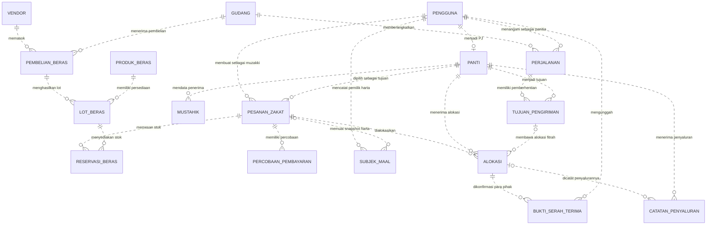
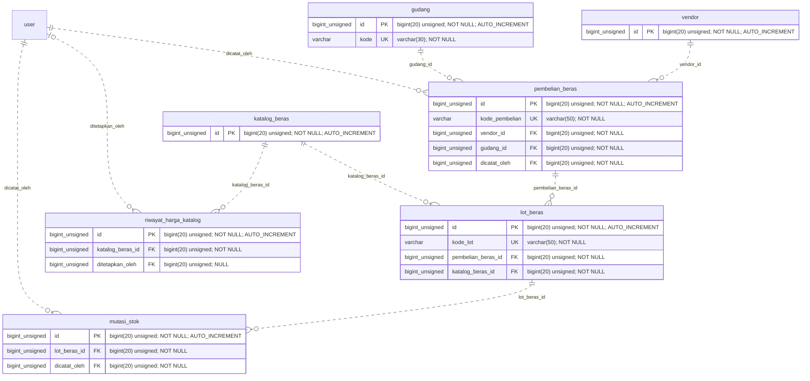

# ERD database zakat_db

Snapshot skema **7 Oktober 2026 (WIB)**. Sumbernya adalah metadata database MySQL aktif `zakat_db`, bukan ERD lama database `zakat` pada Bagian 2 di `!wajib_baca.md`. Server memakai MariaDB 10.6.23; seluruh 42 tabel memakai InnoDB dan collation `utf8mb4_unicode_ci`. Snapshot mencakup **423 kolom, 55 foreign key, dan 2 CHECK constraint JSON**.

Dokumen ini dibuat dengan pembacaan skema dan metadata saja. Nama kolom seperti `pass_hash`, `token`, atau `no_rek` merupakan definisi skema; tidak ada kata sandi, hash milik pengguna, nomor rekening, maupun baris data transaksi yang disalin ke dokumentasi.

## Memilih diagram

| Kebutuhan | Diagram |
| --- | --- |
| Menjelaskan alur bisnis atau presentasi tugas | ERD konseptual di bawah; sumber [ERD_zakat_db_conceptual.mmd](ERD_zakat_db_conceptual.mmd) |
| Menjelaskan implementasi database dan foreign key | ERD physical per kelompok di bawah |
| Menampilkan semua tabel dan semua kolom dalam satu diagram | [ERD_zakat_db_physical.mmd](ERD_zakat_db_physical.mmd) |
| Memeriksa tipe SQL, nullable, default, indeks, CHECK, dan aturan relasi | Kamus skema di bagian akhir dokumen ini |

Diagram menggunakan Mermaid dan notasi crow's foot. Blok `mermaid` dapat ditampilkan pada pembaca Markdown yang mendukung Mermaid. Untuk mengekspor SVG/PNG, salin isi salah satu file `.mmd` ke [Mermaid Live Editor](https://mermaid.live/) lalu gunakan menu ekspor. Diagram physical lengkap cukup besar; untuk laporan, diagram per kelompok lebih mudah dibaca. Sintaks notasinya mengikuti [dokumentasi resmi Mermaid](https://mermaid.js.org/syntax/entityRelationshipDiagram.html).

## ERD konseptual

Model ini menyederhanakan skema menjadi entitas bisnis utama dan hubungan yang relevan. Pengguna memiliki peran muzakki, PJ, panitia, atau admin; keempatnya tetap berasal dari satu entitas pengguna. Detail harga, dokumen verifikasi, notifikasi, audit, dan tabel teknis Laravel dibaca pada model physical.

Hubungan ini diturunkan dari skema saat ini, kemudian diberi nama bisnis. Label peran dan aturan dua bukti adalah aturan aplikasi; diagram konseptual tidak membuktikan bahwa semuanya dibatasi oleh constraint database.

| Entitas konseptual | Implementasi physical |
| --- | --- |
| PENGGUNA | `user`; profil keluarga `pemberi_zakat_fitrah` dan catatan harta lama `pemberi_zakat_mal` |
| PANTI dan MUSTAHIK | `yayasan` dan `mustahik` |
| VENDOR, GUDANG, PRODUK_BERAS | `vendor`, `gudang`, `katalog_beras` |
| PEMBELIAN_BERAS dan LOT_BERAS | `pembelian_beras` dan `lot_beras` |
| PESANAN_ZAKAT | `transaksi_zakat` dengan detail `transaksi_fitrah` atau `transaksi_mal` |
| SUBJEK_MAAL | `subjek_zakat_maal`, termasuk snapshot pemilik harta per transaksi |
| RESERVASI_BERAS dan PERCOBAAN_PEMBAYARAN | `reservasi_stok` dan `percobaan_pembayaran` |
| ALOKASI | `alokasi_transaksi` |
| PERJALANAN dan TUJUAN_PENGIRIMAN | `perjalanan_pengiriman` dan `titik_pengiriman` |
| BUKTI_SERAH_TERIMA dan CATATAN_PENYALURAN | `bukti_serah_terima` dan `penyaluran` |

## Membaca ERD physical

Nama tabel dan kolom mengikuti database aktif. `PK` berarti primary key, `FK` berarti foreign key yang benar-benar terpasang, dan `UK` berarti indeks UNIQUE satu kolom. Kolom pada UNIQUE gabungan diberi keterangan anggota indeks, bukan dianggap unik sendiri-sendiri. Tipe Mermaid disederhanakan, misalnya `decimal` atau `bigint_unsigned`; komentar atribut dan kamus skema mempertahankan tipe SQL tepat seperti `decimal(18,2)`.

Penanda `||` berarti satu, `|o` di sisi kiri atau `o|` di sisi kanan berarti nol atau satu, dan `o{` berarti nol atau banyak. FK nullable membuat sisi induk opsional; UNIQUE pada seluruh kolom FK membuat maksimal satu anak. Tanpa constraint tambahan, database tidak menjamin setiap induk sudah memiliki anak, sehingga minimum sisi anak selalu nol. Garis putus-putus menunjukkan relasi non-identifying: FK tidak menjadi bagian primary key anak.

Diagram per kelompok hanya menampilkan kolom PK, FK, dan anggota indeks UNIQUE agar tetap terbaca. Tabel rujukan dari kelompok lain muncul sebagai kotak nama tabel. File physical lengkap memuat seluruh kolom; kamus di bawah memuat seluruh indeks dan constraint.

### 1. Akun, panti, dan notifikasi

```mermaid
erDiagram
    user {
        bigint_unsigned id PK "bigint(20) unsigned; NOT NULL; AUTO_INCREMENT"
        varchar nik UK "varchar(16); NULL"
        varchar email UK "varchar(191); NOT NULL"
        bigint_unsigned created_by_admin_id FK "bigint(20) unsigned; NULL"
    }
    bank {
        bigint_unsigned id PK "bigint(20) unsigned; NOT NULL; AUTO_INCREMENT"
        varchar kode UK "varchar(20); NOT NULL"
    }
    yayasan {
        bigint_unsigned id PK "bigint(20) unsigned; NOT NULL; AUTO_INCREMENT"
        varchar nomor_izin UK "varchar(100); NOT NULL"
        bigint_unsigned bank_id FK "bigint(20) unsigned; NULL"
        bigint_unsigned pj_user_id FK, UK "bigint(20) unsigned; NOT NULL"
        bigint_unsigned wilayah_layanan_id FK "bigint(20) unsigned; NULL"
    }
    mustahik {
        bigint_unsigned id PK "bigint(20) unsigned; NOT NULL; AUTO_INCREMENT"
        bigint_unsigned yayasan_id FK "bigint(20) unsigned; NOT NULL"
    }
    foto_yayasan {
        bigint_unsigned id PK "bigint(20) unsigned; NOT NULL; AUTO_INCREMENT"
        bigint_unsigned yayasan_id FK "bigint(20) unsigned; NOT NULL"
        bigint_unsigned diunggah_oleh FK "bigint(20) unsigned; NOT NULL"
    }
    verifikasi_panti {
        bigint_unsigned id PK "bigint(20) unsigned; NOT NULL; AUTO_INCREMENT"
        bigint_unsigned yayasan_id FK "bigint(20) unsigned; NOT NULL"
        bigint_unsigned panitia_id FK "bigint(20) unsigned; NOT NULL"
    }
    permohonan_perubahan_rekening {
        bigint_unsigned id PK "bigint(20) unsigned; NOT NULL; AUTO_INCREMENT"
        bigint_unsigned yayasan_id FK "bigint(20) unsigned; NOT NULL"
        bigint_unsigned diajukan_oleh FK "bigint(20) unsigned; NOT NULL"
        bigint_unsigned bank_id FK "bigint(20) unsigned; NOT NULL"
        bigint_unsigned diperiksa_oleh FK "bigint(20) unsigned; NULL"
    }
    pemberi_zakat_fitrah {
        bigint_unsigned id PK "bigint(20) unsigned; NOT NULL; AUTO_INCREMENT"
        bigint_unsigned id_kepala FK, UK "bigint(20) unsigned; NOT NULL"
    }
    pemberi_zakat_mal {
        bigint_unsigned id PK "bigint(20) unsigned; NOT NULL; AUTO_INCREMENT"
        bigint_unsigned user_id FK "bigint(20) unsigned; NOT NULL"
    }
    preferensi_notifikasi {
        bigint_unsigned id PK "bigint(20) unsigned; NOT NULL; AUTO_INCREMENT"
        bigint_unsigned user_id FK, UK "bigint(20) unsigned; NOT NULL"
    }
    notifikasi_aplikasi {
        bigint_unsigned id PK "bigint(20) unsigned; NOT NULL; AUTO_INCREMENT"
        bigint_unsigned user_id FK "bigint(20) unsigned; NOT NULL"
    }
    wilayah_layanan
    user |o..o{ user : "created_by_admin_id"
    bank |o..o{ yayasan : "bank_id"
    user ||..o| yayasan : "pj_user_id"
    wilayah_layanan |o..o{ yayasan : "wilayah_layanan_id"
    yayasan ||..o{ mustahik : "yayasan_id"
    user ||..o{ foto_yayasan : "diunggah_oleh"
    yayasan ||..o{ foto_yayasan : "yayasan_id"
    user ||..o{ verifikasi_panti : "panitia_id"
    yayasan ||..o{ verifikasi_panti : "yayasan_id"
    bank ||..o{ permohonan_perubahan_rekening : "bank_id"
    user ||..o{ permohonan_perubahan_rekening : "diajukan_oleh"
    user |o..o{ permohonan_perubahan_rekening : "diperiksa_oleh"
    yayasan ||..o{ permohonan_perubahan_rekening : "yayasan_id"
    user ||..o| pemberi_zakat_fitrah : "id_kepala"
    user ||..o{ pemberi_zakat_mal : "user_id"
    user ||..o| preferensi_notifikasi : "user_id"
    user ||..o{ notifikasi_aplikasi : "user_id"
```

### 2. Gudang, katalog, dan stok

### 3. Transaksi, pembayaran, dan perhitungan

```mermaid
erDiagram
    transaksi_zakat {
        bigint_unsigned id PK "bigint(20) unsigned; NOT NULL; AUTO_INCREMENT"
        varchar kode_transaksi UK "varchar(50); NOT NULL"
        bigint_unsigned user_id FK "bigint(20) unsigned; NOT NULL"
        bigint_unsigned yayasan_id FK "bigint(20) unsigned; NOT NULL"
    }
    transaksi_fitrah {
        bigint_unsigned id PK "bigint(20) unsigned; NOT NULL; AUTO_INCREMENT"
        bigint_unsigned transaksi_id FK, UK "bigint(20) unsigned; NOT NULL"
        bigint_unsigned katalog_beras_id FK "bigint(20) unsigned; NOT NULL"
    }
    transaksi_mal {
        bigint_unsigned id PK "bigint(20) unsigned; NOT NULL; AUTO_INCREMENT"
        bigint_unsigned transaksi_id FK, UK "bigint(20) unsigned; NOT NULL"
        bigint_unsigned harga_emas_id FK "bigint(20) unsigned; NULL"
    }
    subjek_zakat_maal {
        bigint_unsigned id PK "bigint(20) unsigned; NOT NULL; AUTO_INCREMENT"
        bigint_unsigned user_id FK "bigint(20) unsigned; NOT NULL"
        bigint_unsigned transaksi_id FK "bigint(20) unsigned; NULL"
    }
    reservasi_stok {
        bigint_unsigned id PK "bigint(20) unsigned; NOT NULL; AUTO_INCREMENT"
        bigint_unsigned transaksi_id FK "bigint(20) unsigned; NOT NULL; anggota UNIQUE reservasi_stok_transaksi_id_lot_beras_id_unique"
        bigint_unsigned lot_beras_id FK "bigint(20) unsigned; NOT NULL; anggota UNIQUE reservasi_stok_transaksi_id_lot_beras_id_unique"
    }
    percobaan_pembayaran {
        bigint_unsigned id PK "bigint(20) unsigned; NOT NULL; AUTO_INCREMENT"
        bigint_unsigned transaksi_id FK "bigint(20) unsigned; NOT NULL"
        varchar token_hash UK "varchar(64); NOT NULL"
    }
    harga_emas {
        bigint_unsigned id PK "bigint(20) unsigned; NOT NULL; AUTO_INCREMENT"
        bigint_unsigned dicatat_oleh FK "bigint(20) unsigned; NULL"
    }
    user
    yayasan
    katalog_beras
    lot_beras
    user ||..o{ transaksi_zakat : "user_id"
    yayasan ||..o{ transaksi_zakat : "yayasan_id"
    katalog_beras ||..o{ transaksi_fitrah : "katalog_beras_id"
    transaksi_zakat ||..o| transaksi_fitrah : "transaksi_id"
    harga_emas |o..o{ transaksi_mal : "harga_emas_id"
    transaksi_zakat ||..o| transaksi_mal : "transaksi_id"
    transaksi_zakat |o..o{ subjek_zakat_maal : "transaksi_id"
    user ||..o{ subjek_zakat_maal : "user_id"
    lot_beras ||..o{ reservasi_stok : "lot_beras_id"
    transaksi_zakat ||..o{ reservasi_stok : "transaksi_id"
    transaksi_zakat ||..o{ percobaan_pembayaran : "transaksi_id"
    user |o..o{ harga_emas : "dicatat_oleh"
```

### 4. Pengiriman, penyaluran, dan konfigurasi

```mermaid
erDiagram
    perjalanan_pengiriman {
        bigint_unsigned id PK "bigint(20) unsigned; NOT NULL; AUTO_INCREMENT"
        varchar kode_perjalanan UK "varchar(50); NOT NULL"
        bigint_unsigned gudang_id FK "bigint(20) unsigned; NOT NULL"
        bigint_unsigned panitia_id FK "bigint(20) unsigned; NOT NULL"
    }
    titik_pengiriman {
        bigint_unsigned id PK "bigint(20) unsigned; NOT NULL; AUTO_INCREMENT"
        bigint_unsigned perjalanan_pengiriman_id FK "bigint(20) unsigned; NOT NULL; anggota UNIQUE titik_pengiriman_perjalanan_pengiriman_id_urutan_unique"
        bigint_unsigned yayasan_id FK "bigint(20) unsigned; NOT NULL"
        int_unsigned urutan "int(10) unsigned; NOT NULL; anggota UNIQUE titik_pengiriman_perjalanan_pengiriman_id_urutan_unique"
    }
    alokasi_transaksi {
        bigint_unsigned id PK "bigint(20) unsigned; NOT NULL; AUTO_INCREMENT"
        bigint_unsigned transaksi_id FK "bigint(20) unsigned; NOT NULL"
        bigint_unsigned yayasan_id FK "bigint(20) unsigned; NOT NULL"
        bigint_unsigned titik_pengiriman_id FK "bigint(20) unsigned; NULL"
    }
    bukti_serah_terima {
        bigint_unsigned id PK "bigint(20) unsigned; NOT NULL; AUTO_INCREMENT"
        bigint_unsigned alokasi_transaksi_id FK "bigint(20) unsigned; NOT NULL; anggota UNIQUE bukti_serah_terima_alokasi_transaksi_id_pihak_unique"
        bigint_unsigned diunggah_oleh FK "bigint(20) unsigned; NOT NULL"
        varchar pihak "varchar(20); NOT NULL; anggota UNIQUE bukti_serah_terima_alokasi_transaksi_id_pihak_unique"
    }
    penyaluran {
        bigint_unsigned id PK "bigint(20) unsigned; NOT NULL; AUTO_INCREMENT"
        bigint_unsigned yayasan_id FK "bigint(20) unsigned; NOT NULL"
        bigint_unsigned mustahik_id FK "bigint(20) unsigned; NULL"
        bigint_unsigned alokasi_transaksi_id FK "bigint(20) unsigned; NULL"
    }
    wilayah_layanan {
        bigint_unsigned id PK "bigint(20) unsigned; NOT NULL; AUTO_INCREMENT"
        bigint_unsigned gudang_id FK "bigint(20) unsigned; NOT NULL; anggota UNIQUE wilayah_layanan_gudang_id_provinsi_unique"
        varchar provinsi "varchar(100); NOT NULL; anggota UNIQUE wilayah_layanan_gudang_id_provinsi_unique"
    }
    tarif_pengiriman {
        bigint_unsigned id PK "bigint(20) unsigned; NOT NULL; AUTO_INCREMENT"
        bigint_unsigned wilayah_layanan_id FK "bigint(20) unsigned; NOT NULL"
        bigint_unsigned ditetapkan_oleh FK "bigint(20) unsigned; NULL"
    }
    pengaturan_operasional {
        bigint_unsigned id PK "bigint(20) unsigned; NOT NULL; AUTO_INCREMENT"
        varchar kunci UK "varchar(100); NOT NULL"
        bigint_unsigned diubah_oleh FK "bigint(20) unsigned; NULL"
    }
    audit_log {
        bigint_unsigned id PK "bigint(20) unsigned; NOT NULL; AUTO_INCREMENT"
        bigint_unsigned actor_user_id FK "bigint(20) unsigned; NULL"
    }
    gudang
    user
    yayasan
    transaksi_zakat
    mustahik
    gudang ||..o{ perjalanan_pengiriman : "gudang_id"
    user ||..o{ perjalanan_pengiriman : "panitia_id"
    perjalanan_pengiriman ||..o{ titik_pengiriman : "perjalanan_pengiriman_id"
    yayasan ||..o{ titik_pengiriman : "yayasan_id"
    titik_pengiriman |o..o{ alokasi_transaksi : "titik_pengiriman_id"
    transaksi_zakat ||..o{ alokasi_transaksi : "transaksi_id"
    yayasan ||..o{ alokasi_transaksi : "yayasan_id"
    alokasi_transaksi ||..o{ bukti_serah_terima : "alokasi_transaksi_id"
    user ||..o{ bukti_serah_terima : "diunggah_oleh"
    alokasi_transaksi |o..o{ penyaluran : "alokasi_transaksi_id"
    mustahik |o..o{ penyaluran : "mustahik_id"
    yayasan ||..o{ penyaluran : "yayasan_id"
    gudang ||..o{ wilayah_layanan : "gudang_id"
    user |o..o{ tarif_pengiriman : "ditetapkan_oleh"
    wilayah_layanan ||..o{ tarif_pengiriman : "wilayah_layanan_id"
    user |o..o{ pengaturan_operasional : "diubah_oleh"
    user |o..o{ audit_log : "actor_user_id"
```

### 5. Infrastruktur Laravel

```mermaid
erDiagram
    cache {
        varchar key PK "varchar(255); NOT NULL"
    }
    cache_locks {
        varchar key PK "varchar(255); NOT NULL"
    }
    jobs {
        bigint_unsigned id PK "bigint(20) unsigned; NOT NULL; AUTO_INCREMENT"
    }
    job_batches {
        varchar id PK "varchar(255); NOT NULL"
    }
    failed_jobs {
        bigint_unsigned id PK "bigint(20) unsigned; NOT NULL; AUTO_INCREMENT"
        varchar uuid UK "varchar(255); NOT NULL"
    }
    migrations {
        int_unsigned id PK "int(10) unsigned; NOT NULL; AUTO_INCREMENT"
    }
    password_reset_tokens {
        varchar email PK "varchar(255); NOT NULL"
    }
    sessions {
        varchar id PK "varchar(255); NOT NULL"
    }
```

## Hal yang perlu dibedakan dari aturan aplikasi

- `user.role`, status transaksi, status verifikasi, dan `bukti_serah_terima.pihak` disimpan sebagai VARCHAR. ERD tidak menganggapnya ENUM atau CHECK pembatas nilai.
- UNIQUE `yayasan.pj_user_id` membatasi satu akun PJ maksimal satu panti pada skema sekarang. FK ke `user` tidak membatasi nilai perannya menjadi PJ; aplikasi yang memeriksanya.
- UNIQUE `transaksi_fitrah.transaksi_id` dan `transaksi_mal.transaksi_id` membatasi satu detail pada masing-masing tabel. Database sendiri tidak memaksa setiap transaksi mempunyai detail dan tidak melarang satu transaksi mempunyai kedua jenis detail sekaligus.
- UNIQUE `(alokasi_transaksi_id, pihak)` mencegah duplikasi bukti untuk nilai pihak yang sama. Jumlah dua pihak serta kecocokan jumlah dan foto adalah aturan aplikasi.
- `sessions.user_id` memiliki indeks tetapi **tidak mempunyai foreign key**. `password_reset_tokens.email` juga tidak mempunyai FK ke `user.email`; keduanya tidak digambar seolah memiliki relasi FK.
- `audit_log.jenis_objek` dan `objek_id` adalah referensi generik, bukan FK ke semua tabel domain. Hanya `actor_user_id` yang memiliki FK.
- `pemberi_zakat_mal`, `pemberi_zakat_fitrah`, dan kolom bukti lama masih ada pada skema sehingga tetap ditampilkan. Snapshot ini menggambarkan tabel yang tersedia, bukan menyatakan semua tabel lama digunakan oleh alur terbaru.
- Ada dua constraint JSON pada MariaDB: `audit_log.detail` dan `notifikasi_aplikasi.payload` memakai `LONGTEXT` dengan `CHECK(json_valid(...))`. Tidak digambarkan sebagai tipe JSON native MySQL.
- Kebutuhan memakai `gudang` pusat Surabaya, tarif berdasarkan jarak, snapshot harga, dan konfirmasi panti dianggap penerima akhir tetap mengikuti keputusan proyek di `!wajib_baca.md`. Lokasi gudang dan nilai tarif adalah data, bukan definisi relasi.
- ERD dapat diperbarui setelah migration mengubah skema. Dokumen ini tidak otomatis mengikuti perubahan database.

## Kamus skema physical

Semua definisi berikut berasal dari metadata `zakat_db`. `NULL` pada kolom Default berarti default SQL NULL. Tanda `—` berarti metadata tidak menyatakan default. Nilai teks bawaan ditampilkan dengan tanda kutip SQL; ini adalah nilai skema, bukan data pengguna.

### Tabel `user`

Engine: `InnoDB`; collation: `utf8mb4_unicode_ci`.

| Kolom | Tipe SQL | Nullable | Default | Key | Auto increment |
| --- | --- | --- | --- | --- | --- |
| `id` | `bigint(20) unsigned` | Tidak | — | PK | Ya |
| `nik` | `varchar(16)` | Ya | `NULL` | UK | Tidak |
| `nama` | `varchar(255)` | Tidak | — | — | Tidak |
| `telp` | `varchar(20)` | Ya | `NULL` | — | Tidak |
| `email` | `varchar(191)` | Tidak | — | UK | Tidak |
| `email_verified_at` | `timestamp` | Ya | `NULL` | — | Tidak |
| `pass_hash` | `varchar(255)` | Tidak | — | — | Tidak |
| `tggl_lahir` | `date` | Ya | `NULL` | — | Tidak |
| `gender` | `varchar(1)` | Ya | `NULL` | — | Tidak |
| `kota_kabupaten` | `varchar(100)` | Ya | `NULL` | — | Tidak |
| `provinsi` | `varchar(100)` | Ya | `NULL` | — | Tidak |
| `alamat_lengkap` | `text` | Ya | `NULL` | — | Tidak |
| `npwp` | `varchar(25)` | Ya | `NULL` | — | Tidak |
| `role` | `varchar(20)` | Tidak | `'pemberi'` | — | Tidak |
| `is_active` | `tinyint(1)` | Tidak | `1` | — | Tidak |
| `must_change_password` | `tinyint(1)` | Tidak | `0` | — | Tidak |
| `created_by_admin_id` | `bigint(20) unsigned` | Ya | `NULL` | FK | Tidak |
| `remember_token` | `varchar(100)` | Ya | `NULL` | — | Tidak |
| `created_at` | `timestamp` | Ya | `NULL` | — | Tidak |
| `updated_at` | `timestamp` | Ya | `NULL` | — | Tidak |

Indeks (urutan kolom dipertahankan):

| Nama | Jenis | Kolom | Metode |
| --- | --- | --- | --- |
| `primary` | PRIMARY KEY | `id` | `btree` |
| `user_created_by_admin_id_foreign` | INDEX | `created_by_admin_id` | `btree` |
| `user_email_unique` | UNIQUE | `email` | `btree` |
| `user_nik_unique` | UNIQUE | `nik` | `btree` |

Foreign key:

| Constraint | Kolom anak | Rujukan | ON DELETE | ON UPDATE |
| --- | --- | --- | --- | --- |
| `user_created_by_admin_id_foreign` | `created_by_admin_id` | `user(id)` | `SET NULL` | `RESTRICT` |

### Tabel `bank`

Engine: `InnoDB`; collation: `utf8mb4_unicode_ci`.

| Kolom | Tipe SQL | Nullable | Default | Key | Auto increment |
| --- | --- | --- | --- | --- | --- |
| `id` | `bigint(20) unsigned` | Tidak | — | PK | Ya |
| `kode` | `varchar(20)` | Tidak | — | UK | Tidak |
| `nama` | `varchar(255)` | Tidak | — | — | Tidak |
| `is_active` | `tinyint(1)` | Tidak | `1` | — | Tidak |
| `created_at` | `timestamp` | Ya | `NULL` | — | Tidak |
| `updated_at` | `timestamp` | Ya | `NULL` | — | Tidak |

Indeks (urutan kolom dipertahankan):

| Nama | Jenis | Kolom | Metode |
| --- | --- | --- | --- |
| `bank_kode_unique` | UNIQUE | `kode` | `btree` |
| `primary` | PRIMARY KEY | `id` | `btree` |

Tidak memiliki foreign key.

### Tabel `yayasan`

Engine: `InnoDB`; collation: `utf8mb4_unicode_ci`.

| Kolom | Tipe SQL | Nullable | Default | Key | Auto increment |
| --- | --- | --- | --- | --- | --- |
| `id` | `bigint(20) unsigned` | Tidak | — | PK | Ya |
| `nama` | `varchar(255)` | Tidak | — | — | Tidak |
| `nomor_izin` | `varchar(100)` | Tidak | — | UK | Tidak |
| `telp` | `varchar(20)` | Tidak | — | — | Tidak |
| `email` | `varchar(191)` | Tidak | — | — | Tidak |
| `kota_kabupaten` | `varchar(100)` | Tidak | — | — | Tidak |
| `provinsi` | `varchar(100)` | Tidak | — | — | Tidak |
| `alamat_lengkap` | `text` | Tidak | — | — | Tidak |
| `kode_pos` | `varchar(10)` | Ya | `NULL` | — | Tidak |
| `bank_id` | `bigint(20) unsigned` | Ya | `NULL` | FK | Tidak |
| `nama_bank` | `varchar(100)` | Ya | `NULL` | — | Tidak |
| `no_rek` | `varchar(50)` | Ya | `NULL` | — | Tidak |
| `atas_nama_rek` | `varchar(255)` | Ya | `NULL` | — | Tidak |
| `status_verif` | `varchar(20)` | Tidak | `'pending'` | — | Tidak |
| `is_active` | `tinyint(1)` | Tidak | `0` | — | Tidak |
| `pj_user_id` | `bigint(20) unsigned` | Tidak | — | FK, UK | Tidak |
| `wilayah_layanan_id` | `bigint(20) unsigned` | Ya | `NULL` | FK | Tidak |
| `jarak_jalan_km` | `decimal(10,2)` | Ya | `NULL` | — | Tidak |
| `jumlah_mustahik_layak` | `int(10) unsigned` | Tidak | `0` | — | Tidak |
| `pict_id` | `varchar(255)` | Ya | `NULL` | — | Tidak |
| `created_at` | `timestamp` | Ya | `NULL` | — | Tidak |
| `updated_at` | `timestamp` | Ya | `NULL` | — | Tidak |
| `jumlah_mustahik_diajukan` | `int(10) unsigned` | Tidak | `0` | — | Tidak |
| `kebutuhan_saat_ini` | `text` | Ya | `NULL` | — | Tidak |
| `kapasitas_penerimaan_kg` | `decimal(12,2)` | Ya | `NULL` | — | Tidak |

Indeks (urutan kolom dipertahankan):

| Nama | Jenis | Kolom | Metode |
| --- | --- | --- | --- |
| `primary` | PRIMARY KEY | `id` | `btree` |
| `yayasan_bank_id_foreign` | INDEX | `bank_id` | `btree` |
| `yayasan_nomor_izin_unique` | UNIQUE | `nomor_izin` | `btree` |
| `yayasan_pj_user_id_unique` | UNIQUE | `pj_user_id` | `btree` |
| `yayasan_status_verif_is_active_index` | INDEX | `status_verif`, `is_active` | `btree` |
| `yayasan_wilayah_layanan_id_foreign` | INDEX | `wilayah_layanan_id` | `btree` |

Foreign key:

| Constraint | Kolom anak | Rujukan | ON DELETE | ON UPDATE |
| --- | --- | --- | --- | --- |
| `yayasan_bank_id_foreign` | `bank_id` | `bank(id)` | `RESTRICT` | `RESTRICT` |
| `yayasan_pj_user_id_foreign` | `pj_user_id` | `user(id)` | `RESTRICT` | `RESTRICT` |
| `yayasan_wilayah_layanan_id_foreign` | `wilayah_layanan_id` | `wilayah_layanan(id)` | `SET NULL` | `RESTRICT` |

### Tabel `mustahik`

Engine: `InnoDB`; collation: `utf8mb4_unicode_ci`.

| Kolom | Tipe SQL | Nullable | Default | Key | Auto increment |
| --- | --- | --- | --- | --- | --- |
| `id` | `bigint(20) unsigned` | Tidak | — | PK | Ya |
| `yayasan_id` | `bigint(20) unsigned` | Tidak | — | FK | Tidak |
| `nama` | `varchar(255)` | Ya | `NULL` | — | Tidak |
| `kelamin` | `varchar(1)` | Ya | `NULL` | — | Tidak |
| `tggl_lahir` | `date` | Ya | `NULL` | — | Tidak |
| `kategori_asnaf` | `varchar(30)` | Tidak | — | — | Tidak |
| `is_verified` | `tinyint(1)` | Tidak | `0` | — | Tidak |
| `created_at` | `timestamp` | Ya | `NULL` | — | Tidak |
| `updated_at` | `timestamp` | Ya | `NULL` | — | Tidak |

Indeks (urutan kolom dipertahankan):

| Nama | Jenis | Kolom | Metode |
| --- | --- | --- | --- |
| `mustahik_yayasan_id_foreign` | INDEX | `yayasan_id` | `btree` |
| `primary` | PRIMARY KEY | `id` | `btree` |

Foreign key:

| Constraint | Kolom anak | Rujukan | ON DELETE | ON UPDATE |
| --- | --- | --- | --- | --- |
| `mustahik_yayasan_id_foreign` | `yayasan_id` | `yayasan(id)` | `RESTRICT` | `RESTRICT` |

### Tabel `foto_yayasan`

Engine: `InnoDB`; collation: `utf8mb4_unicode_ci`.

| Kolom | Tipe SQL | Nullable | Default | Key | Auto increment |
| --- | --- | --- | --- | --- | --- |
| `id` | `bigint(20) unsigned` | Tidak | — | PK | Ya |
| `yayasan_id` | `bigint(20) unsigned` | Tidak | — | FK | Tidak |
| `diunggah_oleh` | `bigint(20) unsigned` | Tidak | — | FK | Tidak |
| `path_private` | `varchar(255)` | Tidak | — | — | Tidak |
| `keterangan` | `varchar(255)` | Ya | `NULL` | — | Tidak |
| `created_at` | `timestamp` | Ya | `NULL` | — | Tidak |
| `updated_at` | `timestamp` | Ya | `NULL` | — | Tidak |

Indeks (urutan kolom dipertahankan):

| Nama | Jenis | Kolom | Metode |
| --- | --- | --- | --- |
| `foto_yayasan_diunggah_oleh_foreign` | INDEX | `diunggah_oleh` | `btree` |
| `foto_yayasan_yayasan_id_foreign` | INDEX | `yayasan_id` | `btree` |
| `primary` | PRIMARY KEY | `id` | `btree` |

Foreign key:

| Constraint | Kolom anak | Rujukan | ON DELETE | ON UPDATE |
| --- | --- | --- | --- | --- |
| `foto_yayasan_diunggah_oleh_foreign` | `diunggah_oleh` | `user(id)` | `RESTRICT` | `RESTRICT` |
| `foto_yayasan_yayasan_id_foreign` | `yayasan_id` | `yayasan(id)` | `CASCADE` | `RESTRICT` |

### Tabel `verifikasi_panti`

Engine: `InnoDB`; collation: `utf8mb4_unicode_ci`.

| Kolom | Tipe SQL | Nullable | Default | Key | Auto increment |
| --- | --- | --- | --- | --- | --- |
| `id` | `bigint(20) unsigned` | Tidak | — | PK | Ya |
| `yayasan_id` | `bigint(20) unsigned` | Tidak | — | FK | Tidak |
| `panitia_id` | `bigint(20) unsigned` | Tidak | — | FK | Tidak |
| `hasil` | `varchar(20)` | Tidak | — | — | Tidak |
| `jumlah_mustahik_layak` | `int(10) unsigned` | Tidak | `0` | — | Tidak |
| `catatan` | `text` | Ya | `NULL` | — | Tidak |
| `diperiksa_at` | `timestamp` | Tidak | `current_timestamp()` | — | Tidak |
| `created_at` | `timestamp` | Ya | `NULL` | — | Tidak |
| `updated_at` | `timestamp` | Ya | `NULL` | — | Tidak |
| `kapasitas_penerimaan_kg` | `decimal(12,2)` | Ya | `NULL` | — | Tidak |
| `kebutuhan_snapshot` | `text` | Ya | `NULL` | — | Tidak |

Indeks (urutan kolom dipertahankan):

| Nama | Jenis | Kolom | Metode |
| --- | --- | --- | --- |
| `primary` | PRIMARY KEY | `id` | `btree` |
| `verifikasi_panti_panitia_id_foreign` | INDEX | `panitia_id` | `btree` |
| `verifikasi_panti_yayasan_id_diperiksa_at_index` | INDEX | `yayasan_id`, `diperiksa_at` | `btree` |

Foreign key:

| Constraint | Kolom anak | Rujukan | ON DELETE | ON UPDATE |
| --- | --- | --- | --- | --- |
| `verifikasi_panti_panitia_id_foreign` | `panitia_id` | `user(id)` | `RESTRICT` | `RESTRICT` |
| `verifikasi_panti_yayasan_id_foreign` | `yayasan_id` | `yayasan(id)` | `RESTRICT` | `RESTRICT` |

### Tabel `permohonan_perubahan_rekening`

Engine: `InnoDB`; collation: `utf8mb4_unicode_ci`.

| Kolom | Tipe SQL | Nullable | Default | Key | Auto increment |
| --- | --- | --- | --- | --- | --- |
| `id` | `bigint(20) unsigned` | Tidak | — | PK | Ya |
| `yayasan_id` | `bigint(20) unsigned` | Tidak | — | FK | Tidak |
| `diajukan_oleh` | `bigint(20) unsigned` | Tidak | — | FK | Tidak |
| `bank_id` | `bigint(20) unsigned` | Tidak | — | FK | Tidak |
| `no_rek` | `varchar(50)` | Tidak | — | — | Tidak |
| `atas_nama_rek` | `varchar(255)` | Tidak | — | — | Tidak |
| `status` | `varchar(20)` | Tidak | `'pending'` | — | Tidak |
| `diperiksa_oleh` | `bigint(20) unsigned` | Ya | `NULL` | FK | Tidak |
| `catatan` | `text` | Ya | `NULL` | — | Tidak |
| `diperiksa_at` | `timestamp` | Ya | `NULL` | — | Tidak |
| `created_at` | `timestamp` | Ya | `NULL` | — | Tidak |
| `updated_at` | `timestamp` | Ya | `NULL` | — | Tidak |

Indeks (urutan kolom dipertahankan):

| Nama | Jenis | Kolom | Metode |
| --- | --- | --- | --- |
| `permohonan_perubahan_rekening_bank_id_foreign` | INDEX | `bank_id` | `btree` |
| `permohonan_perubahan_rekening_diajukan_oleh_foreign` | INDEX | `diajukan_oleh` | `btree` |
| `permohonan_perubahan_rekening_diperiksa_oleh_foreign` | INDEX | `diperiksa_oleh` | `btree` |
| `permohonan_perubahan_rekening_yayasan_id_foreign` | INDEX | `yayasan_id` | `btree` |
| `primary` | PRIMARY KEY | `id` | `btree` |

Foreign key:

| Constraint | Kolom anak | Rujukan | ON DELETE | ON UPDATE |
| --- | --- | --- | --- | --- |
| `permohonan_perubahan_rekening_bank_id_foreign` | `bank_id` | `bank(id)` | `RESTRICT` | `RESTRICT` |
| `permohonan_perubahan_rekening_diajukan_oleh_foreign` | `diajukan_oleh` | `user(id)` | `RESTRICT` | `RESTRICT` |
| `permohonan_perubahan_rekening_diperiksa_oleh_foreign` | `diperiksa_oleh` | `user(id)` | `SET NULL` | `RESTRICT` |
| `permohonan_perubahan_rekening_yayasan_id_foreign` | `yayasan_id` | `yayasan(id)` | `RESTRICT` | `RESTRICT` |

### Tabel `pemberi_zakat_fitrah`

Engine: `InnoDB`; collation: `utf8mb4_unicode_ci`.

| Kolom | Tipe SQL | Nullable | Default | Key | Auto increment |
| --- | --- | --- | --- | --- | --- |
| `id` | `bigint(20) unsigned` | Tidak | — | PK | Ya |
| `id_kepala` | `bigint(20) unsigned` | Tidak | — | FK, UK | Tidak |
| `jum_anggota` | `int(10) unsigned` | Tidak | `1` | — | Tidak |
| `created_at` | `timestamp` | Ya | `NULL` | — | Tidak |
| `updated_at` | `timestamp` | Ya | `NULL` | — | Tidak |

Indeks (urutan kolom dipertahankan):

| Nama | Jenis | Kolom | Metode |
| --- | --- | --- | --- |
| `pemberi_zakat_fitrah_id_kepala_unique` | UNIQUE | `id_kepala` | `btree` |
| `primary` | PRIMARY KEY | `id` | `btree` |

Foreign key:

| Constraint | Kolom anak | Rujukan | ON DELETE | ON UPDATE |
| --- | --- | --- | --- | --- |
| `pemberi_zakat_fitrah_id_kepala_foreign` | `id_kepala` | `user(id)` | `CASCADE` | `RESTRICT` |

### Tabel `pemberi_zakat_mal`

Engine: `InnoDB`; collation: `utf8mb4_unicode_ci`.

| Kolom | Tipe SQL | Nullable | Default | Key | Auto increment |
| --- | --- | --- | --- | --- | --- |
| `id` | `bigint(20) unsigned` | Tidak | — | PK | Ya |
| `user_id` | `bigint(20) unsigned` | Tidak | — | FK | Tidak |
| `kepemilikan` | `varchar(100)` | Ya | `NULL` | — | Tidak |
| `atas_nama` | `varchar(255)` | Ya | `NULL` | — | Tidak |
| `nominal_tabungan` | `decimal(18,2)` | Tidak | `0.00` | — | Tidak |
| `emas_gram` | `decimal(10,2)` | Tidak | `0.00` | — | Tidak |
| `nilai_invest` | `decimal(18,2)` | Tidak | `0.00` | — | Tidak |
| `nilai_aset_dagang` | `decimal(18,2)` | Tidak | `0.00` | — | Tidak |
| `piutang` | `decimal(18,2)` | Tidak | `0.00` | — | Tidak |
| `utang` | `decimal(18,2)` | Tidak | `0.00` | — | Tidak |
| `total_harta_bersih` | `decimal(18,2)` | Tidak | `0.00` | — | Tidak |
| `apakah_wajib_zakat` | `tinyint(1)` | Tidak | `0` | — | Tidak |
| `tanggal_haul` | `date` | Ya | `NULL` | — | Tidak |
| `created_at` | `timestamp` | Ya | `NULL` | — | Tidak |
| `updated_at` | `timestamp` | Ya | `NULL` | — | Tidak |

Indeks (urutan kolom dipertahankan):

| Nama | Jenis | Kolom | Metode |
| --- | --- | --- | --- |
| `pemberi_zakat_mal_user_id_foreign` | INDEX | `user_id` | `btree` |
| `primary` | PRIMARY KEY | `id` | `btree` |

Foreign key:

| Constraint | Kolom anak | Rujukan | ON DELETE | ON UPDATE |
| --- | --- | --- | --- | --- |
| `pemberi_zakat_mal_user_id_foreign` | `user_id` | `user(id)` | `CASCADE` | `RESTRICT` |

### Tabel `preferensi_notifikasi`

Engine: `InnoDB`; collation: `utf8mb4_unicode_ci`.

| Kolom | Tipe SQL | Nullable | Default | Key | Auto increment |
| --- | --- | --- | --- | --- | --- |
| `id` | `bigint(20) unsigned` | Tidak | — | PK | Ya |
| `user_id` | `bigint(20) unsigned` | Tidak | — | FK, UK | Tidak |
| `ingatkan_fitrah` | `tinyint(1)` | Tidak | `0` | — | Tidak |
| `ingatkan_haul_maal` | `tinyint(1)` | Tidak | `0` | — | Tidak |
| `email_bukti_penyaluran` | `tinyint(1)` | Tidak | `0` | — | Tidak |
| `created_at` | `timestamp` | Ya | `NULL` | — | Tidak |
| `updated_at` | `timestamp` | Ya | `NULL` | — | Tidak |

Indeks (urutan kolom dipertahankan):

| Nama | Jenis | Kolom | Metode |
| --- | --- | --- | --- |
| `preferensi_notifikasi_user_id_unique` | UNIQUE | `user_id` | `btree` |
| `primary` | PRIMARY KEY | `id` | `btree` |

Foreign key:

| Constraint | Kolom anak | Rujukan | ON DELETE | ON UPDATE |
| --- | --- | --- | --- | --- |
| `preferensi_notifikasi_user_id_foreign` | `user_id` | `user(id)` | `CASCADE` | `RESTRICT` |

### Tabel `notifikasi_aplikasi`

Engine: `InnoDB`; collation: `utf8mb4_unicode_ci`.

| Kolom | Tipe SQL | Nullable | Default | Key | Auto increment |
| --- | --- | --- | --- | --- | --- |
| `id` | `bigint(20) unsigned` | Tidak | — | PK | Ya |
| `user_id` | `bigint(20) unsigned` | Tidak | — | FK | Tidak |
| `jenis` | `varchar(50)` | Tidak | — | — | Tidak |
| `payload` | `longtext` | Tidak | — | — | Tidak |
| `dibaca_at` | `timestamp` | Ya | `NULL` | — | Tidak |
| `dikirim_at` | `timestamp` | Ya | `NULL` | — | Tidak |
| `created_at` | `timestamp` | Ya | `NULL` | — | Tidak |
| `updated_at` | `timestamp` | Ya | `NULL` | — | Tidak |

Indeks (urutan kolom dipertahankan):

| Nama | Jenis | Kolom | Metode |
| --- | --- | --- | --- |
| `notifikasi_aplikasi_user_id_dibaca_at_index` | INDEX | `user_id`, `dibaca_at` | `btree` |
| `primary` | PRIMARY KEY | `id` | `btree` |

Foreign key:

| Constraint | Kolom anak | Rujukan | ON DELETE | ON UPDATE |
| --- | --- | --- | --- | --- |
| `notifikasi_aplikasi_user_id_foreign` | `user_id` | `user(id)` | `CASCADE` | `RESTRICT` |

CHECK constraint:

- `payload`: `json_valid(`payload`)`.

### Tabel `gudang`

Engine: `InnoDB`; collation: `utf8mb4_unicode_ci`.

| Kolom | Tipe SQL | Nullable | Default | Key | Auto increment |
| --- | --- | --- | --- | --- | --- |
| `id` | `bigint(20) unsigned` | Tidak | — | PK | Ya |
| `kode` | `varchar(30)` | Tidak | — | UK | Tidak |
| `nama` | `varchar(255)` | Tidak | — | — | Tidak |
| `provinsi` | `varchar(100)` | Tidak | — | — | Tidak |
| `kota_kabupaten` | `varchar(100)` | Tidak | — | — | Tidak |
| `alamat_lengkap` | `text` | Ya | `NULL` | — | Tidak |
| `is_active` | `tinyint(1)` | Tidak | `1` | — | Tidak |
| `created_at` | `timestamp` | Ya | `NULL` | — | Tidak |
| `updated_at` | `timestamp` | Ya | `NULL` | — | Tidak |

Indeks (urutan kolom dipertahankan):

| Nama | Jenis | Kolom | Metode |
| --- | --- | --- | --- |
| `gudang_kode_unique` | UNIQUE | `kode` | `btree` |
| `primary` | PRIMARY KEY | `id` | `btree` |

Tidak memiliki foreign key.

### Tabel `vendor`

Engine: `InnoDB`; collation: `utf8mb4_unicode_ci`.

| Kolom | Tipe SQL | Nullable | Default | Key | Auto increment |
| --- | --- | --- | --- | --- | --- |
| `id` | `bigint(20) unsigned` | Tidak | — | PK | Ya |
| `nama` | `varchar(255)` | Tidak | — | — | Tidak |
| `telp` | `varchar(20)` | Ya | `NULL` | — | Tidak |
| `email` | `varchar(191)` | Ya | `NULL` | — | Tidak |
| `alamat` | `text` | Ya | `NULL` | — | Tidak |
| `is_active` | `tinyint(1)` | Tidak | `1` | — | Tidak |
| `created_at` | `timestamp` | Ya | `NULL` | — | Tidak |
| `updated_at` | `timestamp` | Ya | `NULL` | — | Tidak |

Indeks (urutan kolom dipertahankan):

| Nama | Jenis | Kolom | Metode |
| --- | --- | --- | --- |
| `primary` | PRIMARY KEY | `id` | `btree` |

Tidak memiliki foreign key.

### Tabel `pembelian_beras`

Engine: `InnoDB`; collation: `utf8mb4_unicode_ci`.

| Kolom | Tipe SQL | Nullable | Default | Key | Auto increment |
| --- | --- | --- | --- | --- | --- |
| `id` | `bigint(20) unsigned` | Tidak | — | PK | Ya |
| `kode_pembelian` | `varchar(50)` | Tidak | — | UK | Tidak |
| `vendor_id` | `bigint(20) unsigned` | Tidak | — | FK | Tidak |
| `gudang_id` | `bigint(20) unsigned` | Tidak | — | FK | Tidak |
| `dicatat_oleh` | `bigint(20) unsigned` | Tidak | — | FK | Tidak |
| `tanggal_pembelian` | `date` | Tidak | — | — | Tidak |
| `nomor_faktur` | `varchar(100)` | Ya | `NULL` | — | Tidak |
| `bukti_path` | `varchar(255)` | Ya | `NULL` | — | Tidak |
| `status` | `varchar(20)` | Tidak | `'dipesan'` | — | Tidak |
| `created_at` | `timestamp` | Ya | `NULL` | — | Tidak |
| `updated_at` | `timestamp` | Ya | `NULL` | — | Tidak |

Indeks (urutan kolom dipertahankan):

| Nama | Jenis | Kolom | Metode |
| --- | --- | --- | --- |
| `pembelian_beras_dicatat_oleh_foreign` | INDEX | `dicatat_oleh` | `btree` |
| `pembelian_beras_gudang_id_foreign` | INDEX | `gudang_id` | `btree` |
| `pembelian_beras_kode_pembelian_unique` | UNIQUE | `kode_pembelian` | `btree` |
| `pembelian_beras_vendor_id_foreign` | INDEX | `vendor_id` | `btree` |
| `primary` | PRIMARY KEY | `id` | `btree` |

Foreign key:

| Constraint | Kolom anak | Rujukan | ON DELETE | ON UPDATE |
| --- | --- | --- | --- | --- |
| `pembelian_beras_dicatat_oleh_foreign` | `dicatat_oleh` | `user(id)` | `RESTRICT` | `RESTRICT` |
| `pembelian_beras_gudang_id_foreign` | `gudang_id` | `gudang(id)` | `RESTRICT` | `RESTRICT` |
| `pembelian_beras_vendor_id_foreign` | `vendor_id` | `vendor(id)` | `RESTRICT` | `RESTRICT` |

### Tabel `katalog_beras`

Engine: `InnoDB`; collation: `utf8mb4_unicode_ci`.

| Kolom | Tipe SQL | Nullable | Default | Key | Auto increment |
| --- | --- | --- | --- | --- | --- |
| `id` | `bigint(20) unsigned` | Tidak | — | PK | Ya |
| `nama_beras` | `varchar(100)` | Tidak | — | — | Tidak |
| `harga_per_kg` | `decimal(15,2)` | Tidak | `0.00` | — | Tidak |
| `stock` | `decimal(12,2)` | Tidak | `0.00` | — | Tidak |
| `pict_id` | `varchar(255)` | Ya | `NULL` | — | Tidak |
| `is_active` | `tinyint(1)` | Tidak | `1` | — | Tidak |
| `created_at` | `timestamp` | Ya | `NULL` | — | Tidak |
| `updated_at` | `timestamp` | Ya | `NULL` | — | Tidak |

Indeks (urutan kolom dipertahankan):

| Nama | Jenis | Kolom | Metode |
| --- | --- | --- | --- |
| `primary` | PRIMARY KEY | `id` | `btree` |

Tidak memiliki foreign key.

### Tabel `lot_beras`

Engine: `InnoDB`; collation: `utf8mb4_unicode_ci`.

| Kolom | Tipe SQL | Nullable | Default | Key | Auto increment |
| --- | --- | --- | --- | --- | --- |
| `id` | `bigint(20) unsigned` | Tidak | — | PK | Ya |
| `kode_lot` | `varchar(50)` | Tidak | — | UK | Tidak |
| `pembelian_beras_id` | `bigint(20) unsigned` | Tidak | — | FK | Tidak |
| `katalog_beras_id` | `bigint(20) unsigned` | Tidak | — | FK | Tidak |
| `jumlah_masuk_kg` | `decimal(12,2)` | Tidak | — | — | Tidak |
| `sisa_kg` | `decimal(12,2)` | Tidak | — | — | Tidak |
| `harga_beli_per_kg` | `decimal(15,2)` | Tidak | — | — | Tidak |
| `tanggal_masuk` | `date` | Tidak | — | — | Tidak |
| `tanggal_kedaluwarsa` | `date` | Ya | `NULL` | — | Tidak |
| `is_simulation` | `tinyint(1)` | Tidak | `1` | — | Tidak |
| `created_at` | `timestamp` | Ya | `NULL` | — | Tidak |
| `updated_at` | `timestamp` | Ya | `NULL` | — | Tidak |

Indeks (urutan kolom dipertahankan):

| Nama | Jenis | Kolom | Metode |
| --- | --- | --- | --- |
| `lot_beras_katalog_beras_id_tanggal_masuk_index` | INDEX | `katalog_beras_id`, `tanggal_masuk` | `btree` |
| `lot_beras_kode_lot_unique` | UNIQUE | `kode_lot` | `btree` |
| `lot_beras_pembelian_beras_id_foreign` | INDEX | `pembelian_beras_id` | `btree` |
| `primary` | PRIMARY KEY | `id` | `btree` |

Foreign key:

| Constraint | Kolom anak | Rujukan | ON DELETE | ON UPDATE |
| --- | --- | --- | --- | --- |
| `lot_beras_katalog_beras_id_foreign` | `katalog_beras_id` | `katalog_beras(id)` | `RESTRICT` | `RESTRICT` |
| `lot_beras_pembelian_beras_id_foreign` | `pembelian_beras_id` | `pembelian_beras(id)` | `RESTRICT` | `RESTRICT` |

### Tabel `mutasi_stok`

Engine: `InnoDB`; collation: `utf8mb4_unicode_ci`.

| Kolom | Tipe SQL | Nullable | Default | Key | Auto increment |
| --- | --- | --- | --- | --- | --- |
| `id` | `bigint(20) unsigned` | Tidak | — | PK | Ya |
| `lot_beras_id` | `bigint(20) unsigned` | Tidak | — | FK | Tidak |
| `dicatat_oleh` | `bigint(20) unsigned` | Tidak | — | FK | Tidak |
| `jenis` | `varchar(30)` | Tidak | — | — | Tidak |
| `perubahan_kg` | `decimal(12,2)` | Tidak | — | — | Tidak |
| `saldo_setelah_kg` | `decimal(12,2)` | Tidak | — | — | Tidak |
| `alasan` | `text` | Ya | `NULL` | — | Tidak |
| `referensi` | `varchar(100)` | Ya | `NULL` | — | Tidak |
| `is_simulation` | `tinyint(1)` | Tidak | `1` | — | Tidak |
| `created_at` | `timestamp` | Ya | `NULL` | — | Tidak |
| `updated_at` | `timestamp` | Ya | `NULL` | — | Tidak |

Indeks (urutan kolom dipertahankan):

| Nama | Jenis | Kolom | Metode |
| --- | --- | --- | --- |
| `mutasi_stok_dicatat_oleh_foreign` | INDEX | `dicatat_oleh` | `btree` |
| `mutasi_stok_lot_beras_id_created_at_index` | INDEX | `lot_beras_id`, `created_at` | `btree` |
| `primary` | PRIMARY KEY | `id` | `btree` |

Foreign key:

| Constraint | Kolom anak | Rujukan | ON DELETE | ON UPDATE |
| --- | --- | --- | --- | --- |
| `mutasi_stok_dicatat_oleh_foreign` | `dicatat_oleh` | `user(id)` | `RESTRICT` | `RESTRICT` |
| `mutasi_stok_lot_beras_id_foreign` | `lot_beras_id` | `lot_beras(id)` | `RESTRICT` | `RESTRICT` |

### Tabel `riwayat_harga_katalog`

Engine: `InnoDB`; collation: `utf8mb4_unicode_ci`.

| Kolom | Tipe SQL | Nullable | Default | Key | Auto increment |
| --- | --- | --- | --- | --- | --- |
| `id` | `bigint(20) unsigned` | Tidak | — | PK | Ya |
| `katalog_beras_id` | `bigint(20) unsigned` | Tidak | — | FK | Tidak |
| `harga_pokok_per_kg` | `decimal(15,2)` | Tidak | — | — | Tidak |
| `persen_keuntungan` | `decimal(5,2)` | Tidak | — | — | Tidak |
| `harga_penawaran_per_kg` | `decimal(15,2)` | Tidak | — | — | Tidak |
| `berlaku_mulai` | `timestamp` | Tidak | `current_timestamp()` | — | Tidak |
| `ditetapkan_oleh` | `bigint(20) unsigned` | Ya | `NULL` | FK | Tidak |
| `created_at` | `timestamp` | Ya | `NULL` | — | Tidak |
| `updated_at` | `timestamp` | Ya | `NULL` | — | Tidak |

Indeks (urutan kolom dipertahankan):

| Nama | Jenis | Kolom | Metode |
| --- | --- | --- | --- |
| `primary` | PRIMARY KEY | `id` | `btree` |
| `riwayat_harga_katalog_ditetapkan_oleh_foreign` | INDEX | `ditetapkan_oleh` | `btree` |
| `riwayat_harga_katalog_katalog_beras_id_berlaku_mulai_index` | INDEX | `katalog_beras_id`, `berlaku_mulai` | `btree` |

Foreign key:

| Constraint | Kolom anak | Rujukan | ON DELETE | ON UPDATE |
| --- | --- | --- | --- | --- |
| `riwayat_harga_katalog_ditetapkan_oleh_foreign` | `ditetapkan_oleh` | `user(id)` | `SET NULL` | `RESTRICT` |
| `riwayat_harga_katalog_katalog_beras_id_foreign` | `katalog_beras_id` | `katalog_beras(id)` | `RESTRICT` | `RESTRICT` |

### Tabel `transaksi_zakat`

Engine: `InnoDB`; collation: `utf8mb4_unicode_ci`.

| Kolom | Tipe SQL | Nullable | Default | Key | Auto increment |
| --- | --- | --- | --- | --- | --- |
| `id` | `bigint(20) unsigned` | Tidak | — | PK | Ya |
| `kode_transaksi` | `varchar(50)` | Tidak | — | UK | Tidak |
| `user_id` | `bigint(20) unsigned` | Tidak | — | FK | Tidak |
| `yayasan_id` | `bigint(20) unsigned` | Tidak | — | FK | Tidak |
| `jenis_zakat` | `varchar(10)` | Tidak | — | — | Tidak |
| `harga_pokok_snapshot` | `decimal(18,2)` | Tidak | `0.00` | — | Tidak |
| `keuntungan_snapshot` | `decimal(18,2)` | Tidak | `0.00` | — | Tidak |
| `biaya_admin_snapshot` | `decimal(18,2)` | Tidak | `0.00` | — | Tidak |
| `ongkir_snapshot` | `decimal(18,2)` | Tidak | `0.00` | — | Tidak |
| `total_nominal` | `decimal(18,2)` | Tidak | — | — | Tidak |
| `mode_pembayaran` | `varchar(20)` | Tidak | `'simulation'` | — | Tidak |
| `metode_pembayaran` | `varchar(50)` | Ya | `NULL` | — | Tidak |
| `status_pembayaran` | `varchar(25)` | Tidak | `'pending'` | — | Tidak |
| `status_penyaluran` | `varchar(30)` | Tidak | `'menunggu_alokasi'` | — | Tidak |
| `payment_gateway_ref` | `varchar(100)` | Ya | `NULL` | — | Tidak |
| `qr_payload` | `text` | Ya | `NULL` | — | Tidak |
| `catatan_doa` | `text` | Ya | `NULL` | — | Tidak |
| `expired_at` | `timestamp` | Ya | `NULL` | — | Tidak |
| `paid_at` | `timestamp` | Ya | `NULL` | — | Tidak |
| `created_at` | `timestamp` | Ya | `NULL` | — | Tidak |
| `updated_at` | `timestamp` | Ya | `NULL` | — | Tidak |

Indeks (urutan kolom dipertahankan):

| Nama | Jenis | Kolom | Metode |
| --- | --- | --- | --- |
| `primary` | PRIMARY KEY | `id` | `btree` |
| `transaksi_zakat_kode_transaksi_unique` | UNIQUE | `kode_transaksi` | `btree` |
| `transaksi_zakat_user_id_created_at_index` | INDEX | `user_id`, `created_at` | `btree` |
| `transaksi_zakat_yayasan_id_jenis_zakat_status_pembayaran_index` | INDEX | `yayasan_id`, `jenis_zakat`, `status_pembayaran` | `btree` |

Foreign key:

| Constraint | Kolom anak | Rujukan | ON DELETE | ON UPDATE |
| --- | --- | --- | --- | --- |
| `transaksi_zakat_user_id_foreign` | `user_id` | `user(id)` | `RESTRICT` | `RESTRICT` |
| `transaksi_zakat_yayasan_id_foreign` | `yayasan_id` | `yayasan(id)` | `RESTRICT` | `RESTRICT` |

### Tabel `transaksi_fitrah`

Engine: `InnoDB`; collation: `utf8mb4_unicode_ci`.

| Kolom | Tipe SQL | Nullable | Default | Key | Auto increment |
| --- | --- | --- | --- | --- | --- |
| `id` | `bigint(20) unsigned` | Tidak | — | PK | Ya |
| `transaksi_id` | `bigint(20) unsigned` | Tidak | — | FK, UK | Tidak |
| `katalog_beras_id` | `bigint(20) unsigned` | Tidak | — | FK | Tidak |
| `nama_beras_snapshot` | `varchar(100)` | Tidak | — | — | Tidak |
| `harga_per_kg_snapshot` | `decimal(15,2)` | Tidak | — | — | Tidak |
| `bobot_per_jiwa_kg` | `decimal(6,2)` | Tidak | `2.50` | — | Tidak |
| `jumlah_jiwa` | `int(10) unsigned` | Tidak | — | — | Tidak |
| `total_beras_kg` | `decimal(12,2)` | Tidak | — | — | Tidak |
| `total_biaya_fitrah` | `decimal(18,2)` | Tidak | — | — | Tidak |
| `jarak_jalan_km_snapshot` | `decimal(10,2)` | Ya | `NULL` | — | Tidak |
| `bukti_pict_id` | `varchar(255)` | Ya | `NULL` | — | Tidak |
| `created_at` | `timestamp` | Ya | `NULL` | — | Tidak |
| `updated_at` | `timestamp` | Ya | `NULL` | — | Tidak |

Indeks (urutan kolom dipertahankan):

| Nama | Jenis | Kolom | Metode |
| --- | --- | --- | --- |
| `primary` | PRIMARY KEY | `id` | `btree` |
| `transaksi_fitrah_katalog_beras_id_foreign` | INDEX | `katalog_beras_id` | `btree` |
| `transaksi_fitrah_transaksi_id_unique` | UNIQUE | `transaksi_id` | `btree` |

Foreign key:

| Constraint | Kolom anak | Rujukan | ON DELETE | ON UPDATE |
| --- | --- | --- | --- | --- |
| `transaksi_fitrah_katalog_beras_id_foreign` | `katalog_beras_id` | `katalog_beras(id)` | `RESTRICT` | `RESTRICT` |
| `transaksi_fitrah_transaksi_id_foreign` | `transaksi_id` | `transaksi_zakat(id)` | `CASCADE` | `RESTRICT` |

### Tabel `transaksi_mal`

Engine: `InnoDB`; collation: `utf8mb4_unicode_ci`.

| Kolom | Tipe SQL | Nullable | Default | Key | Auto increment |
| --- | --- | --- | --- | --- | --- |
| `id` | `bigint(20) unsigned` | Tidak | — | PK | Ya |
| `transaksi_id` | `bigint(20) unsigned` | Tidak | — | FK, UK | Tidak |
| `harga_emas_id` | `bigint(20) unsigned` | Ya | `NULL` | FK | Tidak |
| `nilai_tabungan` | `decimal(18,2)` | Tidak | `0.00` | — | Tidak |
| `emas_gram` | `decimal(10,2)` | Tidak | `0.00` | — | Tidak |
| `harga_emas_per_gram_snapshot` | `decimal(15,2)` | Tidak | — | — | Tidak |
| `sumber_harga_emas_snapshot` | `varchar(255)` | Ya | `NULL` | — | Tidak |
| `nilai_investasi` | `decimal(18,2)` | Tidak | `0.00` | — | Tidak |
| `nilai_aset_dagang` | `decimal(18,2)` | Tidak | `0.00` | — | Tidak |
| `nilai_piutang` | `decimal(18,2)` | Tidak | `0.00` | — | Tidak |
| `nilai_utang` | `decimal(18,2)` | Tidak | `0.00` | — | Tidak |
| `total_harta_bersih` | `decimal(18,2)` | Tidak | — | — | Tidak |
| `nilai_nisab` | `decimal(18,2)` | Tidak | — | — | Tidak |
| `wajib_zakat` | `tinyint(1)` | Tidak | — | — | Tidak |
| `persentase_zakat` | `decimal(5,2)` | Tidak | `2.50` | — | Tidak |
| `total_zakat_wajib` | `decimal(18,2)` | Tidak | — | — | Tidak |
| `bukti_pict_id` | `varchar(255)` | Ya | `NULL` | — | Tidak |
| `created_at` | `timestamp` | Ya | `NULL` | — | Tidak |
| `updated_at` | `timestamp` | Ya | `NULL` | — | Tidak |

Indeks (urutan kolom dipertahankan):

| Nama | Jenis | Kolom | Metode |
| --- | --- | --- | --- |
| `primary` | PRIMARY KEY | `id` | `btree` |
| `transaksi_mal_harga_emas_id_foreign` | INDEX | `harga_emas_id` | `btree` |
| `transaksi_mal_transaksi_id_unique` | UNIQUE | `transaksi_id` | `btree` |

Foreign key:

| Constraint | Kolom anak | Rujukan | ON DELETE | ON UPDATE |
| --- | --- | --- | --- | --- |
| `transaksi_mal_harga_emas_id_foreign` | `harga_emas_id` | `harga_emas(id)` | `RESTRICT` | `RESTRICT` |
| `transaksi_mal_transaksi_id_foreign` | `transaksi_id` | `transaksi_zakat(id)` | `CASCADE` | `RESTRICT` |

### Tabel `subjek_zakat_maal`

Engine: `InnoDB`; collation: `utf8mb4_unicode_ci`.

| Kolom | Tipe SQL | Nullable | Default | Key | Auto increment |
| --- | --- | --- | --- | --- | --- |
| `id` | `bigint(20) unsigned` | Tidak | — | PK | Ya |
| `user_id` | `bigint(20) unsigned` | Tidak | — | FK | Tidak |
| `transaksi_id` | `bigint(20) unsigned` | Ya | `NULL` | FK | Tidak |
| `hubungan` | `varchar(20)` | Tidak | — | — | Tidak |
| `nama_tampilan` | `varchar(255)` | Tidak | `'Hamba Allah'` | — | Tidak |
| `tabungan` | `decimal(18,2)` | Tidak | `0.00` | — | Tidak |
| `emas_gram` | `decimal(10,2)` | Tidak | `0.00` | — | Tidak |
| `investasi` | `decimal(18,2)` | Tidak | `0.00` | — | Tidak |
| `aset_dagang` | `decimal(18,2)` | Tidak | `0.00` | — | Tidak |
| `piutang` | `decimal(18,2)` | Tidak | `0.00` | — | Tidak |
| `utang` | `decimal(18,2)` | Tidak | `0.00` | — | Tidak |
| `harga_emas_snapshot` | `decimal(15,2)` | Ya | `NULL` | — | Tidak |
| `nisab_snapshot` | `decimal(18,2)` | Ya | `NULL` | — | Tidak |
| `harta_bersih` | `decimal(18,2)` | Tidak | `0.00` | — | Tidak |
| `zakat_wajib` | `decimal(18,2)` | Tidak | `0.00` | — | Tidak |
| `tanggal_haul` | `date` | Ya | `NULL` | — | Tidak |
| `sudah_haul` | `tinyint(1)` | Tidak | `0` | — | Tidak |
| `is_snapshot` | `tinyint(1)` | Tidak | `0` | — | Tidak |
| `created_at` | `timestamp` | Ya | `NULL` | — | Tidak |
| `updated_at` | `timestamp` | Ya | `NULL` | — | Tidak |

Indeks (urutan kolom dipertahankan):

| Nama | Jenis | Kolom | Metode |
| --- | --- | --- | --- |
| `primary` | PRIMARY KEY | `id` | `btree` |
| `subjek_zakat_maal_transaksi_id_foreign` | INDEX | `transaksi_id` | `btree` |
| `subjek_zakat_maal_user_id_is_snapshot_index` | INDEX | `user_id`, `is_snapshot` | `btree` |

Foreign key:

| Constraint | Kolom anak | Rujukan | ON DELETE | ON UPDATE |
| --- | --- | --- | --- | --- |
| `subjek_zakat_maal_transaksi_id_foreign` | `transaksi_id` | `transaksi_zakat(id)` | `CASCADE` | `RESTRICT` |
| `subjek_zakat_maal_user_id_foreign` | `user_id` | `user(id)` | `RESTRICT` | `RESTRICT` |

### Tabel `reservasi_stok`

Engine: `InnoDB`; collation: `utf8mb4_unicode_ci`.

| Kolom | Tipe SQL | Nullable | Default | Key | Auto increment |
| --- | --- | --- | --- | --- | --- |
| `id` | `bigint(20) unsigned` | Tidak | — | PK | Ya |
| `transaksi_id` | `bigint(20) unsigned` | Tidak | — | FK | Tidak |
| `lot_beras_id` | `bigint(20) unsigned` | Tidak | — | FK | Tidak |
| `jumlah_kg` | `decimal(12,2)` | Tidak | — | — | Tidak |
| `harga_beli_per_kg_snapshot` | `decimal(15,2)` | Tidak | — | — | Tidak |
| `status` | `varchar(20)` | Tidak | `'active'` | — | Tidak |
| `released_at` | `timestamp` | Ya | `NULL` | — | Tidak |
| `created_at` | `timestamp` | Ya | `NULL` | — | Tidak |
| `updated_at` | `timestamp` | Ya | `NULL` | — | Tidak |

Indeks (urutan kolom dipertahankan):

| Nama | Jenis | Kolom | Metode |
| --- | --- | --- | --- |
| `primary` | PRIMARY KEY | `id` | `btree` |
| `reservasi_stok_lot_beras_id_status_index` | INDEX | `lot_beras_id`, `status` | `btree` |
| `reservasi_stok_transaksi_id_lot_beras_id_unique` | UNIQUE | `transaksi_id`, `lot_beras_id` | `btree` |

Foreign key:

| Constraint | Kolom anak | Rujukan | ON DELETE | ON UPDATE |
| --- | --- | --- | --- | --- |
| `reservasi_stok_lot_beras_id_foreign` | `lot_beras_id` | `lot_beras(id)` | `RESTRICT` | `RESTRICT` |
| `reservasi_stok_transaksi_id_foreign` | `transaksi_id` | `transaksi_zakat(id)` | `RESTRICT` | `RESTRICT` |

### Tabel `percobaan_pembayaran`

Engine: `InnoDB`; collation: `utf8mb4_unicode_ci`.

| Kolom | Tipe SQL | Nullable | Default | Key | Auto increment |
| --- | --- | --- | --- | --- | --- |
| `id` | `bigint(20) unsigned` | Tidak | — | PK | Ya |
| `transaksi_id` | `bigint(20) unsigned` | Tidak | — | FK | Tidak |
| `token_hash` | `varchar(64)` | Tidak | — | UK | Tidak |
| `status` | `varchar(25)` | Tidak | `'pending'` | — | Tidak |
| `expired_at` | `timestamp` | Tidak | `current_timestamp()` | — | Tidak |
| `completed_at` | `timestamp` | Ya | `NULL` | — | Tidak |
| `created_at` | `timestamp` | Ya | `NULL` | — | Tidak |
| `updated_at` | `timestamp` | Ya | `NULL` | — | Tidak |

Indeks (urutan kolom dipertahankan):

| Nama | Jenis | Kolom | Metode |
| --- | --- | --- | --- |
| `percobaan_pembayaran_token_hash_unique` | UNIQUE | `token_hash` | `btree` |
| `percobaan_pembayaran_transaksi_id_foreign` | INDEX | `transaksi_id` | `btree` |
| `primary` | PRIMARY KEY | `id` | `btree` |

Foreign key:

| Constraint | Kolom anak | Rujukan | ON DELETE | ON UPDATE |
| --- | --- | --- | --- | --- |
| `percobaan_pembayaran_transaksi_id_foreign` | `transaksi_id` | `transaksi_zakat(id)` | `CASCADE` | `RESTRICT` |

### Tabel `harga_emas`

Engine: `InnoDB`; collation: `utf8mb4_unicode_ci`.

| Kolom | Tipe SQL | Nullable | Default | Key | Auto increment |
| --- | --- | --- | --- | --- | --- |
| `id` | `bigint(20) unsigned` | Tidak | — | PK | Ya |
| `harga_per_gram` | `decimal(15,2)` | Tidak | — | — | Tidak |
| `sumber` | `varchar(255)` | Tidak | — | — | Tidak |
| `tanggal_sumber` | `timestamp` | Tidak | `current_timestamp()` | — | Tidak |
| `dicatat_oleh` | `bigint(20) unsigned` | Ya | `NULL` | FK | Tidak |
| `created_at` | `timestamp` | Ya | `NULL` | — | Tidak |
| `updated_at` | `timestamp` | Ya | `NULL` | — | Tidak |

Indeks (urutan kolom dipertahankan):

| Nama | Jenis | Kolom | Metode |
| --- | --- | --- | --- |
| `harga_emas_dicatat_oleh_foreign` | INDEX | `dicatat_oleh` | `btree` |
| `harga_emas_tanggal_sumber_index` | INDEX | `tanggal_sumber` | `btree` |
| `primary` | PRIMARY KEY | `id` | `btree` |

Foreign key:

| Constraint | Kolom anak | Rujukan | ON DELETE | ON UPDATE |
| --- | --- | --- | --- | --- |
| `harga_emas_dicatat_oleh_foreign` | `dicatat_oleh` | `user(id)` | `SET NULL` | `RESTRICT` |

### Tabel `perjalanan_pengiriman`

Engine: `InnoDB`; collation: `utf8mb4_unicode_ci`.

| Kolom | Tipe SQL | Nullable | Default | Key | Auto increment |
| --- | --- | --- | --- | --- | --- |
| `id` | `bigint(20) unsigned` | Tidak | — | PK | Ya |
| `kode_perjalanan` | `varchar(50)` | Tidak | — | UK | Tidak |
| `gudang_id` | `bigint(20) unsigned` | Tidak | — | FK | Tidak |
| `panitia_id` | `bigint(20) unsigned` | Tidak | — | FK | Tidak |
| `kendaraan` | `varchar(100)` | Tidak | — | — | Tidak |
| `kapasitas_kg` | `decimal(12,2)` | Tidak | — | — | Tidak |
| `ongkir_aktual` | `decimal(18,2)` | Ya | `NULL` | — | Tidak |
| `jadwal_berangkat` | `timestamp` | Tidak | `current_timestamp()` | — | Tidak |
| `berangkat_at` | `timestamp` | Ya | `NULL` | — | Tidak |
| `status` | `varchar(30)` | Tidak | `'direncanakan'` | — | Tidak |
| `is_simulation` | `tinyint(1)` | Tidak | `1` | — | Tidak |
| `created_at` | `timestamp` | Ya | `NULL` | — | Tidak |
| `updated_at` | `timestamp` | Ya | `NULL` | — | Tidak |

Indeks (urutan kolom dipertahankan):

| Nama | Jenis | Kolom | Metode |
| --- | --- | --- | --- |
| `perjalanan_pengiriman_gudang_id_foreign` | INDEX | `gudang_id` | `btree` |
| `perjalanan_pengiriman_kode_perjalanan_unique` | UNIQUE | `kode_perjalanan` | `btree` |
| `perjalanan_pengiriman_panitia_id_foreign` | INDEX | `panitia_id` | `btree` |
| `primary` | PRIMARY KEY | `id` | `btree` |

Foreign key:

| Constraint | Kolom anak | Rujukan | ON DELETE | ON UPDATE |
| --- | --- | --- | --- | --- |
| `perjalanan_pengiriman_gudang_id_foreign` | `gudang_id` | `gudang(id)` | `RESTRICT` | `RESTRICT` |
| `perjalanan_pengiriman_panitia_id_foreign` | `panitia_id` | `user(id)` | `RESTRICT` | `RESTRICT` |

### Tabel `titik_pengiriman`

Engine: `InnoDB`; collation: `utf8mb4_unicode_ci`.

| Kolom | Tipe SQL | Nullable | Default | Key | Auto increment |
| --- | --- | --- | --- | --- | --- |
| `id` | `bigint(20) unsigned` | Tidak | — | PK | Ya |
| `perjalanan_pengiriman_id` | `bigint(20) unsigned` | Tidak | — | FK | Tidak |
| `yayasan_id` | `bigint(20) unsigned` | Tidak | — | FK | Tidak |
| `urutan` | `int(10) unsigned` | Tidak | — | — | Tidak |
| `jumlah_kg` | `decimal(12,2)` | Tidak | — | — | Tidak |
| `ongkir_aktual` | `decimal(18,2)` | Ya | `NULL` | — | Tidak |
| `status` | `varchar(30)` | Tidak | `'dijadwalkan'` | — | Tidak |
| `tiba_at` | `timestamp` | Ya | `NULL` | — | Tidak |
| `diterima_at` | `timestamp` | Ya | `NULL` | — | Tidak |
| `created_at` | `timestamp` | Ya | `NULL` | — | Tidak |
| `updated_at` | `timestamp` | Ya | `NULL` | — | Tidak |

Indeks (urutan kolom dipertahankan):

| Nama | Jenis | Kolom | Metode |
| --- | --- | --- | --- |
| `primary` | PRIMARY KEY | `id` | `btree` |
| `titik_pengiriman_perjalanan_pengiriman_id_urutan_unique` | UNIQUE | `perjalanan_pengiriman_id`, `urutan` | `btree` |
| `titik_pengiriman_yayasan_id_foreign` | INDEX | `yayasan_id` | `btree` |

Foreign key:

| Constraint | Kolom anak | Rujukan | ON DELETE | ON UPDATE |
| --- | --- | --- | --- | --- |
| `titik_pengiriman_perjalanan_pengiriman_id_foreign` | `perjalanan_pengiriman_id` | `perjalanan_pengiriman(id)` | `RESTRICT` | `RESTRICT` |
| `titik_pengiriman_yayasan_id_foreign` | `yayasan_id` | `yayasan(id)` | `RESTRICT` | `RESTRICT` |

### Tabel `alokasi_transaksi`

Engine: `InnoDB`; collation: `utf8mb4_unicode_ci`.

| Kolom | Tipe SQL | Nullable | Default | Key | Auto increment |
| --- | --- | --- | --- | --- | --- |
| `id` | `bigint(20) unsigned` | Tidak | — | PK | Ya |
| `transaksi_id` | `bigint(20) unsigned` | Tidak | — | FK | Tidak |
| `yayasan_id` | `bigint(20) unsigned` | Tidak | — | FK | Tidak |
| `titik_pengiriman_id` | `bigint(20) unsigned` | Ya | `NULL` | FK | Tidak |
| `jumlah_kg` | `decimal(12,2)` | Ya | `NULL` | — | Tidak |
| `nominal` | `decimal(18,2)` | Ya | `NULL` | — | Tidak |
| `status` | `varchar(30)` | Tidak | `'menunggu_alokasi'` | — | Tidak |
| `is_simulation` | `tinyint(1)` | Tidak | `1` | — | Tidak |
| `created_at` | `timestamp` | Ya | `NULL` | — | Tidak |
| `updated_at` | `timestamp` | Ya | `NULL` | — | Tidak |

Indeks (urutan kolom dipertahankan):

| Nama | Jenis | Kolom | Metode |
| --- | --- | --- | --- |
| `alokasi_transaksi_titik_pengiriman_id_foreign` | INDEX | `titik_pengiriman_id` | `btree` |
| `alokasi_transaksi_transaksi_id_status_index` | INDEX | `transaksi_id`, `status` | `btree` |
| `alokasi_transaksi_yayasan_id_foreign` | INDEX | `yayasan_id` | `btree` |
| `primary` | PRIMARY KEY | `id` | `btree` |

Foreign key:

| Constraint | Kolom anak | Rujukan | ON DELETE | ON UPDATE |
| --- | --- | --- | --- | --- |
| `alokasi_transaksi_titik_pengiriman_id_foreign` | `titik_pengiriman_id` | `titik_pengiriman(id)` | `RESTRICT` | `RESTRICT` |
| `alokasi_transaksi_transaksi_id_foreign` | `transaksi_id` | `transaksi_zakat(id)` | `RESTRICT` | `RESTRICT` |
| `alokasi_transaksi_yayasan_id_foreign` | `yayasan_id` | `yayasan(id)` | `RESTRICT` | `RESTRICT` |

### Tabel `bukti_serah_terima`

Engine: `InnoDB`; collation: `utf8mb4_unicode_ci`.

| Kolom | Tipe SQL | Nullable | Default | Key | Auto increment |
| --- | --- | --- | --- | --- | --- |
| `id` | `bigint(20) unsigned` | Tidak | — | PK | Ya |
| `alokasi_transaksi_id` | `bigint(20) unsigned` | Tidak | — | FK | Tidak |
| `diunggah_oleh` | `bigint(20) unsigned` | Tidak | — | FK | Tidak |
| `pihak` | `varchar(20)` | Tidak | — | — | Tidak |
| `path_private` | `varchar(255)` | Tidak | — | — | Tidak |
| `jumlah_kg` | `decimal(12,2)` | Ya | `NULL` | — | Tidak |
| `nominal` | `decimal(18,2)` | Ya | `NULL` | — | Tidak |
| `jumlah_sesuai` | `tinyint(1)` | Ya | `NULL` | — | Tidak |
| `catatan` | `text` | Ya | `NULL` | — | Tidak |
| `is_simulation` | `tinyint(1)` | Tidak | `1` | — | Tidak |
| `created_at` | `timestamp` | Ya | `NULL` | — | Tidak |
| `updated_at` | `timestamp` | Ya | `NULL` | — | Tidak |

Indeks (urutan kolom dipertahankan):

| Nama | Jenis | Kolom | Metode |
| --- | --- | --- | --- |
| `bukti_serah_terima_alokasi_transaksi_id_pihak_unique` | UNIQUE | `alokasi_transaksi_id`, `pihak` | `btree` |
| `bukti_serah_terima_diunggah_oleh_foreign` | INDEX | `diunggah_oleh` | `btree` |
| `primary` | PRIMARY KEY | `id` | `btree` |

Foreign key:

| Constraint | Kolom anak | Rujukan | ON DELETE | ON UPDATE |
| --- | --- | --- | --- | --- |
| `bukti_serah_terima_alokasi_transaksi_id_foreign` | `alokasi_transaksi_id` | `alokasi_transaksi(id)` | `RESTRICT` | `RESTRICT` |
| `bukti_serah_terima_diunggah_oleh_foreign` | `diunggah_oleh` | `user(id)` | `RESTRICT` | `RESTRICT` |

### Tabel `penyaluran`

Engine: `InnoDB`; collation: `utf8mb4_unicode_ci`.

| Kolom | Tipe SQL | Nullable | Default | Key | Auto increment |
| --- | --- | --- | --- | --- | --- |
| `id` | `bigint(20) unsigned` | Tidak | — | PK | Ya |
| `yayasan_id` | `bigint(20) unsigned` | Tidak | — | FK | Tidak |
| `mustahik_id` | `bigint(20) unsigned` | Ya | `NULL` | FK | Tidak |
| `alokasi_transaksi_id` | `bigint(20) unsigned` | Ya | `NULL` | FK | Tidak |
| `jenis_zakat` | `varchar(10)` | Tidak | — | — | Tidak |
| `barang` | `varchar(100)` | Tidak | — | — | Tidak |
| `jumlah` | `decimal(18,2)` | Tidak | — | — | Tidak |
| `satuan` | `varchar(20)` | Tidak | — | — | Tidak |
| `status` | `varchar(30)` | Tidak | `'pending'` | — | Tidak |
| `bukti_pict_id` | `varchar(255)` | Ya | `NULL` | — | Tidak |
| `created_at` | `timestamp` | Ya | `NULL` | — | Tidak |
| `updated_at` | `timestamp` | Ya | `NULL` | — | Tidak |

Indeks (urutan kolom dipertahankan):

| Nama | Jenis | Kolom | Metode |
| --- | --- | --- | --- |
| `penyaluran_alokasi_transaksi_id_foreign` | INDEX | `alokasi_transaksi_id` | `btree` |
| `penyaluran_mustahik_id_foreign` | INDEX | `mustahik_id` | `btree` |
| `penyaluran_yayasan_id_foreign` | INDEX | `yayasan_id` | `btree` |
| `primary` | PRIMARY KEY | `id` | `btree` |

Foreign key:

| Constraint | Kolom anak | Rujukan | ON DELETE | ON UPDATE |
| --- | --- | --- | --- | --- |
| `penyaluran_alokasi_transaksi_id_foreign` | `alokasi_transaksi_id` | `alokasi_transaksi(id)` | `RESTRICT` | `RESTRICT` |
| `penyaluran_mustahik_id_foreign` | `mustahik_id` | `mustahik(id)` | `RESTRICT` | `RESTRICT` |
| `penyaluran_yayasan_id_foreign` | `yayasan_id` | `yayasan(id)` | `RESTRICT` | `RESTRICT` |

### Tabel `wilayah_layanan`

Engine: `InnoDB`; collation: `utf8mb4_unicode_ci`.

| Kolom | Tipe SQL | Nullable | Default | Key | Auto increment |
| --- | --- | --- | --- | --- | --- |
| `id` | `bigint(20) unsigned` | Tidak | — | PK | Ya |
| `gudang_id` | `bigint(20) unsigned` | Tidak | — | FK | Tidak |
| `nama` | `varchar(100)` | Tidak | — | — | Tidak |
| `provinsi` | `varchar(100)` | Tidak | — | — | Tidak |
| `hari_batas_fitrah` | `tinyint(3) unsigned` | Tidak | — | — | Tidak |
| `batas_checkout_at` | `timestamp` | Ya | `NULL` | — | Tidak |
| `is_active` | `tinyint(1)` | Tidak | `0` | — | Tidak |
| `created_at` | `timestamp` | Ya | `NULL` | — | Tidak |
| `updated_at` | `timestamp` | Ya | `NULL` | — | Tidak |

Indeks (urutan kolom dipertahankan):

| Nama | Jenis | Kolom | Metode |
| --- | --- | --- | --- |
| `primary` | PRIMARY KEY | `id` | `btree` |
| `wilayah_layanan_gudang_id_provinsi_unique` | UNIQUE | `gudang_id`, `provinsi` | `btree` |

Foreign key:

| Constraint | Kolom anak | Rujukan | ON DELETE | ON UPDATE |
| --- | --- | --- | --- | --- |
| `wilayah_layanan_gudang_id_foreign` | `gudang_id` | `gudang(id)` | `RESTRICT` | `RESTRICT` |

### Tabel `tarif_pengiriman`

Engine: `InnoDB`; collation: `utf8mb4_unicode_ci`.

| Kolom | Tipe SQL | Nullable | Default | Key | Auto increment |
| --- | --- | --- | --- | --- | --- |
| `id` | `bigint(20) unsigned` | Tidak | — | PK | Ya |
| `wilayah_layanan_id` | `bigint(20) unsigned` | Tidak | — | FK | Tidak |
| `biaya_tetap` | `decimal(15,2)` | Tidak | `3000.00` | — | Tidak |
| `biaya_per_km_kg` | `decimal(15,2)` | Tidak | `8.00` | — | Tidak |
| `berlaku_mulai` | `timestamp` | Tidak | `current_timestamp()` | — | Tidak |
| `berlaku_sampai` | `timestamp` | Ya | `NULL` | — | Tidak |
| `ditetapkan_oleh` | `bigint(20) unsigned` | Ya | `NULL` | FK | Tidak |
| `created_at` | `timestamp` | Ya | `NULL` | — | Tidak |
| `updated_at` | `timestamp` | Ya | `NULL` | — | Tidak |

Indeks (urutan kolom dipertahankan):

| Nama | Jenis | Kolom | Metode |
| --- | --- | --- | --- |
| `primary` | PRIMARY KEY | `id` | `btree` |
| `tarif_pengiriman_ditetapkan_oleh_foreign` | INDEX | `ditetapkan_oleh` | `btree` |
| `tarif_pengiriman_wilayah_layanan_id_berlaku_mulai_index` | INDEX | `wilayah_layanan_id`, `berlaku_mulai` | `btree` |

Foreign key:

| Constraint | Kolom anak | Rujukan | ON DELETE | ON UPDATE |
| --- | --- | --- | --- | --- |
| `tarif_pengiriman_ditetapkan_oleh_foreign` | `ditetapkan_oleh` | `user(id)` | `SET NULL` | `RESTRICT` |
| `tarif_pengiriman_wilayah_layanan_id_foreign` | `wilayah_layanan_id` | `wilayah_layanan(id)` | `RESTRICT` | `RESTRICT` |

### Tabel `pengaturan_operasional`

Engine: `InnoDB`; collation: `utf8mb4_unicode_ci`.

| Kolom | Tipe SQL | Nullable | Default | Key | Auto increment |
| --- | --- | --- | --- | --- | --- |
| `id` | `bigint(20) unsigned` | Tidak | — | PK | Ya |
| `kunci` | `varchar(100)` | Tidak | — | UK | Tidak |
| `nilai` | `text` | Tidak | — | — | Tidak |
| `satuan` | `varchar(30)` | Ya | `NULL` | — | Tidak |
| `diubah_oleh` | `bigint(20) unsigned` | Ya | `NULL` | FK | Tidak |
| `created_at` | `timestamp` | Ya | `NULL` | — | Tidak |
| `updated_at` | `timestamp` | Ya | `NULL` | — | Tidak |

Indeks (urutan kolom dipertahankan):

| Nama | Jenis | Kolom | Metode |
| --- | --- | --- | --- |
| `pengaturan_operasional_diubah_oleh_foreign` | INDEX | `diubah_oleh` | `btree` |
| `pengaturan_operasional_kunci_unique` | UNIQUE | `kunci` | `btree` |
| `primary` | PRIMARY KEY | `id` | `btree` |

Foreign key:

| Constraint | Kolom anak | Rujukan | ON DELETE | ON UPDATE |
| --- | --- | --- | --- | --- |
| `pengaturan_operasional_diubah_oleh_foreign` | `diubah_oleh` | `user(id)` | `SET NULL` | `RESTRICT` |

### Tabel `audit_log`

Engine: `InnoDB`; collation: `utf8mb4_unicode_ci`.

| Kolom | Tipe SQL | Nullable | Default | Key | Auto increment |
| --- | --- | --- | --- | --- | --- |
| `id` | `bigint(20) unsigned` | Tidak | — | PK | Ya |
| `actor_user_id` | `bigint(20) unsigned` | Ya | `NULL` | FK | Tidak |
| `aksi` | `varchar(100)` | Tidak | — | — | Tidak |
| `jenis_objek` | `varchar(100)` | Tidak | — | — | Tidak |
| `objek_id` | `bigint(20) unsigned` | Ya | `NULL` | — | Tidak |
| `detail` | `longtext` | Ya | `NULL` | — | Tidak |
| `ip_address` | `varchar(45)` | Ya | `NULL` | — | Tidak |
| `created_at` | `timestamp` | Tidak | `current_timestamp()` | — | Tidak |

Indeks (urutan kolom dipertahankan):

| Nama | Jenis | Kolom | Metode |
| --- | --- | --- | --- |
| `audit_log_actor_user_id_foreign` | INDEX | `actor_user_id` | `btree` |
| `audit_log_jenis_objek_objek_id_index` | INDEX | `jenis_objek`, `objek_id` | `btree` |
| `primary` | PRIMARY KEY | `id` | `btree` |

Foreign key:

| Constraint | Kolom anak | Rujukan | ON DELETE | ON UPDATE |
| --- | --- | --- | --- | --- |
| `audit_log_actor_user_id_foreign` | `actor_user_id` | `user(id)` | `SET NULL` | `RESTRICT` |

CHECK constraint:

- `detail`: `json_valid(`detail`)`.

### Tabel `cache`

Engine: `InnoDB`; collation: `utf8mb4_unicode_ci`.

| Kolom | Tipe SQL | Nullable | Default | Key | Auto increment |
| --- | --- | --- | --- | --- | --- |
| `key` | `varchar(255)` | Tidak | — | PK | Tidak |
| `value` | `mediumtext` | Tidak | — | — | Tidak |
| `expiration` | `bigint(20)` | Tidak | — | — | Tidak |

Indeks (urutan kolom dipertahankan):

| Nama | Jenis | Kolom | Metode |
| --- | --- | --- | --- |
| `cache_expiration_index` | INDEX | `expiration` | `btree` |
| `primary` | PRIMARY KEY | `key` | `btree` |

Tidak memiliki foreign key.

### Tabel `cache_locks`

Engine: `InnoDB`; collation: `utf8mb4_unicode_ci`.

| Kolom | Tipe SQL | Nullable | Default | Key | Auto increment |
| --- | --- | --- | --- | --- | --- |
| `key` | `varchar(255)` | Tidak | — | PK | Tidak |
| `owner` | `varchar(255)` | Tidak | — | — | Tidak |
| `expiration` | `bigint(20)` | Tidak | — | — | Tidak |

Indeks (urutan kolom dipertahankan):

| Nama | Jenis | Kolom | Metode |
| --- | --- | --- | --- |
| `cache_locks_expiration_index` | INDEX | `expiration` | `btree` |
| `primary` | PRIMARY KEY | `key` | `btree` |

Tidak memiliki foreign key.

### Tabel `jobs`

Engine: `InnoDB`; collation: `utf8mb4_unicode_ci`.

| Kolom | Tipe SQL | Nullable | Default | Key | Auto increment |
| --- | --- | --- | --- | --- | --- |
| `id` | `bigint(20) unsigned` | Tidak | — | PK | Ya |
| `queue` | `varchar(255)` | Tidak | — | — | Tidak |
| `payload` | `longtext` | Tidak | — | — | Tidak |
| `attempts` | `smallint(5) unsigned` | Tidak | — | — | Tidak |
| `reserved_at` | `int(10) unsigned` | Ya | `NULL` | — | Tidak |
| `available_at` | `int(10) unsigned` | Tidak | — | — | Tidak |
| `created_at` | `int(10) unsigned` | Tidak | — | — | Tidak |

Indeks (urutan kolom dipertahankan):

| Nama | Jenis | Kolom | Metode |
| --- | --- | --- | --- |
| `jobs_queue_index` | INDEX | `queue` | `btree` |
| `primary` | PRIMARY KEY | `id` | `btree` |

Tidak memiliki foreign key.

### Tabel `job_batches`

Engine: `InnoDB`; collation: `utf8mb4_unicode_ci`.

| Kolom | Tipe SQL | Nullable | Default | Key | Auto increment |
| --- | --- | --- | --- | --- | --- |
| `id` | `varchar(255)` | Tidak | — | PK | Tidak |
| `name` | `varchar(255)` | Tidak | — | — | Tidak |
| `total_jobs` | `int(11)` | Tidak | — | — | Tidak |
| `pending_jobs` | `int(11)` | Tidak | — | — | Tidak |
| `failed_jobs` | `int(11)` | Tidak | — | — | Tidak |
| `failed_job_ids` | `longtext` | Tidak | — | — | Tidak |
| `options` | `mediumtext` | Ya | `NULL` | — | Tidak |
| `cancelled_at` | `int(11)` | Ya | `NULL` | — | Tidak |
| `created_at` | `int(11)` | Tidak | — | — | Tidak |
| `finished_at` | `int(11)` | Ya | `NULL` | — | Tidak |

Indeks (urutan kolom dipertahankan):

| Nama | Jenis | Kolom | Metode |
| --- | --- | --- | --- |
| `primary` | PRIMARY KEY | `id` | `btree` |

Tidak memiliki foreign key.

### Tabel `failed_jobs`

Engine: `InnoDB`; collation: `utf8mb4_unicode_ci`.

| Kolom | Tipe SQL | Nullable | Default | Key | Auto increment |
| --- | --- | --- | --- | --- | --- |
| `id` | `bigint(20) unsigned` | Tidak | — | PK | Ya |
| `uuid` | `varchar(255)` | Tidak | — | UK | Tidak |
| `connection` | `varchar(255)` | Tidak | — | — | Tidak |
| `queue` | `varchar(255)` | Tidak | — | — | Tidak |
| `payload` | `longtext` | Tidak | — | — | Tidak |
| `exception` | `longtext` | Tidak | — | — | Tidak |
| `failed_at` | `timestamp` | Tidak | `current_timestamp()` | — | Tidak |

Indeks (urutan kolom dipertahankan):

| Nama | Jenis | Kolom | Metode |
| --- | --- | --- | --- |
| `failed_jobs_connection_queue_failed_at_index` | INDEX | `connection`, `queue`, `failed_at` | `btree` |
| `failed_jobs_uuid_unique` | UNIQUE | `uuid` | `btree` |
| `primary` | PRIMARY KEY | `id` | `btree` |

Tidak memiliki foreign key.

### Tabel `migrations`

Engine: `InnoDB`; collation: `utf8mb4_unicode_ci`.

| Kolom | Tipe SQL | Nullable | Default | Key | Auto increment |
| --- | --- | --- | --- | --- | --- |
| `id` | `int(10) unsigned` | Tidak | — | PK | Ya |
| `migration` | `varchar(255)` | Tidak | — | — | Tidak |
| `batch` | `int(11)` | Tidak | — | — | Tidak |

Indeks (urutan kolom dipertahankan):

| Nama | Jenis | Kolom | Metode |
| --- | --- | --- | --- |
| `primary` | PRIMARY KEY | `id` | `btree` |

Tidak memiliki foreign key.

### Tabel `password_reset_tokens`

Engine: `InnoDB`; collation: `utf8mb4_unicode_ci`.

| Kolom | Tipe SQL | Nullable | Default | Key | Auto increment |
| --- | --- | --- | --- | --- | --- |
| `email` | `varchar(255)` | Tidak | — | PK | Tidak |
| `token` | `varchar(255)` | Tidak | — | — | Tidak |
| `created_at` | `timestamp` | Ya | `NULL` | — | Tidak |

Indeks (urutan kolom dipertahankan):

| Nama | Jenis | Kolom | Metode |
| --- | --- | --- | --- |
| `primary` | PRIMARY KEY | `email` | `btree` |

Tidak memiliki foreign key.

### Tabel `sessions`

Engine: `InnoDB`; collation: `utf8mb4_unicode_ci`.

| Kolom | Tipe SQL | Nullable | Default | Key | Auto increment |
| --- | --- | --- | --- | --- | --- |
| `id` | `varchar(255)` | Tidak | — | PK | Tidak |
| `user_id` | `bigint(20) unsigned` | Ya | `NULL` | — | Tidak |
| `ip_address` | `varchar(45)` | Ya | `NULL` | — | Tidak |
| `user_agent` | `text` | Ya | `NULL` | — | Tidak |
| `payload` | `longtext` | Tidak | — | — | Tidak |
| `last_activity` | `int(11)` | Tidak | — | — | Tidak |

Indeks (urutan kolom dipertahankan):

| Nama | Jenis | Kolom | Metode |
| --- | --- | --- | --- |
| `primary` | PRIMARY KEY | `id` | `btree` |
| `sessions_last_activity_index` | INDEX | `last_activity` | `btree` |
| `sessions_user_id_index` | INDEX | `user_id` | `btree` |

Tidak memiliki foreign key.
