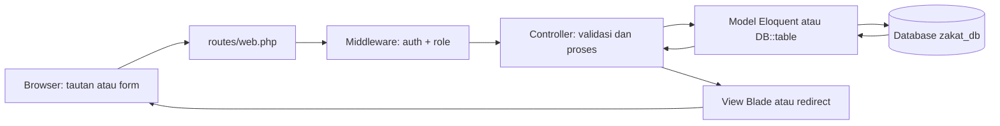
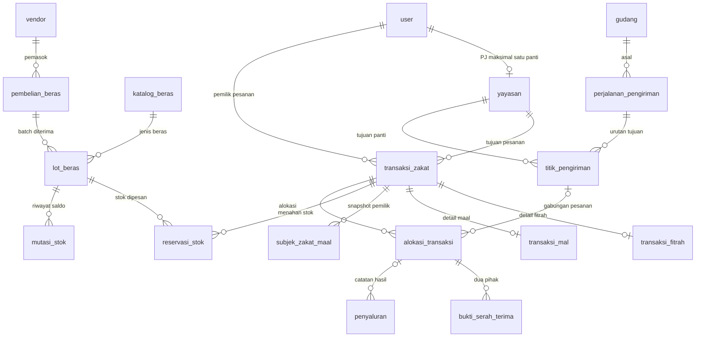

# Penjelasan Kode per File dan Database Portal Zakat

Dokumentasi pembelajaran berbahasa Indonesia, diperiksa pada **9 Oktober 2026 (WIB)**. Urutan pembahasan: tujuan sistem → MVC dan alur kode → penjelasan file dan cuplikan penting → CRUD → database beserta tabel, kolom, PK/FK, dan alasan relasinya.

Sumber utama adalah **kode di workspace saat dokumen dibuat**, daftar route yang benar-benar terdaftar, serta metadata database aktif melalui Laravel Boost. Kamus kolom dari panduan proyek yang sudah ada dicocokkan ulang: **35 tabel, 393 kolom, 55 foreign key**, tanpa perbedaan nama kolom, tipe, nullable, atau FK. Paket terpasang yang relevan: **Laravel 13.32.0** dan **endroid/qr-code 5.1.0**. Versi rentang pada `composer.json` bukan selalu versi terpasang.

Dokumen memuat 17 controller (termasuk class dasar bawaan), 12 model, 4 command aplikasi, 1 middleware khusus, 1 provider yang disesuaikan, 12 file migration (seluruhnya sudah diterapkan), 2 seeder, 1 factory, dan 29 template Blade. File bawaan Laravel yang belum mempunyai logika bisnis cukup ditandai sebagai bawaan. Kode di `vendor/`, `node_modules/`, hasil kompilasi/cache, dan isi paket tidak diuraikan ulang. Gambar adalah aset, bukan kode PHP/JavaScript.

**Penting untuk memahami implementasi saat ini:** QR pembayaran hanya mencatat **simulasi**, belum menerima uang atau berkomunikasi dengan payment gateway. Teks UI “pembayaran tercatat” berasal dari status `simulated_paid`. Model/halaman lama tetap diterangkan dan ditandai agar tidak dianggap sebagai fitur aktif.

## Daftar isi

1. [Tujuan aplikasi dan pembagian peran](#1-tujuan-aplikasi-dan-pembagian-peran)
2. [MVC, folder, dan arah perjalanan kode](#2-mvc-folder-dan-arah-perjalanan-kode)
3. [Routing dan bootstrap aplikasi](#3-routing-dan-bootstrap-aplikasi)
4. [Controller per file](#4-controller-per-file)
5. [Model per file](#5-model-per-file)
6. [Middleware, provider, dan command per file](#6-middleware-provider-dan-command-per-file)
7. [Migration, seeder, dan factory per file](#7-migration-seeder-dan-factory-per-file)
8. [View, CSS, dan JavaScript per file](#8-view-css-dan-javascript-per-file)
9. [Konfigurasi dan file pendukung](#9-konfigurasi-dan-file-pendukung)
10. [CRUD yang benar-benar tersedia](#10-crud-yang-benar-benar-tersedia)
11. [Dasar database dan alasan desainnya](#11-dasar-database-dan-alasan-desainnya)
12. [Kamus seluruh tabel dan kolom](#12-kamus-seluruh-tabel-dan-kolom)
13. [Mengikuti satu fitur dari kode sampai database](#13-mengikuti-satu-fitur-dari-kode-sampai-database)
14. [Peta seluruh route aktif](#14-peta-seluruh-route-aktif)
15. [Batas implementasi dan cara membaca kode lama](#15-batas-implementasi-dan-cara-membaca-kode-lama)

## 1. Tujuan aplikasi dan pembagian peran

Portal Zakat menghubungkan pembayar zakat dengan panti/yayasan terverifikasi. Sistem menghitung zakat fitrah dan maal, menyimpan pesanan dan snapshot hitungannya, mencatat pembayaran simulasi, mengatur stok beras dan perjalanan pengiriman, lalu mencocokkan bukti panitia dengan bukti PJ panti.

| Peran | Nilai `user.role` yang dipakai route | Tanggung jawab |
| --- | --- | --- |
| Muzakki/pembayar | `pemberi` | Registrasi, biodata, checkout fitrah/maal, draft keluarga maal, pembayaran simulasi, melihat riwayat/bukti. |
| PJ panti | `pj` | Mendaftarkan satu panti, mengoreksi pengajuan, mengajukan rekening baru, mengunggah bukti penerimaan. |
| Panitia | `panitia` | Verifikasi panti/rekening, vendor, persediaan, alokasi, pengiriman, bukti dan laporan. |
| Admin | `admin` | Membuat/nonaktifkan panitia, mengelola bank, tarif/wilayah, pengaturan zakat, harga emas dan teks publik, melihat audit. |

Pilihan “muzakki” saat registrasi dikonversi menjadi `pemberi` sebelum disimpan. Closure `/home` masih mengenali beberapa nama role lama; middleware route aktif memakai nilai pada tabel di atas. Admin pertama dibuat lewat terminal, panitia dibuat oleh admin, sementara registrasi publik hanya menawarkan muzakki dan PJ.

**Arah pengembangan yang terlihat dari kode:** memisahkan pembayaran, stok, logistik, dan bukti agar setiap tahap dapat ditelusuri. Ini penjelasan implementasi yang ada, bukan janji bahwa pembayaran nyata atau fitur lain yang belum tersedia sudah selesai.

## 2. MVC, folder, dan arah perjalanan kode

**MVC** adalah pembagian tanggung jawab:

- **Model (M):** representasi data dan relasi, misalnya `User`, `Yayasan`, `TransaksiZakat` di `app/Models/`.
- **View (V):** tampilan HTML/Blade, misalnya form fitrah di `resources/views/muzakki/fitrah.blade.php`.
- **Controller (C):** menerima input, memvalidasi, mengambil/menulis data, menentukan hasil, misalnya `FitrahCheckoutController` di `app/Http/Controllers/`.

Route mengarahkan request; middleware menjaga akses; migration membangun struktur database; command menjalankan pekerjaan terminal/jadwal. Keempatnya mendukung MVC, tetapi bukan model/view/controller halaman.



**Kondisi nyata proyek:** banyak controller menggunakan `DB::table(...)` langsung, selain Eloquent. Jadi alurnya bisa controller → Query Builder → tabel, tanpa melewati class model khusus. `DB::table` adalah alat akses data, bukan class model MVC buatan aplikasi. Tidak semua tabel harus memiliki satu file model.

| Folder | Mengapa kode ditempatkan di sana | Contoh |
| --- | --- | --- |
| `app/Http/Controllers/` | Mengurus request browser dan menentukan respons. | Checkout, persetujuan panti, laporan. |
| `app/Models/` | Memetakan data/relasi ke objek PHP. | `User.php`. |
| `app/Http/Middleware/` | Memeriksa syarat sebelum controller dijalankan. | `EnsureRole.php`. |
| `app/Console/Commands/` | Tugas terminal atau scheduler, tidak membuka halaman. | `CreateInitialAdmin.php`. |
| `app/Providers/` | Inisialisasi perilaku aplikasi lintas fitur. | Pemaksaan URL aplikasi. |
| `routes/` | Daftar pintu masuk URL dan jadwal terminal. | `web.php`, `console.php`. |
| `database/migrations/` | Resep perubahan tabel, kolom, FK, dan indeks. | Tabel transaksi dan lot. |
| `database/seeders/` | Data referensi awal yang diperlukan aplikasi. | Bank, gudang, tarif awal. |
| `database/factories/` | Data contoh untuk pengujian/pengembangan. | `UserFactory.php`. |
| `resources/views/` | Sumber template yang akan dirender server. | Dashboard per role. |
| `public/css/` dan `public/images/` | Aset yang dapat diminta langsung browser. | Tema dan ilustrasi. |
| `config/` | Pengaturan layanan/infrastruktur, tidak mengurus tombol halaman. | URL API emas, disk privat. |
| `bootstrap/` | Merangkai route, middleware dan provider saat Laravel boot. | Alias `role`. |

### 2.1 Arti sintaks yang sering muncul

| Kode | Arti sederhana |
| --- | --- |
| `namespace App\Http\Controllers;` | Alamat class dalam autoload PHP; selaras dengan folder. |
| `use ...;` | Mengimpor nama class/facade agar dapat dipakai singkat. Bukan perintah mengambil isi tabel. |
| `extends Controller` | Class mengikuti class dasar controller. |
| `Request $request` | Input HTTP beserta user dan sesi saat ini. |
| `$request->validate(...)` | Memeriksa input; kegagalan umumnya kembali ke form dengan pesan dan input lama. |
| `Rule::exists(...)` / `Rule::unique(...)` | Memastikan ID tersedia / nilai belum digunakan. |
| `view('muzakki.fitrah', compact(...))` | Membuka template `resources/views/muzakki/fitrah.blade.php` dan mengirim variabel. |
| `redirect()->route(...)` | Mengarahkan browser ke URL dari nama route. |
| `DB::transaction(...)` | Sekumpulan perubahan berhasil bersama atau dibatalkan bersama bila ada exception. |
| `lockForUpdate()` | Mengunci baris selama transaksi untuk mengurangi benturan proses bersamaan. |
| `bcadd/bcsub/bcmul/bcdiv/bccomp` | Perhitungan dan perbandingan desimal BCMath, dipakai hitungan uang/berat. |
| `Hash::make(...)` | Membuat hash password. Tidak dapat dibalik menjadi password asli. |
| `Crypt::encryptString(...)` | Mengenkripsi token; dapat dibuka kembali dengan kunci aplikasi yang sesuai. |
| `hash('sha256', $token)` | Membuat sidik token untuk pencarian, tanpa menyimpan token mentah pada tabel percobaan. |
| `@csrf` | Membuat token perlindungan form Laravel. |
| `@method('DELETE')` | Mengirim maksud HTTP DELETE melalui form HTML POST. |
| `@extends / @section / @yield` | Memakai layout, mengisi bagian, dan menampilkan bagian tersebut. |
| `@foreach / @forelse` | Mengulang data; `@forelse` juga menyediakan tampilan saat data kosong. |
| `old(...)` | Mengembalikan isian form setelah gagal validasi. |
| `{{ ... }}` | Menampilkan nilai dengan escaping HTML. |

Cuplikan di dokumen ini diambil dari source, bukan salinan seluruh class. Potongan yang berhenti di tengah array/closure dibaca sebagai **kutipan bagian kode**, bukan program terpisah yang dapat dijalankan sendiri.

## 3. Routing dan bootstrap aplikasi

### `routes/web.php`

**Jenis:** konfigurasi route HTTP; pendukung MVC. **Mengapa di sini:** Laravel memuat daftar URL web dari file ini. **Arah:** URL → controller/method, setelah middleware yang ditentukan.

Grup `guest` memuat login/register; grup `auth` memuat halaman akun; grup `role:pemberi/panitia/pj/admin` memisahkan akses. Request perubahan menggunakan POST/PATCH/PUT/DELETE. Login, registrasi dan konfirmasi QR dibatasi `throttle:5,1`. Parameter ID dibatasi angka dan token QR dibatasi 64 karakter alfanumerik.

`/home` melakukan redirect menurut role atau memaksa ganti password. Halaman scan QR sengaja berada di luar grup login karena pemegang token perlu dapat membuka konfirmasi dari perangkat lain. Peta seluruh URL dan method tersedia di bagian 14.

**Cuplikan asli — routes/web.php, mulai baris 66:**

```php
Route::prefix('muzakki')->name('muzakki.')->middleware('role:pemberi')->group(function () {
    Route::get('/dashboard', [MuzakkiController::class, 'index'])->name('dashboard');
    Route::get('/zakat-fitrah', [FitrahCheckoutController::class, 'index'])->name('fitrah');
    Route::post('/zakat-fitrah', [FitrahCheckoutController::class, 'store'])->name('fitrah.store');
    Route::get('/zakat-maal', [MaalCheckoutController::class, 'index'])->name('maal');
    Route::post('/zakat-maal', [MaalCheckoutController::class, 'store'])->name('maal.store');
    Route::post('/zakat-maal/draft', [MaalCheckoutController::class, 'saveDraft'])->name('maal.draft');
```

Grup ini menambahkan awalan URL/nama route dan pemeriksaan role. GET fitrah membaca form; POST fitrah membuat pesanan. Keduanya masuk controller yang sama tetapi method berbeda.

### `routes/console.php`

**Jenis:** route console dan scheduler; bukan bagian C halaman. **Mengapa di sini:** tempat Laravel mendefinisikan pekerjaan periodik. `inspire` adalah contoh bawaan Laravel.

Jadwal khusus: expired pesanan setiap menit; pengingat pukul **08.00 WIB**; sinkronisasi harga emas pukul **09.30 WIB** berdasarkan config. `withoutOverlapping` mencegah eksekusi jadwal yang sama bertumpuk. Definisi jadwal memerlukan scheduler/cron yang benar-benar berjalan; pemeriksaan dokumen ini tidak menjalankan tugas tersebut.

**Cuplikan asli — routes/console.php, mulai baris 11:**

```php
Schedule::command('app:expire-pending-orders')->everyMinute()->withoutOverlapping();
Schedule::command('app:create-zakat-reminders')->dailyAt('08:00')->timezone('Asia/Jakarta')->withoutOverlapping();

Schedule::command('app:sync-gold-price')
    ->dailyAt(config('services.gold_price.daily_at'))
    ->timezone(config('services.gold_price.timezone'))
    ->withoutOverlapping(5)
    ->when(fn (): bool => (bool) config('services.gold_price.enabled'));
```

Tiga nama command pada jadwal menghubungkan file console ini dengan ExpirePendingOrders, CreateZakatReminders dan SyncGoldPrice. CreateInitialAdmin dijalankan manual, tidak dijadwalkan otomatis.

### `bootstrap/app.php`

**Jenis:** bootstrap yang disesuaikan, pendukung seluruh MVC. Memuat route web/console dan health `/up`; mendaftarkan alias `role` ke `EnsureRole`; mempercayai proxy; mengatur error menjadi JSON untuk `api/*` atau request yang mengharapkan JSON. Keberadaan pola `api/*` pada penanganan exception tidak berarti API zakat terpisah sudah tersedia.

**Cuplikan asli — bootstrap/app.php, mulai baris 15:**

```php
->withMiddleware(function (Middleware $middleware): void {
    $middleware->trustProxies(at: '*');
    $middleware->alias(['role' => EnsureRole::class]);
})
```

Alias role membuat teks middleware seperti role:panitia pada route dapat menjalankan EnsureRole::handle.

### `bootstrap/providers.php`

**Jenis:** daftar provider, kerangka Laravel yang menghubungkan provider proyek. Arraynya mendaftarkan `AppServiceProvider::class`. Laravel kemudian menjalankan `register()` dan `boot()` provider saat aplikasi dimuat.

**Cuplikan asli — bootstrap/providers.php, mulai baris 5:**

```php
return [
    AppServiceProvider::class,
];
```

Provider perlu terdaftar agar pengaturan URL di AppServiceProvider berlaku.

## 4. Controller per file

Semua controller berada di `app/Http/Controllers/` karena menerima request HTTP. Tabel method menjelaskan isi setiap method; bagian MVC/arah menunjukkan file tampilan dan tabel tujuan. Operasi C/R/U/D di sini merujuk data bisnis, bukan nama HTTP semata.

### `app/Http/Controllers/AdminController.php`

**File:** [app/Http/Controllers/AdminController.php](app/Http/Controllers/AdminController.php).

Panel pengaturan internal. Mengelola panitia, bank, aturan biaya/tenggat, harga emas, dan konten landing. Operasi gudang/panti/pengiriman berada di controller panitia lainnya.

| Method | Tugas dan hasil |
| --- | --- |
| [`index()`](app/Http/Controllers/AdminController.php) | Membaca panitia, bank, wilayah dan tarif, pengaturan, harga emas terbaru, serta teks publik. Menghitung apakah zona dapat diaktifkan. Merender admin.dashboard. |
| [`auditLog()`](app/Http/Controllers/AdminController.php) | Membaca catatan audit dengan nama/role pelaku, paginasi 30 baris. View tidak menampilkan seluruh detail JSON/identitas pribadi secara otomatis. |
| [`setLandingContent()`](app/Http/Controllers/AdminController.php) | Memvalidasi lima field teks publik, melakukan upsert pengaturan dan audit dalam satu transaksi, kemudian kembali ke dashboard. |
| [`storePanitia()`](app/Http/Controllers/AdminController.php) | Memvalidasi nama/email/password, membuat User role panitia dengan hash dan must_change_password=true, menghubungkan pembuat admin, lalu mencatat audit. |
| [`setPanitiaActive()`](app/Http/Controllers/AdminController.php) | Memastikan target User role panitia, mengubah is_active dan mencatat audit. Menonaktifkan tidak menghapus akun atau riwayatnya. |
| [`storeBank()`](app/Http/Controllers/AdminController.php) | Menambah kode bank unik dengan karakter huruf kapital/angka/_/- dan nama; membuat audit. |
| [`setBankActive()`](app/Http/Controllers/AdminController.php) | Mengunci bank, mengubah aktif/nonaktif, mencatat audit. Rekening panti yang sudah ada tetap tercatat. |
| [`setOperationalSettings()`](app/Http/Controllers/AdminController.php) | Memvalidasi tanggal Idulfitri, admin, margin, dan bobot; upsert semua pengaturan; menghitung ulang batas checkout UTC; menonaktifkan zona lewat; memperbarui harga katalog berdasarkan lot tertua dan riwayat harga. Tidak mengubah snapshot pesanan lama. |
| [`setRegion()`](app/Http/Controllers/AdminController.php) | Memvalidasi status dan tarif; menolak aktivasi zona tanpa tenggat masa depan. Mengubah aktif dan hanya membuat versi tarif baru jika nilainya berbeda, dengan menutup periode tarif lama. |
| [`storeGoldPrice()`](app/Http/Controllers/AdminController.php) | Memvalidasi harga/sumber/tanggal tidak di masa depan; menambah riwayat emas, tanggal sumber jam 12 WIB dikonversi UTC. Tidak mengambil harga dari internet. |

**MVC:** C. **Mengapa di folder ini:** menangani request HTTP dari route, memvalidasi, mengambil/menulis data, dan menentukan respons.

**Pintu masuk (nama route):** `admin.dashboard`, `admin.audit.index`, `admin.bank.store`, `admin.bank.active`, `admin.harga-emas.store`, `admin.konten.update`, `admin.panitia.store`, `admin.panitia.active`, `admin.pengaturan.update`, `admin.wilayah.update`.

**Arah query langsung:** `audit_log`, `bank`, `harga_emas`, `katalog_beras`, `lot_beras`, `pengaturan_operasional`, `riwayat_harga_katalog`, `tarif_pengiriman`, `wilayah_layanan`. Eloquent/relasi juga dapat mengakses tabel tanpa string DB::table.

**Keluaran view:** `admin.audit`, `admin.dashboard`.

**CRUD:** C/R/U panitia, bank dan pengaturan; tidak ada D umum.

**Cuplikan asli — app/Http/Controllers/AdminController.php, mulai baris 102:**

```php
$panitia = User::create([
    'nama' => $data['nama'],
    'email' => $data['email'],
    'pass_hash' => Hash::make($data['password']),
    'role' => 'panitia',
    'is_active' => true,
    'must_change_password' => true,
    'created_by_admin_id' => $request->user()->id,
]);
```

Admin menyimpan hash password sementara dan mewajibkan panitia menggantinya; FK created_by_admin_id menunjuk pembuat.

### `app/Http/Controllers/AuthController.php`

**File:** [app/Http/Controllers/AuthController.php](app/Http/Controllers/AuthController.php).

Registrasi, autentikasi, logout, dan pergantian kata sandi. Eloquent User diperlukan karena nama kolom akun berbeda dari bawaan Laravel.

| Method | Tugas dan hasil |
| --- | --- |
| [`showLogin()`](app/Http/Controllers/AuthController.php) | Mengirim template auth.login. |
| [`showRegister()`](app/Http/Controllers/AuthController.php) | Mengirim template auth.register. |
| [`register()`](app/Http/Controllers/AuthController.php) | Memvalidasi biodata/akun, menyimpan hash password dan role yang diizinkan, login otomatis, regenerate session, redirect home. |
| [`login()`](app/Http/Controllers/AuthController.php) | Memvalidasi email/password, Auth::attempt dengan is_active=true. Jika gagal mengembalikan pesan umum; jika berhasil memperbarui session dan redirect home. |
| [`logout()`](app/Http/Controllers/AuthController.php) | Keluar dari Auth, invalidate session, regenerate token CSRF, redirect login. |
| [`showChangePassword()`](app/Http/Controllers/AuthController.php) | Menampilkan auth.change-password untuk akun login. |
| [`changePassword()`](app/Http/Controllers/AuthController.php) | Memeriksa password sekarang dan password baru minimal 12 karakter, menyimpan hash baru, menghapus kewajiban must_change_password, memperbarui session, redirect home. |

**MVC:** C. **Mengapa di folder ini:** menangani request HTTP dari route, memvalidasi, mengambil/menulis data, dan menentukan respons.

**Pintu masuk (nama route):** `password.change`, `password.change.store`, `login`, `login.post`, `logout`, `register`, `register.post`.

**Arah query langsung:** Eloquent/User dan sesi autentikasi. Eloquent/relasi juga dapat mengakses tabel tanpa string DB::table.

**Keluaran view:** `auth.change-password`, `auth.login`, `auth.register`.

**CRUD:** C akun publik, R autentikasi, U password; logout membatalkan sesi.

**Cuplikan asli — app/Http/Controllers/AuthController.php, mulai baris 47:**

```php
'role' => $data['role'] === 'pj' ? 'pj' : 'pemberi',
'nik' => $data['nik'],
'telp' => $data['telp'],
'tggl_lahir' => $data['tggl_lahir'],
'gender' => $data['gender'],
'kota_kabupaten' => $data['kota_kabupaten'],
'provinsi' => $data['provinsi'],
```

Pilihan muzakki dipetakan ke pemberi. Biodata tersimpan pada user.

### `app/Http/Controllers/BankChangeRequestController.php`

**File:** [app/Http/Controllers/BankChangeRequestController.php](app/Http/Controllers/BankChangeRequestController.php).

Mengatur proses permohonan rekening supaya PJ tidak langsung menimpa rekening aktif.

| Method | Tugas dan hasil |
| --- | --- |
| [`index()`](app/Http/Controllers/BankChangeRequestController.php) | Membaca permohonan beserta rekening lama panti, bank baru dan PJ; yang pending didahulukan; paginasi 20. Merender panitia.rekening. |
| [`store()`](app/Http/Controllers/BankChangeRequestController.php) | Memastikan PJ punya panti, bank aktif, tidak ada permintaan pending, dan rekening berbeda. Menyimpan permohonan dan audit, tidak mengganti rekening aktif. |
| [`review()`](app/Http/Controllers/BankChangeRequestController.php) | Mengunci permohonan/panti dan memastikan pending. Jika approved, memeriksa bank masih aktif dan menyalin rekening ke yayasan. Menyimpan keputusan, pemeriksa/waktu/catatan dan audit. |

**MVC:** C. **Mengapa di folder ini:** menangani request HTTP dari route, memvalidasi, mengambil/menulis data, dan menentukan respons.

**Pintu masuk (nama route):** `panitia.rekening.index`, `panitia.rekening.review`, `yayasan.rekening.store`.

**Arah query langsung:** `audit_log`, `bank`, `permohonan_perubahan_rekening`, `permohonan_perubahan_rekening as permohonan`, `yayasan`. Eloquent/relasi juga dapat mengakses tabel tanpa string DB::table.

**Keluaran view:** `panitia.rekening`.

**CRUD:** C permohonan, R riwayat, U keputusan/rekening; tanpa D.

**Cuplikan asli — app/Http/Controllers/BankChangeRequestController.php, mulai baris 81:**

```php
if ($data['hasil'] === 'approved') {
    $bank = DB::table('bank')->where('id', $permohonan->bank_id)->where('is_active', true)->first(['nama']);
    abort_unless($bank, 422, 'Bank tujuan sudah tidak aktif. Tolak permohonan dan minta PJ mengajukan ulang.');
    DB::table('yayasan')->where('id', $panti->id)->update([
        'bank_id' => $permohonan->bank_id,
        'nama_bank' => $bank->nama,
        'no_rek' => $permohonan->no_rek,
        'atas_nama_rek' => $permohonan->atas_nama_rek,
        'updated_at' => now(),
    ]);
```

Hanya keputusan approved dengan bank aktif yang menyalin rekening ke yayasan.

### `app/Http/Controllers/Controller.php`

**File:** [app/Http/Controllers/Controller.php](app/Http/Controllers/Controller.php).

Class dasar abstract yang diwarisi semua controller proyek. File saat ini kosong; tidak menyimpan alur zakat.

Tidak mempunyai method tambahan pada source sekarang.

**MVC:** class dasar C bawaan Laravel yang masih kosong; tidak mempunyai tabel atau CRUD sendiri.

### `app/Http/Controllers/DistributionController.php`

**File:** [app/Http/Controllers/DistributionController.php](app/Http/Controllers/DistributionController.php).

Mengatur pesanan yang siap dialokasikan, perjalanan fitrah, titik, keberangkatan, manifest, dan ongkir aktual.

| Method | Tugas dan hasil |
| --- | --- |
| [`index()`](app/Http/Controllers/DistributionController.php) | Membaca gudang, pesanan fitrah/maal simulated_paid yang belum dialokasikan, 30 perjalanan terbaru dan titiknya; merender panitia.distribusi. |
| [`createTrip()`](app/Http/Controllers/DistributionController.php) | Memvalidasi gudang aktif, kendaraan, kapasitas, jadwal WIB masa depan; membuat perjalanan direncanakan dengan penanda simulasi. |
| [`destroyTrip()`](app/Http/Controllers/DistributionController.php) | Mengunci perjalanan, mensyaratkan direncanakan, belum berangkat, dan tanpa titik pengiriman. Menghapus trip kosong dan mencatat audit; tidak mengubah pesanan, reservasi, atau stok. |
| [`addStop()`](app/Http/Controllers/DistributionController.php) | Memvalidasi ID pesanan tidak ganda; mengunci perjalanan, memeriksa panti pada gudang sama, status/panti pesanan, kapasitas per kunjungan dan kendaraan. Membuat titik serta alokasi tiap pesanan dan status dijadwalkan; tidak mengurangi stok. |
| [`allocateMaal()`](app/Http/Controllers/DistributionController.php) | Memastikan pesanan mal dibayar simulasi dan belum dialokasikan. Membuat alokasi nominal menunggu_bukti serta memperbarui penyaluran. Tidak membuat perjalanan beras. |
| [`dispatch()`](app/Http/Controllers/DistributionController.php) | Mengunci perjalanan/produk/lot; memastikan berat reservasi sama dengan alokasi dan saldo cukup. Mengurangi lot/katalog, membuat mutasi keluar, menandai reservasi fulfilled, memperbarui harga katalog, lalu status dikirim. Ini titik pemotongan stok. |
| [`setActualShipping()`](app/Http/Controllers/DistributionController.php) | Mencatat ongkir aktual satu titik hanya setelah perjalanan dikirim/selesai. Total aktual perjalanan NULL bila masih ada titik belum diisi; jika lengkap, jumlahkan. Tidak memperbarui tagihan muzakki. |
| [`manifest()`](app/Http/Controllers/DistributionController.php) | Membaca gudang/perjalanan, titik berurutan, dan alokasi/kode pesanan per titik. Merender panitia.manifest untuk cetak. |

**MVC:** C. **Mengapa di folder ini:** menangani request HTTP dari route, memvalidasi, mengambil/menulis data, dan menentukan respons.

**Pintu masuk (nama route):** `panitia.distribusi.index`, `panitia.maal.allocate`, `panitia.perjalanan.store`, `panitia.perjalanan.destroy`, `panitia.perjalanan.dispatch`, `panitia.perjalanan.manifest`, `panitia.titik.store`, `panitia.titik.ongkir`.

**Arah query langsung:** `alokasi_transaksi`, `audit_log`, `gudang`, `katalog_beras`, `lot_beras`, `mutasi_stok`, `pengaturan_operasional`, `perjalanan_pengiriman`, `reservasi_stok`, `riwayat_harga_katalog`, `titik_pengiriman`, `transaksi_zakat`, `yayasan`. Eloquent/relasi juga dapat mengakses tabel tanpa string DB::table.

**Keluaran view:** `panitia.distribusi`, `panitia.manifest`.

**CRUD:** C perjalanan/titik/alokasi; R daftar/manifest; U berangkat/ongkir; D perjalanan kosong.

**Cuplikan asli — app/Http/Controllers/DistributionController.php, mulai baris 227:**

```php
$itemLot->sisa_kg = bcsub($itemLot->sisa_kg, $baris->jumlah_kg, 2);
$itemProduk->stock = bcsub($itemProduk->stock, $baris->jumlah_kg, 2);
DB::table('lot_beras')->where('id', $itemLot->id)->update(['sisa_kg' => $itemLot->sisa_kg, 'updated_at' => now()]);
DB::table('katalog_beras')->where('id', $itemProduk->id)->update(['stock' => $itemProduk->stock, 'updated_at' => now()]);
DB::table('mutasi_stok')->insert([
    'lot_beras_id' => $itemLot->id,
    'dicatat_oleh' => $request->user()->id,
    'jenis' => 'keluar_pengiriman',
    'perubahan_kg' => '-'.$baris->jumlah_kg,
    'saldo_setelah_kg' => $itemLot->sisa_kg,
```

Stok lot/katalog berkurang pada dispatch; mutasi menyimpan perubahan dan saldo setelahnya.

### `app/Http/Controllers/FitrahCheckoutController.php`

**File:** [app/Http/Controllers/FitrahCheckoutController.php](app/Http/Controllers/FitrahCheckoutController.php).

Pembentukan pesanan fitrah beserta harga berdasarkan lot dan reservasi persediaan.

| Method | Tugas dan hasil |
| --- | --- |
| [`index()`](app/Http/Controllers/FitrahCheckoutController.php) | Memanggil expirePending; membaca katalog dengan jumlah reservasi aktif, menghitung tersedia, menyaring jenis stok positif dan mengurutkan harga. Membaca panti layak/wilayah belum lewat serta statistik dan bobot. Merender muzakki.fitrah. |
| [`store()`](app/Http/Controllers/FitrahCheckoutController.php) | Memvalidasi jiwa/beras/panti, memproses expired, mengunci stok dan memilih lot FIFO. Memeriksa panti/tarif/pengaturan/kapasitas, menghitung komponen biaya BCMath, membuat master/detail/reservasi/token QR bersama. Redirect pembayaran dengan ID baru; retry transaksi DB sampai 3 percobaan untuk konflik yang dapat dicoba ulang. |

**MVC:** C. **Mengapa di folder ini:** menangani request HTTP dari route, memvalidasi, mengambil/menulis data, dan menentukan respons.

**Pintu masuk (nama route):** `muzakki.fitrah`, `muzakki.fitrah.store`.

**Arah query langsung:** `katalog_beras`, `lot_beras`, `pengaturan_operasional`, `penyaluran`, `percobaan_pembayaran`, `reservasi_stok`, `tarif_pengiriman`, `transaksi_fitrah`, `transaksi_zakat`, `yayasan`. Eloquent/relasi juga dapat mengakses tabel tanpa string DB::table.

**Keluaran view:** `muzakki.fitrah`.

**CRUD:** R pilihan, C header/detail/reservasi/percobaan.

**Cuplikan asli — app/Http/Controllers/FitrahCheckoutController.php, mulai baris 120:**

```php
$berat = bcmul((string) $data['jumlah_jiwa'], $pengaturan['bobot_fitrah_per_jiwa_kg'], 2);
abort_if(bccomp($berat, $tujuan->kapasitas_penerimaan_kg, 2) > 0, 422, 'Jumlah beras pesanan melebihi kapasitas penerimaan panti per kunjungan.');
$sisa = $berat;
$pokokEmpatDesimal = '0';
$alokasiLot = [];
```

Jumlah jiwa dikalikan bobot dan diperiksa terhadap kapasitas panti sebelum reservasi.

**Cuplikan asli — app/Http/Controllers/FitrahCheckoutController.php, mulai baris 146:**

```php
$ambil = bccomp($tersedia, $sisa, 2) < 0 ? $tersedia : $sisa;
$alokasiLot[] = ['lot_id' => $item->id, 'jumlah_kg' => $ambil, 'harga_beli_per_kg' => $item->harga_beli_per_kg];
$pokokEmpatDesimal = bcadd($pokokEmpatDesimal, bcmul($ambil, $item->harga_beli_per_kg, 4), 4);
$sisa = bcsub($sisa, $ambil, 2);
```

FIFO memakai tanggal_masuk lalu id. Pokok dihitung dari setiap lot yang digunakan, sehingga pesanan lintas lot dapat mempunyai harga rata-rata.

**Hasil store:** satu header, satu detail, satu/beberapa reservasi dan satu percobaan QR, semuanya dalam DB::transaction. Masa berlaku 30 menit; sisa lot belum dikurangi.

### `app/Http/Controllers/HandoverEvidenceController.php`

**File:** [app/Http/Controllers/HandoverEvidenceController.php](app/Http/Controllers/HandoverEvidenceController.php).

Unggah bukti kedua pihak, kesesuaian angka, penyelesaian, dan akses foto privat. Method submit menjadi pusat proses supaya panitia dan PJ memakai aturan sama.

| Method | Tugas dan hasil |
| --- | --- |
| [`index()`](app/Http/Controllers/HandoverEvidenceController.php) | Membaca 100 alokasi terbaru berikut panti, jenis pesanan, serta ID bukti panitia/yayasan. Merender panitia.bukti. |
| [`submitPanitia()`](app/Http/Controllers/HandoverEvidenceController.php) | Meneruskan unggahan ke submit dengan pihak panitia; route role panitia mengatur aksesnya. |
| [`submitPj()`](app/Http/Controllers/HandoverEvidenceController.php) | Meneruskan unggahan ke submit dengan pihak yayasan; submit memastikan PJ adalah pemilik panti tujuan. |
| [`foto()`](app/Http/Controllers/HandoverEvidenceController.php) | Mencari path foto dan hubungan pesanan/panti. Mengizinkan akun aktif panitia/admin, muzakki pemilik, atau PJ tujuan. Mengirim file privat, no-store; tidak menaruh foto di URL public/uploads. |
| [`submit()`](app/Http/Controllers/HandoverEvidenceController.php) | Memilih field jumlah_kg/nominal menurut jenis, validasi foto/angka, simpan file privat. Dalam transaksi DB, periksa pembayaran, pihak/status, tulis/ganti bukti dan cocokkan dua pihak. Ubah status; bila selesai buat penyaluran sekali dan notifikasi; perbarui titik/perjalanan. Jika DB gagal file baru dihapus; jika penggantian berhasil file lama dihapus. |

**MVC:** C. **Mengapa di folder ini:** menangani request HTTP dari route, memvalidasi, mengambil/menulis data, dan menentukan respons.

**Pintu masuk (nama route):** `bukti.foto`, `panitia.bukti.index`, `panitia.bukti.store`, `yayasan.bukti.store`.

**Arah query langsung:** `alokasi_transaksi`, `bukti_serah_terima`, `notifikasi_aplikasi`, `penyaluran`, `perjalanan_pengiriman`, `titik_pengiriman`, `transaksi_zakat`. Eloquent/relasi juga dapat mengakses tabel tanpa string DB::table.

**Keluaran view:** `panitia.bukti`.

**CRUD:** C/R/U bukti sebelum selesai; C penyaluran/notifikasi; tanpa D umum.

**Cuplikan asli — app/Http/Controllers/HandoverEvidenceController.php, mulai baris 130:**

```php
$lengkap = $bukti->has('panitia') && $bukti->has('yayasan');
$bermasalah = $bukti->contains(fn ($item) => ! $item->jumlah_sesuai);
$status = $bermasalah ? 'perlu_tinjauan' : ($lengkap ? 'selesai' : 'menunggu_bukti');

DB::table('alokasi_transaksi')->where('id', $id)->update(['status' => $status, 'updated_at' => now()]);
DB::table('transaksi_zakat')->where('id', $alokasi->transaksi_id)->update(['status_penyaluran' => $status, 'updated_at' => now()]);
```

Selesai membutuhkan dua bukti yang cocok; selisih jumlah menghasilkan perlu_tinjauan.

**Hasil selesai:** menambah penyaluran dan notifikasi pembayar/PJ; titik selesai jika seluruh alokasi selesai, perjalanan selesai jika semua titik diterima. Upload baru dibersihkan bila database gagal; berkas lama dibuang setelah penggantian berhasil.

### `app/Http/Controllers/InAppNotificationController.php`

**File:** [app/Http/Controllers/InAppNotificationController.php](app/Http/Controllers/InAppNotificationController.php).

Tindakan kecil untuk notifikasi milik akun.

| Method | Tugas dan hasil |
| --- | --- |
| [`markRead()`](app/Http/Controllers/InAppNotificationController.php) | Mencari notifikasi dengan ID dan user_id login. Menandai dibaca_at bila masih NULL, lalu kembali dengan pesan. Tidak boleh menandai pesan milik akun lain. |

**MVC:** C. **Mengapa di folder ini:** menangani request HTTP dari route, memvalidasi, mengambil/menulis data, dan menentukan respons.

**Pintu masuk (nama route):** `notifikasi.read`.

**Arah query langsung:** `notifikasi_aplikasi`. Eloquent/relasi juga dapat mengakses tabel tanpa string DB::table.

**Keluaran view:** redirect atau respons file; dipakai dari halaman lain.

**CRUD:** R kepemilikan, U dibaca_at.

**Cuplikan asli — app/Http/Controllers/InAppNotificationController.php, mulai baris 15:**

```php
    ->where('user_id', $request->user()->id)
    ->first(['id', 'dibaca_at']);
abort_unless($notifikasi, 404);

if (! $notifikasi->dibaca_at) {
    DB::table('notifikasi_aplikasi')
        ->where('id', $id)
        ->whereNull('dibaca_at')
```

Filter akun login mencegah menandai notifikasi milik akun lain.

### `app/Http/Controllers/InventoryController.php`

**File:** [app/Http/Controllers/InventoryController.php](app/Http/Controllers/InventoryController.php).

Persediaan: vendor, katalog, penerimaan lot/faktur dan koreksi. Harga beli lot tetap; saldo/penawaran dapat berubah.

| Method | Tugas dan hasil |
| --- | --- |
| [`index()`](app/Http/Controllers/InventoryController.php) | Membaca vendor/gudang/katalog dan reservasi, 30 lot/pembelian terbaru, 20 koreksi. Merender panitia.gudang. |
| [`storeVendor()`](app/Http/Controllers/InventoryController.php) | Memvalidasi kontak pemasok dan menambah vendor aktif. |
| [`updateVendor()`](app/Http/Controllers/InventoryController.php) | Memvalidasi nama/kontak/status aktif, mengunci vendor, memperbarui data dan mencatat audit. Isian gagal validasi ditandai vendor_edit_id agar tampil pada form vendor yang benar. |
| [`destroyVendor()`](app/Http/Controllers/InventoryController.php) | Mengunci vendor, menolak jika ada pembelian, lalu menghapus permanen vendor yang belum digunakan dan mencatat audit dalam transaksi yang sama. |
| [`storeKatalog()`](app/Http/Controllers/InventoryController.php) | Membuat jenis beras dengan nama unik, harga/stok nol, aktif. Penerimaan stok menentukan harga. |
| [`destroyKatalog()`](app/Http/Controllers/InventoryController.php) | Mengunci jenis beras dan menolak jika stok bukan nol atau memiliki lot/transaksi_fitrah/riwayat harga. Menghapus hanya katalog yang belum digunakan dan mencatat audit. |
| [`receive()`](app/Http/Controllers/InventoryController.php) | Memvalidasi pemasok/gudang/jenis/berat/harga/tanggal/faktur, menyimpan berkas bila ada. Dalam transaksi: buat pembelian, lot, mutasi masuk, tambah stock, refresh harga. Hapus file baru jika gagal. |
| [`uploadInvoice()`](app/Http/Controllers/InventoryController.php) | Menambah faktur privat untuk pembelian yang belum mempunyai faktur, audit. Bila sudah punya, ditolak 409; file baru dihapus jika transaksi gagal. |
| [`invoice()`](app/Http/Controllers/InventoryController.php) | Membaca path faktur, memeriksa file ada, mengirim respons privat. Hak panitia datang dari middleware route. |
| [`adjust()`](app/Http/Controllers/InventoryController.php) | Memvalidasi koreksi positif/negatif bukan nol dan alasan. Mengunci lot/katalog; melarang saldo di bawah reservasi/negatif/batas angka. Mengubah dua saldo, mencatat mutasi dan refresh harga. |
| [`refreshCatalogPrice()`](app/Http/Controllers/InventoryController.php) | Helper privat memilih lot tertua bersisa, menghitung pokok+margin. Tidak ada lot berarti harga nol. Jika harga berubah, memperbarui katalog dan menambah riwayat. |

**MVC:** C. **Mengapa di folder ini:** menangani request HTTP dari route, memvalidasi, mengambil/menulis data, dan menentukan respons.

**Pintu masuk (nama route):** `panitia.gudang.index`, `panitia.katalog.store`, `panitia.katalog.destroy`, `panitia.lot.adjust`, `panitia.pembelian.receive`, `panitia.pembelian.faktur.store`, `panitia.pembelian.faktur.show`, `panitia.vendor.store`, `panitia.vendor.update`, `panitia.vendor.destroy`.

**Arah query langsung:** `audit_log`, `gudang`, `katalog_beras`, `lot_beras`, `mutasi_stok`, `pembelian_beras`, `pengaturan_operasional`, `reservasi_stok`, `riwayat_harga_katalog`, `transaksi_fitrah`, `vendor`. Eloquent/relasi juga dapat mengakses tabel tanpa string DB::table.

**Keluaran view:** `panitia.gudang`.

**CRUD:** CRUD vendor; C/R/D terbatas katalog; C/R pembelian/faktur; U koreksi stok.

**Cuplikan asli — app/Http/Controllers/InventoryController.php, mulai baris 187:**

```php
$sudahDigunakan = DB::table('lot_beras')->where('katalog_beras_id', $id)->exists()
    || DB::table('transaksi_fitrah')->where('katalog_beras_id', $id)->exists()
    || DB::table('riwayat_harga_katalog')->where('katalog_beras_id', $id)->exists();
if ($sudahDigunakan || bccomp((string) $produk->stock, '0', 2) !== 0) {
    throw ValidationException::withMessages([
        'katalog' => 'Jenis beras hanya boleh dihapus jika stok nol dan belum memiliki lot, transaksi, atau riwayat harga. Stok habis tidak berarti riwayatnya boleh dihapus.',
    ]);
}

DB::table('katalog_beras')->where('id', $id)->delete();
```

Jenis beras hanya boleh dihapus jika stock=0 dan tanpa lot/transaksi/riwayat harga, termasuk lot yang sudah habis.

**Cuplikan asli — app/Http/Controllers/InventoryController.php, mulai baris 365:**

```php
$sisaBaru = bcadd($lot->sisa_kg, $data['perubahan_kg'], 2);
$stokBaru = bcadd($produk->stock, $data['perubahan_kg'], 2);
abort_if(bccomp($sisaBaru, (string) $terpesan, 2) < 0, 422, 'Koreksi akan mengurangi stok di bawah jumlah yang sudah dipesan.');
abort_if(bccomp($sisaBaru, '9999999999.99', 2) > 0 || bccomp($stokBaru, '9999999999.99', 2) > 0, 422, 'Koreksi melampaui kapasitas angka stok.');
abort_if(bccomp($stokBaru, '0', 2) < 0, 422, 'Stok katalog tidak boleh negatif.');

DB::table('lot_beras')->where('id', $id)->update(['sisa_kg' => $sisaBaru, 'updated_at' => now()]);
```

Koreksi ditolak bila membuat stok di bawah reservasi, negatif, atau melewati kapasitas kolom; perubahan dicatat sebagai mutasi dengan alasan.

### `app/Http/Controllers/LandingController.php`

**File:** [app/Http/Controllers/LandingController.php](app/Http/Controllers/LandingController.php).

Halaman publik dan statistik simulasi. DEFAULT_CONTENT menyediakan lima teks cadangan bila admin belum menyimpannya.

| Method | Tugas dan hasil |
| --- | --- |
| [`index()`](app/Http/Controllers/LandingController.php) | Mengambil teks override, paling banyak 6 panti aktif verified, jumlah panti, total penyaluran selesai yang terhubung pembayaran simulation/simulated_paid, dan bobot fitrah. Merender landing; tidak membutuhkan login. |

**MVC:** C. **Mengapa di folder ini:** menangani request HTTP dari route, memvalidasi, mengambil/menulis data, dan menentukan respons.

**Pintu masuk (nama route):** `landing`.

**Arah query langsung:** `pengaturan_operasional`, `penyaluran`, `yayasan`. Eloquent/relasi juga dapat mengakses tabel tanpa string DB::table.

**Keluaran view:** `landing`.

**CRUD:** R konten, panti dan ringkasan.

**Cuplikan asli — app/Http/Controllers/LandingController.php, mulai baris 23:**

```php
$konten = collect(self::DEFAULT_CONTENT)
    ->mapWithKeys(fn (string $nilai, string $kunci): array => [$kunci => $tersimpan[$kunci] ?? $nilai]);

$panti = DB::table('yayasan')
    ->where('status_verif', 'verified')
    ->where('is_active', true)
    ->orderBy('nama')
    ->limit(6)
    ->get(['nama', 'kota_kabupaten', 'provinsi', 'jumlah_mustahik_layak', 'kebutuhan_saat_ini']);
```

Konten tersimpan menimpa fallback. Panti publik dibatasi verified dan aktif.

### `app/Http/Controllers/MaalCheckoutController.php`

**File:** [app/Http/Controllers/MaalCheckoutController.php](app/Http/Controllers/MaalCheckoutController.php).

Draft keluarga, perhitungan maal per pemilik dan pemilihan panti manual/acak.

| Method | Tugas dan hasil |
| --- | --- |
| [`index()`](app/Http/Controllers/MaalCheckoutController.php) | Membaca acuan emas dan usia, panti layak/statistik, draft keluarga akun. Memaksa checkbox haul tampil false ketika draft dibuka. Merender muzakki.maal. |
| [`store()`](app/Http/Controllers/MaalCheckoutController.php) | Memvalidasi subjek/panti; memeriksa acuan emas, memilih panti, menghitung nisab/kewajiban per subjek lalu agregat. Menolak total wajib nol. Membuat transaksi master/detail/snapshot/QR, audit bila panti otomatis. Tidak mengambil stok beras. |
| [`saveDraft()`](app/Http/Controllers/MaalCheckoutController.php) | Memvalidasi subjek, mengunci user, menghapus draft lama saja (transaksi NULL, bukan snapshot), lalu menyimpan draft baru. Redirect form maal tanpa membuat pesanan. |
| [`destroyDraft()`](app/Http/Controllers/MaalCheckoutController.php) | Mengunci user login seperti saveDraft; menghapus hanya draft akun sendiri dengan transaksi_id NULL dan is_snapshot false. Snapshot/riwayat pesanan tetap ada. Audit hanya memuat jumlah draft yang dihapus. |
| [`validateSubjects()`](app/Http/Controllers/MaalCheckoutController.php) | Helper privat membatasi jumlah/angka/hubungan/tanggal. Tepat satu diri dan maksimum satu istri; seluruh subjek maksimum 10. Dipakai draft maupun checkout. |

**MVC:** C. **Mengapa di folder ini:** menangani request HTTP dari route, memvalidasi, mengambil/menulis data, dan menentukan respons.

**Pintu masuk (nama route):** `muzakki.maal`, `muzakki.maal.store`, `muzakki.maal.draft`, `muzakki.maal.draft.destroy`.

**Arah query langsung:** `audit_log`, `harga_emas`, `penyaluran`, `percobaan_pembayaran`, `subjek_zakat_maal`, `transaksi_mal`, `transaksi_zakat`, `user`, `yayasan`. Eloquent/relasi juga dapat mengakses tabel tanpa string DB::table.

**Keluaran view:** `muzakki.maal`.

**CRUD:** C pesanan/snapshot; CRUD draft keluarga milik sendiri.

**Cuplikan asli — app/Http/Controllers/MaalCheckoutController.php, mulai baris 111:**

```php
$sudahHaul = (bool) ($subjek['sudah_haul'] ?? false);
$wajib = $sudahHaul && bccomp($bersih, $nisab, 2) >= 0;
$zakat = $wajib ? bcadd(bcdiv(bcmul($bersih, '2.5', 3), '100', 3), '0.005', 2) : '0.00';
$rincian[] = [...$subjek, 'harta_bersih' => $bersih, 'zakat_wajib' => $zakat, 'sudah_haul' => $sudahHaul];
```

Nisab/haul dinilai masing-masing pemilik sebelum kewajiban mereka digabung ke total tagihan.

**Draft/snapshot:** saveDraft mengganti kumpulan draft setelah mengunci user. destroyDraft hanya menghapus milik sendiri dengan transaksi_id NULL dan is_snapshot=false. index mengembalikan pernyataan haul ke false; store menulis baris snapshot terpisah dengan transaksi_id, harga/nisab/hasil saat checkout.

### `app/Http/Controllers/MuzakkiController.php`

**File:** [app/Http/Controllers/MuzakkiController.php](app/Http/Controllers/MuzakkiController.php).

Dashboard, riwayat, profil, dan preferensi muzakki. Pembentukan pesanan telah dipisah ke dua checkout controller.

| Method | Tugas dan hasil |
| --- | --- |
| [`index()`](app/Http/Controllers/MuzakkiController.php) | Memproses expired, membaca ringkasan dan 5 transaksi/notifikasi terbaru akun. Menghitung bantuan per panti/per penerima, rekomendasi terbanyak/terendah/provinsi sama dan countdown Idulfitri. Merender dashboard. |
| [`showMaal()`](app/Http/Controllers/MuzakkiController.php) | Sisa method lama yang hanya membuka view maal tanpa data. Route maal aktif memakai MaalCheckoutController::index; jangan memakai method ini sebagai acuan alur aktif. |
| [`riwayat()`](app/Http/Controllers/MuzakkiController.php) | Memproses expired; membaca pesanan akun beserta panti/detail lewat eager loading, paginate 20. Merender riwayat. |
| [`profil()`](app/Http/Controllers/MuzakkiController.php) | Membaca preferensi akun; mengirim User dan preferensi ke view profil. |
| [`updateNotificationPreferences()`](app/Http/Controllers/MuzakkiController.php) | Memvalidasi tiga boolean, upsert preferensi unik user, mencatat audit. Pesan hasil menjelaskan email belum aktif. |
| [`updateProfil()`](app/Http/Controllers/MuzakkiController.php) | Memvalidasi biodata serta NIK unik selain akun sendiri, lalu update user login. Tidak mengganti email/role/password melalui form profil ini. |

**MVC:** C. **Mengapa di folder ini:** menangani request HTTP dari route, memvalidasi, mengambil/menulis data, dan menentukan respons.

**Pintu masuk (nama route):** `muzakki.dashboard`, `muzakki.profil`, `muzakki.profil.update`, `muzakki.profil.notifikasi`, `muzakki.riwayat`.

**Arah query langsung:** `audit_log`, `notifikasi_aplikasi`, `pengaturan_operasional`, `penyaluran`, `preferensi_notifikasi`, `transaksi_zakat`, `yayasan`. Eloquent/relasi juga dapat mengakses tabel tanpa string DB::table.

**Keluaran view:** `muzakki.dashboard`, `muzakki.maal`, `muzakki.profil`, `muzakki.riwayat`.

**CRUD:** R dashboard/riwayat/profil; U biodata; C/U preferensi.

**Cuplikan asli — app/Http/Controllers/MuzakkiController.php, mulai baris 103:**

```php
        ->with(['yayasan', 'detailFitrah', 'detailMal'])
        ->where('user_id', $request->user()->id)
        ->latest()
        ->paginate(20);

    return view('muzakki.riwayat', compact('transaksi'));
}
```

Eager loading menyiapkan panti/detail; user_id membatasi riwayat milik sendiri.

### `app/Http/Controllers/OperationalReportController.php`

**File:** [app/Http/Controllers/OperationalReportController.php](app/Http/Controllers/OperationalReportController.php).

Laporan rekonsiliasi dari tabel operasional, tidak melalui accessor status model Penyaluran lama.

| Method | Tugas dan hasil |
| --- | --- |
| [`index()`](app/Http/Controllers/OperationalReportController.php) | Mengelompokkan status transaksi, membandingkan stok katalog/lot/reservasi, ongkir ditagih/aktual, jumlah terkumpul/selesai per panti dan tugas pending. Merender panitia.laporan; belum ada filter tahun/periode atau export file. |

**MVC:** C. **Mengapa di folder ini:** menangani request HTTP dari route, memvalidasi, mengambil/menulis data, dan menentukan respons.

**Pintu masuk (nama route):** `panitia.laporan.index`.

**Arah query langsung:** `alokasi_transaksi`, `katalog_beras`, `lot_beras`, `penyaluran`, `perjalanan_pengiriman`, `reservasi_stok`, `transaksi_zakat`, `yayasan`. Eloquent/relasi juga dapat mengakses tabel tanpa string DB::table.

**Keluaran view:** `panitia.laporan`.

**CRUD:** R laporan saja.

**Cuplikan asli — app/Http/Controllers/OperationalReportController.php, mulai baris 25:**

```php
$stok = DB::table('katalog_beras')
    ->leftJoinSub($lot, 'lot', 'lot.katalog_beras_id', '=', 'katalog_beras.id')
    ->leftJoinSub($reservasi, 'reservasi', 'reservasi.katalog_beras_id', '=', 'katalog_beras.id')
    ->orderBy('katalog_beras.nama_beras')
    ->get(['katalog_beras.nama_beras', 'katalog_beras.stock', DB::raw('COALESCE(lot.jumlah, 0) as lot_kg'), DB::raw('COALESCE(reservasi.jumlah, 0) as reservasi_kg')]);
```

Saldo katalog, lot dan reservasi dibandingkan untuk rekonsiliasi, tanpa koreksi otomatis.

### `app/Http/Controllers/PanitiaController.php`

**File:** [app/Http/Controllers/PanitiaController.php](app/Http/Controllers/PanitiaController.php).

Dashboard pekerjaan harian panitia, bukan semua operasi dalam satu controller.

| Method | Tugas dan hasil |
| --- | --- |
| [`index()`](app/Http/Controllers/PanitiaController.php) | Membaca ringkasan pending/alokasi/stock/reservasi/bukti; menampilkan panti menunggu, stok tersedia <25 kg, pesanan siap, perjalanan dalam 3 hari, dan bukti tertunda. Merender panitia.dashboard. |

**MVC:** C. **Mengapa di folder ini:** menangani request HTTP dari route, memvalidasi, mengambil/menulis data, dan menentukan respons.

**Pintu masuk (nama route):** `panitia.dashboard`.

**Arah query langsung:** `alokasi_transaksi`, `katalog_beras`, `lot_beras`, `perjalanan_pengiriman`, `reservasi_stok`, `titik_pengiriman`, `transaksi_zakat`, `yayasan`. Eloquent/relasi juga dapat mengakses tabel tanpa string DB::table.

**Keluaran view:** `panitia.dashboard`.

**CRUD:** R ringkasan saja.

**Cuplikan asli — app/Http/Controllers/PanitiaController.php, mulai baris 13:**

```php
'panti_pending' => DB::table('yayasan')->where('status_verif', 'pending')->count(),
'pesanan_dibayar' => DB::table('transaksi_zakat')
    ->where('status_pembayaran', 'simulated_paid')
    ->where('status_penyaluran', 'menunggu_alokasi')
    ->count(),
'pengiriman_tertunda' => DB::table('titik_pengiriman')
    ->whereIn('status', ['dijadwalkan', 'dikirim'])
```

Membaca pekerjaan pemeriksaan, alokasi, pengiriman dan stok yang belum selesai.

### `app/Http/Controllers/PantiVerificationController.php`

**File:** [app/Http/Controllers/PantiVerificationController.php](app/Http/Controllers/PantiVerificationController.php).

Pemeriksaan kelayakan panti dan penyajian foto privat panti.

| Method | Tugas dan hasil |
| --- | --- |
| [`index()`](app/Http/Controllers/PantiVerificationController.php) | Membaca panti/pengaju/wilayah paginasi 10, foto per panti, dan zona gudang aktif. Merender panitia.panti. |
| [`update()`](app/Http/Controllers/PantiVerificationController.php) | Validasi verified/rejected, jumlah layak, pilihan fitrah, rute dan catatan. Menolak penonaktifan jika pesanan terbuka; mencocokkan jumlah diajukan/kebutuhan, kapasitas persetujuan terhadap kapasitas PJ, dan provinsi wilayah. Penolakan bisnis memakai ValidationException sehingga pesan tampil di form dan isian dipertahankan, bukan halaman error generik. Mengubah yayasan, menambah verifikasi dan audit hanya setelah seluruh syarat terpenuhi. |
| [`foto()`](app/Http/Controllers/PantiVerificationController.php) | Mengizinkan panitia/admin aktif atau PJ pemilik melihat foto, memastikan file privat ada, mengirim berkas. Muzakki tidak diberikan akses foto pendaftaran ini. |

**MVC:** C. **Mengapa di folder ini:** menangani request HTTP dari route, memvalidasi, mengambil/menulis data, dan menentukan respons.

**Pintu masuk (nama route):** `panitia.panti.index`, `panitia.panti.update`, `panti.foto`.

**Arah query langsung:** `audit_log`, `foto_yayasan`, `transaksi_zakat`, `verifikasi_panti`, `wilayah_layanan`, `yayasan`. Eloquent/relasi juga dapat mengakses tabel tanpa string DB::table.

**Keluaran view:** `panitia.panti`.

**CRUD:** R daftar/foto; U keputusan panti; C riwayat/audit.

**Cuplikan asli — app/Http/Controllers/PantiVerificationController.php, mulai baris 93:**

```php
if ($panti->kapasitas_diajukan_kg !== null && bccomp((string) $data['kapasitas_penerimaan_kg'], (string) $panti->kapasitas_diajukan_kg, 2) > 0) {
    throw ValidationException::withMessages([
        'kapasitas_penerimaan_kg' => 'Kapasitas yang disetujui maksimal '.$panti->kapasitas_diajukan_kg.' kg per kunjungan, sesuai pengajuan PJ.',
    ]);
}
```

Batas kapasitas PJ diperiksa server; atribut max HTML bukan satu-satunya pengaman.

### `app/Http/Controllers/SimulationPaymentController.php`

**File:** [app/Http/Controllers/SimulationPaymentController.php](app/Http/Controllers/SimulationPaymentController.php).

Detail pembayaran pemilik, QR scan publik, bayar simulasi, pembatalan. Semua endpoint pembentuk uang nyata belum ada.

| Method | Tugas dan hasil |
| --- | --- |
| [`show()`](app/Http/Controllers/SimulationPaymentController.php) | Memproses expired, memanggil pesananMilikUser, membentuk URL/QR SVG dari token terenkripsi jika pending, membaca bukti dan snapshot subjek maal. Merender muzakki.payment. |
| [`scan()`](app/Http/Controllers/SimulationPaymentController.php) | Hash token dan cari percobaan+master+panti mode simulation. Hitung tombol bisa bayar/sudah dibayar. Merender halaman publik ringkas dengan no-store/no-referrer. Tidak login dan tidak mengubah status pembayaran. |
| [`pay()`](app/Http/Controllers/SimulationPaymentController.php) | Cari token lalu kunci pesanan/percobaan. Jika sudah dibayar, kembalikan hasil yang sama tanpa penggandaan. Jika sah/belum lewat, tandai simulated_paid dan waktu/audit dengan actor kosong. Redirect halaman scan. Tidak mengubah stok/penyaluran. |
| [`cancel()`](app/Http/Controllers/SimulationPaymentController.php) | Pastikan pesanan milik user dan pending; tandai master/percobaan cancelled, lepas reservasi, catat audit. Redirect detail. |
| [`pesananMilikUser()`](app/Http/Controllers/SimulationPaymentController.php) | Helper privat menggabungkan master, panti, detail fitrah/maal dengan filter user_id login; pesanan orang lain menghasilkan 404. |

**MVC:** C. **Mengapa di folder ini:** menangani request HTTP dari route, memvalidasi, mengambil/menulis data, dan menentukan respons.

**Pintu masuk (nama route):** `muzakki.payment.scan`, `muzakki.payment.pay`, `muzakki.payment.show`, `muzakki.payment.cancel`.

**Arah query langsung:** `audit_log`, `bukti_serah_terima`, `percobaan_pembayaran`, `reservasi_stok`, `subjek_zakat_maal`, `transaksi_zakat`. Eloquent/relasi juga dapat mengakses tabel tanpa string DB::table.

**Keluaran view:** `muzakki.payment`, `muzakki.payment-scan`.

**CRUD:** R detail/scan; U konfirmasi/batal; tanpa D transaksi.

**Cuplikan asli — app/Http/Controllers/SimulationPaymentController.php, mulai baris 27:**

```php
    $token = Crypt::decryptString($pesanan->qr_payload);
    $scanUrl = route('muzakki.payment.scan', $token);
    $qrDataUri = (new SvgWriter)->write(new QrCode($scanUrl))->getDataUri();
}
```

Token dibuka untuk membuat URL scan dan QR SVG Endroid; bukan instruksi transfer bank.

**Cuplikan asli — app/Http/Controllers/SimulationPaymentController.php, mulai baris 92:**

```php
if ($pesanan->status_pembayaran === 'simulated_paid' && $attempt->status === 'simulated_paid') {
    return false;
}
```

Konfirmasi ulang mengembalikan hasil yang sama tanpa menggandakan pembayaran (idempotent).

### `app/Http/Controllers/YayasanController.php`

**File:** [app/Http/Controllers/YayasanController.php](app/Http/Controllers/YayasanController.php).

Dashboard PJ, pendaftaran satu panti, dan koreksi pengajuan ditolak.

| Method | Tugas dan hasil |
| --- | --- |
| [`dashboard()`](app/Http/Controllers/YayasanController.php) | Membaca panti akun, bank aktif, catatan pemeriksaan, pengajuan rekening terakhir, alokasi/bukti milik panti dan 5 notifikasi penyaluran. Merender yayasan.dashboard. |
| [`storePanti()`](app/Http/Controllers/YayasanController.php) | Menolak panti kedua, memvalidasi identitas/rekening/kebutuhan/foto, pilihan layanan dan kapasitas beras wajib untuk fitrah, membuat Yayasan pending nonaktif. Menyimpan foto privat dan foto_yayasan; membersihkan file bila gagal. |
| [`resubmitPanti()`](app/Http/Controllers/YayasanController.php) | Untuk status pending atau rejected. Memvalidasi identitas/kebutuhan, pilihan layanan, kapasitas beras wajib bila memilih fitrah, dan foto opsional, mengunci panti, kembali pending nonaktif dan menghapus kelayakan/rute lama. Jika foto baru ada mengganti foto; membersihkan file sesuai hasil transaksi. |

**MVC:** C. **Mengapa di folder ini:** menangani request HTTP dari route, memvalidasi, mengambil/menulis data, dan menentukan respons.

**Pintu masuk (nama route):** `yayasan.panti.store`, `yayasan.panti.resubmit`, `yayasan.dashboard`.

**Arah query langsung:** `alokasi_transaksi`, `bank`, `foto_yayasan`, `notifikasi_aplikasi`, `permohonan_perubahan_rekening as permohonan`, `verifikasi_panti`. Eloquent/relasi juga dapat mengakses tabel tanpa string DB::table.

**Keluaran view:** `yayasan.dashboard`.

**CRUD:** C panti/foto; R dashboard; U pengajuan pending/rejected.

**Cuplikan asli — app/Http/Controllers/YayasanController.php, mulai baris 111:**

```php
    'kapasitas_diajukan_kg' => $data['kapasitas_diajukan_kg'] ?? null,
    'status_verif' => 'pending',
    'is_active' => false,
]);
```

Kapasitas dari PJ adalah pengajuan; persetujuan/rute diisi panitia kemudian.

## 5. Model per file

**Mengapa di `app/Models/`:** model adalah bagian M yang memetakan objek PHP ke tabel dan mendefinisikan relasi. `protected $table` diperlukan karena banyak nama tabel memakai bentuk Indonesia tunggal, berbeda dari tebakan plural Eloquent.

`$fillable` adalah daftar field untuk mass assignment model, bukan daftar lengkap semua kolom database. Query Builder `DB::table` tidak menggunakan `$fillable` atau accessor/cast Eloquent. `$hidden` menyembunyikan atribut saat serialisasi; password tetap berupa hash. `casts()` mengubah cara nilai dibaca, tidak membuat tabel atau menggantikan validasi input.

### `app/Models/User.php`

**File:** [app/Models/User.php](app/Models/User.php); tabel `user`.

Aktif untuk login, registrasi, akun panitia dan profil. Menerjemahkan nama/password bawaan Laravel ke nama/pass_hash. $hidden menyembunyikan hash saat serialisasi, bukan mengganti otorisasi. Relasi profil lama tetap ada.

| Method | Fungsi |
| --- | --- |
| `casts()` | Menyatakan cara konversi nilai database ke PHP (tanggal, boolean, decimal). Tidak menciptakan kolom atau memvalidasi input. |
| `getAuthPasswordName()` | Memberitahu autentikasi nama kolom hash adalah pass_hash. |
| `getAuthPassword()` | Mengembalikan hash pass_hash untuk verifikasi login. |
| `getNameAttribute()` | Saat kode membaca name, mengembalikan isi kolom nama. |
| `setNameAttribute()` | Saat kode menulis name, menyimpan ke atribut nama. |
| `setPasswordAttribute()` | Saat kode mengisi atribut password, mengarahkannya ke pass_hash dan menjalankan hashing bila perlu; create akun aktif menulis pass_hash dengan Hash::make secara eksplisit. |
| `getKotaNamaAttribute()` | Alias baca kota_nama ke kota_kabupaten. |
| `getProvinsiNamaAttribute()` | Alias baca provinsi_nama ke provinsi. |
| `getAlamatAttribute()` | Alias baca alamat ke alamat_lengkap. |
| `yayasan()` | Relasi ke panti; pada User hasOne melalui pj_user_id, pada detail lain belongsTo melalui yayasan_id. |
| `profilFitrah()` | HasOne profil fitrah lama melalui id_kepala. |
| `catatanMal()` | HasMany catatan aset maal lama melalui user_id. |
| `transaksiZakat()` | HasMany pesanan milik akun atau panti melalui FK yang sesuai. |

**MVC:** M. **Mengapa di sini:** memetakan objek/tabel dan relasinya. **CRUD:** akses data model tidak otomatis menyediakan tindakan atau halaman CRUD; route/controller menentukan fitur.

**Cuplikan asli — app/Models/User.php, mulai baris 54:**

```php
public function getAuthPasswordName(): string
{
    return 'pass_hash';
}

public function getAuthPassword(): string
{
    return (string) $this->pass_hash;
}
```

Autentikasi diarahkan ke pass_hash, berbeda dari password skeleton; alias name/password mendukung kode lama.

### `app/Models/Yayasan.php`

**File:** [app/Models/Yayasan.php](app/Models/Yayasan.php); tabel `yayasan`.

Aktif untuk panti milik PJ dan relasi transaksi. Fillable memuat data pendaftaran/kelayakan. Accessor nama/domisili memudahkan template lama.

| Method | Fungsi |
| --- | --- |
| `casts()` | Menyatakan cara konversi nilai database ke PHP (tanggal, boolean, decimal). Tidak menciptakan kolom atau memvalidasi input. |
| `getNameAttribute()` | Saat kode membaca name, mengembalikan isi kolom nama. |
| `getKotaNamaAttribute()` | Alias baca kota_nama ke kota_kabupaten. |
| `getProvinsiNamaAttribute()` | Alias baca provinsi_nama ke provinsi. |
| `pjUser()` | BelongsTo akun penanggung jawab melalui pj_user_id. |
| `mustahik()` | Pada Yayasan hasMany individu; pada Penyaluran belongsTo individu opsional. |
| `transaksiZakat()` | HasMany pesanan milik akun atau panti melalui FK yang sesuai. |
| `penyaluran()` | HasMany catatan penyaluran dari panti atau mustahik. |

**MVC:** M. **Mengapa di sini:** memetakan objek/tabel dan relasinya. **CRUD:** akses data model tidak otomatis menyediakan tindakan atau halaman CRUD; route/controller menentukan fitur.

**Cuplikan asli — app/Models/Yayasan.php, mulai baris 63:**

```php
public function pjUser()
{
    return $this->belongsTo(User::class, 'pj_user_id');
}

public function mustahik()
{
    return $this->hasMany(Mustahik::class, 'yayasan_id');
}
```

FK pj_user_id pada yayasan menggunakan belongsTo; kumpulan mustahik menggunakan hasMany karena FK ada di tabel anak.

### `app/Models/TransaksiZakat.php`

**File:** [app/Models/TransaksiZakat.php](app/Models/TransaksiZakat.php); tabel `transaksi_zakat`.

Aktif untuk riwayat dan kedaluwarsa. Eloquent membaca relasi detail/panti; proses checkout memakai Query Builder sehingga tidak bergantung semua field masuk fillable.

| Method | Fungsi |
| --- | --- |
| `expirePending()` | Fungsi static mengambil maksimum 100 pesanan pending lewat batas; per pesanan mengunci dan memeriksa ulang, mengubah master/percobaan expired, melepas reservasi active. Mengembalikan jumlah yang diproses. |
| `casts()` | Menyatakan cara konversi nilai database ke PHP (tanggal, boolean, decimal). Tidak menciptakan kolom atau memvalidasi input. |
| `getNamaPembayarAttribute()` | Alias tampilan nama_pembayar dari user.nama, cadangan Muzakki. |
| `getTotalBayarAttribute()` | Alias total_bayar ke total_nominal. |
| `getStatusAttribute()` | Accessor kompatibilitas; TransaksiZakat mengubah paid lama menjadi success dan selain itu mengembalikan status_pembayaran. Penyaluran menghitung disalurkan/pending dari bukti_pict_id; berbeda dari kolom status baru selesai. |
| `getBuktiPembayaranAttribute()` | Accessor lama mengembalikan qr_payload atau path default; qr_payload sekarang token terenkripsi sehingga bukan foto bukti pembayaran nyata. |
| `user()` | BelongsTo pemilik akun melalui user_id. |
| `yayasan()` | Relasi ke panti; pada User hasOne melalui pj_user_id, pada detail lain belongsTo melalui yayasan_id. |
| `detailFitrah()` | Pada TransaksiZakat hasOne detail melalui transaksi_id; pada KatalogBeras hasMany detail lewat katalog_beras_id. |
| `detailMal()` | HasOne detail maal melalui transaksi_id. |

**MVC:** M. **Mengapa di sini:** memetakan objek/tabel dan relasinya. **CRUD:** akses data model tidak otomatis menyediakan tindakan atau halaman CRUD; route/controller menentukan fitur.

**Cuplikan asli — app/Models/TransaksiZakat.php, mulai baris 48:**

```php
DB::table('transaksi_zakat')->where('id', $id)->update(['status_pembayaran' => 'expired', 'updated_at' => now()]);
DB::table('percobaan_pembayaran')->where('transaksi_id', $id)->where('status', 'pending')->update(['status' => 'expired', 'updated_at' => now()]);
DB::table('reservasi_stok')->where('transaksi_id', $id)->where('status', 'active')->update(['status' => 'expired', 'released_at' => now(), 'updated_at' => now()]);
$expired++;
```

Expired mengubah status header, percobaan, reservasi. Saldo lot tidak ditambah karena belum dikurangi pada checkout.

### `app/Models/TransaksiFitrah.php`

**File:** [app/Models/TransaksiFitrah.php](app/Models/TransaksiFitrah.php); tabel `transaksi_fitrah`.

Aktif dibaca sebagai detail riwayat fitrah; pembuatan detail memakai Query Builder. Decimal casts menjaga representasi field harga/berat.

| Method | Fungsi |
| --- | --- |
| `casts()` | Menyatakan cara konversi nilai database ke PHP (tanggal, boolean, decimal). Tidak menciptakan kolom atau memvalidasi input. |
| `transaksi()` | BelongsTo master transaksi melalui transaksi_id. |
| `katalogBeras()` | BelongsTo jenis beras melalui katalog_beras_id. |

**MVC:** M. **Mengapa di sini:** memetakan objek/tabel dan relasinya. **CRUD:** akses data model tidak otomatis menyediakan tindakan atau halaman CRUD; route/controller menentukan fitur.

**Cuplikan asli — app/Models/TransaksiFitrah.php, mulai baris 36:**

```php
public function transaksi()
{
    return $this->belongsTo(TransaksiZakat::class, 'transaksi_id');
}

public function katalogBeras()
{
    return $this->belongsTo(KatalogBeras::class, 'katalog_beras_id');
}
```

Detail mengacu header/katalog; transaksi_id UNIQUE membatasi satu detail fitrah per header.

### `app/Models/TransaksiMal.php`

**File:** [app/Models/TransaksiMal.php](app/Models/TransaksiMal.php); tabel `transaksi_mal`.

Aktif dibaca sebagai detail maal. Model nama Mal mengikuti tabel, sedangkan controller/view menulis Maal. Field baru yang ditulis query langsung tidak selalu tercantum dalam fillable model.

| Method | Fungsi |
| --- | --- |
| `casts()` | Menyatakan cara konversi nilai database ke PHP (tanggal, boolean, decimal). Tidak menciptakan kolom atau memvalidasi input. |
| `transaksi()` | BelongsTo master transaksi melalui transaksi_id. |

**MVC:** M. **Mengapa di sini:** memetakan objek/tabel dan relasinya. **CRUD:** akses data model tidak otomatis menyediakan tindakan atau halaman CRUD; route/controller menentukan fitur.

**Cuplikan asli — app/Models/TransaksiMal.php, mulai baris 49:**

```php
public function transaksi()
{
    return $this->belongsTo(TransaksiZakat::class, 'transaksi_id');
}
```

Detail maal mengacu header; checkout menulisnya melalui Query Builder.

### `app/Models/KatalogBeras.php`

**File:** [app/Models/KatalogBeras.php](app/Models/KatalogBeras.php); tabel `katalog_beras`.

Struktur model produk; operasi gudang dan checkout aktif banyak mengakses tabel langsung. Relasi detailFitrah menghubungkan produk ke detail pesanan.

| Method | Fungsi |
| --- | --- |
| `casts()` | Menyatakan cara konversi nilai database ke PHP (tanggal, boolean, decimal). Tidak menciptakan kolom atau memvalidasi input. |
| `detailFitrah()` | Pada TransaksiZakat hasOne detail melalui transaksi_id; pada KatalogBeras hasMany detail lewat katalog_beras_id. |

**MVC:** M. **Mengapa di sini:** memetakan objek/tabel dan relasinya. **CRUD:** akses data model tidak otomatis menyediakan tindakan atau halaman CRUD; route/controller menentukan fitur.

**Cuplikan asli — app/Models/KatalogBeras.php, mulai baris 31:**

```php
public function detailFitrah()
{
    return $this->hasMany(TransaksiFitrah::class, 'katalog_beras_id');
}
```

Satu jenis beras dapat muncul pada banyak transaksi fitrah.

### `app/Models/Mustahik.php`

**File:** [app/Models/Mustahik.php](app/Models/Mustahik.php); tabel `mustahik`.

Model struktur individu, berhubungan panti dan penyaluran. Belum ada controller CRUD individu aktif. Tanda is_verified di skema tidak ikut tercantum dalam fillable saat ini.

| Method | Fungsi |
| --- | --- |
| `casts()` | Menyatakan cara konversi nilai database ke PHP (tanggal, boolean, decimal). Tidak menciptakan kolom atau memvalidasi input. |
| `yayasan()` | Relasi ke panti; pada User hasOne melalui pj_user_id, pada detail lain belongsTo melalui yayasan_id. |
| `penyaluran()` | HasMany catatan penyaluran dari panti atau mustahik. |

**MVC:** M. **Mengapa di sini:** memetakan objek/tabel dan relasinya. **CRUD:** akses data model tidak otomatis menyediakan tindakan atau halaman CRUD; route/controller menentukan fitur.

**Cuplikan asli — app/Models/Mustahik.php, mulai baris 29:**

```php
public function yayasan()
{
    return $this->belongsTo(Yayasan::class, 'yayasan_id');
}

public function penyaluran()
{
    return $this->hasMany(Penyaluran::class, 'mustahik_id');
}
```

Penerima individu dimiliki satu panti dan dapat mempunyai banyak penyaluran; belum ada CRUD halaman individu.

### `app/Models/PemberiZakatFitrah.php`

**File:** [app/Models/PemberiZakatFitrah.php](app/Models/PemberiZakatFitrah.php); tabel `pemberi_zakat_fitrah`.

Profil keluarga lama, relasi kepalaKeluarga. Checkout aktif tidak memakai profil ini sebagai tempat jumlah jiwa pesanan.

| Method | Fungsi |
| --- | --- |
| `kepalaKeluarga()` | BelongsTo akun kepala keluarga lewat id_kepala. |

**MVC:** M. **Mengapa di sini:** memetakan objek/tabel dan relasinya. **CRUD:** akses data model tidak otomatis menyediakan tindakan atau halaman CRUD; route/controller menentukan fitur.

**Cuplikan asli — app/Models/PemberiZakatFitrah.php, mulai baris 19:**

```php
public function kepalaKeluarga()
{
    return $this->belongsTo(User::class, 'id_kepala');
}
```

Profil lama mengacu akun kepala keluarga; jumlah jiwa aktif berada pada detail transaksi.

### `app/Models/PemberiZakatMal.php`

**File:** [app/Models/PemberiZakatMal.php](app/Models/PemberiZakatMal.php); tabel `pemberi_zakat_mal`.

Profil aset lama. Checkout aktif memakai subjek_zakat_maal, bukan otomatis memperbarui tabel ini.

| Method | Fungsi |
| --- | --- |
| `casts()` | Menyatakan cara konversi nilai database ke PHP (tanggal, boolean, decimal). Tidak menciptakan kolom atau memvalidasi input. |
| `user()` | BelongsTo pemilik akun melalui user_id. |

**MVC:** M. **Mengapa di sini:** memetakan objek/tabel dan relasinya. **CRUD:** akses data model tidak otomatis menyediakan tindakan atau halaman CRUD; route/controller menentukan fitur.

**Cuplikan asli — app/Models/PemberiZakatMal.php, mulai baris 42:**

```php
public function user()
{
    return $this->belongsTo(User::class, 'user_id');
}
```

Catatan aset lama milik satu akun; kalkulator keluarga baru menggunakan subjek_zakat_maal.

### `app/Models/Penyaluran.php`

**File:** [app/Models/Penyaluran.php](app/Models/Penyaluran.php); tabel `penyaluran`.

Model kompatibilitas tampilan lama. Controller bukti dan laporan baru memakai DB::table agar status tabel baru tidak tertimpa accessor lama. Jangan menyimpulkan proses selesai dari accessor getStatusAttribute yang masih melihat bukti_pict_id.

| Method | Fungsi |
| --- | --- |
| `casts()` | Menyatakan cara konversi nilai database ke PHP (tanggal, boolean, decimal). Tidak menciptakan kolom atau memvalidasi input. |
| `yayasan()` | Relasi ke panti; pada User hasOne melalui pj_user_id, pada detail lain belongsTo melalui yayasan_id. |
| `mustahik()` | Pada Yayasan hasMany individu; pada Penyaluran belongsTo individu opsional. |
| `getJumlahUangDimintaAttribute()` | Accessor lama mengembalikan jumlah jika jenis mal atau satuan Rupiah, selain itu nol. |
| `getJumlahBerasDimintaKgAttribute()` | Accessor lama mengembalikan jumlah jika jenis fitrah atau satuan Kg, selain itu nol. |
| `getKeteranganAttribute()` | Alias keterangan ke kolom barang. |
| `getStatusAttribute()` | Accessor kompatibilitas; TransaksiZakat mengubah paid lama menjadi success dan selain itu mengembalikan status_pembayaran. Penyaluran menghitung disalurkan/pending dari bukti_pict_id; berbeda dari kolom status baru selesai. |

**MVC:** M. **Mengapa di sini:** memetakan objek/tabel dan relasinya. **CRUD:** akses data model tidak otomatis menyediakan tindakan atau halaman CRUD; route/controller menentukan fitur.

**Cuplikan asli — app/Models/Penyaluran.php, mulai baris 56:**

```php
public function getStatusAttribute()
{
    return $this->bukti_pict_id ? 'disalurkan' : 'pending';
}
```

Accessor lama menghitung dari foto, berbeda dari kolom status operasional; controller aktif memakai Query Builder.

### `app/Models/GudangBeras.php`

**File:** [app/Models/GudangBeras.php](app/Models/GudangBeras.php); tabel `gudang_beras`.

Sisa rancangan konversi uang menjadi stok. Tabel gudang_beras tidak ada pada skema zakat_db yang diperiksa dan route baru tidak memakai model ini. Gudang baru memakai gudang, lot_beras dan mutasi_stok.

Tidak ada method khusus; file mendefinisikan tabel dan field yang dapat diisi.

**MVC:** M. **Mengapa di sini:** memetakan objek/tabel dan relasinya. **CRUD:** akses data model tidak otomatis menyediakan tindakan atau halaman CRUD; route/controller menentukan fitur.

**Cuplikan asli — app/Models/GudangBeras.php, mulai baris 12:**

```php
protected $table = 'gudang_beras';
protected $fillable = ['total_uang_dikonversi', 'stok_beras_kg'];
```

gudang_beras tidak ada pada skema aktif; stok baru melalui lot/katalog/reservasi/mutasi.

### `app/Models/PengajuanYayasan.php`

**File:** [app/Models/PengajuanYayasan.php](app/Models/PengajuanYayasan.php); tabel `pengajuan_yayasans`.

Sisa proposal program lama. Tabel pengajuan_yayasans tidak ada pada skema zakat_db; route baru memakai pendaftaran yayasan dan pemeriksaan panti, bukan model ini.

| Method | Fungsi |
| --- | --- |
| `user()` | BelongsTo pemilik akun melalui user_id. |

**MVC:** M. **Mengapa di sini:** memetakan objek/tabel dan relasinya. **CRUD:** akses data model tidak otomatis menyediakan tindakan atau halaman CRUD; route/controller menentukan fitur.

**Cuplikan asli — app/Models/PengajuanYayasan.php, mulai baris 12:**

```php
protected $table = 'pengajuan_yayasans';

protected $fillable = [
    'user_id',
    'judul_program',
    'kebutuhan_dana',
    'kebutuhan_beras_kg',
```

pengajuan_yayasans tidak ada pada skema aktif; pendaftaran baru melalui yayasan/verifikasi_panti.

## 6. Middleware, provider, dan command per file

### `app/Http/Middleware/EnsureRole.php`

**Jenis:** middleware otorisasi, pendukung MVC. **Mengapa di folder ini:** dijalankan sebelum controller. **Arah:** alias `role` di bootstrap → `handle` → abort/redirect atau `$next($request)`.

Memastikan user ada, aktif, dan role sesuai. User wajib ganti password diarahkan ke form. Tidak menulis transaksi atau menghitung zakat.

**Cuplikan asli — app/Http/Middleware/EnsureRole.php, mulai baris 18:**

```php
if (! $request->user() || ! $request->user()->is_active || ! in_array($request->user()->role, $roles, true)) {
    abort(403);
}

if ($request->user()->must_change_password) {
    return redirect()->route('password.change');
}

return $next($request);
```

Pemeriksaan berlaku di server walaupun tombol yang salah role tidak terlihat pada halaman. Kegagalan akses menghasilkan HTTP 403.

### `app/Providers/AppServiceProvider.php`

**Jenis:** provider Laravel yang disesuaikan; bukan controller halaman. **Mengapa di sini:** pengaturan lintas aplikasi dijalankan saat boot. `register()` masih kosong; `boot()` memaksa root URL dari `config('app.url')` dan HTTPS jika URL diawali `https://`.

**Arah:** bootstrap/providers → provider boot → helper URL/route → tautan dan QR. Tidak ada CRUD.

**Cuplikan asli — app/Providers/AppServiceProvider.php, mulai baris 24:**

```php
if (config('app.url')) {
    URL::forceRootUrl(config('app.url'));
}

if (str_starts_with(config('app.url'), 'https://')) {
    URL::forceScheme('https');
}
```

URL QR perlu memakai alamat aplikasi yang benar agar perangkat pemindai dapat membuka endpoint yang sama.

### `app/Console/Commands/CreateInitialAdmin.php`

**Jenis:** command aplikasi, di luar MVC halaman. **Pintu masuk:** `app:create-initial-admin` melalui Artisan atau scheduler.

Pembuatan admin pertama melalui terminal. handle memeriksa role admin yang sudah ada, meminta nama/email dan dua password melalui prompt tersembunyi, memvalidasi email unik serta password minimal 12 karakter dengan huruf/angka, lalu membuat User role admin aktif. Jika admin sudah ada atau validasi gagal, mengembalikan FAILURE.

**Cuplikan asli — app/Console/Commands/CreateInitialAdmin.php, mulai baris 50:**

```php
User::create([
    'nama' => $name,
    'email' => $email,
    'pass_hash' => Hash::make($password),
    'role' => 'admin',
    'is_active' => true,
]);
```

C pada user. Hash::make menyimpan hash; password mentah tidak ditulis ke source. Class berada di Console/Commands karena tugas penyiapan lewat terminal, bukan fitur registrasi publik.

**Cara membaca deklarasi:** atribut `#[Signature(...)]` menentukan nama perintah; `#[Description(...)]` memberi penjelasan help; class mewarisi `Command`; `handle(): int` adalah fungsi yang dijalankan Artisan. `ask` menanyakan teks dan `secret` menyembunyikan isian password. `Validator::make` memeriksa input sebelum `User::create`.

### `app/Console/Commands/ExpirePendingOrders.php`

**Jenis:** command aplikasi, di luar MVC halaman. **Pintu masuk:** `app:expire-pending-orders` melalui Artisan atau scheduler.

handle memanggil TransaksiZakat::expirePending berulang selama jumlah batch tepat 100. Batch mengunci setiap pesanan, memeriksa pending dan waktu, lalu mengubah master/percobaan/reservasi menjadi expired.

**Cuplikan asli — app/Console/Commands/ExpirePendingOrders.php, mulai baris 17:**

```php
do {
    $expired = TransaksiZakat::expirePending();
    $total += $expired;
} while ($expired === 100);
```

U status pembayaran, percobaan dan reservasi. Riwayat tidak dihapus dan stok lot tidak dipotong/ditambah. File ini merupakan tugas scheduler, bukan controller browser.

### `app/Console/Commands/CreateZakatReminders.php`

**Jenis:** command aplikasi, di luar MVC halaman. **Pintu masuk:** `app:create-zakat-reminders` melalui Artisan atau scheduler.

handle memeriksa H-14 terhadap tanggal_idulfitri dan ulang bulan/hari tanggal haul pada draft maal. Hanya akun aktif dengan preferensi terkait menerima pesan. buatJikaBelumAda mengunci preferensi, memeriksa pesan sejenis pada hari WIB yang sama, lalu insert notifikasi agar tidak berganda.

**Cuplikan asli — app/Console/Commands/CreateZakatReminders.php, mulai baris 81:**

```php
$sudahAda = DB::table('notifikasi_aplikasi')
    ->where('user_id', $userId)
    ->where('jenis', $jenis)
    ->where('created_at', '>=', $awalHariUtc)
    ->where('created_at', '<', $akhirHariUtc)
    ->exists();
if ($sudahAda) {
```

R preferensi/draft/pengaturan dan C notifikasi_aplikasi. Rentang hari WIB dikonversi ke UTC untuk pencarian. Tidak memutuskan bahwa maal otomatis wajib dan tidak mengirim email.

### `app/Console/Commands/SyncGoldPrice.php`

**Jenis:** command aplikasi, di luar MVC halaman. **Pintu masuk:** `app:sync-gold-price` melalui Artisan atau scheduler.

handle memeriksa enabled, cache lock 180 detik, dan tanggal_sinkronisasi hari WIB agar satu hasil harian. Mengambil Gold API (XAU/USD per troy ounce) dan Frankfurter (USD/IDR), memvalidasi respons/umur data, lalu menyimpan riwayat harga. httpClient mengatur timeout/retry; positiveDecimal memvalidasi angka; goldTimestamp memvalidasi timestamp UTC dan toleransi masa depan; exchangeDate memvalidasi tanggal kurs. Lock dilepas dalam finally.

**Cuplikan asli — app/Console/Commands/SyncGoldPrice.php, mulai baris 70:**

```php
$hargaPerGram = bcadd(bcdiv(bcmul($hargaUsd, $kurs, 16), self::GRAMS_PER_TROY_OUNCE, 8), '0.005', 2);
if (bccomp($hargaPerGram, '0', 2) <= 0 || bccomp($hargaPerGram, '9999999999999.99', 2) > 0) {
    throw new RuntimeException('Hasil konversi harga emas di luar rentang database.');
}
```

Konversi: USD per troy ounce × kurs IDR per USD ÷ 31.1034768 gram. Pembulatan dua desimal memakai BCMath. Harga baru ditambah sebagai riwayat, bukan menimpa snapshot transaksi.

**Saat gagal:** exception dicatat dan command mengembalikan FAILURE; harga terakhir tidak diubah. Acuan lebih tua dari tujuh hari membuat checkout maal ditolak sampai ada pembaruan. Sumber ini adalah harga emas dunia yang dikonversi, bukan otomatis harga jual ANTAM.

## 7. Migration, seeder, dan factory per file

Migration adalah **kode pembentuk struktur**, bukan tempat transaksi pengguna. `up()` menerapkan perubahan; `down()` membalik perubahan skema. Nama file berawalan tanggal/waktu menyusun urutan. Kelompok A dibuat sebelum B/C/D agar tabel induk tersedia sebelum FK dibuat.

**Mengapa di `database/migrations/`:** Laravel mendeteksi resep skema di folder ini. Migration adalah lapisan database pendukung MVC, bukan Model. Menambahkan class model tidak membuat tabel; menjalankan migration yang membuat/mengubah tabel.

Pembuatan awal dokumentasi tidak mengubah database. Pada 9 Oktober 2026 ditambahkan migration penghapusan tujuh tabel infrastruktur atas permintaan pengguna. Migration tersebut **sudah diterapkan pada batch 6** dengan izin DROP sementara khusus tujuh tabel; skema aktif kini 35 tabel. Izin sementara sudah dicabut. Istilah “database baru” merujuk desain operasional `zakat_db` yang sudah dipakai proyek.

### `database/migrations/0001_01_01_000000_create_users_table.php`

**Jenis:** migration, pendukung data/MVC. **Isi dan tujuan:** Kerangka bawaan yang telah banyak disesuaikan: membuat user (tunggal), password_reset_tokens dan sessions. Identitas Indonesia, pass_hash, role, is_active, must_change_password, serta FK admin pembuat adalah logika proyek. Pemulihan tabel user yang sudah ada dibatasi pada tabel parsial kosong dengan kolom/FK yang diharapkan; bukan impor tabel lama.

**Arah:** migration → struktur tabel/kolom → digunakan model/controller.

**Cuplikan asli — database/migrations/0001_01_01_000000_create_users_table.php, mulai baris 32:**

```php
Schema::create('user', function (Blueprint $table) {
    $table->id();
    $table->string('nik', 16)->nullable()->unique();
    $table->string('nama');
    $table->string('telp', 20)->nullable();
    $table->string('email', 191)->unique();
    $table->timestamp('email_verified_at')->nullable();
    $table->string('pass_hash');
    $table->date('tggl_lahir')->nullable();
```

Nama file users berasal dari skeleton, tetapi nama tabel yang benar ialah user. Model User menyesuaikan nama tabel dan kolom password.

**Pembalikan:** `down()` menghapus tabel/kolom yang dibuat oleh file ini. Mengembalikan skema tidak otomatis memulihkan data yang terhapus.

### `database/migrations/0001_01_01_000001_create_cache_table.php`

**Jenis:** migration, pendukung data/MVC. **Isi dan tujuan:** Bawaan Laravel untuk cache dan cache_locks. Tidak mempunyai aturan zakat khusus; dicantumkan karena tabelnya ada pada database aktif.

**Arah:** migration → struktur tabel/kolom → digunakan model/controller.

**Pembalikan:** `down()` menghapus tabel/kolom yang dibuat oleh file ini. Mengembalikan skema tidak otomatis memulihkan data yang terhapus.

### `database/migrations/0001_01_01_000002_create_jobs_table.php`

**Jenis:** migration, pendukung data/MVC. **Isi dan tujuan:** Kerangka Laravel untuk jobs, job_batches dan failed_jobs; ada indeks connection + queue + failed_at pada failed_jobs. Bukan tabel pembayaran atau pengiriman.

**Arah:** migration → struktur tabel/kolom → digunakan model/controller.

**Pembalikan:** `down()` menghapus tabel/kolom yang dibuat oleh file ini. Mengembalikan skema tidak otomatis memulihkan data yang terhapus.

### `database/migrations/2026_09_27_042021_create_a_zakat_reference_tables.php`

**Jenis:** migration, pendukung data/MVC. **Isi dan tujuan:** Membuat 11 tabel referensi: bank, gudang, wilayah_layanan, tarif_pengiriman, pengaturan_operasional, harga_emas, yayasan, foto_yayasan, verifikasi_panti, permohonan_perubahan_rekening dan mustahik. Dipakai admin, PJ, panitia, dan checkout.

**Arah:** migration → struktur tabel/kolom → digunakan model/controller.

**Cuplikan asli — database/migrations/2026_09_27_042021_create_a_zakat_reference_tables.php, mulai baris 30:**

```php
Schema::create('wilayah_layanan', function (Blueprint $table) {
    $table->id();
    $table->foreignId('gudang_id')->constrained('gudang')->restrictOnDelete();
    $table->string('nama', 100);
    $table->string('provinsi', 100);
    $table->unsignedTinyInteger('hari_batas_fitrah');
    $table->timestamp('batas_checkout_at')->nullable();
    $table->boolean('is_active')->default(false);
    $table->timestamps();
```

Wilayah mengacu gudang agar rute, tenggat dan tarif mempunyai cakupan jelas. RESTRICT melindungi induk gudang jika sudah dipakai.

**Pembalikan:** `down()` menghapus tabel/kolom yang dibuat oleh file ini. Mengembalikan skema tidak otomatis memulihkan data yang terhapus.

### `database/migrations/2026_09_27_042022_create_b_zakat_inventory_tables.php`

**Jenis:** migration, pendukung data/MVC. **Isi dan tujuan:** Membuat vendor, katalog_beras, pembelian_beras, lot_beras, mutasi_stok dan riwayat_harga_katalog. Memisahkan jenis beras, pembelian, batch fisik, saldo gerakan dan harga penawaran.

**Arah:** migration → struktur tabel/kolom → digunakan model/controller.

**Cuplikan asli — database/migrations/2026_09_27_042022_create_b_zakat_inventory_tables.php, mulai baris 44:**

```php
Schema::create('lot_beras', function (Blueprint $table) {
    $table->id();
    $table->string('kode_lot', 50)->unique();
    $table->foreignId('pembelian_beras_id')->constrained('pembelian_beras')->restrictOnDelete();
    $table->foreignId('katalog_beras_id')->constrained('katalog_beras')->restrictOnDelete();
    $table->decimal('jumlah_masuk_kg', 12, 2);
    $table->decimal('sisa_kg', 12, 2);
    $table->decimal('harga_beli_per_kg', 15, 2);
    $table->date('tanggal_masuk');
    $table->date('tanggal_kedaluwarsa')->nullable();
```

Satu lot terkait pembelian dan katalog. sisa_kg berbeda dari jumlah_masuk_kg sehingga saldo berkurang dapat ditelusuri tanpa mengubah jumlah awal.

**Pembalikan:** `down()` menghapus tabel/kolom yang dibuat oleh file ini. Mengembalikan skema tidak otomatis memulihkan data yang terhapus.

### `database/migrations/2026_09_27_042023_create_c_zakat_transaction_tables.php`

**Jenis:** migration, pendukung data/MVC. **Isi dan tujuan:** Membuat pemberi_zakat_fitrah, pemberi_zakat_mal, transaksi_zakat, transaksi_fitrah, transaksi_mal, subjek_zakat_maal, reservasi_stok dan percobaan_pembayaran. Dua tabel pemberi lama tetap ada; checkout keluarga aktif memakai subjek_zakat_maal.

**Arah:** migration → struktur tabel/kolom → digunakan model/controller.

**Cuplikan asli — database/migrations/2026_09_27_042023_create_c_zakat_transaction_tables.php, mulai baris 60:**

```php
Schema::create('transaksi_fitrah', function (Blueprint $table) {
    $table->id();
    $table->foreignId('transaksi_id')->unique()->constrained('transaksi_zakat')->cascadeOnDelete();
    $table->foreignId('katalog_beras_id')->constrained('katalog_beras')->restrictOnDelete();
    $table->string('nama_beras_snapshot', 100);
    $table->decimal('harga_per_kg_snapshot', 15, 2);
    $table->decimal('bobot_per_jiwa_kg', 6, 2)->default(2.50);
    $table->unsignedInteger('jumlah_jiwa');
```

transaksi_id UNIQUE membatasi detail fitrah satu per header. CASCADE hanya berlaku jika header benar-benar dihapus; membatalkan pembayaran tidak otomatis menghapus detail.

**Pembalikan:** `down()` menghapus tabel/kolom yang dibuat oleh file ini. Mengembalikan skema tidak otomatis memulihkan data yang terhapus.

### `database/migrations/2026_09_27_042024_create_d_zakat_distribution_tables.php`

**Jenis:** migration, pendukung data/MVC. **Isi dan tujuan:** Membuat perjalanan_pengiriman, titik_pengiriman, alokasi_transaksi, bukti_serah_terima, penyaluran, audit_log dan notifikasi_aplikasi. Memisahkan rencana kendaraan, tujuan, kontribusi tiap pesanan dan bukti masing-masing pihak.

**Arah:** migration → struktur tabel/kolom → digunakan model/controller.

**Cuplikan asli — database/migrations/2026_09_27_042024_create_d_zakat_distribution_tables.php, mulai baris 65:**

```php
$table->unique(['alokasi_transaksi_id', 'pihak']);
```

UNIQUE gabungan memastikan maksimal satu bukti per pihak untuk setiap alokasi; bukti dapat diperbarui melalui controller sebelum selesai.

**Pembalikan:** `down()` menghapus tabel/kolom yang dibuat oleh file ini. Mengembalikan skema tidak otomatis memulihkan data yang terhapus.

### `database/migrations/2026_09_27_062149_add_panti_need_fields_to_yayasan.php`

**Jenis:** migration, pendukung data/MVC. **Isi dan tujuan:** Menambah jumlah_mustahik_diajukan, kebutuhan_saat_ini, kapasitas_penerimaan_kg pada yayasan; kapasitas_penerimaan_kg dan kebutuhan_snapshot pada verifikasi_panti. Memisahkan pengajuan kebutuhan dengan hasil pemeriksaan.

**Arah:** migration → struktur tabel/kolom → digunakan model/controller.

**Cuplikan asli — database/migrations/2026_09_27_062149_add_panti_need_fields_to_yayasan.php, mulai baris 11:**

```php
Schema::table('yayasan', function (Blueprint $table) {
    $table->unsignedInteger('jumlah_mustahik_diajukan')->default(0);
    $table->text('kebutuhan_saat_ini')->nullable();
    $table->decimal('kapasitas_penerimaan_kg', 12, 2)->nullable();
});
```

Schema::table mengubah tabel yang sudah ada, bukan membuat tabel kedua. Snapshot kebutuhan menyimpan konteks keputusan saat diperiksa.

**Pembalikan:** `down()` menghapus tabel/kolom yang dibuat oleh file ini. Mengembalikan skema tidak otomatis memulihkan data yang terhapus.

### `database/migrations/2026_09_27_124232_create_notification_preferences_table.php`

**Jenis:** migration, pendukung data/MVC. **Isi dan tujuan:** Membuat preferensi_notifikasi dengan user_id UNIQUE dan tiga boolean default false. Akun memilih pengingat fitrah, haul maal, dan preferensi email bukti; pengiriman email belum ada.

**Arah:** migration → struktur tabel/kolom → digunakan model/controller.

**Cuplikan asli — database/migrations/2026_09_27_124232_create_notification_preferences_table.php, mulai baris 11:**

```php
Schema::create('preferensi_notifikasi', function (Blueprint $table) {
    $table->id();
    $table->foreignId('user_id')->unique()->constrained('user')->cascadeOnDelete();
    $table->boolean('ingatkan_fitrah')->default(false);
    $table->boolean('ingatkan_haul_maal')->default(false);
    $table->boolean('email_bukti_penyaluran')->default(false);
    $table->timestamps();
```

Satu akun mempunyai paling banyak satu baris preferensi. CASCADE sesuai karena pilihan akun tidak perlu hidup tanpa akun.

**Pembalikan:** `down()` menghapus tabel/kolom yang dibuat oleh file ini. Mengembalikan skema tidak otomatis memulihkan data yang terhapus.

### `database/migrations/2026_10_08_082353_add_api_source_fields_to_harga_emas.php`

**Jenis:** migration, pendukung data/MVC. **Isi dan tujuan:** Menambah jenis_sumber, harga_usd_per_troy_ounce, kurs_usd_idr, sumber_kurs, waktu_harga_emas, tanggal_kurs, diambil_at, tanggal_sinkronisasi. Harga lama diberi default manual; tanggal sinkronisasi nullable UNIQUE membatasi satu catatan otomatis per hari.

**Arah:** migration → struktur tabel/kolom → digunakan model/controller.

**Cuplikan asli — database/migrations/2026_10_08_082353_add_api_source_fields_to_harga_emas.php, mulai baris 14:**

```php
Schema::table('harga_emas', function (Blueprint $table) {
    $table->string('jenis_sumber', 20)->default('manual');
    $table->decimal('harga_usd_per_troy_ounce', 20, 8)->nullable();
    $table->decimal('kurs_usd_idr', 20, 8)->nullable();
    $table->string('sumber_kurs')->nullable();
    $table->timestamp('waktu_harga_emas')->nullable();
    $table->date('tanggal_kurs')->nullable();
    $table->timestamp('diambil_at')->nullable();
    $table->date('tanggal_sinkronisasi')->nullable()->unique();
});
```

Nilai USD/kurs disimpan dengan delapan desimal untuk jejak konversi. Baris manual boleh mempunyai tanggal_sinkronisasi NULL.

**Pembalikan:** `down()` menghapus tabel/kolom yang dibuat oleh file ini. Mengembalikan skema tidak otomatis memulihkan data yang terhapus.

### `database/migrations/2026_10_08_090750_add_proposed_capacity_to_yayasan.php`

**Jenis:** migration, pendukung data/MVC. **Isi dan tujuan:** Menambah kapasitas_diajukan_kg nullable pada yayasan. Ini kemampuan menerima beras menurut PJ, berbeda dari kapasitas_penerimaan_kg hasil persetujuan panitia. Baris lama dibiarkan NULL tanpa menebak kapasitas.

**Arah:** migration → struktur tabel/kolom → digunakan model/controller.

**Cuplikan asli — database/migrations/2026_10_08_090750_add_proposed_capacity_to_yayasan.php, mulai baris 14:**

```php
Schema::table('yayasan', function (Blueprint $table) {
    $table->decimal('kapasitas_diajukan_kg', 12, 2)->nullable();
});
```

Penambahan kolom cukup untuk memisahkan pengajuan dan persetujuan; tidak perlu database atau tabel baru.

**Pembalikan:** `down()` menghapus tabel/kolom yang dibuat oleh file ini. Mengembalikan skema tidak otomatis memulihkan data yang terhapus.

### `database/migrations/2026_10_09_071031_remove_unused_framework_tables.php`

**Jenis:** migration khusus proyek, pendukung lapisan database/MVC. **Tujuan:** menghapus `sessions`, `password_reset_tokens`, `cache`, `cache_locks`, `jobs`, `job_batches`, dan `failed_jobs` karena tidak dipakai konfigurasi saat ini. Tabel `migrations` dan seluruh 34 tabel domain dipertahankan. File migration lama tetap ada agar riwayat dan urutan instalasi konsisten.

**Arah:** Artisan → pemeriksaan konfigurasi dan isi semua tabel → penghapusan tujuh tabel. Ini operasi skema oleh pengembang, bukan CRUD halaman pengguna.

**Cuplikan asli — pemeriksaan data sebelum penghapusan:**

```php
foreach ($this->tables as $table) {
    if (Schema::hasTable($table) && DB::table($table)->exists()) {
        throw new RuntimeException("Tabel {$table} masih berisi data; tidak ada tabel yang dihapus.");
    }
}

foreach ($this->tables as $table) {
    Schema::dropIfExists($table);
}
```

Seluruh tabel diperiksa sebelum DROP pertama agar tabel berisi data menghentikan proses tanpa penghapusan sebagian. `up()` juga menolak session/cache/queue berbasis database, queue failover, dan penyimpanan failed jobs berbasis database. `down()` membuat kembali struktur tujuh tabel kosong beserta indeksnya; isi data hanya dapat dipulihkan dari cadangan.

**Status aktual:** migration berhasil diterapkan pada 9 Oktober 2026 sebagai batch 6. Skema menjadi **35 tabel, 393 kolom, 55 FK, dan 2 CHECK JSON**. Seluruh 34 tabel domain dan isi data bisnis tetap utuh; izin DROP sementara telah dicabut. Catatan pelaksanaan tersedia di [HANDOFF_HAPUS_TABEL_LARAVEL.md](HANDOFF_HAPUS_TABEL_LARAVEL.md).

### `database/seeders/DatabaseSeeder.php`

**Jenis:** seeder induk yang disesuaikan. **Mengapa di sini:** titik pengisian data awal Laravel. `run()` memanggil `OperationalSeeder`, bukan membuat akun admin dengan password tetap. Tidak berada dalam MVC halaman.

**Cuplikan asli — database/seeders/DatabaseSeeder.php, mulai baris 14:**

```php
$this->call(OperationalSeeder::class);
```

Seeder induk mendelegasikan data referensi ke seeder operasional.

### `database/seeders/OperationalSeeder.php`

**Jenis:** seeder data operasional buatan proyek. `run()` mengisi tujuh bank, gudang pusat Surabaya, enam wilayah di Pulau Jawa dengan selisih tenggat 5/7/10 hari, tarif awal Rp3.000 + Rp8 per km·kg, serta biaya admin Rp1.000, keuntungan beras 5%, bobot fitrah 2,5 kg/jiwa.

**Arah:** seeder → bank/gudang/wilayah/tarif/pengaturan → pilihan dan hitungan pada controller. Wilayah awal nonaktif; tanggal Idulfitri dan aktivasi diurus admin. Tidak membuat vendor/lot/transaksi/panti atau admin.

**Cuplikan asli — database/seeders/OperationalSeeder.php, mulai baris 83:**

```php
    DB::table('pengaturan_operasional')->insertOrIgnore([
        ...$pengaturan,
        'created_at' => $now,
        'updated_at' => $now,
    ]);
}
```

insertOrIgnore membantu menghindari duplikasi pada kunci yang UNIQUE; bukan jaminan semua isi seeder otomatis diperbarui ketika nilai lama sudah ada.

### `database/factories/UserFactory.php`

**Jenis:** factory skeleton yang disesuaikan ke skema user. **Mengapa di sini:** membuat atribut akun contoh untuk pengembangan/test, bukan registrasi pengguna nyata. `definition()` memakai Faker untuk nama/NIK/telepon/email, hash password contoh dan role pemberi; `unverified()` memberi state email_verified_at NULL.

**Arah:** test/seeder yang memanggil factory → User → user. Menggunakan trait HasFactory tidak berarti factory terpisah tersedia untuk semua model.

**Cuplikan asli — database/factories/UserFactory.php, mulai baris 28:**

```php
'nama' => fake()->name(),
'nik' => fake()->unique()->numerify('################'),
'telp' => fake()->numerify('08##########'),
'email' => fake()->unique()->safeEmail(),
'email_verified_at' => now(),
'pass_hash' => static::$password ??= Hash::make('password'),
'provinsi' => 'Jawa Timur',
```

Nama field mengikuti user.nama/pass_hash, sehingga data contoh cocok dengan skema khusus proyek.

## 8. View, CSS, dan JavaScript per file

**Mengapa Blade di `resources/views/`:** Laravel mengompilasi template menjadi PHP/HTML untuk browser. Nama `view('panitia.gudang')` berarti `resources/views/panitia/gudang.blade.php`. Subfolder memisahkan halaman per role dan layout yang dipakai bersama. Pemisahan folder tidak mengamankan akses; middleware/controller tetap memeriksa role.

Semua view berikut adalah bagian **V**. Form hanya mengirim request; yang menulis database adalah controller. CSS mengatur tampilan, sedangkan JavaScript inline membantu isian browser. Tabel route/form pada setiap penjelasan menunjukkan arah kode berikutnya.

### `resources/views/landing.blade.php`

**File:** [resources/views/landing.blade.php](resources/views/landing.blade.php). **Status:** Aktif, publik. **Dibuka oleh:** `LandingController::index`.

Halaman depan: teks admin, dampak simulasi selesai, panti aktif, kalkulator perkiraan berat fitrah. JavaScript hanya menghitung perkiraan jiwa × bobot; tidak membuat pesanan.

**Nama route yang dipanggil template:** `landing`, `home`, `login`, `register`, `muzakki.fitrah`.

**MVC:** V. **Mengapa di folder ini:** template HTML/Blade dikelompokkan menurut role/halaman; folder tidak menggantikan otorisasi. **CRUD:** form mengirim input ke controller; view tidak menulis tabel.

**Cuplikan asli — resources/views/landing.blade.php, mulai baris 187:**

```blade
jumlahJiwa.addEventListener('input', () => {
    const jumlah = Math.min(100, Math.max(0, Number(jumlahJiwa.value) || 0));
    hasilFitrah.textContent = new Intl.NumberFormat('id-ID', { minimumFractionDigits: 2, maximumFractionDigits: 2 }).format(jumlah * bobotPerJiwa) + ' kg';
});
```

Kode ini mengubah tampilan/input browser. Proses dan validasi database tetap berada di controller.

### `resources/views/home.blade.php`

**File:** [resources/views/home.blade.php](resources/views/home.blade.php). **Status:** Lama, tidak dirender route home aktif. **Dibuka oleh:** `Tidak ada pemanggil route aktif`.

Halaman sambutan/profil bawaan rancangan lama. Route /home sekarang redirect menurut role sehingga mengedit file ini tidak mengubah dashboard muzakki.

**Nama route yang dipanggil template:** `logout`.

**MVC:** V. **Mengapa di folder ini:** template HTML/Blade dikelompokkan menurut role/halaman; folder tidak menggantikan otorisasi. **CRUD:** form mengirim input ke controller; view tidak menulis tabel.

**Cuplikan asli — resources/views/home.blade.php, mulai baris 22:**

```blade
<h3>Selamat Datang, {{ Auth::user()->name }}!</h3>
<p class="text-muted">Role Anda: <strong>{{ ucfirst(Auth::user()->role) }}</strong></p>
<hr>
<div class="row">
```

Kode ini mengubah tampilan/input browser. Proses dan validasi database tetap berada di controller.

### `resources/views/welcome.blade.php`

**File:** [resources/views/welcome.blade.php](resources/views/welcome.blade.php). **Status:** Bawaan, tidak digunakan landing aktif. **Dibuka oleh:** `Tidak ada pemanggil route aktif`.

Contoh halaman awal Laravel dan integrasi Vite. Route / sekarang merender landing, bukan welcome.

**Nama route yang dipanggil template:** `login`, `register`.

**MVC:** V. **Mengapa di folder ini:** template HTML/Blade dikelompokkan menurut role/halaman; folder tidak menggantikan otorisasi. **CRUD:** form mengirim input ke controller; view tidak menulis tabel.

**Bawaan Laravel:** markup sambutan skeleton tidak diuraikan ulang; landing aktif memakai landing.blade.php.

### `resources/views/auth/login.blade.php`

**File:** [resources/views/auth/login.blade.php](resources/views/auth/login.blade.php). **Status:** Aktif, guest. **Dibuka oleh:** `AuthController::showLogin`.

Form email/password dan pesan gagal. Tema login memiliki CSS dalam file serta tombol tampil/sembunyikan password. Login ditentukan AuthController, bukan JavaScript.

**Nama route yang dipanggil template:** `login`, `register`, `landing`.

**MVC:** V. **Mengapa di folder ini:** template HTML/Blade dikelompokkan menurut role/halaman; folder tidak menggantikan otorisasi. **CRUD:** form mengirim input ke controller; view tidak menulis tabel.

**Cuplikan asli — resources/views/auth/login.blade.php, mulai baris 466:**

```blade
<form action="{{ route('login', [], false) }}" method="POST">
    @csrf

    <!-- Email Input -->
```

Form/tautan memakai nama route untuk menghasilkan path. Metode HTTP dan route aktif menentukan controller/method tujuan; CSRF melindungi form perubahan.

**Catatan route:** template memakai route(login) untuk menghasilkan URL /login. Karena form menggunakan POST, handler yang dipilih tetap AuthController::login pada route login.post; nama route dipakai untuk URL, bukan memaksakan metode GET.

### `resources/views/auth/register.blade.php`

**File:** [resources/views/auth/register.blade.php](resources/views/auth/register.blade.php). **Status:** Aktif, guest. **Dibuka oleh:** `AuthController::showRegister`.

Form akun/biodata dan pilihan muzakki/PJ. JavaScript mengubah kewajiban alamat PJ, menampilkan password, dan pilihan provinsi/kota dari daftar statis. Backend memvalidasi kembali.

**Nama route yang dipanggil template:** `register.post`, `login`.

**MVC:** V. **Mengapa di folder ini:** template HTML/Blade dikelompokkan menurut role/halaman; folder tidak menggantikan otorisasi. **CRUD:** form mengirim input ke controller; view tidak menulis tabel.

**Cuplikan asli — resources/views/auth/register.blade.php, mulai baris 436:**

```blade
<form action="{{ route('register.post', [], false) }}" method="POST">
    @csrf

    <!-- Nama Lengkap & Email -->
```

Form/tautan memakai nama route untuk menghasilkan path. Metode HTTP dan route aktif menentukan controller/method tujuan; CSRF melindungi form perubahan.

**JavaScript inline:** togglePassword mengubah type password/text; updateRoleRequirements meminta alamat PJ; dataWilayah/updateKotaList menyiapkan provinsi/kota dan mengembalikan old input. Tidak membuat tabel administratif.

### `resources/views/auth/change-password.blade.php`

**File:** [resources/views/auth/change-password.blade.php](resources/views/auth/change-password.blade.php). **Status:** Aktif, auth. **Dibuka oleh:** `AuthController::showChangePassword`.

Form password sekarang, baru, konfirmasi dan logout. Dipakai terutama akun panitia yang wajib mengganti password sementara.

**Nama route yang dipanggil template:** `password.change.store`, `logout`.

**MVC:** V. **Mengapa di folder ini:** template HTML/Blade dikelompokkan menurut role/halaman; folder tidak menggantikan otorisasi. **CRUD:** form mengirim input ke controller; view tidak menulis tabel.

**Cuplikan asli — resources/views/auth/change-password.blade.php, mulai baris 24:**

```blade
<form method="POST" action="{{ route('password.change.store') }}">
    @csrf
    <div class="app-form-group">
        <label for="current_password" class="app-form-label">Kata sandi sementara</label>
```

Form/tautan memakai nama route untuk menghasilkan path. Metode HTTP dan route aktif menentukan controller/method tujuan; CSRF melindungi form perubahan.

### `resources/views/admin/dashboard.blade.php`

**File:** [resources/views/admin/dashboard.blade.php](resources/views/admin/dashboard.blade.php). **Status:** Aktif, admin. **Dibuka oleh:** `AdminController::index`.

Satu panel memuat pembuatan/aktivasi panitia, bank, Idulfitri/bobot/admin/margin, wilayah/tarif, harga emas, teks landing. Tiap form menuju method admin berbeda; angka statistik tidak diisi manual sebagai teks.

**Nama route yang dipanggil template:** `admin.dashboard`, `logout`, `admin.audit.index`, `admin.panitia.store`, `admin.panitia.active`, `admin.bank.store`, `admin.bank.active`, `admin.pengaturan.update`, `admin.wilayah.update`, `admin.harga-emas.store`, `landing`, `admin.konten.update`.

**MVC:** V. **Mengapa di folder ini:** template HTML/Blade dikelompokkan menurut role/halaman; folder tidak menggantikan otorisasi. **CRUD:** form mengirim input ke controller; view tidak menulis tabel.

**Cuplikan asli — resources/views/admin/dashboard.blade.php, mulai baris 43:**

```blade
<form method="POST" action="{{ route('admin.panitia.store') }}">
    @csrf
    <div class="app-form-group">
        <label class="app-form-label" for="nama">Nama lengkap</label>
```

Form/tautan memakai nama route untuk menghasilkan path. Metode HTTP dan route aktif menentukan controller/method tujuan; CSRF melindungi form perubahan.

### `resources/views/admin/audit.blade.php`

**File:** [resources/views/admin/audit.blade.php](resources/views/admin/audit.blade.php). **Status:** Aktif, admin. **Dibuka oleh:** `AdminController::auditLog`.

Tabel paginasi riwayat tindakan beserta pelaku/role/objek/waktu. Membaca data audit, tidak mengedit kejadian.

**Nama route yang dipanggil template:** `admin.dashboard`.

**MVC:** V. **Mengapa di folder ini:** template HTML/Blade dikelompokkan menurut role/halaman; folder tidak menggantikan otorisasi. **CRUD:** form mengirim input ke controller; view tidak menulis tabel.

**Cuplikan asli — resources/views/admin/audit.blade.php, mulai baris 27:**

```blade
@forelse ($riwayat as $item)
    <tr>
        <td>{{ \Carbon\Carbon::parse($item->created_at)->timezone('Asia/Jakarta')->format('d M Y H:i') }}</td>
        <td>{{ $item->aksi === 'pembayaran.simulasi_dibayar' ? 'Konfirmasi pembayaran dicatat' : str_replace(['.', '_'], ' ', $item->aksi) }}</td>
```

Loop menampilkan kumpulan data yang disiapkan controller; tidak memodifikasi data database.

### `resources/views/muzakki/layout.blade.php`

**File:** [resources/views/muzakki/layout.blade.php](resources/views/muzakki/layout.blade.php). **Status:** Aktif, kerangka. **Dibuka oleh:** `@extends dari halaman muzakki`.

Navbar, menu dashboard/riwayat/profil, identitas akun, logout, CSS dan area @yield content. Mengubah kerangka memengaruhi view yang mewarisinya.

**Nama route yang dipanggil template:** `muzakki.dashboard`, `muzakki.riwayat`, `muzakki.profil`, `logout`.

**MVC:** V. **Mengapa di folder ini:** template HTML/Blade dikelompokkan menurut role/halaman; folder tidak menggantikan otorisasi. **CRUD:** form mengirim input ke controller; view tidak menulis tabel.

**Cuplikan asli — resources/views/muzakki/layout.blade.php, mulai baris 59:**

```blade
    @yield('content')
</main>

<script src="https://code.jquery.com/jquery-3.6.0.min.js"></script>
```

Layout menyisipkan section content dari halaman anak; JavaScript halaman dapat disisipkan melalui stack scripts.

### `resources/views/muzakki/dashboard.blade.php`

**File:** [resources/views/muzakki/dashboard.blade.php](resources/views/muzakki/dashboard.blade.php). **Status:** Aktif, pemberi. **Dibuka oleh:** `MuzakkiController::index`.

Ringkasan pending/dibayar/selesai, notifikasi, tombol fitrah/maal, pesanan terbaru, statistik panti tertinggi/terendah/provinsi sama. Data akun difilter controller.

**Kerangka:** `muzakki.layout`.

**Nama route yang dipanggil template:** `muzakki.payment.show`, `notifikasi.read`, `muzakki.fitrah`, `muzakki.maal`.

**MVC:** V. **Mengapa di folder ini:** template HTML/Blade dikelompokkan menurut role/halaman; folder tidak menggantikan otorisasi. **CRUD:** form mengirim input ke controller; view tidak menulis tabel.

**Cuplikan asli — resources/views/muzakki/dashboard.blade.php, mulai baris 328:**

```blade
            <form method="POST" action="{{ route('notifikasi.read', $pesan->id) }}" class="mt-2">@csrf<button type="submit" class="btn btn-sm btn-outline-primary">Tandai dibaca</button></form>
        @endif
    </div>
@endforeach
```

Form/tautan memakai nama route untuk menghasilkan path. Metode HTTP dan route aktif menentukan controller/method tujuan; CSRF melindungi form perubahan.

### `resources/views/muzakki/fitrah.blade.php`

**File:** [resources/views/muzakki/fitrah.blade.php](resources/views/muzakki/fitrah.blade.php). **Status:** Aktif, pemberi. **Dibuka oleh:** `FitrahCheckoutController::index`.

Form jumlah jiwa, kartu jenis beras dengan stok tersedia, panti dan catatan. JavaScript menonaktifkan jenis beras yang tidak cukup dan menampilkan berat; keputusan harga/stok final tetap backend.

**Kerangka:** `muzakki.layout`.

**Nama route yang dipanggil template:** `muzakki.fitrah.store`.

**MVC:** V. **Mengapa di folder ini:** template HTML/Blade dikelompokkan menurut role/halaman; folder tidak menggantikan otorisasi. **CRUD:** form mengirim input ke controller; view tidak menulis tabel.

**Cuplikan asli — resources/views/muzakki/fitrah.blade.php, mulai baris 94:**

```blade
function perbaruiPilihanBeras() {
    const jiwa = Number(jumlahJiwaFitrah.value);
    const kebutuhan = Number.isInteger(jiwa) && jiwa >= 1 && jiwa <= 50 ? jiwa * bobotFitrah : Infinity;
    document.getElementById('kebutuhan-beras').textContent = Number.isFinite(kebutuhan)
```

Kode ini mengubah tampilan/input browser. Proses dan validasi database tetap berada di controller.

### `resources/views/muzakki/maal.blade.php`

**File:** [resources/views/muzakki/maal.blade.php](resources/views/muzakki/maal.blade.php). **Status:** Aktif, pemberi. **Dibuka oleh:** `MaalCheckoutController::index`.

Form pemilik harta diri/istri/anak, aset/utang/haul, pilihan panti, tombol simpan draft atau buat pesanan. JavaScript menambah/menghapus kartu maksimal 10; angka wajib dihitung di controller.

**Kerangka:** `muzakki.layout`.

**Nama route yang dipanggil template:** `muzakki.maal.store`, `muzakki.maal.draft`, `muzakki.maal.draft.destroy`.

**MVC:** V. **Mengapa di folder ini:** template HTML/Blade dikelompokkan menurut role/halaman; folder tidak menggantikan otorisasi. **CRUD:** form mengirim input ke controller; view tidak menulis tabel.

**Cuplikan asli — resources/views/muzakki/maal.blade.php, mulai baris 54:**

```blade
<form method="POST" action="{{ route('muzakki.maal.store') }}">
    @csrf
    <input type="hidden" name="harga_emas_id" value="{{ $hargaEmas->id ?? '' }}">
    <div id="daftar-subjek">
```

Form/tautan memakai nama route untuk menghasilkan path. Metode HTTP dan route aktif menentukan controller/method tujuan; CSRF melindungi form perubahan.

**Cuplikan asli — resources/views/muzakki/maal.blade.php, mulai baris 123:**

```javascript
document.getElementById('tambah-subjek')?.addEventListener('click', () => {
    const container = document.getElementById('daftar-subjek');
    if (container.querySelectorAll('.subjek-card').length >= 10) return;
    const nomor = Date.now();
    const card = document.createElement('section');
```

JavaScript menambah kartu maksimal 10. Hapus kartu hanya mengubah DOM; menghapus draft tersimpan memerlukan form DELETE terpisah.

### `resources/views/muzakki/payment.blade.php`

**File:** [resources/views/muzakki/payment.blade.php](resources/views/muzakki/payment.blade.php). **Status:** Aktif, pemilik pesanan. **Dibuka oleh:** `SimulationPaymentController::show`.

Tagihan komponen fitrah atau rincian per pemilik maal, status pembayaran/penyaluran, QR pending, masa berlaku, bukti dan tombol batal pending. Bukan halaman publik hasil scan.

**Kerangka:** `muzakki.layout`.

**Nama route yang dipanggil template:** `bukti.foto`, `muzakki.payment.cancel`, `muzakki.riwayat`.

**MVC:** V. **Mengapa di folder ini:** template HTML/Blade dikelompokkan menurut role/halaman; folder tidak menggantikan otorisasi. **CRUD:** form mengirim input ke controller; view tidak menulis tabel.

**Cuplikan asli — resources/views/muzakki/payment.blade.php, mulai baris 58:**

```blade
        <form method="POST" action="{{ route('muzakki.payment.cancel', $pesanan->id) }}" class="text-end">@csrf<button class="btn btn-outline-danger" type="submit">Batalkan pesanan</button></form>
    @endif
</div></div>
<a href="{{ route('muzakki.riwayat') }}" class="btn btn-outline-secondary">Lihat riwayat saya</a>
```

Form/tautan memakai nama route untuk menghasilkan path. Metode HTTP dan route aktif menentukan controller/method tujuan; CSRF melindungi form perubahan.

### `resources/views/muzakki/payment-scan.blade.php`

**File:** [resources/views/muzakki/payment-scan.blade.php](resources/views/muzakki/payment-scan.blade.php). **Status:** Aktif, publik dengan token. **Dibuka oleh:** `SimulationPaymentController::scan`.

Template mandiri tanpa layout akun. Ringkasan kode/panti/total, tombol bayar simulasi jika sah, atau pesan sudah dibayar/tidak berlaku. CSRF tetap disertakan; tidak menampilkan rincian harta.

**Nama route yang dipanggil template:** `login`, `muzakki.payment.pay`.

**MVC:** V. **Mengapa di folder ini:** template HTML/Blade dikelompokkan menurut role/halaman; folder tidak menggantikan otorisasi. **CRUD:** form mengirim input ke controller; view tidak menulis tabel.

**Cuplikan asli — resources/views/muzakki/payment-scan.blade.php, mulai baris 30:**

```blade
<form method="POST" action="{{ route('muzakki.payment.pay', $token) }}">
    @csrf
    <button class="btn-app btn-app-primary" type="submit">Catat konfirmasi pembayaran</button>
</form>
```

Form/tautan memakai nama route untuk menghasilkan path. Metode HTTP dan route aktif menentukan controller/method tujuan; CSRF melindungi form perubahan.

### `resources/views/muzakki/riwayat.blade.php`

**File:** [resources/views/muzakki/riwayat.blade.php](resources/views/muzakki/riwayat.blade.php). **Status:** Aktif, pemberi. **Dibuka oleh:** `MuzakkiController::riwayat`.

Daftar transaksi akun, jenis, detail/status, tombol detail dan paginasi. Tidak menggabungkan semua akun muzakki.

**Kerangka:** `muzakki.layout`.

**Nama route yang dipanggil template:** `muzakki.payment.show`.

**MVC:** V. **Mengapa di folder ini:** template HTML/Blade dikelompokkan menurut role/halaman; folder tidak menggantikan otorisasi. **CRUD:** form mengirim input ke controller; view tidak menulis tabel.

**Cuplikan asli — resources/views/muzakki/riwayat.blade.php, mulai baris 37:**

```blade
        <td><a href="{{ route('muzakki.payment.show', $item->id) }}" class="btn btn-sm btn-outline-primary">Detail</a></td>
    </tr>
@empty
    <tr><td colspan="8" class="text-center text-muted">Belum ada pesanan.</td></tr>
```

Form/tautan memakai nama route untuk menghasilkan path. Metode HTTP dan route aktif menentukan controller/method tujuan; CSRF melindungi form perubahan.

### `resources/views/muzakki/profil.blade.php`

**File:** [resources/views/muzakki/profil.blade.php](resources/views/muzakki/profil.blade.php). **Status:** Aktif, pemberi. **Dibuka oleh:** `MuzakkiController::profil`.

Identitas dan form edit biodata, timestamp akun, tiga preferensi notifikasi. JavaScript membantu domisili. Form profil tidak mengubah role, email atau password.

**Kerangka:** `muzakki.layout`.

**Nama route yang dipanggil template:** `muzakki.profil.update`, `muzakki.profil.notifikasi`.

**MVC:** V. **Mengapa di folder ini:** template HTML/Blade dikelompokkan menurut role/halaman; folder tidak menggantikan otorisasi. **CRUD:** form mengirim input ke controller; view tidak menulis tabel.

**Cuplikan asli — resources/views/muzakki/profil.blade.php, mulai baris 123:**

```blade
<form action="{{ route('muzakki.profil.update') }}" method="POST">
    @csrf

    <!-- Nama Lengkap & Email -->
```

Form/tautan memakai nama route untuk menghasilkan path. Metode HTTP dan route aktif menentukan controller/method tujuan; CSRF melindungi form perubahan.

**JavaScript inline:** dataWilayah/updateKotaList mengisi dropdown domisili. Kota/provinsi disimpan sebagai teks user, bukan FK administratif.

### `resources/views/panitia/layout.blade.php`

**File:** [resources/views/panitia/layout.blade.php](resources/views/panitia/layout.blade.php). **Status:** Aktif, kerangka. **Dibuka oleh:** `@extends dari halaman panitia`.

Menu pekerjaan panitia, CSS, pesan hasil/validasi, @yield content dan logout. View lama yang masih extends file ini belum tentu mempunyai route aktif.

**Nama route yang dipanggil template:** `panitia.dashboard`, `panitia.panti.index`, `panitia.rekening.index`, `panitia.gudang.index`, `panitia.distribusi.index`, `panitia.bukti.index`, `panitia.laporan.index`, `logout`.

**MVC:** V. **Mengapa di folder ini:** template HTML/Blade dikelompokkan menurut role/halaman; folder tidak menggantikan otorisasi. **CRUD:** form mengirim input ke controller; view tidak menulis tabel.

**Cuplikan asli — resources/views/panitia/layout.blade.php, mulai baris 90:**

```blade
    @yield('content')
</main>

<script src="https://code.jquery.com/jquery-3.6.0.min.js"></script>
```

Layout menyisipkan section content dari halaman anak; JavaScript halaman dapat disisipkan melalui stack scripts.

### `resources/views/panitia/dashboard.blade.php`

**File:** [resources/views/panitia/dashboard.blade.php](resources/views/panitia/dashboard.blade.php). **Status:** Aktif, panitia. **Dibuka oleh:** `PanitiaController::index`.

Pekerjaan menunggu: panti, alokasi, stok rendah, perjalanan dekat, bukti. Tautan menuju halaman operasional masing-masing.

**Kerangka:** `panitia.layout`.

**Nama route yang dipanggil template:** `panitia.panti.index`, `panitia.bukti.index`, `panitia.gudang.index`, `panitia.distribusi.index`, `panitia.laporan.index`.

**MVC:** V. **Mengapa di folder ini:** template HTML/Blade dikelompokkan menurut role/halaman; folder tidak menggantikan otorisasi. **CRUD:** form mengirim input ke controller; view tidak menulis tabel.

**Cuplikan asli — resources/views/panitia/dashboard.blade.php, mulai baris 20:**

```blade
<div class="col-md-4"><div class="card shadow-sm border-0"><div class="card-body"><h2 class="h6">Panti menunggu pemeriksaan</h2><strong class="fs-3">{{ $ringkasan['panti_pending'] }}</strong><p class="mb-0"><a href="{{ route('panitia.panti.index') }}">Periksa panti</a></p></div></div></div>
```

Form/tautan memakai nama route untuk menghasilkan path. Metode HTTP dan route aktif menentukan controller/method tujuan; CSRF melindungi form perubahan.

### `resources/views/panitia/panti.blade.php`

**File:** [resources/views/panitia/panti.blade.php](resources/views/panitia/panti.blade.php). **Status:** Aktif, panitia. **Dibuka oleh:** `PantiVerificationController::index`.

Pengajuan panti, foto privat, kebutuhan/jumlah penerima, form persetujuan dengan rute/kapasitas dan penolakan dengan catatan. Kapasitas beras PJ dan panitia ditampilkan terpisah; jarak tetap ditetapkan panitia. Input persetujuan dibatasi maksimal jumlah pengajuan PJ; ketika gagal, isian dikembalikan hanya pada panti dan jenis form yang dikirim.

**Kerangka:** `panitia.layout`.

**Nama route yang dipanggil template:** `panti.foto`, `panitia.panti.update`.

**MVC:** V. **Mengapa di folder ini:** template HTML/Blade dikelompokkan menurut role/halaman; folder tidak menggantikan otorisasi. **CRUD:** form mengirim input ke controller; view tidak menulis tabel.

**Cuplikan asli — resources/views/panitia/panti.blade.php, mulai baris 48:**

```blade
<form method="POST" action="{{ route('panitia.panti.update', $item->id) }}" class="row g-3 mb-3">
    @csrf
    @method('PATCH')
    <input type="hidden" name="hasil" value="verified">
```

Form/tautan memakai nama route untuk menghasilkan path. Metode HTTP dan route aktif menentukan controller/method tujuan; CSRF melindungi form perubahan.

### `resources/views/panitia/rekening.blade.php`

**File:** [resources/views/panitia/rekening.blade.php](resources/views/panitia/rekening.blade.php). **Status:** Aktif, panitia. **Dibuka oleh:** `BankChangeRequestController::index`.

Menampilkan rekening lama dan permintaan baru, status bank, form approve/reject dan catatan. Bukan transfer dana.

**Kerangka:** `panitia.layout`.

**Nama route yang dipanggil template:** `panitia.rekening.review`.

**MVC:** V. **Mengapa di folder ini:** template HTML/Blade dikelompokkan menurut role/halaman; folder tidak menggantikan otorisasi. **CRUD:** form mengirim input ke controller; view tidak menulis tabel.

**Cuplikan asli — resources/views/panitia/rekening.blade.php, mulai baris 35:**

```blade
<form method="POST" action="{{ route('panitia.rekening.review', $item->id) }}" class="row g-2">
    @csrf
    @method('PATCH')
    <div class="col-md-7"><label class="form-label">Catatan pemeriksaan</label><input name="catatan" class="form-control" maxlength="2000" placeholder="Wajib bila ditolak"></div>
```

Form/tautan memakai nama route untuk menghasilkan path. Metode HTTP dan route aktif menentukan controller/method tujuan; CSRF melindungi form perubahan.

### `resources/views/panitia/gudang.blade.php`

**File:** [resources/views/panitia/gudang.blade.php](resources/views/panitia/gudang.blade.php). **Status:** Aktif, panitia. **Dibuka oleh:** `InventoryController::index`.

Tambah vendor/jenis, catat penerimaan/faktur, tabel stok/reservasi, lot dan form koreksi beralasan. Pengaturan ini menulis beberapa tabel lewat backend.

**Kerangka:** `panitia.layout`.

**Nama route yang dipanggil template:** `panitia.vendor.store`, `panitia.vendor.update`, `panitia.vendor.destroy`, `panitia.katalog.store`, `panitia.katalog.destroy`, `panitia.pembelian.receive`, `panitia.pembelian.faktur.show`, `panitia.pembelian.faktur.store`, `panitia.lot.adjust`.

**MVC:** V. **Mengapa di folder ini:** template HTML/Blade dikelompokkan menurut role/halaman; folder tidak menggantikan otorisasi. **CRUD:** form mengirim input ke controller; view tidak menulis tabel.

**Cuplikan asli — resources/views/panitia/gudang.blade.php, mulai baris 68:**

```blade
<form method="POST" action="{{ route('panitia.vendor.destroy', $item->id) }}" onsubmit="return confirm('Hapus vendor ini secara permanen? Vendor hanya dapat dihapus jika belum memiliki pembelian.');">
    @csrf
    @method('DELETE')
    <button class="btn btn-sm btn-outline-danger" type="submit" @disabled($item->pembelian_count > 0)>Hapus vendor</button>
```

Form/tautan memakai nama route untuk menghasilkan path. Metode HTTP dan route aktif menentukan controller/method tujuan; CSRF melindungi form perubahan.

### `resources/views/panitia/distribusi.blade.php`

**File:** [resources/views/panitia/distribusi.blade.php](resources/views/panitia/distribusi.blade.php). **Status:** Aktif, panitia. **Dibuka oleh:** `DistributionController::index`.

Form perjalanan, pemilihan titik/pesanan fitrah, daftar perjalanan, manifest/berangkat, ongkir aktual dan alokasi maal. Semua tindakan butuh status yang sesuai.

**Kerangka:** `panitia.layout`.

**Nama route yang dipanggil template:** `panitia.perjalanan.store`, `panitia.perjalanan.destroy`, `panitia.titik.store`, `panitia.titik.ongkir`, `panitia.perjalanan.manifest`, `panitia.perjalanan.dispatch`, `panitia.maal.allocate`.

**MVC:** V. **Mengapa di folder ini:** template HTML/Blade dikelompokkan menurut role/halaman; folder tidak menggantikan otorisasi. **CRUD:** form mengirim input ke controller; view tidak menulis tabel.

**Cuplikan asli — resources/views/panitia/distribusi.blade.php, mulai baris 80:**

```blade
<form method="POST" action="{{ route('panitia.perjalanan.destroy', $trip->id) }}" class="mt-2" onsubmit="return confirm('Hapus perjalanan kosong ini secara permanen? Perjalanan yang sudah memiliki titik pengiriman tidak dapat dihapus.');">
```

Form/tautan memakai nama route untuk menghasilkan path. Metode HTTP dan route aktif menentukan controller/method tujuan; CSRF melindungi form perubahan.

### `resources/views/panitia/manifest.blade.php`

**File:** [resources/views/panitia/manifest.blade.php](resources/views/panitia/manifest.blade.php). **Status:** Aktif, panitia. **Dibuka oleh:** `DistributionController::manifest`.

Template cetak perjalanan berisi gudang, kendaraan, tujuan/urutan, berat dan kode pesanan. Tidak mengubah keberangkatan ketika dicetak.

**MVC:** V. **Mengapa di folder ini:** template HTML/Blade dikelompokkan menurut role/halaman; folder tidak menggantikan otorisasi. **CRUD:** form mengirim input ke controller; view tidak menulis tabel.

**Cuplikan asli — resources/views/panitia/manifest.blade.php, mulai baris 10:**

```blade
<button onclick="window.print()">Cetak manifest</button>
```

Manifest dicetak oleh browser; tindakan print tidak mengubah stok.

### `resources/views/panitia/bukti.blade.php`

**File:** [resources/views/panitia/bukti.blade.php](resources/views/panitia/bukti.blade.php). **Status:** Aktif, panitia. **Dibuka oleh:** `HandoverEvidenceController::index`.

Daftar alokasi dan tautan foto kedua pihak; unggah foto panitia berikut kg/nominal/catatan saat alokasi siap. Penyelesaian ditentukan controller.

**Kerangka:** `panitia.layout`.

**Nama route yang dipanggil template:** `bukti.foto`, `panitia.bukti.store`.

**MVC:** V. **Mengapa di folder ini:** template HTML/Blade dikelompokkan menurut role/halaman; folder tidak menggantikan otorisasi. **CRUD:** form mengirim input ke controller; view tidak menulis tabel.

**Cuplikan asli — resources/views/panitia/bukti.blade.php, mulai baris 26:**

```blade
<form method="POST" action="{{ route('panitia.bukti.store', $item->id) }}" enctype="multipart/form-data" class="row g-2 mt-2">
    @csrf
    <div class="col-md-3"><label class="form-label">Jumlah {{ $item->jenis_zakat === 'fitrah' ? 'beras (kg)' : 'dana (Rp)' }}</label><input type="number" step="0.01" min="0.01" name="{{ $item->jenis_zakat === 'fitrah' ? 'jumlah_kg' : 'nominal' }}" class="form-control" value="{{ $item->jenis_zakat === 'fitrah' ? $item->jumlah_kg : $item->nominal }}" required></div>
    <div class="col-md-4"><label class="form-label">Foto serah terima</label><input type="file" name="foto" accept="image/jpeg,image/png,image/webp" class="form-control" required></div>
```

Form/tautan memakai nama route untuk menghasilkan path. Metode HTTP dan route aktif menentukan controller/method tujuan; CSRF melindungi form perubahan.

### `resources/views/panitia/laporan.blade.php`

**File:** [resources/views/panitia/laporan.blade.php](resources/views/panitia/laporan.blade.php). **Status:** Aktif, panitia. **Dibuka oleh:** `OperationalReportController::index`.

Tabel status pesanan, rekonsiliasi stok, ongkir ditagih/aktual, dampak per panti dan tugas tertunda. Belum export atau filter tahun.

**Kerangka:** `panitia.layout`.

**MVC:** V. **Mengapa di folder ini:** template HTML/Blade dikelompokkan menurut role/halaman; folder tidak menggantikan otorisasi. **CRUD:** form mengirim input ke controller; view tidak menulis tabel.

**Cuplikan asli — resources/views/panitia/laporan.blade.php, mulai baris 29:**

```blade
@forelse ($status as $item)
    <tr><td>{{ $item->jenis_zakat }}</td><td>{{ $item->status_pembayaran === 'simulated_paid' ? 'Pembayaran tercatat' : str_replace('_', ' ', $item->status_pembayaran) }}</td><td>{{ $item->status_penyaluran }}</td><td>{{ $item->jumlah }}</td></tr>
@empty
    <tr><td colspan="4" class="text-muted">Belum ada transaksi.</td></tr>
```

Loop menampilkan kumpulan data yang disiapkan controller; tidak memodifikasi data database.

### `resources/views/panitia/pengguna.blade.php`

**File:** [resources/views/panitia/pengguna.blade.php](resources/views/panitia/pengguna.blade.php). **Status:** Lama, tidak dihubungkan route aktif. **Dibuka oleh:** `Tidak ada controller aktif yang merendernya`.

Tabel daftar muzakki/yayasan rancangan lama. Tidak menjadi halaman pengelolaan akun admin baru.

**Kerangka:** `panitia.layout`.

**MVC:** V. **Mengapa di folder ini:** template HTML/Blade dikelompokkan menurut role/halaman; folder tidak menggantikan otorisasi. **CRUD:** form mengirim input ke controller; view tidak menulis tabel.

**Cuplikan asli — resources/views/panitia/pengguna.blade.php, mulai baris 12:**

```blade
@forelse($muzakki as $m)
    <li class="list-group-item">
        <strong>{{ $m->name }}</strong> (NIK: {{ $m->nik ?? '-' }})<br>
        <small class="text-muted">{{ $m->email }} | {{ $m->kota_nama }}, {{ $m->provinsi_nama }}</small>
```

Loop menampilkan kumpulan data yang disiapkan controller; tidak memodifikasi data database.

### `resources/views/panitia/transaksi.blade.php`

**File:** [resources/views/panitia/transaksi.blade.php](resources/views/panitia/transaksi.blade.php). **Status:** Lama, tidak dihubungkan route aktif. **Dibuka oleh:** `Tidak ada controller aktif yang merendernya`.

Verifikasi pembayaran manual lama dengan route panitia.verifikasi yang tidak ada pada route aktif. Alur baru membayar QR simulasi tanpa persetujuan per pembayaran.

**Kerangka:** `panitia.layout`.

**Nama route yang dipanggil template:** `panitia.verifikasi`.

**MVC:** V. **Mengapa di folder ini:** template HTML/Blade dikelompokkan menurut role/halaman; folder tidak menggantikan otorisasi. **CRUD:** form mengirim input ke controller; view tidak menulis tabel.

**Cuplikan asli — resources/views/panitia/transaksi.blade.php, mulai baris 43:**

```blade
<form action="{{ route('panitia.verifikasi', $item->id) }}" method="POST" class="d-inline">
    @csrf
    <input type="hidden" name="status" value="success">
    <button class="btn btn-sm btn-success">Approve</button>
```

Nama route dalam cuplikan ini adalah sisa lama dan tidak terdaftar pada route aktif; halaman tidak menjadi bagian alur baru.

### `resources/views/panitia/pengajuan.blade.php`

**File:** [resources/views/panitia/pengajuan.blade.php](resources/views/panitia/pengajuan.blade.php). **Status:** Lama, tidak dihubungkan route aktif. **Dibuka oleh:** `Tidak ada controller aktif yang merendernya`.

Proposal/penyaluran lama dengan route panitia.prosesPengajuan yang tidak tersedia. Pengiriman baru berada pada distribusi dan bukti.

**Kerangka:** `panitia.layout`.

**Nama route yang dipanggil template:** `panitia.prosesPengajuan`.

**MVC:** V. **Mengapa di folder ini:** template HTML/Blade dikelompokkan menurut role/halaman; folder tidak menggantikan otorisasi. **CRUD:** form mengirim input ke controller; view tidak menulis tabel.

**Cuplikan asli — resources/views/panitia/pengajuan.blade.php, mulai baris 44:**

```blade
<form action="{{ route('panitia.prosesPengajuan', $item->id) }}" method="POST" class="d-inline">
    @csrf
    <input type="hidden" name="status" value="disalurkan">
    <button class="btn btn-sm btn-success">Salurkan / Centang Sukses</button>
```

Nama route dalam cuplikan ini adalah sisa lama dan tidak terdaftar pada route aktif; halaman tidak menjadi bagian alur baru.

### `resources/views/yayasan/dashboard.blade.php`

**File:** [resources/views/yayasan/dashboard.blade.php](resources/views/yayasan/dashboard.blade.php). **Status:** Aktif, pj. **Dibuka oleh:** `YayasanController::dashboard`.

Template mandiri PJ dengan formulir daftar atau koreksi panti sesuai keadaan, status pemeriksaan, rekening/perubahan, alokasi/bukti PJ, dan notifikasi. Tidak memakai layout muzakki/panitia.

**Nama route yang dipanggil template:** `yayasan.dashboard`, `logout`, `notifikasi.read`, `yayasan.rekening.store`, `yayasan.panti.resubmit`, `bukti.foto`, `yayasan.bukti.store`, `yayasan.panti.store`.

**MVC:** V. **Mengapa di folder ini:** template HTML/Blade dikelompokkan menurut role/halaman; folder tidak menggantikan otorisasi. **CRUD:** form mengirim input ke controller; view tidak menulis tabel.

**Cuplikan asli — resources/views/yayasan/dashboard.blade.php, mulai baris 123:**

```blade
<form method="POST" action="{{ route('yayasan.panti.resubmit') }}" enctype="multipart/form-data" class="row g-3">
    @csrf
    @method('PATCH')
    <div class="col-md-6"><label class="form-label">Nama panti</label><input name="nama" class="form-control" value="{{ old('nama', $yayasan->nama) }}" required></div>
```

Form/tautan memakai nama route untuk menghasilkan path. Metode HTTP dan route aktif menentukan controller/method tujuan; CSRF melindungi form perubahan.

### `public/css/style.css`

**Jenis:** stylesheet buatan proyek, pendukung V. **Mengapa di public/css:** dipanggil langsung dengan `asset('css/style.css')` dan tersedia bagi browser. Berisi variabel warna/font, navbar bersama, kartu/statistik, tabel, badge, input, tombol, alert, landing, pilihan beras/panti, dan media query untuk layar kecil. Ada aturan yang menyesuaikan class Bootstrap pada halaman akun.

**Arah:** Blade memuat asset → browser menerapkan selector CSS → tampilan berubah. Tidak mengubah nilai tabel, hak akses atau hitungan zakat.

**Cuplikan asli — public/css/style.css, mulai baris 3:**

```css
:root {
    --primary: #325c1c;
    --primary-hover: #274916;
    --primary-light: #eef4e9;
    --primary-border: #c9dcbc;

    --secondary: #c47c00;
```

Variabel tema dipakai banyak selector sehingga warna/font dapat diseragamkan.

### `resources/js/app.js`

**Jenis:** entry JavaScript Vite bawaan; sekarang hanya komentar `//`. Tidak ada logika zakat di file ini. Interaksi nyata saat ini ditulis inline pada landing, auth, profil, fitrah dan maal.

### `resources/css/app.css`

**Jenis:** entry CSS bundler, terutama skeleton. Mengimpor Tailwind, menetapkan sumber scanning dan font Instrument Sans. Tidak otomatis menggantikan CSS publik pada template yang tidak memanggil `@vite`.

**Cuplikan asli — resources/css/app.css, mulai baris 1:**

```css
@import 'tailwindcss';

@source '../../vendor/laravel/framework/src/Illuminate/Pagination/resources/views/*.blade.php';
@source '../../storage/framework/views/*.php';

@theme {
    --font-sans: 'Instrument Sans', ui-sans-serif, system-ui, sans-serif, 'Apple Color Emoji', 'Segoe UI Emoji',
```

Entry ini diproses Vite ketika digunakan oleh template; sebagian besar halaman zakat aktif memuat public/css/style.css.

### `vite.config.js`

**Jenis:** konfigurasi build frontend, di luar MVC bisnis. Menentukan input app.css/app.js, plugin Laravel, Tailwind, font Bunny, refresh dan pengecualian watcher compiled Blade. Membuild aset tidak menjalankan checkout atau migration.

**Cuplikan asli — vite.config.js, mulai baris 9:**

```javascript
input: ['resources/css/app.css', 'resources/js/app.js'],
refresh: true,
fonts: [
    bunny('Instrument Sans', {
        weights: [400, 500, 600],
    }),
],
```

Input menentukan sumber aset yang dibundel; refresh membantu perkembangan tampilan di mode dev.

### Aset gambar publik per file

Gambar berikut adalah aset ilustrasi; tidak memiliki MVC/CRUD sendiri dan tidak merepresentasikan saldo atau bukti transaksi.

| File | Kegunaan |
| --- | --- |
| `public/images/masjid_1.jpg` | Latar ilustrasi masjid pada landing. |
| `public/images/masjid_2.png` | Latar masjid pada dashboard muzakki. |
| `public/images/zakat_2.jpg` | Ilustrasi zakat pada bagian landing. |
| `public/images/beras.png` | Aset ilustrasi beras. |
| `public/images/beras_1.png` | Varian ilustrasi beras. |
| `public/images/beras_2.png` | Varian ilustrasi beras. |
| `public/images/gold_1.png` | Aset ilustrasi emas. |
| `public/images/money_1.png` | Aset ilustrasi uang. |
| `public/images/rupiah.png` | Aset ilustrasi rupiah. |
| `public/favicon.ico` | Ikon browser bawaan/asset proyek. |

Tidak semua aset yang tersedia harus dipanggil template. Foto panti, faktur dan bukti operasional menggunakan storage privat dan endpoint berotorisasi, berbeda dari gambar ilustrasi publik.

## 9. Konfigurasi dan file pendukung

### 9.1 Konfigurasi per file

| File | Yang diatur | Hubungannya dengan website |
| --- | --- | --- |
| [config/app.php](config/app.php) | Nama, environment, debug, URL, timezone UTC, locale, key enkripsi, maintenance | Nama Portal Zakat dan APP_URL untuk tautan/QR; APP_KEY dipakai mengenkripsi token. |
| [config/auth.php](config/auth.php) | Guard session web, provider Eloquent User, reset broker | Nama provider users tidak berarti tabel harus users; model User menentukan tabel user. Konfigurasi reset bukan bukti route lupa password sudah ada. |
| [config/database.php](config/database.php) | Koneksi SQLite/MySQL/MariaDB/PostgreSQL/SQL Server dan Redis | Default fallback source adalah sqlite, tetapi environment aktif yang diperiksa memilih mysql menuju zakat_db. Tidak semua driver yang tersedia dipakai. |
| [config/cache.php](config/cache.php) | Store cache dan lock serta prefix | Default source file, dapat dioverride env. Cache dan lock memakai filesystem, termasuk lock scheduler/harga emas dan cache Laravel Boost; tidak memerlukan tabel cache. |
| [config/filesystems.php](config/filesystems.php) | Disk local/private, public, S3 dan link storage | Disk local berakar storage/app/private, dipakai foto/faktur; public berakar storage/app/public. storage:link hanya untuk public, tidak membuat bukti privat menjadi publik. |
| [config/logging.php](config/logging.php) | Channel log, level, tujuan/rotasi | Tempat error aplikasi dicatat, terpisah dari audit_log bisnis dan journal systemd/MariaDB. |
| [config/mail.php](config/mail.php) | Driver dan koneksi pengiriman email | Default source log; belum ada kode pengiriman bukti aktif walaupun kolom preferensi tersedia. |
| [config/queue.php](config/queue.php) | Backend antrean, retry, batches, failed jobs | Default source sync: pekerjaan dijalankan langsung. queue.failed.driver default null sehingga failed_jobs tidak dipakai. Konfigurasi batching tersedia sebagai bawaan, tetapi aplikasi tidak memakai job batch. |
| [config/services.php](config/services.php) | Konfigurasi gold_price buatan proyek dan kredensial layanan skeleton | URL Gold API/Frankfurter, enabled, jadwal 09.30 WIB, timezone, max_age_days=7. Dipakai SyncGoldPrice dan MaalCheckoutController. Tidak ada callback payment gateway aktif. |
| [config/session.php](config/session.php) | Driver session, umur, cookie, domain, secure, same-site | Default source file; sesi login disimpan di storage/framework/sessions. Sesi HP terpisah; QR publik sengaja tidak memerlukan sesi akun. |

File `.env` lokal memasok environment yang dibaca config; tidak dimasukkan Git dan isinya tidak disalin ke panduan. Config yang di-cache dapat membuat edit env belum terasa sampai cache diperbarui. APP_KEY jangan diganti sembarang pada database dengan token terenkripsi: token lama memerlukan key yang sesuai.

**Environment:** default template .env.example dapat berbeda dari koneksi aktif. Dokumen ini memakai metadata koneksi aplikasi saat diperiksa dan tidak menyalin kredensial .env. Nilai port/URL tidak disimpulkan dari template.

### 9.2 Paket, alat dan dokumen

| File | Fungsi |
| --- | --- |
| [composer.json](composer.json) | Daftar paket PHP dan script setup/dev/test/lifecycle. Paket utama framework dan endroid/qr-code. Script setup juga memasang dependency, membuat env/key bila perlu, menjalankan migration, memasang/build JS; bukan hanya membaca kode. |
| [composer.lock](composer.lock) | Mengunci versi tepat paket PHP agar composer install memakai versi yang konsisten. Jangan diedit manual. |
| [package.json](package.json) | Daftar paket JS dan script dev/build. Versi rentang Tailwind 4, Vite 8, plugin Laravel 3; versi tepat PHP diperiksa dari instalasi, bukan diasumsikan dari rentang composer.json. |
| [phpunit.xml](phpunit.xml) | Konfigurasi suite pengujian dan env testing, termasuk SQLite :memory:, cache/session array dan queue sync. Berbeda dengan koneksi web aktif MariaDB. |
| [.env.example](.env.example) | Contoh nama environment dengan placeholder, bukan salinan kredensial aktif. |
| [.gitignore](.gitignore) | Menentukan file lokal/rahasia/dependency/generated yang diabaikan Git. Tidak otomatis menghapus file yang sudah tracked sebelumnya. |
| [.gitattributes](.gitattributes) | Line ending LF dan cara diff menurut jenis file; bukan aturan aplikasi. |
| [.editorconfig](.editorconfig) | Format editor: UTF-8, LF, spasi indent, newline akhir. |
| [.npmrc](.npmrc) | Pengaturan npm, termasuk ignore-scripts=true dan audit=true. Tidak mengatur PHP/database. |
| [.mcp.json](.mcp.json) | Menjalankan server alat Laravel Boost melalui php artisan boost:mcp untuk asisten pengembangan. Bukan route website publik. |
| [boost.json](boost.json) | Pengaturan integrasi Boost, agent dan skill yang diaktifkan. Tidak menyimpan stok/pesanan. |
| [AGENTS.md](AGENTS.md) | Panduan untuk agen yang mengerjakan repository: framework, aturan kerja, dokumentasi, format dan tool. Bukan kode runtime. |
| [CLAUDE.md](CLAUDE.md) | Panduan untuk alat asisten lain. Bukan controller dan tidak dipanggil pengunjung web. |
| [README.md](README.md) | Pengenalan repository/kerangka; jangan menggantikannya sebagai sumber lengkap skema bisnis aktif. |
| [!wajib_baca.md](%21wajib_baca.md) | Keputusan, rencana/checklist, catatan implementasi, commit/rollback dan petunjuk menjalankan. Bagian awal historis tidak seluruhnya sama dengan implementasi baru. |
| [ERD_zakat_db.md](ERD_zakat_db.md) | Dokumentasi skema aktual, diagram dan indeks/default/FK terperinci. |
| [ERD_zakat_db_conceptual.mmd](ERD_zakat_db_conceptual.mmd) | Sumber Mermaid hubungan konseptual bisnis. |
| [ERD_zakat_db_physical.mmd](ERD_zakat_db_physical.mmd) | Sumber Mermaid seluruh tabel/kolom dan FK physical. |
| [PANDUAN_LENGKAP_PORTAL_ZAKAT.md](PANDUAN_LENGKAP_PORTAL_ZAKAT.md) | Panduan proyek terdahulu; kamus kolomnya telah dicocokkan ulang untuk dokumen ini. |

### 9.3 Pengujian yang tersedia

| File | Method/tugas | Cakupan sebenarnya |
| --- | --- | --- |
| [tests/TestCase.php](tests/TestCase.php) | Class dasar test aplikasi | Mewarisi test case Laravel, belum menambah helper khusus. |
| [tests/Feature/ExampleTest.php](tests/Feature/ExampleTest.php) | test_the_application_returns_a_successful_response | Meminta GET / lalu assert HTTP 200. Tidak membuktikan checkout, reservasi, role, pengiriman atau bukti bekerja. |
| [tests/Unit/ExampleTest.php](tests/Unit/ExampleTest.php) | test_that_true_is_true | Contoh assertTrue(true), bukan pengujian rumus bisnis. |
| [tests/Feature/FitrahCheckoutControllerTest.php](tests/Feature/FitrahCheckoutControllerTest.php) | Pengujian checkout | Memeriksa batas kapasitas, pesanan/reservasi yang berhasil, dan penolakan pilihan yang tidak tersedia. |
| [tests/Feature/RemoveUnusedFrameworkTablesTest.php](tests/Feature/RemoveUnusedFrameworkTablesTest.php) | Pengujian cleanup dan rollback | Memastikan akun/data bisnis serta riwayat migration tetap ada, rollback membuat tabel kosong, dan data/driver database menghentikan seluruh penghapusan. |

Pembuatan awal panduan hanya memeriksa dokumentasi. Saat menyiapkan penghapusan tabel, pengujian migration dan regresi checkout dijalankan pada SQLite :memory: terpisah dari MySQL aktif: **16 test, 138 assertion lulus**.

### 9.4 Potongan konfigurasi khusus yang menghubungkan fitur

**Cuplikan asli — config/services.php, mulai baris 5:**

```php
'gold_price' => [
    'enabled' => env('GOLD_PRICE_SYNC_ENABLED', true),
    'gold_url' => 'https://api.gold-api.com/price/XAU',
    'exchange_url' => 'https://api.frankfurter.dev/v2/rate/usd/idr',
    'daily_at' => '09:30',
    'timezone' => 'Asia/Jakarta',
    'max_age_days' => 7,
],
```

Pengambilan emas/kurs dan usia acuan dikendalikan config, sehingga command dan checkout merujuk batas yang sama.

**Cuplikan asli — config/app.php, mulai baris 16:**

```php
'name' => env('APP_NAME', 'Portal Zakat'),
```

Default nama aplikasi disesuaikan menjadi Portal Zakat; nilai environment dapat menimpanya.

**Mengapa file konfigurasi di `config/`:** Laravel memuatnya sebagai konfigurasi bernama. `config('services.gold_price.max_age_days')` mengambil key bertingkat, bukan membaca tabel atau melakukan HTTP sendiri.

### 9.5 Entry point bawaan dan hasil proses

| File/folder | Peran dan status |
| --- | --- |
| `public/index.php` | Entry HTTP bawaan: autoload, bootstrap dan handle request. Bukan controller zakat. |
| `artisan` | Entry terminal bawaan: memuat aplikasi dan menjalankan command. |
| `public/.htaccess` | Rewrite Apache ke index.php; infrastruktur web. |
| `public/robots.txt` | Instruksi crawler; bukan otorisasi akun. |
| `public/uploads/bukti/.gitkeep` | Penahan folder upload lama, tanpa kode. |
| `database/.gitignore` | Pengaturan Git untuk file database lokal. |
| `package-lock.json` bila tersedia | Mengunci dependency JS; bukan kode bisnis. |
| `bootstrap/cache/`, `storage/framework/views/` | Cache/hasil kompilasi; tidak diedit sebagai sumber. |
| `storage/app/private/` | Foto panti, faktur dan bukti. Source controller menyimpan path; database tidak menyimpan byte gambar. |
| `storage/logs/` | Log runtime, berbeda dari audit_log database. |
| `vendor/`, `node_modules/`, `public/build/` | Kode package atau hasil instalasi/build, di luar penjelasan source buatan proyek. |
| `.agents/skills/`, `.claude/skills/`, `.codex/` | Instruksi/perangkat asisten, bukan fitur Laravel runtime. |
| `.git/` | Riwayat source, tidak menyimpan data MySQL otomatis. |
| File PDF laporan di root | Dokumen pendukung, bukan source aplikasi. |

File bawaan yang masih standar tidak perlu dihafal untuk menjelaskan fitur. Fokus penyesuaian ada pada User, migration user, bootstrap/app, AppServiceProvider, config/services, nama aplikasi, seeder/factory, controller, route dan Blade aplikasi.

File pengujian yang ada hanya contoh dasar; dokumen ini tidak mengklaim fitur checkout/otorisasi/stok terbukti oleh test contoh.

## 10. CRUD yang benar-benar tersedia

**CRUD** berarti **Create** (tambah), **Read** (baca), **Update** (ubah), **Delete** (hapus). Satu controller tidak harus memiliki empat operasi. Perubahan status seperti nonaktif, batal, expired atau selesai adalah **Update**, bukan Delete.

| Objek | C | R | U | D | File pengendali utama |
| --- | --- | --- | --- | --- | --- |
| Akun muzakki/PJ | Registrasi | Login/profil | Biodata/password | Tidak ada | AuthController, MuzakkiController |
| Akun panitia | Admin membuat | Daftar admin | Aktif/nonaktif, password sendiri | Tidak ada | AdminController, AuthController |
| Bank | Tambah oleh admin/seeder | Daftar | Aktif/nonaktif | Tidak ada | AdminController |
| Panti | PJ mendaftar | Dashboard/daftar publik/panitia | Koreksi pengajuan, verifikasi | Tidak ada | YayasanController, PantiVerificationController |
| Foto panti | Unggah | Endpoint privat | Ganti lewat koreksi | Foto lama terkait dibuang saat ganti | YayasanController, PantiVerificationController |
| Permohonan rekening | PJ mengajukan | Daftar/riwayat | Panitia memutuskan | Tidak ada | BankChangeRequestController |
| Vendor | Tambah | Daftar | Kontak/nama/status | Hanya tanpa pembelian | InventoryController |
| Jenis beras | Tambah | Daftar | Harga/stok otomatis via operasi | Hanya stok 0 tanpa lot/transaksi/harga | InventoryController, DistributionController, AdminController |
| Pembelian/lot | Penerimaan | Daftar/faktur | Koreksi saldo lot; upload faktur sekali jika kosong | Tidak ada umum | InventoryController |
| Reservasi stok | Checkout fitrah | Ketersediaan/laporan | Cancel/expired/fulfilled | Tidak ada UI | FitrahCheckoutController, SimulationPaymentController, TransaksiZakat, DistributionController |
| Pesanan fitrah/maal | Checkout | Riwayat/detail | Bayar/batal/expired/penyaluran | Tidak ada | CheckoutController, SimulationPaymentController |
| Draft keluarga maal | Simpan | Buka form | Simpan mengganti kumpulan draft | Hapus seluruh draft sendiri | MaalCheckoutController |
| Snapshot keluarga maal | Checkout | Detail pesanan | Tidak ada edit UI | Tidak ada UI | MaalCheckoutController, SimulationPaymentController |
| Perjalanan | Buat | Daftar/manifest | Berangkat/ongkir/status | Hanya direncanakan dan kosong | DistributionController |
| Titik/alokasi | Jadwalkan/alokasi | Daftar | Ongkir/proses/bukti | Tidak ada umum | DistributionController, HandoverEvidenceController |
| Bukti serah terima | Unggah dua pihak | Endpoint privat | Ganti sebelum selesai | Tidak ada hapus umum | HandoverEvidenceController |
| Penyaluran | Otomatis saat bukti cocok | Ringkasan/laporan | Tidak ada edit umum | Tidak ada | HandoverEvidenceController |
| Pengaturan/tarif | Seed/upsert/riwayat tarif | Panel | Admin ubah | Tidak ada | AdminController, OperationalSeeder |
| Harga emas | Manual atau sinkronisasi API | Acuan/riwayat yang dirujuk | Tambah acuan baru | Tidak ada UI | AdminController, SyncGoldPrice |
| Preferensi notifikasi | Upsert pertama | Profil/command | Ubah boolean | Tidak ada UI | MuzakkiController |
| Notifikasi | Command/penyaluran selesai | Dashboard | Tandai dibaca | Tidak ada UI | CreateZakatReminders, HandoverEvidenceController, InAppNotificationController |
| Audit | Otomatis pada operasi tertentu | Panel admin | Tidak ada UI | Tidak ada UI | Berbagai controller |

Vendor memiliki CRUD lengkap dengan Delete terbatas. Katalog/perjalanan punya penghapusan terbatas, bukan CRUD lengkap semua field. Draft disimpan dengan strategi delete-then-insert dalam satu transaksi, tetapi dari sisi pengguna tetap merupakan pembaruan kumpulan data.

**Empat route DELETE aktif:** vendor, jenis beras, seluruh draft keluarga maal, dan perjalanan kosong. Tiap controller memeriksa kondisi lagi di server. Pembatalan pesanan mempertahankan header/detail; menonaktifkan vendor/panitia/bank mempertahankan riwayat.

**Contoh CRUD vendor dari tombol ke tabel:** `panitia/gudang.blade.php` → route `panitia.vendor.store/update/destroy` → `InventoryController` → `vendor` (serta `audit_log` untuk update/delete) → redirect gudang → daftar dibaca ulang. Vendor yang sudah mempunyai pembelian ditolak ketika dihapus karena riwayat harus tetap utuh.

## 11. Dasar database dan alasan desainnya

### 11.1 Fakta skema yang diperiksa

Koneksi aktif memakai driver MySQL; skema bisnis bernama `zakat_db`. Metadata yang dibaca menunjukkan **35 tabel, 393 kolom, 55 FK dan 2 CHECK JSON**. Tidak ada database view, trigger, stored procedure atau function tersimpan pada metadata yang diperiksa. Istilah **View MVC** berarti template Blade, berbeda dari **database view**.

Sebanyak **34 tabel** mendukung domain zakat/referensi/notifikasi/audit; **1 tabel** adalah infrastruktur Laravel: `migrations`. Tujuh tabel backend database yang kosong dan tidak dipakai telah dihapus; session/cache memakai file, queue memakai sync, dan penyimpanan failed jobs memakai null. Tabel user memakai struktur khusus proyek, sehingga dibahas bersama domain akun.

Struktur lama `gudang_beras` dan `pengajuan_yayasans` tidak ada pada skema aktif. Tabel `mustahik` dan profil pemberi lama masih ada, tetapi tidak mempunyai CRUD individu aktif.

### 11.2 PK, FK, UNIQUE, indeks, NULL, dan tipe

- **PK/Primary Key:** identitas unik satu baris. Pada skema aktif, tabel memakai `id` angka otomatis.
- **FK/Foreign Key:** kolom anak harus merujuk induk yang ada; contohnya transaksi.user_id harus menunjuk user.id yang sah. Membantu mencegah pesanan tanpa pemilik.
- **UNIQUE:** melarang nilai/kombinasi duplikat; transaksi_id pada detail membuat relasi maksimal satu detail per header. FK sendiri tidak membuat hubungan satu-ke-satu.
- **Indeks nonunik:** membantu pencarian/join/urut, tanpa melarang duplikasi. Indeks gabungan disesuaikan pencarian, misalnya user_id + created_at untuk riwayat.
- **NULL:** nilai belum ada/tidak berlaku. Bukan sama dengan 0 atau string kosong. Contohnya transaksi_id NULL pada draft maal.
- **DECIMAL(p,s):** angka desimal tersimpan dengan s digit pecahan; uang/berat dapat memiliki dua desimal, data emas/kurs API delapan desimal.
- **VARCHAR:** cocok untuk identitas/telepon/rekening karena nol depan perlu dipertahankan.
- **BOOLEAN/tinyint(1):** penanda true/false. Daftar status pada banyak tabel justru VARCHAR, diperiksa di kode, bukan ENUM SQL.
- **JSON:** detail audit dan payload notifikasi dideklarasikan JSON dalam migration; metadata mesin aktif menampilkannya LONGTEXT dengan CHECK json_valid.

**FK bukan pengecekan seluruh aturan bisnis.** FK user_id menjamin akun ada, tetapi tidak memastikan role pemberi. FK yayasan_id menjamin panti ada, tetapi tidak memastikan verified/aktif atau kapasitasnya cukup. Syarat itu tetap diperiksa controller/middleware.

`sessions.user_id` menggunakan foreignId dan index di migration **tanpa constrained**, sehingga tidak menjadi FK aktual. `audit_log.objek_id` dan `mutasi_stok.referensi` juga bukan FK karena dapat merujuk beberapa jenis objek.

### 11.3 Mengapa FK memakai RESTRICT, CASCADE atau SET NULL

| Aturan saat induk dihapus | Maksud | Contoh dan alasan |
| --- | --- | --- |
| `RESTRICT` | Tolak penghapusan jika masih ada anak terkait. | user/panti/katalog yang mempunyai transaksi; vendor yang punya pembelian; lot yang punya mutasi. Menjaga sejarah pesanan/persediaan. |
| `CASCADE` | Anak ikut dihapus apabila induk benar-benar dihapus. | Detail transaksi, foto panti, preferensi/notifikasi akun. Anak tidak mempunyai arti mandiri tanpa induknya. |
| `SET NULL` | Baris anak dipertahankan, referensi opsional dikosongkan. | Admin pembuat akun, pelaku audit, penetap tarif, pencatat emas. Riwayat tetap dibutuhkan walau akun pelakunya tidak lagi ada. |

Semua FK yang dibaca memakai **ON UPDATE RESTRICT**. Praktiknya ID induk dianggap stabil.

CASCADE adalah perilaku skema saat SQL DELETE terjadi, bukan saat status pembayaran berubah cancelled/expired. Selain itu, FK lain yang RESTRICT dapat tetap menghalangi penghapusan induk. Aplikasi tidak menyediakan tombol hapus umum transaksi.

### 11.4 Mengapa tabel dipisahkan

| Kelompok | Alasan pemisahan |
| --- | --- |
| user vs yayasan | Akun login berbeda dari lembaga. Satu user PJ maksimal satu yayasan karena pj_user_id UNIQUE; user pemberi/admin tidak harus mempunyai yayasan. |
| yayasan vs foto/verifikasi/rekening | Satu panti dapat mempunyai beberapa foto, banyak pemeriksaan, dan riwayat pengajuan rekening; profil utama menyimpan kondisi terbaru. |
| gudang vs wilayah vs tarif | Asal pengiriman, zona layanan, dan riwayat harga kirim adalah tiga konsep yang berubah dengan cara berbeda. |
| katalog vs pembelian vs lot | Jenis produk berbeda dari dokumen pembelian dan batch beras; lot menyimpan harga beli, tanggal masuk, serta saldo fisik. |
| lot vs reservasi vs mutasi | Lot = persediaan; reservasi = jumlah ditahan untuk pesanan; mutasi = jejak masuk/keluar/koreksi. Checkout tidak sama dengan barang berangkat. |
| transaksi_zakat vs detail fitrah/maal | Header menyimpan pemilik/tujuan/pembayaran. Detail menyimpan hitungan khusus; satu pesanan aktif dibuat dengan jenis fitrah atau mal. |
| harga_emas vs snapshot | Acuan terbaru dipakai pesanan baru; nilai snapshot menjaga perhitungan pesanan lama walau harga berubah. |
| subjek_zakat_maal vs transaksi_mal | Setiap pemilik punya nisab/haul sendiri; detail transaksi menyimpan total agregat, subjek menyimpan rincian dan draft. |
| perjalanan vs titik vs alokasi | Satu perjalanan punya beberapa tujuan, satu tujuan dapat membawa beberapa pesanan; setiap pesanan tetap dapat ditelusuri. |
| alokasi vs bukti vs penyaluran | Alokasi adalah rencana/kuantitas, bukti adalah pernyataan dua pihak, penyaluran adalah hasil yang sudah diselesaikan. |
| audit vs log runtime vs notifikasi | Audit mencatat tindakan bisnis, log runtime mencatat error/infrastruktur, notifikasi memberi pesan kepada user. |



Diagram ini merangkum relasi skema. `alokasi_transaksi.transaksi_id` tidak UNIQUE, sehingga skema mengizinkan banyak alokasi; controller saat ini membatasi satu alokasi per pesanan dengan pemeriksaan terkunci. Header/detail fitrah atau maal maksimal satu per tabel detail; skema tidak sendirian menjamin hanya salah satu jenis detail, sehingga store controller menjaga pilihan jenis.

### 11.5 Apa yang berubah pada database operasional

Desain aktif menambah pemisahan referensi bank/gudang/wilayah, lot dan reservasi/mutasi, pembayaran percobaan QR, subjek maal per pemilik, perjalanan/titik/alokasi, dua bukti, audit dan notifikasi. Ini membuat alur operasional tidak bergantung pada model stok tunggal/proposal lama.

Perubahan tambahan setelah struktur awal: kebutuhan/jumlah pengajuan panti dan snapshot verifikasi; preferensi notifikasi; metadata API harga emas; kapasitas beras yang diajukan PJ. File migration untuk setiap perubahan sudah diterangkan satu per satu pada bagian 7. Menyimpan file migration tidak berarti skema aktif otomatis berubah sebelum migration dijalankan.

### 11.6 Alasan seluruh foreign key satu per satu

Berikut tujuan setiap relasi dan perilaku penghapusan dari skema aktif. FK menjamin induk ada; role, status aktif dan syarat bisnis tetap diperiksa controller.

| Kolom anak → induk | Saat induk dihapus | Alasan hubungan |
| --- | --- | --- |
| `alokasi_transaksi.titik_pengiriman_id` → `titik_pengiriman.id` | RESTRICT | Mengaitkan data alokasi_transaksi dengan kunjungan tujuan dalam perjalanan; NULL pada alokasi maal tanpa kendaraan beras. |
| `alokasi_transaksi.transaksi_id` → `transaksi_zakat.id` | RESTRICT | Mengaitkan data alokasi_transaksi dengan header pesanan asal, agar pemilik, pembayaran dan hasilnya terhubung. |
| `alokasi_transaksi.yayasan_id` → `yayasan.id` | RESTRICT | Mengaitkan data alokasi_transaksi dengan panti terkait sehingga data/kuantitas tidak tercampur dengan panti lain. |
| `audit_log.actor_user_id` → `user.id` | SET NULL | Menelusuri pelaku tindakan audit; NULL untuk QR publik/proses tanpa akun atau pelaku yang dihapus. |
| `bukti_serah_terima.alokasi_transaksi_id` → `alokasi_transaksi.id` | RESTRICT | Memasangkan bukti panitia dan PJ pada alokasi/kuantitas yang sama; UNIQUE gabungan membatasi satu bukti per pihak. |
| `bukti_serah_terima.diunggah_oleh` → `user.id` | RESTRICT | Menelusuri akun pengunggah foto/bukti. |
| `foto_yayasan.diunggah_oleh` → `user.id` | RESTRICT | Menelusuri akun pengunggah foto/bukti. |
| `foto_yayasan.yayasan_id` → `yayasan.id` | CASCADE | Mengaitkan data foto_yayasan dengan panti terkait sehingga data/kuantitas tidak tercampur dengan panti lain. |
| `harga_emas.dicatat_oleh` → `user.id` | SET NULL | Menelusuri akun pencatat; harga otomatis mengizinkan NULL. |
| `lot_beras.katalog_beras_id` → `katalog_beras.id` | RESTRICT | Mengaitkan data lot_beras dengan jenis beras yang benar, agar saldo dan harga tidak tercampur. |
| `lot_beras.pembelian_beras_id` → `pembelian_beras.id` | RESTRICT | Mengaitkan data lot_beras dengan dokumen pembelian/faktur asal batch stok. |
| `mustahik.yayasan_id` → `yayasan.id` | RESTRICT | Mengaitkan data mustahik dengan panti terkait sehingga data/kuantitas tidak tercampur dengan panti lain. |
| `mutasi_stok.dicatat_oleh` → `user.id` | RESTRICT | Menelusuri akun pencatat; harga otomatis mengizinkan NULL. |
| `mutasi_stok.lot_beras_id` → `lot_beras.id` | RESTRICT | Mengaitkan data mutasi_stok dengan batch stok yang spesifik, agar saldo/reservasi dapat ditelusuri. |
| `notifikasi_aplikasi.user_id` → `user.id` | CASCADE | Menelusuri akun pemilik data, pesanan, draft atau kotak pesan. |
| `pembelian_beras.dicatat_oleh` → `user.id` | RESTRICT | Menelusuri akun pencatat; harga otomatis mengizinkan NULL. |
| `pembelian_beras.gudang_id` → `gudang.id` | RESTRICT | Mengaitkan data pembelian_beras dengan lokasi asal/penerimaan yang menjadi cakupan operasional. |
| `pembelian_beras.vendor_id` → `vendor.id` | RESTRICT | Mengaitkan data pembelian_beras dengan pemasok pembelian, agar dokumen/faktur tetap dapat ditelusuri. |
| `pemberi_zakat_fitrah.id_kepala` → `user.id` | CASCADE | Menghubungkan profil lama dengan kepala keluarga; UNIQUE membatasi satu profil per akun. |
| `pemberi_zakat_mal.user_id` → `user.id` | CASCADE | Menelusuri akun pemilik data, pesanan, draft atau kotak pesan. |
| `pengaturan_operasional.diubah_oleh` → `user.id` | SET NULL | Menelusuri akun pengubah pengaturan. |
| `penyaluran.alokasi_transaksi_id` → `alokasi_transaksi.id` | RESTRICT | Menelusuri hasil selesai ke alokasi dan bukti; nullable untuk kompatibilitas catatan lama. |
| `penyaluran.mustahik_id` → `mustahik.id` | RESTRICT | Mengaitkan data penyaluran dengan penerima individu; NULL pada penyaluran agregat ke panti. |
| `penyaluran.yayasan_id` → `yayasan.id` | RESTRICT | Mengaitkan data penyaluran dengan panti terkait sehingga data/kuantitas tidak tercampur dengan panti lain. |
| `percobaan_pembayaran.transaksi_id` → `transaksi_zakat.id` | CASCADE | Menetapkan pesanan yang akan dikonfirmasi oleh token QR dan masa berlaku ini. |
| `perjalanan_pengiriman.gudang_id` → `gudang.id` | RESTRICT | Mengaitkan data perjalanan_pengiriman dengan lokasi asal/penerimaan yang menjadi cakupan operasional. |
| `perjalanan_pengiriman.panitia_id` → `user.id` | RESTRICT | Menelusuri panitia pemeriksa atau pencatat perjalanan. |
| `permohonan_perubahan_rekening.bank_id` → `bank.id` | RESTRICT | Mengaitkan data permohonan_perubahan_rekening dengan master bank pilihan yang sah; keberadaan bank tidak otomatis menjamin status aktif. |
| `permohonan_perubahan_rekening.diajukan_oleh` → `user.id` | RESTRICT | Menelusuri PJ pengaju permohonan rekening. |
| `permohonan_perubahan_rekening.diperiksa_oleh` → `user.id` | SET NULL | Menelusuri akun pemberi keputusan permohonan. |
| `permohonan_perubahan_rekening.yayasan_id` → `yayasan.id` | RESTRICT | Mengaitkan data permohonan_perubahan_rekening dengan panti terkait sehingga data/kuantitas tidak tercampur dengan panti lain. |
| `preferensi_notifikasi.user_id` → `user.id` | CASCADE | Menghubungkan pilihan pengingat ke pemilik akun; UNIQUE membatasi satu baris preferensi. |
| `reservasi_stok.lot_beras_id` → `lot_beras.id` | RESTRICT | Menetapkan lot FIFO yang ditahan; satu pesanan dapat memakai beberapa lot. |
| `reservasi_stok.transaksi_id` → `transaksi_zakat.id` | RESTRICT | Menetapkan pesanan yang menahan stok, agar batal/expired/berangkat melepas reservasi yang tepat. |
| `riwayat_harga_katalog.ditetapkan_oleh` → `user.id` | SET NULL | Menelusuri akun penetap versi tarif/harga. |
| `riwayat_harga_katalog.katalog_beras_id` → `katalog_beras.id` | RESTRICT | Mengaitkan data riwayat_harga_katalog dengan jenis beras yang benar, agar saldo dan harga tidak tercampur. |
| `subjek_zakat_maal.transaksi_id` → `transaksi_zakat.id` | CASCADE | Snapshot pemilik harta terhubung ke checkout; NULL berarti draft sebelum pesanan. |
| `subjek_zakat_maal.user_id` → `user.id` | RESTRICT | Menelusuri akun pemilik data, pesanan, draft atau kotak pesan. |
| `tarif_pengiriman.ditetapkan_oleh` → `user.id` | SET NULL | Menelusuri akun penetap versi tarif/harga. |
| `tarif_pengiriman.wilayah_layanan_id` → `wilayah_layanan.id` | RESTRICT | Mengaitkan data tarif_pengiriman dengan zona rute, tarif dan tenggat layanan fitrah. |
| `titik_pengiriman.perjalanan_pengiriman_id` → `perjalanan_pengiriman.id` | RESTRICT | Mengaitkan data titik_pengiriman dengan perjalanan kendaraan yang memuat kunjungan tujuan. |
| `titik_pengiriman.yayasan_id` → `yayasan.id` | RESTRICT | Mengaitkan data titik_pengiriman dengan panti terkait sehingga data/kuantitas tidak tercampur dengan panti lain. |
| `transaksi_fitrah.katalog_beras_id` → `katalog_beras.id` | RESTRICT | Mengaitkan data transaksi_fitrah dengan jenis beras yang benar, agar saldo dan harga tidak tercampur. |
| `transaksi_fitrah.transaksi_id` → `transaksi_zakat.id` | CASCADE | Detail fitrah melekat pada satu header; UNIQUE membatasi satu detail fitrah per pesanan. |
| `transaksi_mal.harga_emas_id` → `harga_emas.id` | RESTRICT | Mengaitkan data transaksi_mal dengan baris acuan emas yang digunakan; snapshot harga tetap disimpan tersendiri. |
| `transaksi_mal.transaksi_id` → `transaksi_zakat.id` | CASCADE | Ringkasan maal melekat pada satu header; UNIQUE membatasi satu detail maal per pesanan. |
| `transaksi_zakat.user_id` → `user.id` | RESTRICT | Menelusuri akun pemilik data, pesanan, draft atau kotak pesan. |
| `transaksi_zakat.yayasan_id` → `yayasan.id` | RESTRICT | Mengaitkan data transaksi_zakat dengan panti terkait sehingga data/kuantitas tidak tercampur dengan panti lain. |
| `user.created_by_admin_id` → `user.id` | SET NULL | Menelusuri admin pembuat akun internal. |
| `verifikasi_panti.panitia_id` → `user.id` | RESTRICT | Menelusuri panitia pemeriksa atau pencatat perjalanan. |
| `verifikasi_panti.yayasan_id` → `yayasan.id` | RESTRICT | Mengaitkan data verifikasi_panti dengan panti terkait sehingga data/kuantitas tidak tercampur dengan panti lain. |
| `wilayah_layanan.gudang_id` → `gudang.id` | RESTRICT | Mengaitkan data wilayah_layanan dengan lokasi asal/penerimaan yang menjadi cakupan operasional. |
| `yayasan.bank_id` → `bank.id` | RESTRICT | Mengaitkan data yayasan dengan master bank pilihan yang sah; keberadaan bank tidak otomatis menjamin status aktif. |
| `yayasan.pj_user_id` → `user.id` | RESTRICT | Menghubungkan panti dengan PJ; UNIQUE membatasi satu panti per akun. |
| `yayasan.wilayah_layanan_id` → `wilayah_layanan.id` | SET NULL | Mengaitkan data yayasan dengan zona rute, tarif dan tenggat layanan fitrah. |

## 12. Kamus seluruh tabel dan kolom

Bagian ini menerangkan fungsi bisnis serta arti **setiap kolom** skema aktif. Jenis data, kebolehan NULL, dan hubungan ditulis dari metadata. Nilai status diterangkan menurut penggunaan source; nilai yang mungkin ada pada database tidak diklaim sebagai daftar data aktual.

Cara membaca contoh baris kamus: `jumlah_kg | decimal(...) | Tidak | Berat... ` berarti kolom menyimpan angka desimal, wajib mempunyai nilai pada level skema, dan satuannya kilogram. Kolom NULL tetap dapat diwajibkan oleh suatu form untuk kondisi tertentu.

Semua tabel di bawah dibaca sebagai struktur; panduan tidak menyalin isi akun, nomor rekening, hash password, ataupun token pembayaran.

### 12.1 Akun, panti, profil, dan notifikasi

#### Tabel `user` — Akun dan hak akses

Identitas muzakki, PJ, panitia, dan admin. AuthController menulis akun publik; AdminController membuat panitia; User menghubungkan login ke pass_hash. Kolom nama dipakai UI, sedangkan role/is_active/must_change_password mengontrol akses. Biodata sebagian boleh NULL di skema untuk akun internal, tetapi registrasi publik mewajibkan lebih banyak field.

**Kode yang menyebut tabel ini secara langsung:** [User.php](app/Models/User.php), [CreateZakatReminders.php](app/Console/Commands/CreateZakatReminders.php), [CreateInitialAdmin.php](app/Console/Commands/CreateInitialAdmin.php), [InventoryController.php](app/Http/Controllers/InventoryController.php), [PantiVerificationController.php](app/Http/Controllers/PantiVerificationController.php), [AuthController.php](app/Http/Controllers/AuthController.php), [AdminController.php](app/Http/Controllers/AdminController.php), [MaalCheckoutController.php](app/Http/Controllers/MaalCheckoutController.php), [BankChangeRequestController.php](app/Http/Controllers/BankChangeRequestController.php), [MuzakkiController.php](app/Http/Controllers/MuzakkiController.php). Daftar ini mencakup pembacaan maupun penulisan; relasi Eloquent dapat mengaksesnya juga tanpa menyebut string tabel.

| Kolom | Tipe aktual | Boleh NULL | Arti dan penggunaan |
| --- | --- | --- | --- |
| `id` | `bigint(20) unsigned` | Tidak | Identitas unik baris dalam tabel ini; bukan nama atau urutan proses. ID dibuat otomatis oleh database. |
| `nik` | `varchar(16)` | Ya | Nomor identitas 16 digit, bukan bilangan untuk perhitungan. |
| `nama` | `varchar(255)` | Tidak | Nama yang ditampilkan untuk entitas tabel ini. |
| `telp` | `varchar(20)` | Ya | Nomor kontak telepon, disimpan sebagai teks agar nol depan tidak hilang. |
| `email` | `varchar(191)` | Tidak | Alamat email kontak; pada user juga dipakai login. |
| `email_verified_at` | `timestamp` | Ya | Waktu verifikasi email bila dilakukan; tersedia tetapi belum ada alur verifikasi email aktif. |
| `pass_hash` | `varchar(255)` | Tidak | Hash kata sandi untuk pemeriksaan login; bukan password asli yang dapat dibaca kembali. |
| `tggl_lahir` | `date` | Ya | Tanggal lahir pengguna/penerima. |
| `gender` | `varchar(1)` | Ya | Kode gender akun L atau P menurut validasi registrasi. |
| `kota_kabupaten` | `varchar(100)` | Ya | Nama kota/kabupaten; disimpan sebagai teks. |
| `provinsi` | `varchar(100)` | Ya | Nama provinsi; digunakan juga untuk mencocokkan wilayah panti. |
| `alamat_lengkap` | `text` | Ya | Alamat rinci entitas. |
| `npwp` | `varchar(25)` | Ya | NPWP opsional akun; belum memicu proses pajak otomatis. |
| `role` | `varchar(20)` | Tidak | Peran akses akun: pemberi, pj, panitia, admin menurut kode. |
| `is_active` | `tinyint(1)` | Tidak | Penanda aktif 1/true atau nonaktif 0/false; makna operasional mengikuti jenis tabel. |
| `must_change_password` | `tinyint(1)` | Tidak | Memaksa pergantian kata sandi sebelum memakai halaman ber-role. |
| `created_by_admin_id` | `bigint(20) unsigned` | Ya | Rujukan akun admin pembuat. |
| `remember_token` | `varchar(100)` | Ya | Token mekanisme remember login Laravel; bukan token QR. |
| `created_at` | `timestamp` | Ya | Waktu baris dibuat. |
| `updated_at` | `timestamp` | Ya | Waktu baris terakhir diperbarui. |

**Kunci dan hubungan:**

- Primary key: `id`.
- UNIQUE: `email`; `nik`. Jika beberapa kolom digabung, yang harus unik adalah kombinasinya.
- FK `created_by_admin_id` → `user.id`; saat induk dihapus: **SET NULL**.
- Indeks nonunik: `created_by_admin_id`.

#### Tabel `bank` — Daftar bank pilihan

Master bank yang diisi seeder/admin. Yayasan dan permohonan rekening mengacu ke ID bank. Menonaktifkan bank menghentikan pilihan/persetujuan baru, tidak menghapus rekening yang sudah tercatat. Tidak menyimpan saldo atau berkomunikasi dengan API bank.

**Kode yang menyebut tabel ini secara langsung:** [YayasanController.php](app/Http/Controllers/YayasanController.php), [AdminController.php](app/Http/Controllers/AdminController.php), [BankChangeRequestController.php](app/Http/Controllers/BankChangeRequestController.php). Daftar ini mencakup pembacaan maupun penulisan; relasi Eloquent dapat mengaksesnya juga tanpa menyebut string tabel.

| Kolom | Tipe aktual | Boleh NULL | Arti dan penggunaan |
| --- | --- | --- | --- |
| `id` | `bigint(20) unsigned` | Tidak | Identitas unik baris dalam tabel ini; bukan nama atau urutan proses. ID dibuat otomatis oleh database. |
| `kode` | `varchar(20)` | Tidak | Kode singkat unik untuk membedakan entitas. |
| `nama` | `varchar(255)` | Tidak | Nama yang ditampilkan untuk entitas tabel ini. |
| `is_active` | `tinyint(1)` | Tidak | Penanda aktif 1/true atau nonaktif 0/false; makna operasional mengikuti jenis tabel. |
| `created_at` | `timestamp` | Ya | Waktu baris dibuat. |
| `updated_at` | `timestamp` | Ya | Waktu baris terakhir diperbarui. |

**Kunci dan hubungan:**

- Primary key: `id`.
- UNIQUE: `kode`. Jika beberapa kolom digabung, yang harus unik adalah kombinasinya.
- Tidak ada foreign key eksplisit pada tabel ini.

#### Tabel `yayasan` — Panti mitra dan keadaan terbarunya

Dibuat PJ lalu diperiksa panitia. Menggabungkan identitas, rekening aktif, jumlah penerima agregat, dan rute fitrah. status_verif dan is_active bukan hal yang sama: verified adalah hasil pemeriksaan, aktif adalah keadaan layanan. nama_bank tersimpan sebagai teks selain bank_id; persetujuan rekening memperbarui keduanya.

**Kode yang menyebut tabel ini secara langsung:** [Yayasan.php](app/Models/Yayasan.php), [PantiVerificationController.php](app/Http/Controllers/PantiVerificationController.php), [SimulationPaymentController.php](app/Http/Controllers/SimulationPaymentController.php), [YayasanController.php](app/Http/Controllers/YayasanController.php), [MaalCheckoutController.php](app/Http/Controllers/MaalCheckoutController.php), [LandingController.php](app/Http/Controllers/LandingController.php), [HandoverEvidenceController.php](app/Http/Controllers/HandoverEvidenceController.php), [BankChangeRequestController.php](app/Http/Controllers/BankChangeRequestController.php), [PanitiaController.php](app/Http/Controllers/PanitiaController.php), [FitrahCheckoutController.php](app/Http/Controllers/FitrahCheckoutController.php), [OperationalReportController.php](app/Http/Controllers/OperationalReportController.php), [DistributionController.php](app/Http/Controllers/DistributionController.php), [MuzakkiController.php](app/Http/Controllers/MuzakkiController.php). Daftar ini mencakup pembacaan maupun penulisan; relasi Eloquent dapat mengaksesnya juga tanpa menyebut string tabel.

| Kolom | Tipe aktual | Boleh NULL | Arti dan penggunaan |
| --- | --- | --- | --- |
| `id` | `bigint(20) unsigned` | Tidak | Identitas unik baris dalam tabel ini; bukan nama atau urutan proses. ID dibuat otomatis oleh database. |
| `nama` | `varchar(255)` | Tidak | Nama yang ditampilkan untuk entitas tabel ini. |
| `nomor_izin` | `varchar(100)` | Tidak | Nomor izin panti yang wajib unik. |
| `telp` | `varchar(20)` | Tidak | Nomor kontak telepon, disimpan sebagai teks agar nol depan tidak hilang. |
| `email` | `varchar(191)` | Tidak | Alamat email kontak; pada user juga dipakai login. |
| `kota_kabupaten` | `varchar(100)` | Tidak | Nama kota/kabupaten; disimpan sebagai teks. |
| `provinsi` | `varchar(100)` | Tidak | Nama provinsi; digunakan juga untuk mencocokkan wilayah panti. |
| `alamat_lengkap` | `text` | Tidak | Alamat rinci entitas. |
| `kode_pos` | `varchar(10)` | Ya | Kode pos alamat panti. |
| `bank_id` | `bigint(20) unsigned` | Ya | Rujukan bank pilihan. |
| `nama_bank` | `varchar(100)` | Ya | Nama bank tersimpan pada rekening panti; diperbarui bersama bank_id. |
| `no_rek` | `varchar(50)` | Ya | Nomor rekening berupa teks, bukan nominal atau saldo. |
| `atas_nama_rek` | `varchar(255)` | Ya | Nama pemilik rekening. |
| `status_verif` | `varchar(20)` | Tidak | Hasil keadaan pemeriksaan panti: pending, verified, rejected. |
| `is_active` | `tinyint(1)` | Tidak | Penanda aktif 1/true atau nonaktif 0/false; makna operasional mengikuti jenis tabel. |
| `pj_user_id` | `bigint(20) unsigned` | Tidak | Rujukan akun PJ panti. |
| `wilayah_layanan_id` | `bigint(20) unsigned` | Ya | Rujukan zona fitrah. |
| `jarak_jalan_km` | `decimal(10,2)` | Ya | Jarak perjalanan jalan dari gudang ke panti yang dicatat panitia. |
| `jumlah_mustahik_layak` | `int(10) unsigned` | Tidak | Jumlah penerima agregat yang disetujui panitia. |
| `pict_id` | `varchar(255)` | Ya | Kolom referensi gambar rancangan lama; bukan FK foto aktif. |
| `created_at` | `timestamp` | Ya | Waktu baris dibuat. |
| `updated_at` | `timestamp` | Ya | Waktu baris terakhir diperbarui. |
| `jumlah_mustahik_diajukan` | `int(10) unsigned` | Tidak | Jumlah calon penerima yang dinyatakan PJ. |
| `kebutuhan_saat_ini` | `text` | Ya | Deskripsi kebutuhan dari PJ, bukan target kuantitas periode yang dihitung otomatis. |
| `kapasitas_penerimaan_kg` | `decimal(12,2)` | Ya | Batas beras per kunjungan yang disetujui panitia. |
| `kapasitas_diajukan_kg` | `decimal(12,2)` | Ya | Kapasitas beras per kunjungan yang diajukan PJ; wajib pada pengajuan fitrah baru. NULL untuk maal saja atau data lama yang belum mengajukan. |

**Kunci dan hubungan:**

- Primary key: `id`.
- UNIQUE: `nomor_izin`; `pj_user_id`. Jika beberapa kolom digabung, yang harus unik adalah kombinasinya.
- FK `bank_id` → `bank.id`; saat induk dihapus: **RESTRICT**.
- FK `pj_user_id` → `user.id`; saat induk dihapus: **RESTRICT**.
- FK `wilayah_layanan_id` → `wilayah_layanan.id`; saat induk dihapus: **SET NULL**.
- Indeks nonunik: `bank_id`; `status_verif` + `is_active`; `wilayah_layanan_id`.

#### Tabel `mustahik` — Calon/penerima individu

Struktur untuk data individu dan kategori asnaf. Model relasinya tersedia, tetapi alur panti aktif memakai jumlah_mustahik_layak di yayasan dan belum menyediakan CRUD mustahik individu. Penyaluran tugas dapat selesai dengan mustahik_id kosong. is_verified di tabel ini tidak otomatis dihitung dari jumlah penerima yayasan.

**Kode yang menyebut tabel ini secara langsung:** [Mustahik.php](app/Models/Mustahik.php). Daftar ini mencakup pembacaan maupun penulisan; relasi Eloquent dapat mengaksesnya juga tanpa menyebut string tabel.

| Kolom | Tipe aktual | Boleh NULL | Arti dan penggunaan |
| --- | --- | --- | --- |
| `id` | `bigint(20) unsigned` | Tidak | Identitas unik baris dalam tabel ini; bukan nama atau urutan proses. ID dibuat otomatis oleh database. |
| `yayasan_id` | `bigint(20) unsigned` | Tidak | Rujukan panti terkait. |
| `nama` | `varchar(255)` | Ya | Nama yang ditampilkan untuk entitas tabel ini. |
| `kelamin` | `varchar(1)` | Ya | Jenis kelamin pada struktur penerima lama. |
| `tggl_lahir` | `date` | Ya | Tanggal lahir pengguna/penerima. |
| `kategori_asnaf` | `varchar(30)` | Tidak | Kategori penerima dalam struktur individu. |
| `is_verified` | `tinyint(1)` | Tidak | Penanda verifikasi individu; tidak otomatis sama dengan verifikasi panti. |
| `created_at` | `timestamp` | Ya | Waktu baris dibuat. |
| `updated_at` | `timestamp` | Ya | Waktu baris terakhir diperbarui. |

**Kunci dan hubungan:**

- Primary key: `id`.
- FK `yayasan_id` → `yayasan.id`; saat induk dihapus: **RESTRICT**.
- Indeks nonunik: `yayasan_id`.

#### Tabel `foto_yayasan` — Foto pendukung pendaftaran panti

YayasanController menulis satu baris per foto. Berkas tersimpan di storage/app/private/panti; path_private adalah lokasi relatif, bukan foto dalam database. PantiVerificationController::foto memeriksa hak panitia/admin atau PJ pemilik sebelum menyajikan berkas.

**Kode yang menyebut tabel ini secara langsung:** [PantiVerificationController.php](app/Http/Controllers/PantiVerificationController.php), [YayasanController.php](app/Http/Controllers/YayasanController.php). Daftar ini mencakup pembacaan maupun penulisan; relasi Eloquent dapat mengaksesnya juga tanpa menyebut string tabel.

| Kolom | Tipe aktual | Boleh NULL | Arti dan penggunaan |
| --- | --- | --- | --- |
| `id` | `bigint(20) unsigned` | Tidak | Identitas unik baris dalam tabel ini; bukan nama atau urutan proses. ID dibuat otomatis oleh database. |
| `yayasan_id` | `bigint(20) unsigned` | Tidak | Rujukan panti terkait. |
| `diunggah_oleh` | `bigint(20) unsigned` | Tidak | Rujukan akun pengunggah. |
| `path_private` | `varchar(255)` | Tidak | Lokasi relatif berkas pada disk local privat; database menyimpan path, bukan byte gambar. |
| `keterangan` | `varchar(255)` | Ya | Teks penjelasan tambahan foto. |
| `created_at` | `timestamp` | Ya | Waktu baris dibuat. |
| `updated_at` | `timestamp` | Ya | Waktu baris terakhir diperbarui. |

**Kunci dan hubungan:**

- Primary key: `id`.
- FK `diunggah_oleh` → `user.id`; saat induk dihapus: **RESTRICT**.
- FK `yayasan_id` → `yayasan.id`; saat induk dihapus: **CASCADE**.
- Indeks nonunik: `diunggah_oleh`; `yayasan_id`.

#### Tabel `verifikasi_panti` — Riwayat keputusan pemeriksaan

Satu panti dapat diperiksa berulang kali. Setiap update pemeriksaan menambah baris yang memuat pemeriksa, hasil, jumlah layak, kebutuhan saat diperiksa, dan catatan. Nilai terbaru juga disalin ke yayasan. kapasitas yang dicatat berlaku per kunjungan; bukan target kumulatif tahunan.

**Kode yang menyebut tabel ini secara langsung:** [PantiVerificationController.php](app/Http/Controllers/PantiVerificationController.php), [YayasanController.php](app/Http/Controllers/YayasanController.php). Daftar ini mencakup pembacaan maupun penulisan; relasi Eloquent dapat mengaksesnya juga tanpa menyebut string tabel.

| Kolom | Tipe aktual | Boleh NULL | Arti dan penggunaan |
| --- | --- | --- | --- |
| `id` | `bigint(20) unsigned` | Tidak | Identitas unik baris dalam tabel ini; bukan nama atau urutan proses. ID dibuat otomatis oleh database. |
| `yayasan_id` | `bigint(20) unsigned` | Tidak | Rujukan panti terkait. |
| `panitia_id` | `bigint(20) unsigned` | Tidak | Rujukan akun panitia pencatat/pemeriksa. |
| `hasil` | `varchar(20)` | Tidak | Keputusan pemeriksaan: verified/rejected pada verifikasi panti. |
| `jumlah_mustahik_layak` | `int(10) unsigned` | Tidak | Jumlah penerima agregat yang disetujui panitia. |
| `catatan` | `text` | Ya | Catatan tambahan tindakan/bukti/pemeriksaan. |
| `diperiksa_at` | `timestamp` | Tidak | Waktu pemeriksa memberikan keputusan. |
| `created_at` | `timestamp` | Ya | Waktu baris dibuat. |
| `updated_at` | `timestamp` | Ya | Waktu baris terakhir diperbarui. |
| `kapasitas_penerimaan_kg` | `decimal(12,2)` | Ya | Batas beras yang dapat diterima panti per kunjungan. |
| `kebutuhan_snapshot` | `text` | Ya | Salinan kebutuhan panti ketika pemeriksaan dilakukan. |

**Kunci dan hubungan:**

- Primary key: `id`.
- FK `panitia_id` → `user.id`; saat induk dihapus: **RESTRICT**.
- FK `yayasan_id` → `yayasan.id`; saat induk dihapus: **RESTRICT**.
- Indeks nonunik: `panitia_id`; `yayasan_id` + `diperiksa_at`.

#### Tabel `permohonan_perubahan_rekening` — Permintaan pergantian rekening panti

BankChangeRequestController menyimpan pengajuan PJ dan keputusan panitia. Data di sini adalah rekening yang diminta, belum tentu rekening aktif. Persetujuan menyalin bank/no_rek/atas_nama_rek ke yayasan. status: pending, approved, rejected.

**Kode yang menyebut tabel ini secara langsung:** [YayasanController.php](app/Http/Controllers/YayasanController.php), [BankChangeRequestController.php](app/Http/Controllers/BankChangeRequestController.php). Daftar ini mencakup pembacaan maupun penulisan; relasi Eloquent dapat mengaksesnya juga tanpa menyebut string tabel.

| Kolom | Tipe aktual | Boleh NULL | Arti dan penggunaan |
| --- | --- | --- | --- |
| `id` | `bigint(20) unsigned` | Tidak | Identitas unik baris dalam tabel ini; bukan nama atau urutan proses. ID dibuat otomatis oleh database. |
| `yayasan_id` | `bigint(20) unsigned` | Tidak | Rujukan panti terkait. |
| `diajukan_oleh` | `bigint(20) unsigned` | Tidak | Rujukan akun PJ pengaju. |
| `bank_id` | `bigint(20) unsigned` | Tidak | Rujukan bank pilihan. |
| `no_rek` | `varchar(50)` | Tidak | Nomor rekening berupa teks, bukan nominal atau saldo. |
| `atas_nama_rek` | `varchar(255)` | Tidak | Nama pemilik rekening. |
| `status` | `varchar(20)` | Tidak | pending, approved, rejected. |
| `diperiksa_oleh` | `bigint(20) unsigned` | Ya | Rujukan akun panitia pemeriksa. |
| `catatan` | `text` | Ya | Catatan tambahan tindakan/bukti/pemeriksaan. |
| `diperiksa_at` | `timestamp` | Ya | Waktu pemeriksa memberikan keputusan. |
| `created_at` | `timestamp` | Ya | Waktu baris dibuat. |
| `updated_at` | `timestamp` | Ya | Waktu baris terakhir diperbarui. |

**Kunci dan hubungan:**

- Primary key: `id`.
- FK `bank_id` → `bank.id`; saat induk dihapus: **RESTRICT**.
- FK `diajukan_oleh` → `user.id`; saat induk dihapus: **RESTRICT**.
- FK `diperiksa_oleh` → `user.id`; saat induk dihapus: **SET NULL**.
- FK `yayasan_id` → `yayasan.id`; saat induk dihapus: **RESTRICT**.
- Indeks nonunik: `bank_id`; `diajukan_oleh`; `diperiksa_oleh`; `yayasan_id`.

#### Tabel `pemberi_zakat_fitrah` — Profil keluarga dari rancangan awal

Menghubungkan kepala keluarga dan jumlah anggota. Tabel masih dibuat migration dan modelnya tersedia, tetapi checkout fitrah sekarang mengambil jumlah jiwa dari form lalu menyimpan di transaksi_fitrah. Jangan menganggap tabel ini otomatis berubah ketika membuat pesanan baru.

**Kode yang menyebut tabel ini secara langsung:** [PemberiZakatFitrah.php](app/Models/PemberiZakatFitrah.php). Daftar ini mencakup pembacaan maupun penulisan; relasi Eloquent dapat mengaksesnya juga tanpa menyebut string tabel.

| Kolom | Tipe aktual | Boleh NULL | Arti dan penggunaan |
| --- | --- | --- | --- |
| `id` | `bigint(20) unsigned` | Tidak | Identitas unik baris dalam tabel ini; bukan nama atau urutan proses. ID dibuat otomatis oleh database. |
| `id_kepala` | `bigint(20) unsigned` | Tidak | FK akun kepala keluarga pada profil fitrah lama. |
| `jum_anggota` | `int(10) unsigned` | Tidak | Jumlah anggota keluarga pada profil fitrah lama; bukan otomatis jumlah jiwa pesanan baru. |
| `created_at` | `timestamp` | Ya | Waktu baris dibuat. |
| `updated_at` | `timestamp` | Ya | Waktu baris terakhir diperbarui. |

**Kunci dan hubungan:**

- Primary key: `id`.
- UNIQUE: `id_kepala`. Jika beberapa kolom digabung, yang harus unik adalah kombinasinya.
- FK `id_kepala` → `user.id`; saat induk dihapus: **CASCADE**.

#### Tabel `pemberi_zakat_mal` — Catatan aset dari rancangan awal

Menyimpan pemilik dan aset pada profil lama. Controller maal aktif memakai subjek_zakat_maal untuk draft dan snapshot keluarga. Data atau model tabel lama tidak otomatis tersinkron dengan alur maal baru.

**Kode yang menyebut tabel ini secara langsung:** [PemberiZakatMal.php](app/Models/PemberiZakatMal.php). Daftar ini mencakup pembacaan maupun penulisan; relasi Eloquent dapat mengaksesnya juga tanpa menyebut string tabel.

| Kolom | Tipe aktual | Boleh NULL | Arti dan penggunaan |
| --- | --- | --- | --- |
| `id` | `bigint(20) unsigned` | Tidak | Identitas unik baris dalam tabel ini; bukan nama atau urutan proses. ID dibuat otomatis oleh database. |
| `user_id` | `bigint(20) unsigned` | Tidak | Rujukan akun terkait. |
| `kepemilikan` | `varchar(100)` | Ya | Hubungan/pemilik aset pada profil maal lama. |
| `atas_nama` | `varchar(255)` | Ya | Nama pemilik aset pada profil maal lama. |
| `nominal_tabungan` | `decimal(18,2)` | Tidak | Nilai tabungan rupiah pada profil maal lama. |
| `emas_gram` | `decimal(10,2)` | Tidak | Berat emas dalam gram; pada ringkasan mal jumlah seluruh subjek. |
| `nilai_invest` | `decimal(18,2)` | Tidak | Nilai investasi rupiah pada profil maal lama. |
| `nilai_aset_dagang` | `decimal(18,2)` | Tidak | Nilai aset perdagangan rupiah. |
| `piutang` | `decimal(18,2)` | Tidak | Nilai uang yang menjadi piutang pemilik. |
| `utang` | `decimal(18,2)` | Tidak | Nilai utang yang dikurangkan dari aset menurut rumus aplikasi. |
| `total_harta_bersih` | `decimal(18,2)` | Tidak | Ringkasan nilai aset bersih setelah utang; pada transaksi mal dijumlah dari tiap subjek. |
| `apakah_wajib_zakat` | `tinyint(1)` | Tidak | Penanda hasil kewajiban dalam struktur profil lama. |
| `tanggal_haul` | `date` | Ya | Tanggal acuan haul yang dicatat pemilik; pengingat draft memakai pengulangan bulan/hari. |
| `created_at` | `timestamp` | Ya | Waktu baris dibuat. |
| `updated_at` | `timestamp` | Ya | Waktu baris terakhir diperbarui. |

**Kunci dan hubungan:**

- Primary key: `id`.
- FK `user_id` → `user.id`; saat induk dihapus: **CASCADE**.
- Indeks nonunik: `user_id`.

#### Tabel `preferensi_notifikasi` — Pilihan pengingat per akun

MuzakkiController menyimpan satu baris per akun lewat upsert. Command pengingat membaca pilihan fitrah/haul. Tidak ada baris berarti command tidak menganggap pengguna telah memilih pengingat. Pilihan email tersedia sebagai rencana pengiriman, tetapi implementasi email belum aktif.

**Kode yang menyebut tabel ini secara langsung:** [CreateZakatReminders.php](app/Console/Commands/CreateZakatReminders.php), [MuzakkiController.php](app/Http/Controllers/MuzakkiController.php). Daftar ini mencakup pembacaan maupun penulisan; relasi Eloquent dapat mengaksesnya juga tanpa menyebut string tabel.

| Kolom | Tipe aktual | Boleh NULL | Arti dan penggunaan |
| --- | --- | --- | --- |
| `id` | `bigint(20) unsigned` | Tidak | Identitas unik baris dalam tabel ini; bukan nama atau urutan proses. ID dibuat otomatis oleh database. |
| `user_id` | `bigint(20) unsigned` | Tidak | Rujukan akun terkait. |
| `ingatkan_fitrah` | `tinyint(1)` | Tidak | Pilihan menerima pengingat fitrah di aplikasi. |
| `ingatkan_haul_maal` | `tinyint(1)` | Tidak | Pilihan menerima pengingat peninjauan haul maal di aplikasi. |
| `email_bukti_penyaluran` | `tinyint(1)` | Tidak | Pilihan email bukti yang tersimpan; pengiriman email belum aktif. |
| `created_at` | `timestamp` | Ya | Waktu baris dibuat. |
| `updated_at` | `timestamp` | Ya | Waktu baris terakhir diperbarui. |

**Kunci dan hubungan:**

- Primary key: `id`.
- UNIQUE: `user_id`. Jika beberapa kolom digabung, yang harus unik adalah kombinasinya.
- FK `user_id` → `user.id`; saat induk dihapus: **CASCADE**.

#### Tabel `notifikasi_aplikasi` — Pesan dalam dashboard

Dibuat saat penyaluran selesai dan oleh command pengingat. payload memuat JSON keterangan; dibaca_at ditandai hanya oleh akun pemilik. dikirim_at disediakan untuk pencatatan pengiriman, belum diisi alur email aktif. Pesan di database tidak berarti email/push sudah terkirim.

**Kode yang menyebut tabel ini secara langsung:** [CreateZakatReminders.php](app/Console/Commands/CreateZakatReminders.php), [YayasanController.php](app/Http/Controllers/YayasanController.php), [HandoverEvidenceController.php](app/Http/Controllers/HandoverEvidenceController.php), [InAppNotificationController.php](app/Http/Controllers/InAppNotificationController.php), [MuzakkiController.php](app/Http/Controllers/MuzakkiController.php). Daftar ini mencakup pembacaan maupun penulisan; relasi Eloquent dapat mengaksesnya juga tanpa menyebut string tabel.

| Kolom | Tipe aktual | Boleh NULL | Arti dan penggunaan |
| --- | --- | --- | --- |
| `id` | `bigint(20) unsigned` | Tidak | Identitas unik baris dalam tabel ini; bukan nama atau urutan proses. ID dibuat otomatis oleh database. |
| `user_id` | `bigint(20) unsigned` | Tidak | Rujukan akun terkait. |
| `jenis` | `varchar(50)` | Tidak | Nama jenis kejadian/pesan; daftar bergantung tabel. |
| `payload` | `longtext` | Tidak | JSON keterangan pesan, misalnya kode transaksi atau teks pengingat. |
| `dibaca_at` | `timestamp` | Ya | Waktu pesan ditandai dibaca; NULL berarti belum dibaca. |
| `dikirim_at` | `timestamp` | Ya | Waktu pengiriman yang disediakan; tidak membuktikan email sudah aktif. |
| `created_at` | `timestamp` | Ya | Waktu baris dibuat. |
| `updated_at` | `timestamp` | Ya | Waktu baris terakhir diperbarui. |

**Kunci dan hubungan:**

- Primary key: `id`.
- FK `user_id` → `user.id`; saat induk dihapus: **CASCADE**.
- Indeks nonunik: `user_id` + `dibaca_at`.
- CHECK memeriksa bahwa kolom JSON berisi JSON yang sah; tidak membuktikan isi bisnis benar.

### 12.2 Persediaan dan harga beras

#### Tabel `gudang` — Tempat asal persediaan dan rute

Seeder membuat Gudang Pusat Surabaya. Pembelian dan perjalanan mengacu gudang; wilayah_layanan menentukan gudang asal panti fitrah. Skema menyediakan banyak gudang, tetapi operasi awal dirancang satu pusat. Katalog stok saat ini gabungan per jenis, belum dipisah per gudang pada checkout.

**Kode yang menyebut tabel ini secara langsung:** [InventoryController.php](app/Http/Controllers/InventoryController.php), [PantiVerificationController.php](app/Http/Controllers/PantiVerificationController.php), [DistributionController.php](app/Http/Controllers/DistributionController.php). Daftar ini mencakup pembacaan maupun penulisan; relasi Eloquent dapat mengaksesnya juga tanpa menyebut string tabel.

| Kolom | Tipe aktual | Boleh NULL | Arti dan penggunaan |
| --- | --- | --- | --- |
| `id` | `bigint(20) unsigned` | Tidak | Identitas unik baris dalam tabel ini; bukan nama atau urutan proses. ID dibuat otomatis oleh database. |
| `kode` | `varchar(30)` | Tidak | Kode singkat unik untuk membedakan entitas. |
| `nama` | `varchar(255)` | Tidak | Nama yang ditampilkan untuk entitas tabel ini. |
| `provinsi` | `varchar(100)` | Tidak | Nama provinsi; digunakan juga untuk mencocokkan wilayah panti. |
| `kota_kabupaten` | `varchar(100)` | Tidak | Nama kota/kabupaten; disimpan sebagai teks. |
| `alamat_lengkap` | `text` | Ya | Alamat rinci entitas. |
| `is_active` | `tinyint(1)` | Tidak | Penanda aktif 1/true atau nonaktif 0/false; makna operasional mengikuti jenis tabel. |
| `created_at` | `timestamp` | Ya | Waktu baris dibuat. |
| `updated_at` | `timestamp` | Ya | Waktu baris terakhir diperbarui. |

**Kunci dan hubungan:**

- Primary key: `id`.
- UNIQUE: `kode`. Jika beberapa kolom digabung, yang harus unik adalah kombinasinya.
- Tidak ada foreign key eksplisit pada tabel ini.

#### Tabel `vendor` — Pemasok beras

InventoryController membuat pemasok yang dapat dipilih saat penerimaan. Nama/kontak/alamat membantu menelusuri pembelian. Tidak menyediakan akun login vendor atau portal vendor terpisah.

**Kode yang menyebut tabel ini secara langsung:** [InventoryController.php](app/Http/Controllers/InventoryController.php). Daftar ini mencakup pembacaan maupun penulisan; relasi Eloquent dapat mengaksesnya juga tanpa menyebut string tabel.

| Kolom | Tipe aktual | Boleh NULL | Arti dan penggunaan |
| --- | --- | --- | --- |
| `id` | `bigint(20) unsigned` | Tidak | Identitas unik baris dalam tabel ini; bukan nama atau urutan proses. ID dibuat otomatis oleh database. |
| `nama` | `varchar(255)` | Tidak | Nama yang ditampilkan untuk entitas tabel ini. |
| `telp` | `varchar(20)` | Ya | Nomor kontak telepon, disimpan sebagai teks agar nol depan tidak hilang. |
| `email` | `varchar(191)` | Ya | Alamat email kontak; pada user juga dipakai login. |
| `alamat` | `text` | Ya | Alamat vendor. |
| `is_active` | `tinyint(1)` | Tidak | Penanda aktif 1/true atau nonaktif 0/false; makna operasional mengikuti jenis tabel. |
| `created_at` | `timestamp` | Ya | Waktu baris dibuat. |
| `updated_at` | `timestamp` | Ya | Waktu baris terakhir diperbarui. |

**Kunci dan hubungan:**

- Primary key: `id`.
- Tidak ada foreign key eksplisit pada tabel ini.

#### Tabel `pembelian_beras` — Dokumen beras diterima dari vendor

Dibuat bersama lot dan mutasi masuk oleh InventoryController::receive. status yang ditulis adalah diterima; saat ini belum ada siklus purchase order belum tiba atau pembayaran utang vendor. nomor_faktur dan bukti_path opsional; berkas faktur disimpan privat.

**Kode yang menyebut tabel ini secara langsung:** [InventoryController.php](app/Http/Controllers/InventoryController.php). Daftar ini mencakup pembacaan maupun penulisan; relasi Eloquent dapat mengaksesnya juga tanpa menyebut string tabel.

| Kolom | Tipe aktual | Boleh NULL | Arti dan penggunaan |
| --- | --- | --- | --- |
| `id` | `bigint(20) unsigned` | Tidak | Identitas unik baris dalam tabel ini; bukan nama atau urutan proses. ID dibuat otomatis oleh database. |
| `kode_pembelian` | `varchar(50)` | Tidak | Kode unik dokumen penerimaan dari vendor, prefix BELI. |
| `vendor_id` | `bigint(20) unsigned` | Tidak | Rujukan vendor pemasok. |
| `gudang_id` | `bigint(20) unsigned` | Tidak | Rujukan gudang asal. |
| `dicatat_oleh` | `bigint(20) unsigned` | Tidak | Rujukan akun pencatat. |
| `tanggal_pembelian` | `date` | Tidak | Tanggal pembelian/penerimaan yang form aktif isi dari tanggal masuk. |
| `nomor_faktur` | `varchar(100)` | Ya | Nomor faktur vendor opsional. |
| `bukti_path` | `varchar(255)` | Ya | Path privat berkas faktur vendor. |
| `status` | `varchar(20)` | Tidak | Status dokumen penerimaan; alur form menulis diterima. |
| `created_at` | `timestamp` | Ya | Waktu baris dibuat. |
| `updated_at` | `timestamp` | Ya | Waktu baris terakhir diperbarui. |

**Kunci dan hubungan:**

- Primary key: `id`.
- UNIQUE: `kode_pembelian`. Jika beberapa kolom digabung, yang harus unik adalah kombinasinya.
- FK `dicatat_oleh` → `user.id`; saat induk dihapus: **RESTRICT**.
- FK `gudang_id` → `gudang.id`; saat induk dihapus: **RESTRICT**.
- FK `vendor_id` → `vendor.id`; saat induk dihapus: **RESTRICT**.
- Indeks nonunik: `dicatat_oleh`; `gudang_id`; `vendor_id`.

#### Tabel `katalog_beras` — Jenis beras, penawaran, dan saldo gabungan

Satu baris per nama jenis. stock merupakan saldo gudang tercatat, belum dikurangi reservasi aktif. harga_per_kg adalah penawaran pokok lot tertua bersisa ditambah margin, bukan dasar harga beli semua lot. Checkout menghitung pokok dari lot secara terpisah. pict_id adalah field lama; katalog aktif belum memakainya untuk pengelolaan foto produk.

**Kode yang menyebut tabel ini secara langsung:** [KatalogBeras.php](app/Models/KatalogBeras.php), [InventoryController.php](app/Http/Controllers/InventoryController.php), [AdminController.php](app/Http/Controllers/AdminController.php), [PanitiaController.php](app/Http/Controllers/PanitiaController.php), [FitrahCheckoutController.php](app/Http/Controllers/FitrahCheckoutController.php), [OperationalReportController.php](app/Http/Controllers/OperationalReportController.php), [DistributionController.php](app/Http/Controllers/DistributionController.php). Daftar ini mencakup pembacaan maupun penulisan; relasi Eloquent dapat mengaksesnya juga tanpa menyebut string tabel.

| Kolom | Tipe aktual | Boleh NULL | Arti dan penggunaan |
| --- | --- | --- | --- |
| `id` | `bigint(20) unsigned` | Tidak | Identitas unik baris dalam tabel ini; bukan nama atau urutan proses. ID dibuat otomatis oleh database. |
| `nama_beras` | `varchar(100)` | Tidak | Nama jenis/varian beras; unik di katalog. |
| `harga_per_kg` | `decimal(15,2)` | Tidak | Harga penawaran katalog per kg, termasuk margin beras; belum admin/ongkir. |
| `stock` | `decimal(12,2)` | Tidak | Saldo beras gabungan jenis dalam kg, sebelum mengurangi reservasi aktif. |
| `pict_id` | `varchar(255)` | Ya | Kolom referensi gambar rancangan lama; bukan FK foto aktif. |
| `is_active` | `tinyint(1)` | Tidak | Penanda aktif 1/true atau nonaktif 0/false; makna operasional mengikuti jenis tabel. |
| `created_at` | `timestamp` | Ya | Waktu baris dibuat. |
| `updated_at` | `timestamp` | Ya | Waktu baris terakhir diperbarui. |

**Kunci dan hubungan:**

- Primary key: `id`.
- Tidak ada foreign key eksplisit pada tabel ini.

#### Tabel `lot_beras` — Kelompok stok dengan harga beli tetap

Dibuat tiap penerimaan. jumlah_masuk_kg mencatat awal, sisa_kg berubah ketika keluar/koreksi. FIFO checkout memilih tanggal masuk lalu ID. tanggal_kedaluwarsa dapat disimpan tetapi belum dipakai filter FIFO aktif; penjelasan ini tidak menyatakan barang kedaluwarsa sudah otomatis diblokir.

**Kode yang menyebut tabel ini secara langsung:** [InventoryController.php](app/Http/Controllers/InventoryController.php), [AdminController.php](app/Http/Controllers/AdminController.php), [PanitiaController.php](app/Http/Controllers/PanitiaController.php), [FitrahCheckoutController.php](app/Http/Controllers/FitrahCheckoutController.php), [OperationalReportController.php](app/Http/Controllers/OperationalReportController.php), [DistributionController.php](app/Http/Controllers/DistributionController.php). Daftar ini mencakup pembacaan maupun penulisan; relasi Eloquent dapat mengaksesnya juga tanpa menyebut string tabel.

| Kolom | Tipe aktual | Boleh NULL | Arti dan penggunaan |
| --- | --- | --- | --- |
| `id` | `bigint(20) unsigned` | Tidak | Identitas unik baris dalam tabel ini; bukan nama atau urutan proses. ID dibuat otomatis oleh database. |
| `kode_lot` | `varchar(50)` | Tidak | Kode unik kelompok stok, prefix LOT. |
| `pembelian_beras_id` | `bigint(20) unsigned` | Tidak | Rujukan dokumen penerimaan vendor. |
| `katalog_beras_id` | `bigint(20) unsigned` | Tidak | Rujukan jenis beras. |
| `jumlah_masuk_kg` | `decimal(12,2)` | Tidak | Jumlah awal yang diterima pada lot. |
| `sisa_kg` | `decimal(12,2)` | Tidak | Saldo lot yang masih dicatat di gudang; sebelum pengurangan reservasi. |
| `harga_beli_per_kg` | `decimal(15,2)` | Tidak | Harga beli per kg lot; tetap untuk riwayat lot. |
| `tanggal_masuk` | `date` | Tidak | Tanggal lot masuk; dipakai urutan FIFO. |
| `tanggal_kedaluwarsa` | `date` | Ya | Tanggal kedaluwarsa opsional; belum difilter oleh checkout FIFO. |
| `is_simulation` | `tinyint(1)` | Tidak | Penanda data proses ini simulasi pengembangan. |
| `created_at` | `timestamp` | Ya | Waktu baris dibuat. |
| `updated_at` | `timestamp` | Ya | Waktu baris terakhir diperbarui. |

**Kunci dan hubungan:**

- Primary key: `id`.
- UNIQUE: `kode_lot`. Jika beberapa kolom digabung, yang harus unik adalah kombinasinya.
- FK `katalog_beras_id` → `katalog_beras.id`; saat induk dihapus: **RESTRICT**.
- FK `pembelian_beras_id` → `pembelian_beras.id`; saat induk dihapus: **RESTRICT**.
- Indeks nonunik: `katalog_beras_id` + `tanggal_masuk`; `pembelian_beras_id`.

#### Tabel `mutasi_stok` — Riwayat masuk, keluar, dan koreksi

Jenis alur aktif: masuk_pembelian, keluar_pengiriman, koreksi_stok. perubahan_kg positif atau negatif; saldo_setelah_kg adalah sisa lot setelah tindakan. referensi berupa teks yang menghubungkan kejadian, bukan FK tambahan. Reservasi pesanan tidak membuat mutasi keluar.

**Kode yang menyebut tabel ini secara langsung:** [InventoryController.php](app/Http/Controllers/InventoryController.php), [DistributionController.php](app/Http/Controllers/DistributionController.php). Daftar ini mencakup pembacaan maupun penulisan; relasi Eloquent dapat mengaksesnya juga tanpa menyebut string tabel.

| Kolom | Tipe aktual | Boleh NULL | Arti dan penggunaan |
| --- | --- | --- | --- |
| `id` | `bigint(20) unsigned` | Tidak | Identitas unik baris dalam tabel ini; bukan nama atau urutan proses. ID dibuat otomatis oleh database. |
| `lot_beras_id` | `bigint(20) unsigned` | Tidak | Rujukan lot yang digunakan. |
| `dicatat_oleh` | `bigint(20) unsigned` | Tidak | Rujukan akun pencatat. |
| `jenis` | `varchar(30)` | Tidak | Nama jenis kejadian/pesan; daftar bergantung tabel. |
| `perubahan_kg` | `decimal(12,2)` | Tidak | Perubahan stok lot, positif masuk dan negatif keluar/koreksi turun. |
| `saldo_setelah_kg` | `decimal(12,2)` | Tidak | Saldo lot setelah mutasi dilakukan. |
| `alasan` | `text` | Ya | Alasan koreksi persediaan. |
| `referensi` | `varchar(100)` | Ya | Rujukan teks kejadian seperti perjalanan_pengiriman:ID; bukan FK. |
| `is_simulation` | `tinyint(1)` | Tidak | Penanda data proses ini simulasi pengembangan. |
| `created_at` | `timestamp` | Ya | Waktu baris dibuat. |
| `updated_at` | `timestamp` | Ya | Waktu baris terakhir diperbarui. |

**Kunci dan hubungan:**

- Primary key: `id`.
- FK `dicatat_oleh` → `user.id`; saat induk dihapus: **RESTRICT**.
- FK `lot_beras_id` → `lot_beras.id`; saat induk dihapus: **RESTRICT**.
- Indeks nonunik: `dicatat_oleh`; `lot_beras_id` + `created_at`.

#### Tabel `riwayat_harga_katalog` — Riwayat pembentukan harga penawaran

Ditulis ketika penerimaan/koreksi/pengiriman/pengaturan margin membuat harga penawaran berubah. Menjelaskan pokok per kg, persen keuntungan, penawaran, waktu, dan penetap. Transaksi lama tetap memakai snapshotnya sendiri, bukan harga terbaru dari tabel ini.

**Kode yang menyebut tabel ini secara langsung:** [InventoryController.php](app/Http/Controllers/InventoryController.php), [AdminController.php](app/Http/Controllers/AdminController.php), [DistributionController.php](app/Http/Controllers/DistributionController.php). Daftar ini mencakup pembacaan maupun penulisan; relasi Eloquent dapat mengaksesnya juga tanpa menyebut string tabel.

| Kolom | Tipe aktual | Boleh NULL | Arti dan penggunaan |
| --- | --- | --- | --- |
| `id` | `bigint(20) unsigned` | Tidak | Identitas unik baris dalam tabel ini; bukan nama atau urutan proses. ID dibuat otomatis oleh database. |
| `katalog_beras_id` | `bigint(20) unsigned` | Tidak | Rujukan jenis beras. |
| `harga_pokok_per_kg` | `decimal(15,2)` | Tidak | Harga beli lot acuan saat menetapkan katalog. |
| `persen_keuntungan` | `decimal(5,2)` | Tidak | Persentase margin beras untuk harga penawaran. |
| `harga_penawaran_per_kg` | `decimal(15,2)` | Tidak | Harga pokok per kg setelah ditambah keuntungan. |
| `berlaku_mulai` | `timestamp` | Tidak | Waktu mulai berlakunya tarif/harga. |
| `ditetapkan_oleh` | `bigint(20) unsigned` | Ya | Rujukan akun penetap aturan/harga. |
| `created_at` | `timestamp` | Ya | Waktu baris dibuat. |
| `updated_at` | `timestamp` | Ya | Waktu baris terakhir diperbarui. |

**Kunci dan hubungan:**

- Primary key: `id`.
- FK `ditetapkan_oleh` → `user.id`; saat induk dihapus: **SET NULL**.
- FK `katalog_beras_id` → `katalog_beras.id`; saat induk dihapus: **RESTRICT**.
- Indeks nonunik: `ditetapkan_oleh`; `katalog_beras_id` + `berlaku_mulai`.

### 12.3 Pesanan, perhitungan, dan pembayaran

#### Tabel `transaksi_zakat` — Master pesanan dan status

Header bersama fitrah dan maal: siapa memesan, panti mana, total, komponen harga, status pembayaran dan penyaluran. jenis_zakat memakai fitrah atau mal; UI sering mengeja maal. QR acak disimpan terenkripsi di qr_payload, sedangkan payment_gateway_ref belum dipakai integrasi nyata.

**Kode yang menyebut tabel ini secara langsung:** [TransaksiZakat.php](app/Models/TransaksiZakat.php), [PantiVerificationController.php](app/Http/Controllers/PantiVerificationController.php), [SimulationPaymentController.php](app/Http/Controllers/SimulationPaymentController.php), [YayasanController.php](app/Http/Controllers/YayasanController.php), [MaalCheckoutController.php](app/Http/Controllers/MaalCheckoutController.php), [LandingController.php](app/Http/Controllers/LandingController.php), [HandoverEvidenceController.php](app/Http/Controllers/HandoverEvidenceController.php), [PanitiaController.php](app/Http/Controllers/PanitiaController.php), [FitrahCheckoutController.php](app/Http/Controllers/FitrahCheckoutController.php), [OperationalReportController.php](app/Http/Controllers/OperationalReportController.php), [DistributionController.php](app/Http/Controllers/DistributionController.php), [MuzakkiController.php](app/Http/Controllers/MuzakkiController.php). Daftar ini mencakup pembacaan maupun penulisan; relasi Eloquent dapat mengaksesnya juga tanpa menyebut string tabel.

| Kolom | Tipe aktual | Boleh NULL | Arti dan penggunaan |
| --- | --- | --- | --- |
| `id` | `bigint(20) unsigned` | Tidak | Identitas unik baris dalam tabel ini; bukan nama atau urutan proses. ID dibuat otomatis oleh database. |
| `kode_transaksi` | `varchar(50)` | Tidak | Kode pesanan unik; ZF untuk fitrah dan ZM untuk maal. |
| `user_id` | `bigint(20) unsigned` | Tidak | Rujukan akun terkait. |
| `yayasan_id` | `bigint(20) unsigned` | Tidak | Rujukan panti terkait. |
| `jenis_zakat` | `varchar(10)` | Tidak | fitrah atau mal menurut penyimpanan alur aktif. |
| `harga_pokok_snapshot` | `decimal(18,2)` | Tidak | Pokok beras seluruh pesanan pada checkout; nol untuk maal. |
| `keuntungan_snapshot` | `decimal(18,2)` | Tidak | Keuntungan beras saat checkout; nol untuk maal. |
| `biaya_admin_snapshot` | `decimal(18,2)` | Tidak | Biaya admin checkout fitrah; nol pada maal aktif. |
| `ongkir_snapshot` | `decimal(18,2)` | Tidak | Ongkir checkout fitrah yang tetap pada transaksi lama. |
| `total_nominal` | `decimal(18,2)` | Tidak | Total tagihan rupiah: seluruh komponen fitrah atau total zakat wajib maal. |
| `mode_pembayaran` | `varchar(20)` | Tidak | Mode alur aktif simulation; belum ada gateway uang nyata. |
| `metode_pembayaran` | `varchar(50)` | Ya | Label metode QR simulasi pada alur saat ini. |
| `status_pembayaran` | `varchar(25)` | Tidak | pending, simulated_paid, cancelled, expired pada alur aktif. |
| `status_penyaluran` | `varchar(30)` | Tidak | Keadaan pekerjaan penyaluran, terpisah dari pembayaran. |
| `payment_gateway_ref` | `varchar(100)` | Ya | Tempat referensi gateway yang belum digunakan integrasi nyata. |
| `qr_payload` | `text` | Ya | Token acak terenkripsi untuk membentuk tautan QR, bukan gambar/foto pembayaran. |
| `catatan_doa` | `text` | Ya | Catatan doa opsional muzakki ketika pesan fitrah. |
| `expired_at` | `timestamp` | Ya | Waktu berakhir masa berlaku pembayaran pending/QR. |
| `paid_at` | `timestamp` | Ya | Waktu pembayaran simulasi dicatat. |
| `created_at` | `timestamp` | Ya | Waktu baris dibuat. |
| `updated_at` | `timestamp` | Ya | Waktu baris terakhir diperbarui. |

**Kunci dan hubungan:**

- Primary key: `id`.
- UNIQUE: `kode_transaksi`. Jika beberapa kolom digabung, yang harus unik adalah kombinasinya.
- FK `user_id` → `user.id`; saat induk dihapus: **RESTRICT**.
- FK `yayasan_id` → `yayasan.id`; saat induk dihapus: **RESTRICT**.
- Indeks nonunik: `user_id` + `created_at`; `yayasan_id` + `jenis_zakat` + `status_pembayaran`.

#### Tabel `transaksi_fitrah` — Detail pesanan fitrah

Satu detail maksimum per master melalui transaksi_id unik. Menjelaskan produk, nama/harga/bobot/jarak snapshot, jiwa, berat, dan biaya beras. total_biaya_fitrah berisi pokok+keuntungan beras, belum termasuk admin/ongkir. Bukti aktif berada di bukti_serah_terima, bukan bukti_pict_id.

**Kode yang menyebut tabel ini secara langsung:** [TransaksiFitrah.php](app/Models/TransaksiFitrah.php), [SimulationPaymentController.php](app/Http/Controllers/SimulationPaymentController.php), [FitrahCheckoutController.php](app/Http/Controllers/FitrahCheckoutController.php), [OperationalReportController.php](app/Http/Controllers/OperationalReportController.php), [DistributionController.php](app/Http/Controllers/DistributionController.php), [MuzakkiController.php](app/Http/Controllers/MuzakkiController.php). Daftar ini mencakup pembacaan maupun penulisan; relasi Eloquent dapat mengaksesnya juga tanpa menyebut string tabel.

| Kolom | Tipe aktual | Boleh NULL | Arti dan penggunaan |
| --- | --- | --- | --- |
| `id` | `bigint(20) unsigned` | Tidak | Identitas unik baris dalam tabel ini; bukan nama atau urutan proses. ID dibuat otomatis oleh database. |
| `transaksi_id` | `bigint(20) unsigned` | Tidak | Rujukan master pesanan. |
| `katalog_beras_id` | `bigint(20) unsigned` | Tidak | Rujukan jenis beras. |
| `nama_beras_snapshot` | `varchar(100)` | Tidak | Nama beras ketika pesanan dibuat, tidak mengikuti perubahan katalog berikutnya. |
| `harga_per_kg_snapshot` | `decimal(15,2)` | Tidak | Rata-rata biaya beras (pokok+keuntungan) dibagi berat saat checkout, di luar admin/ongkir. |
| `bobot_per_jiwa_kg` | `decimal(6,2)` | Tidak | Beras per jiwa ketika checkout; snapshot pengaturan. |
| `jumlah_jiwa` | `int(10) unsigned` | Tidak | Jumlah orang yang dibayarkan pada pesanan fitrah. |
| `total_beras_kg` | `decimal(12,2)` | Tidak | Total berat fitrah untuk pesanan. |
| `total_biaya_fitrah` | `decimal(18,2)` | Tidak | Pokok+keuntungan beras; belum admin dan ongkir. |
| `jarak_jalan_km_snapshot` | `decimal(10,2)` | Ya | Jarak yang dipakai menghitung ongkir checkout. |
| `bukti_pict_id` | `varchar(255)` | Ya | Kolom bukti gambar lama, belum dipakai alur bukti dua pihak. |
| `created_at` | `timestamp` | Ya | Waktu baris dibuat. |
| `updated_at` | `timestamp` | Ya | Waktu baris terakhir diperbarui. |

**Kunci dan hubungan:**

- Primary key: `id`.
- UNIQUE: `transaksi_id`. Jika beberapa kolom digabung, yang harus unik adalah kombinasinya.
- FK `katalog_beras_id` → `katalog_beras.id`; saat induk dihapus: **RESTRICT**.
- FK `transaksi_id` → `transaksi_zakat.id`; saat induk dihapus: **CASCADE**.
- Indeks nonunik: `katalog_beras_id`.

#### Tabel `transaksi_mal` — Ringkasan perhitungan maal satu pesanan

Berisi jumlah aset dari seluruh subjek, acuan emas, nisab, dan jumlah zakat wajib yang sudah diuji per orang. Jangan menguji ulang kewajiban hanya memakai aset agregat: rincian per orang ada pada subjek_zakat_maal. Persentase 2,5 digunakan kode checkout; kolom persentase_zakat mempunyai default tersendiri.

**Kode yang menyebut tabel ini secara langsung:** [TransaksiMal.php](app/Models/TransaksiMal.php), [SimulationPaymentController.php](app/Http/Controllers/SimulationPaymentController.php), [MaalCheckoutController.php](app/Http/Controllers/MaalCheckoutController.php). Daftar ini mencakup pembacaan maupun penulisan; relasi Eloquent dapat mengaksesnya juga tanpa menyebut string tabel.

| Kolom | Tipe aktual | Boleh NULL | Arti dan penggunaan |
| --- | --- | --- | --- |
| `id` | `bigint(20) unsigned` | Tidak | Identitas unik baris dalam tabel ini; bukan nama atau urutan proses. ID dibuat otomatis oleh database. |
| `transaksi_id` | `bigint(20) unsigned` | Tidak | Rujukan master pesanan. |
| `harga_emas_id` | `bigint(20) unsigned` | Ya | Rujukan harga acuan emas. |
| `nilai_tabungan` | `decimal(18,2)` | Tidak | Jumlah tabungan rupiah seluruh subjek pada transaksi maal. |
| `emas_gram` | `decimal(10,2)` | Tidak | Berat emas dalam gram; pada ringkasan mal jumlah seluruh subjek. |
| `harga_emas_per_gram_snapshot` | `decimal(15,2)` | Tidak | Harga acuan emas per gram pada checkout, tidak berubah mengikuti harga baru. |
| `sumber_harga_emas_snapshot` | `varchar(255)` | Ya | Teks sumber harga emas pada saat checkout. |
| `nilai_investasi` | `decimal(18,2)` | Tidak | Jumlah investasi rupiah seluruh subjek pada transaksi maal. |
| `nilai_aset_dagang` | `decimal(18,2)` | Tidak | Nilai aset perdagangan rupiah. |
| `nilai_piutang` | `decimal(18,2)` | Tidak | Jumlah piutang rupiah seluruh subjek. |
| `nilai_utang` | `decimal(18,2)` | Tidak | Jumlah utang rupiah seluruh subjek. |
| `total_harta_bersih` | `decimal(18,2)` | Tidak | Ringkasan nilai aset bersih setelah utang; pada transaksi mal dijumlah dari tiap subjek. |
| `nilai_nisab` | `decimal(18,2)` | Tidak | Nilai ambang 85 gram emas saat checkout. |
| `wajib_zakat` | `tinyint(1)` | Tidak | Penanda ada kewajiban yang dihitung pada pesanan; penilaian dilakukan per subjek. |
| `persentase_zakat` | `decimal(5,2)` | Tidak | Persentase zakat maal; kode checkout menggunakan 2,5 persen. |
| `total_zakat_wajib` | `decimal(18,2)` | Tidak | Jumlah zakat wajib dari pemilik yang memenuhi syarat, bukan 2,5% agregat tanpa pemeriksaan per orang. |
| `bukti_pict_id` | `varchar(255)` | Ya | Kolom bukti gambar lama, belum dipakai alur bukti dua pihak. |
| `created_at` | `timestamp` | Ya | Waktu baris dibuat. |
| `updated_at` | `timestamp` | Ya | Waktu baris terakhir diperbarui. |

**Kunci dan hubungan:**

- Primary key: `id`.
- UNIQUE: `transaksi_id`. Jika beberapa kolom digabung, yang harus unik adalah kombinasinya.
- FK `harga_emas_id` → `harga_emas.id`; saat induk dihapus: **RESTRICT**.
- FK `transaksi_id` → `transaksi_zakat.id`; saat induk dihapus: **CASCADE**.
- Indeks nonunik: `harga_emas_id`.

#### Tabel `subjek_zakat_maal` — Draft keluarga dan snapshot pemilik harta

Dua penggunaan dalam satu tabel: draft transaksi_id=NULL dan is_snapshot=false; riwayat pesanan transaksi_id terisi dan is_snapshot=true. Pembuat draft mengganti seluruh draft akun dalam transaksi database. Checkout membuat baris snapshot baru per pemilik; aset istri/anak tidak langsung diuji nisab sebagai satu aset milik diri.

**Kode yang menyebut tabel ini secara langsung:** [CreateZakatReminders.php](app/Console/Commands/CreateZakatReminders.php), [SimulationPaymentController.php](app/Http/Controllers/SimulationPaymentController.php), [MaalCheckoutController.php](app/Http/Controllers/MaalCheckoutController.php). Daftar ini mencakup pembacaan maupun penulisan; relasi Eloquent dapat mengaksesnya juga tanpa menyebut string tabel.

| Kolom | Tipe aktual | Boleh NULL | Arti dan penggunaan |
| --- | --- | --- | --- |
| `id` | `bigint(20) unsigned` | Tidak | Identitas unik baris dalam tabel ini; bukan nama atau urutan proses. ID dibuat otomatis oleh database. |
| `user_id` | `bigint(20) unsigned` | Tidak | Rujukan akun terkait. |
| `transaksi_id` | `bigint(20) unsigned` | Ya | Rujukan master pesanan. |
| `hubungan` | `varchar(20)` | Tidak | diri, istri, atau anak menurut validasi. |
| `nama_tampilan` | `varchar(255)` | Tidak | Nama pemilik yang ditampilkan; kosong memakai Hamba Allah. |
| `tabungan` | `decimal(18,2)` | Tidak | Tabungan rupiah pemilik ini. |
| `emas_gram` | `decimal(10,2)` | Tidak | Berat emas dalam gram; pada ringkasan mal jumlah seluruh subjek. |
| `investasi` | `decimal(18,2)` | Tidak | Investasi rupiah pemilik ini. |
| `aset_dagang` | `decimal(18,2)` | Tidak | Aset dagang rupiah pemilik ini. |
| `piutang` | `decimal(18,2)` | Tidak | Nilai uang yang menjadi piutang pemilik. |
| `utang` | `decimal(18,2)` | Tidak | Nilai utang yang dikurangkan dari aset menurut rumus aplikasi. |
| `harga_emas_snapshot` | `decimal(15,2)` | Ya | Harga emas per gram yang dipakai snapshot pemilik. |
| `nisab_snapshot` | `decimal(18,2)` | Ya | Nilai nisab saat snapshot pemilik dihitung. |
| `harta_bersih` | `decimal(18,2)` | Tidak | Aset bersih pemilik ini; minimum nol. |
| `zakat_wajib` | `decimal(18,2)` | Tidak | Zakat yang dihitung untuk pemilik ini setelah uji nisab dan haul. |
| `tanggal_haul` | `date` | Ya | Tanggal acuan haul yang dicatat pemilik; pengingat draft memakai pengulangan bulan/hari. |
| `sudah_haul` | `tinyint(1)` | Tidak | Pernyataan pengguna bahwa haul terpenuhi, bukan hasil pembuktian otomatis. |
| `is_snapshot` | `tinyint(1)` | Tidak | true berarti riwayat transaksi; false berarti draft keluarga. |
| `created_at` | `timestamp` | Ya | Waktu baris dibuat. |
| `updated_at` | `timestamp` | Ya | Waktu baris terakhir diperbarui. |

**Kunci dan hubungan:**

- Primary key: `id`.
- FK `transaksi_id` → `transaksi_zakat.id`; saat induk dihapus: **CASCADE**.
- FK `user_id` → `user.id`; saat induk dihapus: **RESTRICT**.
- Indeks nonunik: `transaksi_id`; `user_id` + `is_snapshot`.

#### Tabel `reservasi_stok` — Stok lot yang terikat pesanan

Dibuat pada checkout fitrah, bukan pada pembayaran. Status active berarti tetap menahan stok untuk pending maupun simulated_paid. Pembatalan menjadi cancelled; kedaluwarsa menjadi expired; berangkat menjadi fulfilled. released_at mencatat saat berhenti menahan. Kombinasi transaksi dan lot unik.

**Kode yang menyebut tabel ini secara langsung:** [TransaksiZakat.php](app/Models/TransaksiZakat.php), [InventoryController.php](app/Http/Controllers/InventoryController.php), [SimulationPaymentController.php](app/Http/Controllers/SimulationPaymentController.php), [PanitiaController.php](app/Http/Controllers/PanitiaController.php), [FitrahCheckoutController.php](app/Http/Controllers/FitrahCheckoutController.php), [OperationalReportController.php](app/Http/Controllers/OperationalReportController.php), [DistributionController.php](app/Http/Controllers/DistributionController.php). Daftar ini mencakup pembacaan maupun penulisan; relasi Eloquent dapat mengaksesnya juga tanpa menyebut string tabel.

| Kolom | Tipe aktual | Boleh NULL | Arti dan penggunaan |
| --- | --- | --- | --- |
| `id` | `bigint(20) unsigned` | Tidak | Identitas unik baris dalam tabel ini; bukan nama atau urutan proses. ID dibuat otomatis oleh database. |
| `transaksi_id` | `bigint(20) unsigned` | Tidak | Rujukan master pesanan. |
| `lot_beras_id` | `bigint(20) unsigned` | Tidak | Rujukan lot yang digunakan. |
| `jumlah_kg` | `decimal(12,2)` | Tidak | Berat kg untuk reservasi, alokasi, titik, atau bukti sesuai tabel. |
| `harga_beli_per_kg_snapshot` | `decimal(15,2)` | Tidak | Harga beli lot yang dicadangkan saat checkout. |
| `status` | `varchar(20)` | Tidak | active menahan, fulfilled sudah keluar, cancelled/expired dilepas. |
| `released_at` | `timestamp` | Ya | Waktu reservasi berhenti active karena batal, expired, atau fulfilled. |
| `created_at` | `timestamp` | Ya | Waktu baris dibuat. |
| `updated_at` | `timestamp` | Ya | Waktu baris terakhir diperbarui. |

**Kunci dan hubungan:**

- Primary key: `id`.
- UNIQUE: `transaksi_id` + `lot_beras_id`. Jika beberapa kolom digabung, yang harus unik adalah kombinasinya.
- FK `lot_beras_id` → `lot_beras.id`; saat induk dihapus: **RESTRICT**.
- FK `transaksi_id` → `transaksi_zakat.id`; saat induk dihapus: **RESTRICT**.
- Indeks nonunik: `lot_beras_id` + `status`.

#### Tabel `percobaan_pembayaran` — Token dan keadaan QR simulasi

Dibuat bersamaan dengan pesanan. token_hash adalah SHA-256 token acak; tidak sama dengan token mentah ataupun QR SVG. Controller scan/pay mencarinya untuk akses publik. status aktif: pending, simulated_paid, cancelled, expired. Tidak memuat nomor kartu bank.

**Kode yang menyebut tabel ini secara langsung:** [TransaksiZakat.php](app/Models/TransaksiZakat.php), [SimulationPaymentController.php](app/Http/Controllers/SimulationPaymentController.php), [MaalCheckoutController.php](app/Http/Controllers/MaalCheckoutController.php), [FitrahCheckoutController.php](app/Http/Controllers/FitrahCheckoutController.php). Daftar ini mencakup pembacaan maupun penulisan; relasi Eloquent dapat mengaksesnya juga tanpa menyebut string tabel.

| Kolom | Tipe aktual | Boleh NULL | Arti dan penggunaan |
| --- | --- | --- | --- |
| `id` | `bigint(20) unsigned` | Tidak | Identitas unik baris dalam tabel ini; bukan nama atau urutan proses. ID dibuat otomatis oleh database. |
| `transaksi_id` | `bigint(20) unsigned` | Tidak | Rujukan master pesanan. |
| `token_hash` | `varchar(64)` | Tidak | SHA-256 token acak pembayaran; bukan token mentah. |
| `status` | `varchar(25)` | Tidak | pending, simulated_paid, cancelled, expired. |
| `expired_at` | `timestamp` | Tidak | Waktu berakhir masa berlaku pembayaran pending/QR. |
| `completed_at` | `timestamp` | Ya | Waktu percobaan pembayaran berhasil dicatat. |
| `created_at` | `timestamp` | Ya | Waktu baris dibuat. |
| `updated_at` | `timestamp` | Ya | Waktu baris terakhir diperbarui. |

**Kunci dan hubungan:**

- Primary key: `id`.
- UNIQUE: `token_hash`. Jika beberapa kolom digabung, yang harus unik adalah kombinasinya.
- FK `transaksi_id` → `transaksi_zakat.id`; saat induk dihapus: **CASCADE**.
- Indeks nonunik: `transaksi_id`.

#### Tabel `harga_emas` — Riwayat acuan harga emas

Command otomatis menambahkan harga emas dunia dan kurs USD/IDR setiap 09.30 WIB, dikonversi menjadi Rp/gram menggunakan BCMath. Input manual admin tersedia sebagai cadangan. Checkout mengambil ID catatan terakhir dan mensyaratkan kedua sumber tidak lebih tua dari tujuh hari; perubahan ID saat submit meminta pengguna meninjau ulang. Pesanan lama tetap menyimpan harga dan sumber snapshot. Detail operasional ada di [!wajib_baca.md Bagian 12](%21wajib_baca.md#12-harga-acuan-emas-dunia-otomatis-8-oktober-2026).

**Kode yang menyebut tabel ini secara langsung:** [AdminController.php](app/Http/Controllers/AdminController.php), [MaalCheckoutController.php](app/Http/Controllers/MaalCheckoutController.php), [SyncGoldPrice.php](app/Console/Commands/SyncGoldPrice.php). Daftar ini mencakup pembacaan maupun penulisan; relasi Eloquent dapat mengaksesnya juga tanpa menyebut string tabel.

| Kolom | Tipe aktual | Boleh NULL | Arti dan penggunaan |
| --- | --- | --- | --- |
| `id` | `bigint(20) unsigned` | Tidak | Identitas unik baris dalam tabel ini; bukan nama atau urutan proses. ID dibuat otomatis oleh database. |
| `harga_per_gram` | `decimal(15,2)` | Tidak | Harga emas acuan rupiah per gram. |
| `sumber` | `varchar(255)` | Tidak | Nama/rujukan sumber harga acuan otomatis atau manual. |
| `tanggal_sumber` | `timestamp` | Tidak | Waktu acuan untuk menilai usia; pada API memakai waktu yang lebih tua dari emas dan awal tanggal kurs UTC. Acuan aktif dipilih berdasarkan ID terakhir. |
| `dicatat_oleh` | `bigint(20) unsigned` | Ya | Rujukan akun pencatat. |
| `created_at` | `timestamp` | Ya | Waktu baris dibuat. |
| `updated_at` | `timestamp` | Ya | Waktu baris terakhir diperbarui. |
| `jenis_sumber` | `varchar(20)` | Tidak | Jenis acuan: manual atau api. |
| `harga_usd_per_troy_ounce` | `decimal(20,8)` | Ya | Harga emas dunia dalam USD per troy ounce, sebelum konversi. |
| `kurs_usd_idr` | `decimal(20,8)` | Ya | Rupiah per satu USD yang dipakai mengonversi harga emas. |
| `sumber_kurs` | `varchar(255)` | Ya | Nama sumber kurs, terpisah dari sumber emas. |
| `waktu_harga_emas` | `timestamp` | Ya | Timestamp sumber emas, disimpan UTC. |
| `tanggal_kurs` | `date` | Ya | Tanggal publikasi/data kurs, bukan waktu pengambilan. |
| `diambil_at` | `timestamp` | Ya | Timestamp pengambilan dan penyimpanan data oleh server, UTC. |
| `tanggal_sinkronisasi` | `date` | Ya | Tanggal WIB eksekusi otomatis; unik, NULL untuk manual. |

**Kunci dan hubungan:**

- Primary key: `id`.
- Unique: `tanggal_sinkronisasi` (NULL berulang diizinkan untuk input manual).
- FK `dicatat_oleh` → `user.id`; saat induk dihapus: **SET NULL**.
- Indeks nonunik: `dicatat_oleh`; `tanggal_sumber`.

### 12.4 Penyaluran dan aturan operasional

#### Tabel `perjalanan_pengiriman` — Satu perjalanan kendaraan fitrah

Dibuat panitia berisi gudang asal, kendaraan, kapasitas, jadwal, dan penanggung jawab pencatat. Status direncanakan → dikirim → selesai. Kapasitas adalah berat maksimum keseluruhan titik. ongkir_aktual merupakan total biaya titik setelah semuanya terisi, bukan tarif checkout.

**Kode yang menyebut tabel ini secara langsung:** [HandoverEvidenceController.php](app/Http/Controllers/HandoverEvidenceController.php), [PanitiaController.php](app/Http/Controllers/PanitiaController.php), [OperationalReportController.php](app/Http/Controllers/OperationalReportController.php), [DistributionController.php](app/Http/Controllers/DistributionController.php). Daftar ini mencakup pembacaan maupun penulisan; relasi Eloquent dapat mengaksesnya juga tanpa menyebut string tabel.

| Kolom | Tipe aktual | Boleh NULL | Arti dan penggunaan |
| --- | --- | --- | --- |
| `id` | `bigint(20) unsigned` | Tidak | Identitas unik baris dalam tabel ini; bukan nama atau urutan proses. ID dibuat otomatis oleh database. |
| `kode_perjalanan` | `varchar(50)` | Tidak | Kode unik perjalanan, prefix KIRIM. |
| `gudang_id` | `bigint(20) unsigned` | Tidak | Rujukan gudang asal. |
| `panitia_id` | `bigint(20) unsigned` | Tidak | Rujukan akun panitia pencatat/pemeriksa. |
| `kendaraan` | `varchar(100)` | Tidak | Identitas/keterangan kendaraan yang diisi panitia. |
| `kapasitas_kg` | `decimal(12,2)` | Tidak | Batas muatan kendaraan seluruh tujuan. |
| `ongkir_aktual` | `decimal(18,2)` | Ya | Biaya operasional nyata yang dicatat untuk simulasi; terpisah dari ongkir tagihan. |
| `jadwal_berangkat` | `timestamp` | Tidak | Rencana waktu keberangkatan, input WIB disimpan UTC. |
| `berangkat_at` | `timestamp` | Ya | Waktu operator mencatat perjalanan berangkat. |
| `status` | `varchar(30)` | Tidak | direncanakan, dikirim, selesai. |
| `is_simulation` | `tinyint(1)` | Tidak | Penanda data proses ini simulasi pengembangan. |
| `created_at` | `timestamp` | Ya | Waktu baris dibuat. |
| `updated_at` | `timestamp` | Ya | Waktu baris terakhir diperbarui. |

**Kunci dan hubungan:**

- Primary key: `id`.
- UNIQUE: `kode_perjalanan`. Jika beberapa kolom digabung, yang harus unik adalah kombinasinya.
- FK `gudang_id` → `gudang.id`; saat induk dihapus: **RESTRICT**.
- FK `panitia_id` → `user.id`; saat induk dihapus: **RESTRICT**.
- Indeks nonunik: `gudang_id`; `panitia_id`.

#### Tabel `titik_pengiriman` — Satu panti tujuan dalam perjalanan

Mengelompokkan beberapa alokasi pesanan untuk panti yang sama pada perjalanan. urutan menentukan urutan manifest, bukan hasil optimasi peta. jumlah_kg adalah total muatan tujuan. Status dijadwalkan → dikirim → diterima. tiba_at dicatat saat bukti panitia; diterima_at ketika semua alokasi titik selesai.

**Kode yang menyebut tabel ini secara langsung:** [HandoverEvidenceController.php](app/Http/Controllers/HandoverEvidenceController.php), [PanitiaController.php](app/Http/Controllers/PanitiaController.php), [OperationalReportController.php](app/Http/Controllers/OperationalReportController.php), [DistributionController.php](app/Http/Controllers/DistributionController.php). Daftar ini mencakup pembacaan maupun penulisan; relasi Eloquent dapat mengaksesnya juga tanpa menyebut string tabel.

| Kolom | Tipe aktual | Boleh NULL | Arti dan penggunaan |
| --- | --- | --- | --- |
| `id` | `bigint(20) unsigned` | Tidak | Identitas unik baris dalam tabel ini; bukan nama atau urutan proses. ID dibuat otomatis oleh database. |
| `perjalanan_pengiriman_id` | `bigint(20) unsigned` | Tidak | Rujukan perjalanan kendaraan. |
| `yayasan_id` | `bigint(20) unsigned` | Tidak | Rujukan panti terkait. |
| `urutan` | `int(10) unsigned` | Tidak | Urutan tujuan pada manifest satu perjalanan. |
| `jumlah_kg` | `decimal(12,2)` | Tidak | Berat kg untuk reservasi, alokasi, titik, atau bukti sesuai tabel. |
| `ongkir_aktual` | `decimal(18,2)` | Ya | Biaya operasional nyata yang dicatat untuk simulasi; terpisah dari ongkir tagihan. |
| `status` | `varchar(30)` | Tidak | dijadwalkan, dikirim, diterima. |
| `tiba_at` | `timestamp` | Ya | Waktu kedatangan yang dicatat ketika panitia mengunggah bukti. |
| `diterima_at` | `timestamp` | Ya | Waktu seluruh alokasi tujuan dinyatakan selesai. |
| `created_at` | `timestamp` | Ya | Waktu baris dibuat. |
| `updated_at` | `timestamp` | Ya | Waktu baris terakhir diperbarui. |

**Kunci dan hubungan:**

- Primary key: `id`.
- UNIQUE: `perjalanan_pengiriman_id` + `urutan`. Jika beberapa kolom digabung, yang harus unik adalah kombinasinya.
- FK `perjalanan_pengiriman_id` → `perjalanan_pengiriman.id`; saat induk dihapus: **RESTRICT**.
- FK `yayasan_id` → `yayasan.id`; saat induk dihapus: **RESTRICT**.
- Indeks nonunik: `yayasan_id`.

#### Tabel `alokasi_transaksi` — Hubungan pesanan dengan penyerahan

Fitrah mengisi titik_pengiriman_id dan jumlah_kg; maal mengisi nominal dengan titik kosong. Alur aktif menolak alokasi kedua untuk satu pesanan melalui controller, tetapi transaksi_id di tabel bukan UNIQUE tunggal. status mengikuti proses penyaluran; is_simulation=true pada pembuatan.

**Kode yang menyebut tabel ini secara langsung:** [SimulationPaymentController.php](app/Http/Controllers/SimulationPaymentController.php), [YayasanController.php](app/Http/Controllers/YayasanController.php), [LandingController.php](app/Http/Controllers/LandingController.php), [HandoverEvidenceController.php](app/Http/Controllers/HandoverEvidenceController.php), [PanitiaController.php](app/Http/Controllers/PanitiaController.php), [OperationalReportController.php](app/Http/Controllers/OperationalReportController.php), [DistributionController.php](app/Http/Controllers/DistributionController.php). Daftar ini mencakup pembacaan maupun penulisan; relasi Eloquent dapat mengaksesnya juga tanpa menyebut string tabel.

| Kolom | Tipe aktual | Boleh NULL | Arti dan penggunaan |
| --- | --- | --- | --- |
| `id` | `bigint(20) unsigned` | Tidak | Identitas unik baris dalam tabel ini; bukan nama atau urutan proses. ID dibuat otomatis oleh database. |
| `transaksi_id` | `bigint(20) unsigned` | Tidak | Rujukan master pesanan. |
| `yayasan_id` | `bigint(20) unsigned` | Tidak | Rujukan panti terkait. |
| `titik_pengiriman_id` | `bigint(20) unsigned` | Ya | Rujukan tujuan dalam perjalanan. |
| `jumlah_kg` | `decimal(12,2)` | Ya | Berat kg untuk reservasi, alokasi, titik, atau bukti sesuai tabel. |
| `nominal` | `decimal(18,2)` | Ya | Nilai rupiah alokasi/bukti maal; tidak untuk berat fitrah. |
| `status` | `varchar(30)` | Tidak | dijadwalkan, dikirim, menunggu_bukti, perlu_tinjauan, selesai. |
| `is_simulation` | `tinyint(1)` | Tidak | Penanda data proses ini simulasi pengembangan. |
| `created_at` | `timestamp` | Ya | Waktu baris dibuat. |
| `updated_at` | `timestamp` | Ya | Waktu baris terakhir diperbarui. |

**Kunci dan hubungan:**

- Primary key: `id`.
- FK `titik_pengiriman_id` → `titik_pengiriman.id`; saat induk dihapus: **RESTRICT**.
- FK `transaksi_id` → `transaksi_zakat.id`; saat induk dihapus: **RESTRICT**.
- FK `yayasan_id` → `yayasan.id`; saat induk dihapus: **RESTRICT**.
- Indeks nonunik: `titik_pengiriman_id`; `transaksi_id` + `status`; `yayasan_id`.

#### Tabel `bukti_serah_terima` — Bukti dari panitia dan yayasan

Satu alokasi maksimum satu baris per pihak melalui UNIQUE(alokasi_transaksi_id,pihak). Pihak PJ disimpan dengan nilai yayasan. jumlah_sesuai hasil membandingkan angka form dengan alokasi, bukan pemeriksaan isi gambar. Foto ada di storage/app/private/bukti-serah-terima.

**Kode yang menyebut tabel ini secara langsung:** [SimulationPaymentController.php](app/Http/Controllers/SimulationPaymentController.php), [YayasanController.php](app/Http/Controllers/YayasanController.php), [HandoverEvidenceController.php](app/Http/Controllers/HandoverEvidenceController.php). Daftar ini mencakup pembacaan maupun penulisan; relasi Eloquent dapat mengaksesnya juga tanpa menyebut string tabel.

| Kolom | Tipe aktual | Boleh NULL | Arti dan penggunaan |
| --- | --- | --- | --- |
| `id` | `bigint(20) unsigned` | Tidak | Identitas unik baris dalam tabel ini; bukan nama atau urutan proses. ID dibuat otomatis oleh database. |
| `alokasi_transaksi_id` | `bigint(20) unsigned` | Tidak | Rujukan alokasi penyerahan. |
| `diunggah_oleh` | `bigint(20) unsigned` | Tidak | Rujukan akun pengunggah. |
| `pihak` | `varchar(20)` | Tidak | Pemilik bukti: panitia atau yayasan; PJ menggunakan nilai yayasan. |
| `path_private` | `varchar(255)` | Tidak | Lokasi relatif berkas pada disk local privat; database menyimpan path, bukan byte gambar. |
| `jumlah_kg` | `decimal(12,2)` | Ya | Berat kg untuk reservasi, alokasi, titik, atau bukti sesuai tabel. |
| `nominal` | `decimal(18,2)` | Ya | Nilai rupiah alokasi/bukti maal; tidak untuk berat fitrah. |
| `jumlah_sesuai` | `tinyint(1)` | Ya | Hasil perbandingan angka bukti terhadap alokasi. |
| `catatan` | `text` | Ya | Catatan tambahan tindakan/bukti/pemeriksaan. |
| `is_simulation` | `tinyint(1)` | Tidak | Penanda data proses ini simulasi pengembangan. |
| `created_at` | `timestamp` | Ya | Waktu baris dibuat. |
| `updated_at` | `timestamp` | Ya | Waktu baris terakhir diperbarui. |

**Kunci dan hubungan:**

- Primary key: `id`.
- UNIQUE: `alokasi_transaksi_id` + `pihak`. Jika beberapa kolom digabung, yang harus unik adalah kombinasinya.
- FK `alokasi_transaksi_id` → `alokasi_transaksi.id`; saat induk dihapus: **RESTRICT**.
- FK `diunggah_oleh` → `user.id`; saat induk dihapus: **RESTRICT**.
- Indeks nonunik: `diunggah_oleh`.

#### Tabel `penyaluran` — Hasil penyaluran yang dinyatakan selesai

Ditulis HandoverEvidenceController setelah bukti panitia dan yayasan lengkap dan sesuai. Fitrah jumlah memakai kg; mal memakai rupiah. mustahik_id opsional sesuai agregasi tugas. Status alur baru selesai; accessor status pada model lama berbeda, sehingga laporan aktif memakai query tabel langsung.

**Kode yang menyebut tabel ini secara langsung:** [Penyaluran.php](app/Models/Penyaluran.php), [MaalCheckoutController.php](app/Http/Controllers/MaalCheckoutController.php), [LandingController.php](app/Http/Controllers/LandingController.php), [HandoverEvidenceController.php](app/Http/Controllers/HandoverEvidenceController.php), [FitrahCheckoutController.php](app/Http/Controllers/FitrahCheckoutController.php), [OperationalReportController.php](app/Http/Controllers/OperationalReportController.php), [MuzakkiController.php](app/Http/Controllers/MuzakkiController.php). Daftar ini mencakup pembacaan maupun penulisan; relasi Eloquent dapat mengaksesnya juga tanpa menyebut string tabel.

| Kolom | Tipe aktual | Boleh NULL | Arti dan penggunaan |
| --- | --- | --- | --- |
| `id` | `bigint(20) unsigned` | Tidak | Identitas unik baris dalam tabel ini; bukan nama atau urutan proses. ID dibuat otomatis oleh database. |
| `yayasan_id` | `bigint(20) unsigned` | Tidak | Rujukan panti terkait. |
| `mustahik_id` | `bigint(20) unsigned` | Ya | Rujukan penerima individu jika diisi. |
| `alokasi_transaksi_id` | `bigint(20) unsigned` | Ya | Rujukan alokasi penyerahan. |
| `jenis_zakat` | `varchar(10)` | Tidak | fitrah atau mal menurut penyimpanan alur aktif. |
| `barang` | `varchar(100)` | Tidak | Nama bantuan: beras fitrah atau dana maal simulasi. |
| `jumlah` | `decimal(18,2)` | Tidak | Besar bantuan; baca satuan untuk membedakan kg dan rupiah. |
| `satuan` | `varchar(20)` | Tidak | Satuan bantuan, kg atau rupiah pada alur aktif. |
| `status` | `varchar(30)` | Tidak | Keadaan hasil penyaluran; controller aktif menulis selesai. |
| `bukti_pict_id` | `varchar(255)` | Ya | Kolom bukti gambar lama, belum dipakai alur bukti dua pihak. |
| `created_at` | `timestamp` | Ya | Waktu baris dibuat. |
| `updated_at` | `timestamp` | Ya | Waktu baris terakhir diperbarui. |

**Kunci dan hubungan:**

- Primary key: `id`.
- FK `alokasi_transaksi_id` → `alokasi_transaksi.id`; saat induk dihapus: **RESTRICT**.
- FK `mustahik_id` → `mustahik.id`; saat induk dihapus: **RESTRICT**.
- FK `yayasan_id` → `yayasan.id`; saat induk dihapus: **RESTRICT**.
- Indeks nonunik: `alokasi_transaksi_id`; `mustahik_id`; `yayasan_id`.

#### Tabel `wilayah_layanan` — Zona pengiriman fitrah dari gudang

Enam provinsi Jawa awal diisi seeder dalam keadaan nonaktif. hari_batas_fitrah menentukan H-berapa checkout ditutup; batas_checkout_at hasil pengaturan Idulfitri. Satu zona bukan semua kota sudah pasti terlayani; panti juga harus diverifikasi rute/jarak/kapasitasnya.

**Kode yang menyebut tabel ini secara langsung:** [PantiVerificationController.php](app/Http/Controllers/PantiVerificationController.php), [AdminController.php](app/Http/Controllers/AdminController.php), [FitrahCheckoutController.php](app/Http/Controllers/FitrahCheckoutController.php), [DistributionController.php](app/Http/Controllers/DistributionController.php). Daftar ini mencakup pembacaan maupun penulisan; relasi Eloquent dapat mengaksesnya juga tanpa menyebut string tabel.

| Kolom | Tipe aktual | Boleh NULL | Arti dan penggunaan |
| --- | --- | --- | --- |
| `id` | `bigint(20) unsigned` | Tidak | Identitas unik baris dalam tabel ini; bukan nama atau urutan proses. ID dibuat otomatis oleh database. |
| `gudang_id` | `bigint(20) unsigned` | Tidak | Rujukan gudang asal. |
| `nama` | `varchar(100)` | Tidak | Nama yang ditampilkan untuk entitas tabel ini. |
| `provinsi` | `varchar(100)` | Tidak | Nama provinsi; digunakan juga untuk mencocokkan wilayah panti. |
| `hari_batas_fitrah` | `tinyint(3) unsigned` | Tidak | Jumlah hari sebelum tanggal Idulfitri untuk menutup checkout zona. |
| `batas_checkout_at` | `timestamp` | Ya | Batas waktu pemesanan fitrah zona. |
| `is_active` | `tinyint(1)` | Tidak | Penanda aktif 1/true atau nonaktif 0/false; makna operasional mengikuti jenis tabel. |
| `created_at` | `timestamp` | Ya | Waktu baris dibuat. |
| `updated_at` | `timestamp` | Ya | Waktu baris terakhir diperbarui. |

**Kunci dan hubungan:**

- Primary key: `id`.
- UNIQUE: `gudang_id` + `provinsi`. Jika beberapa kolom digabung, yang harus unik adalah kombinasinya.
- FK `gudang_id` → `gudang.id`; saat induk dihapus: **RESTRICT**.

#### Tabel `tarif_pengiriman` — Riwayat tarif per zona

Rumus biaya_tetap + biaya_per_km_kg × jarak × berat. Saat tarif berubah, tarif terbuka lama ditutup dengan berlaku_sampai dan ditambah baris baru. Checkout memilih tarif yang sudah mulai dan belum berakhir. Tidak ada API ongkir ekspedisi.

**Kode yang menyebut tabel ini secara langsung:** [AdminController.php](app/Http/Controllers/AdminController.php), [FitrahCheckoutController.php](app/Http/Controllers/FitrahCheckoutController.php). Daftar ini mencakup pembacaan maupun penulisan; relasi Eloquent dapat mengaksesnya juga tanpa menyebut string tabel.

| Kolom | Tipe aktual | Boleh NULL | Arti dan penggunaan |
| --- | --- | --- | --- |
| `id` | `bigint(20) unsigned` | Tidak | Identitas unik baris dalam tabel ini; bukan nama atau urutan proses. ID dibuat otomatis oleh database. |
| `wilayah_layanan_id` | `bigint(20) unsigned` | Tidak | Rujukan zona fitrah. |
| `biaya_tetap` | `decimal(15,2)` | Tidak | Komponen tarif tetap per pesanan fitrah. |
| `biaya_per_km_kg` | `decimal(15,2)` | Tidak | Tarif rupiah per kilometer per kilogram. |
| `berlaku_mulai` | `timestamp` | Tidak | Waktu mulai berlakunya tarif/harga. |
| `berlaku_sampai` | `timestamp` | Ya | Waktu akhir tarif lama; NULL berarti interval masih terbuka. |
| `ditetapkan_oleh` | `bigint(20) unsigned` | Ya | Rujukan akun penetap aturan/harga. |
| `created_at` | `timestamp` | Ya | Waktu baris dibuat. |
| `updated_at` | `timestamp` | Ya | Waktu baris terakhir diperbarui. |

**Kunci dan hubungan:**

- Primary key: `id`.
- FK `ditetapkan_oleh` → `user.id`; saat induk dihapus: **SET NULL**.
- FK `wilayah_layanan_id` → `wilayah_layanan.id`; saat induk dihapus: **RESTRICT**.
- Indeks nonunik: `ditetapkan_oleh`; `wilayah_layanan_id` + `berlaku_mulai`.

#### Tabel `pengaturan_operasional` — Nilai aturan dan teks publik

Pola key-value: kunci unik, nilai berupa string. Berisi biaya_admin_rupiah, persen_keuntungan_beras, bobot_fitrah_per_jiwa_kg, tanggal_idulfitri, serta landing_judul/pengantar/tentang/faq_judul/faq_jawaban. Controller mengubahnya melalui upsert. Tipe kolom nilai tidak otomatis memastikan isinya angka; validasi form menentukan aturan.

**Kode yang menyebut tabel ini secara langsung:** [CreateZakatReminders.php](app/Console/Commands/CreateZakatReminders.php), [InventoryController.php](app/Http/Controllers/InventoryController.php), [AdminController.php](app/Http/Controllers/AdminController.php), [LandingController.php](app/Http/Controllers/LandingController.php), [FitrahCheckoutController.php](app/Http/Controllers/FitrahCheckoutController.php), [DistributionController.php](app/Http/Controllers/DistributionController.php), [MuzakkiController.php](app/Http/Controllers/MuzakkiController.php). Daftar ini mencakup pembacaan maupun penulisan; relasi Eloquent dapat mengaksesnya juga tanpa menyebut string tabel.

| Kolom | Tipe aktual | Boleh NULL | Arti dan penggunaan |
| --- | --- | --- | --- |
| `id` | `bigint(20) unsigned` | Tidak | Identitas unik baris dalam tabel ini; bukan nama atau urutan proses. ID dibuat otomatis oleh database. |
| `kunci` | `varchar(100)` | Tidak | Nama pengaturan yang unik. |
| `nilai` | `text` | Tidak | Isi pengaturan berbentuk string; controller menentukan cara membacanya. |
| `satuan` | `varchar(30)` | Ya | Label satuan pengaturan, misalnya kg/persen/rupiah/tanggal; opsional. |
| `diubah_oleh` | `bigint(20) unsigned` | Ya | Rujukan akun pengubah. |
| `created_at` | `timestamp` | Ya | Waktu baris dibuat. |
| `updated_at` | `timestamp` | Ya | Waktu baris terakhir diperbarui. |

**Kunci dan hubungan:**

- Primary key: `id`.
- UNIQUE: `kunci`. Jika beberapa kolom digabung, yang harus unik adalah kombinasinya.
- FK `diubah_oleh` → `user.id`; saat induk dihapus: **SET NULL**.
- Indeks nonunik: `diubah_oleh`.

#### Tabel `audit_log` — Catatan tindakan penting

Berisi pelaku opsional, aksi, tipe/ID objek, JSON detail dan IP. Pembayaran QR publik memakai actor_user_id=NULL karena tidak memerlukan akun. jenis_objek/objek_id adalah rujukan generik berbentuk teks/ID, bukan FK ke tiap tabel. Tidak semua perubahan memiliki catatan audit khusus; ini bukan salinan seluruh riwayat SQL.

**Kode yang menyebut tabel ini secara langsung:** [InventoryController.php](app/Http/Controllers/InventoryController.php), [PantiVerificationController.php](app/Http/Controllers/PantiVerificationController.php), [SimulationPaymentController.php](app/Http/Controllers/SimulationPaymentController.php), [AdminController.php](app/Http/Controllers/AdminController.php), [MaalCheckoutController.php](app/Http/Controllers/MaalCheckoutController.php), [BankChangeRequestController.php](app/Http/Controllers/BankChangeRequestController.php), [MuzakkiController.php](app/Http/Controllers/MuzakkiController.php). Daftar ini mencakup pembacaan maupun penulisan; relasi Eloquent dapat mengaksesnya juga tanpa menyebut string tabel.

| Kolom | Tipe aktual | Boleh NULL | Arti dan penggunaan |
| --- | --- | --- | --- |
| `id` | `bigint(20) unsigned` | Tidak | Identitas unik baris dalam tabel ini; bukan nama atau urutan proses. ID dibuat otomatis oleh database. |
| `actor_user_id` | `bigint(20) unsigned` | Ya | Rujukan akun pelaku bila ada. |
| `aksi` | `varchar(100)` | Tidak | Nama tindakan audit, misalnya panti.diverifikasi. |
| `jenis_objek` | `varchar(100)` | Tidak | Nama jenis objek yang diperiksa audit. |
| `objek_id` | `bigint(20) unsigned` | Ya | ID objek audit, rujukan generik tanpa FK ke setiap jenis objek. |
| `detail` | `longtext` | Ya | Rincian JSON tindakan audit. |
| `ip_address` | `varchar(45)` | Ya | IP permintaan/perangkat; konteks tergantung tabel. |
| `created_at` | `timestamp` | Tidak | Waktu baris dibuat. |

**Kunci dan hubungan:**

- Primary key: `id`.
- FK `actor_user_id` → `user.id`; saat induk dihapus: **SET NULL**.
- Indeks nonunik: `actor_user_id`; `jenis_objek` + `objek_id`.
- CHECK memeriksa bahwa kolom JSON berisi JSON yang sah; tidak membuktikan isi bisnis benar.

### 12.5 Infrastruktur Laravel

**Status 9 Oktober 2026:** hanya `migrations` yang tetap tersedia sebagai infrastruktur Laravel. Tujuh tabel backend database sudah dihapus melalui migration batch 6. Laravel Boost tetap bekerja dengan cache file aplikasi. Jangan mengaktifkan backend session/cache/queue database atau batching tanpa membuat kembali tabel pendukungnya.

#### Tabel `migrations` — Riwayat migration yang sudah dijalankan

Dikelola Laravel berisi nama migration dan batch. Tidak menyimpan source migration atau isi tabel. ID/batch ini membantu menentukan yang pending dan kelompok rollback; bukan kode pesanan.

| Kolom | Tipe aktual | Boleh NULL | Arti dan penggunaan |
| --- | --- | --- | --- |
| `id` | `int(10) unsigned` | Tidak | Identitas unik baris dalam tabel ini; bukan nama atau urutan proses. ID dibuat otomatis oleh database. |
| `migration` | `varchar(255)` | Tidak | Nama file migration yang sudah dijalankan tanpa ekstensi. |
| `batch` | `int(11)` | Tidak | Kelompok eksekusi migration untuk rollback. |

**Kunci dan hubungan:**

- Primary key: `id`.
- Tidak ada foreign key eksplisit pada tabel ini.

## 13. Mengikuti satu fitur dari kode sampai database

### 13.1 Membuat admin pertama

1. Pintu masuk terminal menjalankan command `app:create-initial-admin`.
2. `CreateInitialAdmin::handle` mengecek `user.role=admin`. Akun admin nonaktif pun membuat perintah ini menolak admin kedua.
3. Nama/email/password diminta, kemudian Validator memeriksa.
4. `Hash::make` menghasilkan hash dan `User::create` menambah baris tabel `user`.
5. Model `User` menentukan nama tabel dan kolom autentikasi; admin kemudian login melalui `AuthController`.
6. Ini **Create akun**, tidak membutuhkan View Blade untuk proses pembuatan awal.

### 13.2 Pesanan fitrah dari form sampai diterima panti

| Tahap | File yang mengerjakan | Tabel dan akibat |
| --- | --- | --- |
| Form dibuka | FitrahCheckoutController::index → muzakki/fitrah.blade.php | Membaca beras/lot/reservasi, panti layak, bobot dan rute yang belum lewat tenggat. |
| Tombol buat pesanan | Route muzakki.fitrah.store → store | Membuat transaksi_zakat pending, detail fitrah, reservasi active dan percobaan pending. |
| QR ditampilkan | SimulationPaymentController::show → payment.blade.php | Membaca/enkripsi balik token dan membentuk URL/QR; bukan membuat stok keluar. |
| QR dipindai | scan → payment-scan.blade.php | Mencari hash token, membaca status/waktu. GET tidak membayar. |
| Konfirmasi | pay | Master/percobaan simulated_paid; reservasi tetap active. |
| Menyusun pengiriman | DistributionController::createTrip/addStop | Perjalanan direncanakan, titik/alokasi dijadwalkan, transaksi status_penyaluran dijadwalkan. |
| Berangkat | dispatch | Lot/katalog dikurangi, mutasi keluar ditambah, reservasi fulfilled; status dikirim. |
| Upload bukti panitia/PJ | HandoverEvidenceController | Setiap pihak mempunyai satu bukti; satu bukti cocok → menunggu_bukti, selisih → perlu_tinjauan. |
| Kedua bukti cocok | submit | Alokasi/transaksi selesai; catatan penyaluran/notifikasi dibuat; titik/perjalanan ikut selesai bila semua selesai. |

**Contoh angka buatan untuk belajar:** 4 jiwa × 2,5 kg = 10 kg. Lot A mempunyai 6 kg tersedia dengan harga beli Rp12.000/kg; lot B menyumbang 4 kg dengan harga beli Rp13.000/kg. Pokok = 6×12.000 + 4×13.000 = **Rp124.000**. Keuntungan 5% = **Rp6.200**. Jika jarak 20 km, tarif tetap Rp3.000 dan tarif per km·kg Rp8, ongkir = 3.000 + 8×20×10 = **Rp4.600**. Admin Rp1.000; total pesanan = 124.000 + 6.200 + 4.600 + 1.000 = **Rp135.800**. Semua nilai biaya disimpan snapshot.

Ini contoh, bukan pembacaan harga atau transaksi nyata. Pembayaran simulasi hanya mencatat nominal itu. Harga per kg tampilan/detail dapat berupa rata-rata snapshot; hitungan pokok sebenarnya mengikuti lot FIFO yang digunakan.

### 13.3 Membedakan stok dan reservasi

```text
Stok fisik tercatat = jumlah sisa_kg seluruh lot
Stok tersedia       = stok fisik tercatat - reservasi berstatus active
Checkout            = reservasi bertambah; stok fisik belum berkurang
Bayar simulasi      = status berubah; stok fisik belum berkurang
Batal/expired       = reservasi tidak active; stok fisik tidak ditambah
Berangkat           = stok fisik berkurang; reservasi menjadi fulfilled
```

Misalnya fisik 100 kg, pesanan 10 kg: setelah checkout fisik tetap 100, tersedia 90. Setelah berangkat fisik 90, reservasi pesanan ini 0 aktif, tersedia tetap 90. Bila dibatalkan sebelum berangkat, fisik tetap 100 dan tersedia kembali 100.

### 13.4 Maal dihitung per pemilik

```text
Nilai emas     = emas_gram × harga_emas_per_gram
Harta bersih   = max(0, tabungan + nilai_emas + investasi + aset_dagang + piutang - utang)
Nisab          = 85 × harga_emas_per_gram
Wajib          = sudah_haul benar DAN harta_bersih >= nisab
Zakat pemilik  = 2,5% × harta_bersih jika wajib; selain itu 0
Total checkout = jumlah zakat_wajib semua pemilik
```

Harga contoh Rp1.000.000/gram menghasilkan nisab Rp85.000.000. Diri mempunyai harta bersih Rp100.000.000 dan sudah haul → Rp2.500.000 zakat. Istri Rp50.000.000 dan anak Rp30.000.000 tidak melampaui nisab masing-masing → Rp0. Total checkout Rp2.500.000; tidak dihitung 2,5% dari gabungan Rp180.000.000.

`MaalCheckoutController` mewajibkan tepat satu “diri”, maksimal satu “istri”, maksimal 10 pemilik keseluruhan. Tanggal mulai haul opsional untuk catatan; kewajiban menggunakan pernyataan `sudah_haul` dari user. Jika tidak ada zakat wajib, pesanan tidak dibuat. Panti dipilih sendiri atau otomatis dengan prioritas panti yang belum pernah menerima maal simulated_paid, lalu pilihan acak cadangan.

Draft memakai `transaksi_id=NULL` dan `is_snapshot=false`. Checkout menyimpan baris lain dengan transaksi_id pesanan dan snapshot=true. Total keluarga disimpan di transaksi_mal; rincian tiap pemilik di subjek_zakat_maal. Harga yang berubah sejak halaman dibuka terdeteksi melalui harga_emas_id dan pengguna diminta meninjau lagi sebelum pesanan dibuat.

### 13.5 Database transaction berbeda dari transaksi zakat

`DB::transaction` adalah mekanisme atomik penyimpanan: jika satu langkah gagal, perubahan database dalam blok ikut dibatalkan. `transaksi_zakat` adalah tabel bisnis berisi pesanan. Satu transaksi database dapat menulis banyak tabel sekaligus, termasuk tabel transaksi_zakat.

Penguncian digunakan untuk masalah yang berbeda: katalog/lot saat pemesanan, header saat konfirmasi, user saat mengganti/menghapus draft, perjalanan saat menambah tujuan/berangkat, dan alokasi saat bukti dikirim. Ini membantu menghindari dua proses memakai saldo/status yang sudah berubah.

### 13.6 Hubungan file upload dengan database

`Storage::disk('local')` menyimpan berkas di storage/app/private. Database menyimpan path relatif. Controller foto/faktur memeriksa login/role/kepemilikan dan keberadaan file sebelum mengirim respons. `storage:link` untuk disk public tidak diperlukan untuk membuka foto privat dengan endpoint berotorisasi.

Rollback database tidak otomatis menghapus file fisik. Karena itu controller upload menangkap exception untuk membersihkan file baru bila proses database gagal; penggantian foto membuang file lama sesudah berhasil.

### 13.7 Waktu, tenggat dan scheduler

Timezone aplikasi default UTC; jadwal/tampilan pengguna menggunakan Asia/Jakarta sesuai kode. Jadwal berangkat dan batas wilayah dari WIB dikonversi ke UTC ketika disimpan. Batas checkout fitrah dihitung dari tanggal Idulfitri dikurangi hari_batas_fitrah wilayah, sampai akhir hari WIB.

Definisi scheduler berada pada routes/console.php. Dokumen ini menjelaskan definisi jadwal, tanpa menguji apakah daemon server benar-benar mengeksekusinya.

## 14. Peta seluruh route aktif

Berikut **68 route aplikasi** hasil route:list --except-vendor. Setiap baris menghubungkan metode HTTP, URL relatif, nama route, controller/method dan penjagaan akses. Endpoint package/vendor tidak dicantumkan. Ini path relatif, bukan URL server yang diasumsikan.

| HTTP | Path | Nama route | Tujuan | Middleware tambahan |
| --- | --- | --- | --- | --- |
| `GET / HEAD` | `/` | `landing` | `LandingController@index` | `Publik` |
| `GET / HEAD` | `/admin` | `admin.dashboard` | `AdminController@index` | `auth, role:admin` |
| `GET / HEAD` | `/admin/audit` | `admin.audit.index` | `AdminController@auditLog` | `auth, role:admin` |
| `POST` | `/admin/bank` | `admin.bank.store` | `AdminController@storeBank` | `auth, role:admin` |
| `PATCH` | `/admin/bank/{id}/aktif` | `admin.bank.active` | `AdminController@setBankActive` | `auth, role:admin` |
| `POST` | `/admin/harga-emas` | `admin.harga-emas.store` | `AdminController@storeGoldPrice` | `auth, role:admin` |
| `PUT` | `/admin/konten-publik` | `admin.konten.update` | `AdminController@setLandingContent` | `auth, role:admin` |
| `POST` | `/admin/panitia` | `admin.panitia.store` | `AdminController@storePanitia` | `auth, role:admin` |
| `PATCH` | `/admin/panitia/{user}/aktif` | `admin.panitia.active` | `AdminController@setPanitiaActive` | `auth, role:admin` |
| `PUT` | `/admin/pengaturan` | `admin.pengaturan.update` | `AdminController@setOperationalSettings` | `auth, role:admin` |
| `PUT` | `/admin/wilayah/{id}` | `admin.wilayah.update` | `AdminController@setRegion` | `auth, role:admin` |
| `GET / HEAD` | `/bukti/foto/{id}` | `bukti.foto` | `HandoverEvidenceController@foto` | `auth` |
| `GET / HEAD` | `/ganti-kata-sandi` | `password.change` | `AuthController@showChangePassword` | `auth` |
| `POST` | `/ganti-kata-sandi` | `password.change.store` | `AuthController@changePassword` | `auth` |
| `GET / HEAD` | `/home` | `home` | `Closure` | `auth` |
| `GET / HEAD` | `/login` | `login` | `AuthController@showLogin` | `guest` |
| `POST` | `/login` | `login.post` | `AuthController@login` | `guest, throttle:5,1` |
| `POST` | `/logout` | `logout` | `AuthController@logout` | `auth` |
| `GET / HEAD` | `/muzakki/bayar-uji/{token}` | `muzakki.payment.scan` | `SimulationPaymentController@scan` | `Publik` |
| `POST` | `/muzakki/bayar-uji/{token}` | `muzakki.payment.pay` | `SimulationPaymentController@pay` | `throttle:5,1` |
| `GET / HEAD` | `/muzakki/dashboard` | `muzakki.dashboard` | `MuzakkiController@index` | `auth, role:pemberi` |
| `GET / HEAD` | `/muzakki/pembayaran/{id}` | `muzakki.payment.show` | `SimulationPaymentController@show` | `auth, role:pemberi` |
| `POST` | `/muzakki/pembayaran/{id}/batalkan` | `muzakki.payment.cancel` | `SimulationPaymentController@cancel` | `auth, role:pemberi` |
| `GET / HEAD` | `/muzakki/profil` | `muzakki.profil` | `MuzakkiController@profil` | `auth, role:pemberi` |
| `POST` | `/muzakki/profil` | `muzakki.profil.update` | `MuzakkiController@updateProfil` | `auth, role:pemberi` |
| `POST` | `/muzakki/profil/preferensi-notifikasi` | `muzakki.profil.notifikasi` | `MuzakkiController@updateNotificationPreferences` | `auth, role:pemberi` |
| `GET / HEAD` | `/muzakki/riwayat` | `muzakki.riwayat` | `MuzakkiController@riwayat` | `auth, role:pemberi` |
| `GET / HEAD` | `/muzakki/zakat-fitrah` | `muzakki.fitrah` | `FitrahCheckoutController@index` | `auth, role:pemberi` |
| `POST` | `/muzakki/zakat-fitrah` | `muzakki.fitrah.store` | `FitrahCheckoutController@store` | `auth, role:pemberi` |
| `GET / HEAD` | `/muzakki/zakat-maal` | `muzakki.maal` | `MaalCheckoutController@index` | `auth, role:pemberi` |
| `POST` | `/muzakki/zakat-maal` | `muzakki.maal.store` | `MaalCheckoutController@store` | `auth, role:pemberi` |
| `POST` | `/muzakki/zakat-maal/draft` | `muzakki.maal.draft` | `MaalCheckoutController@saveDraft` | `auth, role:pemberi` |
| `DELETE` | `/muzakki/zakat-maal/draft` | `muzakki.maal.draft.destroy` | `MaalCheckoutController@destroyDraft` | `auth, role:pemberi` |
| `POST` | `/notifikasi/{id}/dibaca` | `notifikasi.read` | `InAppNotificationController@markRead` | `auth` |
| `GET / HEAD` | `/panitia/bukti` | `panitia.bukti.index` | `HandoverEvidenceController@index` | `auth, role:panitia` |
| `POST` | `/panitia/bukti/{id}` | `panitia.bukti.store` | `HandoverEvidenceController@submitPanitia` | `auth, role:panitia` |
| `GET / HEAD` | `/panitia/dashboard` | `panitia.dashboard` | `PanitiaController@index` | `auth, role:panitia` |
| `GET / HEAD` | `/panitia/distribusi` | `panitia.distribusi.index` | `DistributionController@index` | `auth, role:panitia` |
| `GET / HEAD` | `/panitia/gudang` | `panitia.gudang.index` | `InventoryController@index` | `auth, role:panitia` |
| `POST` | `/panitia/katalog` | `panitia.katalog.store` | `InventoryController@storeKatalog` | `auth, role:panitia` |
| `DELETE` | `/panitia/katalog/{id}` | `panitia.katalog.destroy` | `InventoryController@destroyKatalog` | `auth, role:panitia` |
| `GET / HEAD` | `/panitia/laporan` | `panitia.laporan.index` | `OperationalReportController@index` | `auth, role:panitia` |
| `PATCH` | `/panitia/lot/{id}/koreksi` | `panitia.lot.adjust` | `InventoryController@adjust` | `auth, role:panitia` |
| `POST` | `/panitia/maal/{id}/alokasi` | `panitia.maal.allocate` | `DistributionController@allocateMaal` | `auth, role:panitia` |
| `GET / HEAD` | `/panitia/panti` | `panitia.panti.index` | `PantiVerificationController@index` | `auth, role:panitia` |
| `PATCH` | `/panitia/panti/{id}` | `panitia.panti.update` | `PantiVerificationController@update` | `auth, role:panitia` |
| `POST` | `/panitia/pembelian/terima` | `panitia.pembelian.receive` | `InventoryController@receive` | `auth, role:panitia` |
| `POST` | `/panitia/pembelian/{id}/faktur` | `panitia.pembelian.faktur.store` | `InventoryController@uploadInvoice` | `auth, role:panitia` |
| `GET / HEAD` | `/panitia/pembelian/{id}/faktur` | `panitia.pembelian.faktur.show` | `InventoryController@invoice` | `auth, role:panitia` |
| `POST` | `/panitia/perjalanan` | `panitia.perjalanan.store` | `DistributionController@createTrip` | `auth, role:panitia` |
| `DELETE` | `/panitia/perjalanan/{id}` | `panitia.perjalanan.destroy` | `DistributionController@destroyTrip` | `auth, role:panitia` |
| `POST` | `/panitia/perjalanan/{id}/berangkat` | `panitia.perjalanan.dispatch` | `DistributionController@dispatch` | `auth, role:panitia` |
| `GET / HEAD` | `/panitia/perjalanan/{id}/manifest` | `panitia.perjalanan.manifest` | `DistributionController@manifest` | `auth, role:panitia` |
| `GET / HEAD` | `/panitia/rekening` | `panitia.rekening.index` | `BankChangeRequestController@index` | `auth, role:panitia` |
| `PATCH` | `/panitia/rekening/{id}` | `panitia.rekening.review` | `BankChangeRequestController@review` | `auth, role:panitia` |
| `POST` | `/panitia/titik` | `panitia.titik.store` | `DistributionController@addStop` | `auth, role:panitia` |
| `PATCH` | `/panitia/titik/{id}/ongkir` | `panitia.titik.ongkir` | `DistributionController@setActualShipping` | `auth, role:panitia` |
| `POST` | `/panitia/vendor` | `panitia.vendor.store` | `InventoryController@storeVendor` | `auth, role:panitia` |
| `PATCH` | `/panitia/vendor/{id}` | `panitia.vendor.update` | `InventoryController@updateVendor` | `auth, role:panitia` |
| `DELETE` | `/panitia/vendor/{id}` | `panitia.vendor.destroy` | `InventoryController@destroyVendor` | `auth, role:panitia` |
| `GET / HEAD` | `/panti/foto/{id}` | `panti.foto` | `PantiVerificationController@foto` | `auth` |
| `GET / HEAD` | `/register` | `register` | `AuthController@showRegister` | `guest` |
| `POST` | `/register` | `register.post` | `AuthController@register` | `guest, throttle:5,1` |
| `POST` | `/yayasan/bukti/{id}` | `yayasan.bukti.store` | `HandoverEvidenceController@submitPj` | `auth, role:pj` |
| `POST` | `/yayasan/daftar-panti` | `yayasan.panti.store` | `YayasanController@storePanti` | `auth, role:pj` |
| `PATCH` | `/yayasan/daftar-panti` | `yayasan.panti.resubmit` | `YayasanController@resubmitPanti` | `auth, role:pj` |
| `GET / HEAD` | `/yayasan/dashboard` | `yayasan.dashboard` | `YayasanController@dashboard` | `auth, role:pj` |
| `POST` | `/yayasan/rekening` | `yayasan.rekening.store` | `BankChangeRequestController@store` | `auth, role:pj` |

## 15. Batas implementasi dan cara membaca kode lama

| Temuan source | Implikasi ketika menjelaskan proyek |
| --- | --- |
| mode_pembayaran=simulation, status simulated_paid | Tidak menyatakan pembayaran bank/QRIS nyata sudah diterima. |
| payment_gateway_ref tersedia, tanpa callback gateway aktif | Kolom rancangan tidak membuktikan integrasi gateway sudah ada. |
| GudangBeras → gudang_beras dan PengajuanYayasan → pengajuan_yayasans | Model lama menunjuk tabel yang tidak tersedia pada skema aktif; jangan dipakai sebagai alur gudang/panti baru. |
| View pengguna/transaksi/pengajuan panitia lama | Belum dipanggil route aktif; beberapa nama route form sudah tidak ada. |
| MuzakkiController::showMaal | Tidak dipakai route maal aktif dan tidak menyiapkan variabel yang dibutuhkan view baru. |
| Penyaluran::getStatusAttribute | Accessor lama dapat menutupi kolom status; status selesai di alur aktif dibaca dengan Query Builder. |
| TransaksiZakat::getBuktiPembayaranAttribute | qr_payload aktif berisi token terenkripsi, bukan path foto bukti transfer lama. |
| Tabel mustahik dan pemberi_zakat_* lama tetap ada | Struktur tersedia, tetapi tidak ada CRUD individu/profil tersebut melalui route aktif. |
| Nama jenis zakat SQL memakai mal; UI menulis maal | Keduanya merujuk jenis yang sama; pencarian SQL harus mengikuti nilai source. |
| email_bukti_penyaluran hanya preferensi | Pengiriman email bukti belum diimplementasikan; pengingat/penyelesaian yang ada berupa notifikasi dalam aplikasi. |
| tanggal_kedaluwarsa lot tersedia | FIFO aktif mengurutkan tanggal_masuk dan ID; keberadaan kolom kedaluwarsa tidak berarti otomatis FEFO atau otomatis menolak semua lot lewat kedaluwarsa. |
| Laporan berupa ringkasan halaman | Belum ada filter periode/export file khusus pada controller laporan. |
| Hanya test contoh dasar tersedia | Dokumen ini tidak membuktikan seluruh skenario bisnis telah diuji otomatis. |

**Cara menjelaskan satu file saat presentasi:** sebutkan jenis file → alasan foldernya → pintu masuk route/command → method penting → tabel/relasi yang dipakai → keluaran view/redirect → CRUD yang ada → batas implementasinya. Untuk model lama, sebutkan statusnya terlebih dahulu.

**Contoh kalimat:** “CreateInitialAdmin.php adalah command Artisan di app/Console/Commands untuk membuat admin pertama. Atribut Signature memberi nama perintah. handle menolak bila admin sudah ada, meminta input dan memvalidasinya, lalu User::create menulis tabel user dengan Hash::make. Ini proses Create akun lewat terminal, di luar MVC halaman.”

**Validasi dokumen:** cakupan file aplikasi, cuplikan source, daftar method, nama route, tabel/kolom/FK dan tautan diperiksa terhadap workspace serta metadata database. Pembuatan dokumen tidak menjalankan migration, seeder, checkout, pembayaran, penghapusan data, atau sinkronisasi API.
